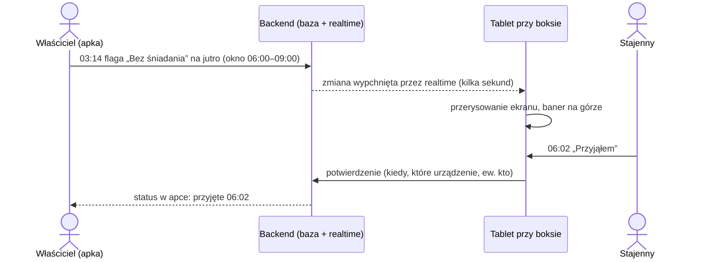
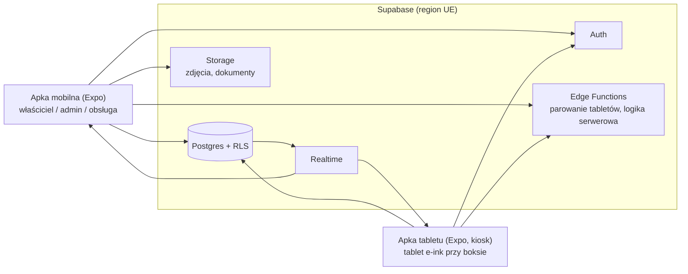

# KonskaAppka — analiza techniczna

> System do zarządzania stajnią z tabletem e-ink przy każdym boksie.
> Wersja robocza v1 · 2026-10-12 · na podstawie rozmowy z Damianem i ustaleń z Dawidem.

## 1. O co chodzi

Punkt odniesienia to [Equinox System](https://equinox-system.com/): wrocławski SaaS do zarządzania stajnią
(harmonogramy jazd, karmienie, padok, weterynarz, karty koni, zadania, komunikacja z właścicielami),
sprzedawany razem z własnym sprzętem, czyli ekranami w stajni, na których obsługa widzi aktualne instrukcje.
Według materiałów firmy na LinkedIn są to **duże ekrany multimedialne w stajni**. Pomysł Damiana to
**e-ink przy każdym boksie** i to jest realny wyróżnik.

> Uwaga: strony equinox-system.com nie dało się otworzyć bezpośrednio ze środowiska, w którym powstała ta analiza
> (blokada sieci). Opis Equinox pochodzi z wyszukiwarki i materiałów o firmie (źródła na końcu). Przed ustaleniem
> finalnego zakresu warto przeklikać ich stronę ręcznie, zwłaszcza cennik i ofertę sprzętu.

### Scenariusz, który sprzedaje system

> Jest 3 w nocy. Właścicielowi przypomina się, że rano przyjeżdża weterynarz i koń ma być na czczo.
> Zamiast dzwonić do stajni, otwiera apkę i klika „Bez śniadania”. Po kilku sekundach tablet przy boksie
> pokazuje duży komunikat. Stajenny o 6:00 go widzi i klika na tablecie „Przyjąłem”, a właściciel widzi
> w apce, że informacja dotarła i o której.

Każda decyzja techniczna poniżej ma służyć temu, żeby ten scenariusz działał **niezawodnie i w mniej niż 10 sekund** od
odblokowania telefonu do zapisania zmiany.



## 2. Ustalenia

| Temat | Decyzja |
|---|---|
| Skala | Docelowo SaaS dla wielu stajni; pilotaż u Damiana |
| Ekrany przy boksach | Tablet e-ink z Androidem, z ekranem dotykowym |
| Interakcja przy boksie | Obsługa potwierdza na tablecie (dotyk) |
| Apka dla właścicieli i admina | Natywna: React Native (Expo) |
| Sieć | Wi-Fi przy boksach to **wymóg wobec stajni** |
| Zasilanie | Po stronie stajni; my podajemy wymagania |
| Sprzęt na start | 1 tablet developerski |
| Zakres pierwszej wersji | Flagi przy boksie, grafik karmienia i padoku, historia zdrowia/wet, jazdy i zadania |
| Poza pierwszą wersją | Push dla obsługi, abonamenty i płatności, zdalne zarządzanie flotą tabletów |
| Stack | TypeScript wszędzie: React Native (Expo) + Supabase (Postgres) |

## 3. Role i uprawnienia

| Rola | Co może |
|---|---|
| **Superadmin** (my, operator SaaS) | Zakłada stajnie, widzi stan wszystkich urządzeń, wsparcie techniczne |
| **Admin stajni** (Damian) | Boksy, konie, urządzenia, zapraszanie użytkowników, nadawanie dostępu, lista predefiniowanych flag, godziny posiłków |
| **Właściciel konia** | Dane swojego konia, flagi, grafik karmienia/padoku, historia zdrowia; widzi potwierdzenia obsługi |
| **Obsługa** (stajenny) | Widzi wszystkie konie w stajni, odhacza zadania (w apce lub na tablecie) |
| **Instruktor / trener** | Jazdy: swoje terminy, konie, jeźdźcy |
| **Urządzenie** (tablet) | Konto techniczne: czyta dane **tylko swojego boksu**, zapisuje wyłącznie potwierdzenia i odhaczenia |

**Dostęp do konia, nie do urządzenia.** Damian mówi „nadaję dostęp do konkretnych urządzeń”. W modelu danych
lepiej przypisać właściciela do **konia**, konia do **boksu**, a tablet do **boksu**. Wtedy przeprowadzka konia
do innego boksu albo wymiana zepsutego tabletu nie psuje uprawnień. W interfejsie admina nadal może to wyglądać
jak „dostęp do boksu 7”.

Jeden użytkownik może należeć do kilku stajni (np. właściciel z końmi w dwóch miejscach, instruktor
pracujący w kilku stajniach), więc rola jest przypisana do pary użytkownik–stajnia, a nie do samego użytkownika.

## 4. Funkcje pierwszej wersji

### 4.1 Flagi przy boksie (rdzeń)
- Lista predefiniowanych flag ustalana przez admina stajni, np. *bez śniadania*, *bez kolacji*, *nie na padok*,
  *tylko siano*, *wet dziś*, *kowal dziś*, *leki*, *derka na noc*, *nie jeździć*; do tego pole na własną notatkę.
- Każda flaga ma **okno ważności** (od–do). Skróty typu „jutro rano” liczą się z godzin posiłków ustawionych dla stajni
  (np. śniadanie 06:00–09:00), więc flaga sama znika z ekranu po czasie.
- Potwierdzenie przez obsługę: przycisk „Przyjąłem” na tablecie. Zapisujemy godzinę i urządzenie.
- Pełna historia zmian (kto, co, kiedy, wartość przed i po). Przy sporze „przecież pisałem” to złoto.

### 4.2 Grafik karmienia i padoku
- Stały plan na posiłek (rano / południe / wieczór): pasza, ilość, jednostka, suplementy.
- Padok: dni, godziny, który padok, z którymi końmi.
- Flagi nadpisują plan na dany posiłek; tablet pokazuje wynik, czyli to, co obowiązuje **teraz**.

### 4.3 Historia zdrowia
- Wpisy: weterynarz, kowal, dentysta, odrobaczanie, szczepienia; opis i załączniki (zdjęcia, PDF-y).
- Termin następnej wizyty lub zabiegu. W pierwszej wersji jako lista „zbliża się” w apce i na tablecie, bez pushy.

### 4.4 Jazdy i zadania
- Kalendarz jazd: koń, jeździec, instruktor, czas, hala lub plac; wykrywanie kolizji (koń lub hala zajęta).
- Zadania dla obsługi: jednorazowe i cykliczne, opcjonalnie powiązane z koniem; odhaczanie w apce albo na tablecie.

## 5. Architektura



### 5.1 Struktura repozytorium (monorepo, pnpm + Turborepo)

```
konskaappka/
├─ apps/
│  ├─ mobile/      # Expo: apka dla właścicieli, admina i obsługi (iOS + Android, opcjonalnie web)
│  └─ tablet/      # Expo: apka kiosk na tablet e-ink (tylko Android)
├─ packages/
│  ├─ shared/      # typy generowane z bazy, schematy zod, logika „co obowiązuje teraz”
│  └─ ui/          # wspólne komponenty, kolory, typografia
├─ supabase/
│  ├─ migrations/  # schemat bazy i polityki RLS (wersjonowane w git)
│  └─ functions/   # Edge Functions
└─ docs/
```

Dwie osobne apki, bo telefon i tablet to zupełnie inne produkty: inne ekrany, inne uprawnienia, kiosk tylko na
tablecie. Logika i typy są wspólne w `packages/shared`.

### 5.2 Backend: dlaczego Supabase

| | Supabase | Własny backend (NestJS + Postgres + Socket.IO) |
|---|---|---|
| Czas do MVP | Krótki: logowanie, baza, realtime i pliki od ręki | Dłuższy: to wszystko trzeba napisać i utrzymać |
| Izolacja stajni (SaaS) | Row Level Security w Postgresie, wymuszana przez bazę | W kodzie aplikacji, więc łatwiej o przeciek danych |
| Realtime na tablety | Wbudowany, respektuje RLS | Własny serwer WebSocket |
| Uzależnienie od dostawcy | Umiarkowane: open source, da się postawić u siebie | Brak |
| Koszt | Darmowy plan na development, płatny (ok. 25 USD/mies.) na produkcję | Serwer + utrzymanie |

**Rekomendacja: Supabase w regionie UE (Frankfurt).** Dla jednego developera to oszczędność kilkudziesięciu
godzin, a RLS daje izolację danych stajni na poziomie bazy, co w SaaS jest najważniejsze. Gdyby kiedyś zabrakło
elastyczności, logikę można przenieść do własnego API stojącego obok tej samej bazy Postgres.

Biblioteki po stronie apek: Expo Router, `supabase-js`, TanStack Query (cache i odświeżanie), react-hook-form + zod.

### 5.3 Model danych (szkic)

Każda tabela biznesowa ma `stable_id`, a polityki RLS pilnują, żeby użytkownik widział tylko swoje stajnie,
a w nich tylko to, do czego ma dostęp.

| Tabela | Najważniejsze pola |
|---|---|
| `stables` | nazwa, strefa czasowa, godziny posiłków |
| `profiles` | imię, telefon, język |
| `stable_members` | user, stajnia, rola |
| `boxes` | stajnia, nazwa/numer, budynek |
| `devices` | stajnia, boks, nazwa, `last_seen_at`, bateria, siła Wi-Fi, wersja apki |
| `horses` | stajnia, boks, imię, zdjęcie, rasa, data urodzenia, notatki |
| `horse_access` | koń, user, poziom (właściciel / edycja / podgląd) |
| `flag_templates` | stajnia, etykieta, ikona, waga (info / ostrzeżenie / krytyczne), domyślne okno |
| `horse_flags` | koń, szablon lub własny tekst, `valid_from`, `valid_to`, autor, `ack_at`, `ack_device_id` |
| `feeding_plans` | koń, posiłek, pozycje (pasza, ilość, jednostka), suplementy |
| `paddock_plans` | koń, dni, godziny, padok, towarzysze |
| `health_events` | koń, typ, data, opis, załączniki, `next_due_at` |
| `rides` | stajnia, koń, jeździec, instruktor, start, koniec, miejsce |
| `tasks` | stajnia, koń (opcjonalnie), tytuł, termin, reguła powtarzania, status, kto i czym odhaczył |
| `audit_log` | kto, co, kiedy, wartość przed i po |

Czas zapisujemy w UTC, a wyświetlamy w strefie stajni (Europe/Warsaw).

## 6. Tablet e-ink przy boksie

### 6.1 Sprzęt
- **Na development:** [Onyx Boox Go 7](https://www.x-kom.pl/p/1542817-czytnik-ebook-onyx-boox-go-7-64gb-czarny.html):
  7", E Ink Carta 1300, Android z Google Play, 4 GB RAM, dotyk; ok. 939 zł w x-kom.
- **Na produkcję** do sprawdzenia, czy 7" jest czytelne z korytarza. Możliwe, że lepszy będzie ekran 10".
  Decyzję podejmiemy po teście czytelności z 1,5–2 m.
- Wymagania wobec stajni: gniazdo lub zasilacz USB-C przy boksie, kabel poza zasięgiem konia, Wi-Fi z dobrym
  sygnałem przy każdym boksie (zmierzyć telefonem przed wdrożeniem), uchwyt lub obudowa od strony korytarza.

### 6.2 Apka na tablecie
- **Tryb kiosku:** apka jako Device Owner + Lock Task Mode (ustawiane przez `adb shell dpm set-device-owner …` na świeżo
  zresetowanym urządzeniu). Obsługa nie wyjdzie z apki, a apka uruchamia się sama po restarcie lub zaniku prądu.
  Wymaga natywnego modułu, więc Expo działa w trybie development build, bez Expo Go.
  **Nie jest potwierdzone, że firmware Boox na to pozwala.** Testujemy to jako pierwsze (faza 0).
  Plan B: apka ustawiona jako launcher, przypięcie ekranu i „nie wygaszaj podczas ładowania”.
- **Ekran zawsze włączony na zasilaczu** (`expo-keep-awake`) i apka zwolniona z optymalizacji baterii.
  Boox ma agresywne usypianie aplikacji w tle, więc trzeba to dobrze przetestować.
- **Aktualizacja danych:** subskrypcja realtime, a do tego pełne pobranie danych po każdym odzyskaniu połączenia
  i co kilka minut jako zabezpieczenie. Ostatni stan trzymamy lokalnie, więc ekran działa też bez sieci.
- **Zaufanie do ekranu:** stopka „aktualne na 06:02”. Gdy brak połączenia dłużej niż X minut, wyraźny komunikat
  „BRAK POŁĄCZENIA, dane z 03:14”. Obsługa musi wiedzieć, czy może ufać temu, co widzi.
- **Monitoring:** tablet co kilka minut raportuje baterię, Wi-Fi i wersję apki. Admin widzi listę urządzeń
  z ostatnim kontaktem.
- **Aktualizacje apki:** zmiany w JS przez EAS Update (bez dotykania tabletu); zmiany natywne ręcznie (przy wielu
  tabletach później przez MDM, np. open source'owy Headwind MDM).
- **Parowanie:** tablet pokazuje kod lub QR, admin skanuje go w apce i wybiera boks. Edge Function tworzy konto techniczne
  urządzenia i wydaje mu sesję. Admin może tablet w każdej chwili odłączyć, co unieważnia sesję.

### 6.3 Zasady UI pod e-ink
- Czarno-białe, wysoki kontrast, bez animacji, przejść, cieni i gradientów.
- Duże fonty (czytelne z 1,5–2 m), duże przyciski (obsługa może mieć rękawiczki).
- Przerysowanie tylko przy zmianie danych; okresowe pełne odświeżenie, żeby usunąć „duchy” po poprzednim obrazie.
- Najważniejsze na górze: aktywne flagi krytyczne zawsze jako pierwsze i największe.

Przykładowy układ ekranu (7–10"):

```
+------------------------------------------------+
| BOKS 7  KASZTAN                 wt 13.10 06:02 |
+------------------------------------------------+
| !!! BEZ SNIADANIA !!!                          |
| Wet o 8:00, kon na czczo      (Anna, 03:14)    |
|                              [  PRZYJALEM  ]   |
+------------------------------------------------+
| KARMIENIE        rano      poludnie   wieczor  |
|   owies          1,5 kg    -          1,5 kg   |
|   siano          bez ograniczen                |
|   suplement X    1 miarka  -          -        |
+------------------------------------------------+
| PADOK   10:00-14:00, padok B, z Bella          |
| DZIS    kowal 12:00, jazda 16:00 (Ola)         |
+------------------------------------------------+
| [ Nakarmiony rano ]    [ Wyszedl na padok ]    |
+------------------------------------------------+
| online, aktualne na 06:02                      |
+------------------------------------------------+
```

## 7. Apka mobilna

- Jedna apka dla właściciela, admina, obsługi i instruktora; ekrany zależą od roli w wybranej stajni.
- Ekran główny właściciela: jego konie i duże kafelki szybkich flag. Ścieżka „wybierz konia, stuknij flagę,
  potwierdź okno (domyślnie najbliższy posiłek)” ma zająć **2–3 stuknięcia**.
- Admin: boksy, konie, urządzenia (status online, bateria), użytkownicy i zaproszenia, słownik flag, godziny posiłków.
  Panel admina wygodniej obsługiwać z komputera, a Expo potrafi zbudować tę samą apkę na web (opcjonalnie).
- Publikacja: konto Apple Developer (99 USD/rok) i Google Play (25 USD jednorazowo). Na pilotaż wystarczy
  TestFlight i testy wewnętrzne w Google Play.
- Push (przypomnienia, zmiany na ostatnią chwilę dla obsługi) świadomie poza pierwszą wersją. Expo Notifications
  dołożymy później bez przebudowy.

## 8. SaaS: co trzeba mieć z tyłu głowy od początku

- **Izolacja stajni:** `stable_id` wszędzie i RLS od pierwszej migracji. Dorabianie tego później jest bolesne.
- **RODO:** przetwarzamy dane osobowe właścicieli, więc stajnia jest administratorem, a my podmiotem przetwarzającym.
  Potrzebne: umowa powierzenia, polityka prywatności, hosting w UE, eksport i usuwanie danych na żądanie.
- **Model sprzedaży sprzętu:** stajnia kupuje tablety sama czy je dzierżawimy? Przy 30 boksach × ok. 940 zł to
  ok. 28 tys. zł na start, co jest realną barierą wejścia. Warto policzyć wariant z tańszym, tylko wyświetlającym
  ekranem dla części boksów albo jednym tabletem na korytarz.
- **Abonament:** np. Stripe z opłatą za boks lub konia. Nie w pierwszej wersji, ale cennik warto mieć przed pilotażem.
- **Wielojęzyczność:** sporo obsługi stajni w Polsce mówi po ukraińsku, więc tablet w PL/UA może być prostym, a mocnym argumentem.

## 9. Plan i estymacja

Estymaty są zgrubne, dla jednej osoby znającej TypeScript i React Native, i będą do skorygowania po fazie 0.

| Faza | Zakres | Szac. godziny |
|---|---|---|
| **0. Test sprzętu** | Zakup Boox Go 7; szkielet apki tabletu; sprawdzenie kiosku i Device Owner, ekranu zawsze włączonego, czasu dotarcia zmiany, powrotu po zaniku Wi-Fi i prądu, „duchów” na ekranie i czytelności z 1,5 m. Wynik: zostajemy przy Boox czy szukamy innego tabletu. | 15–30 |
| **1. Rdzeń (pilotaż)** | Monorepo, schemat bazy i RLS, logowanie i zaproszenia, stajnia, boksy, konie, dostęp, parowanie tabletu, flagi z oknami ważności, ekran tabletu z potwierdzeniami, historia zmian. Pilotaż u Damiana na 1 tablecie. | 120–180 |
| **2. Reszta pierwszej wersji** | Grafik karmienia i padoku, historia zdrowia z załącznikami i terminami, jazdy, zadania cykliczne, ich widoki na tablecie. | 100–160 |
| **3. SaaS** | Onboarding wielu stajni, abonamenty, push, panel superadmina, zarządzanie flotą (MDM), strona www, tłumaczenia. | 150+ |

Koszty stałe na start: tablet ok. 939 zł, Apple 99 USD/rok, Google Play 25 USD, Supabase na developmencie za darmo
(produkcja ok. 25 USD/mies.), domena.

## 10. Ryzyka

| Ryzyko | Co z tym robimy |
|---|---|
| Firmware Boox nie pozwala na kiosk albo zabija apkę w tle | Faza 0 przed jakąkolwiek większą robotą; mamy plan B i alternatywne tablety |
| Zimno, kurz, wilgoć w stajni (e-ink i bateria źle znoszą mróz) | Test zimą; ogrzewany korytarz lub obudowa jako wymóg; ekran od strony korytarza |
| Słabe Wi-Fi (grube mury) | Wymóg w umowie i pomiar przed wdrożeniem; apka działa na ostatnich danych i pokazuje brak połączenia |
| Koń gryzie kabel albo obudowę | Montaż poza zasięgiem konia, kabel w osłonie (po stronie stajni, ale dajemy wytyczne) |
| Obsługa nie ufa ekranowi, więc i tak dzwoni | Widoczna godzina aktualizacji, alarm braku połączenia, potwierdzenia widoczne dla właściciela |
| Koszt sprzętu odstrasza stajnie | Liczymy warianty sprzętowe i model dzierżawy przed fazą 3 |
| Konkurencja (Equinox już działa) | Wyróżnik: ekran przy każdym boksie i szybkie flagi; do doprecyzowania z Damianem |

## 11. Otwarte pytania do Damiana

1. **Kto klika na tablecie?** Czy wystarczy „potwierdzone z tabletu boksu 7 o 06:02”, czy trzeba wiedzieć, *który*
   stajenny (np. 4-cyfrowy PIN)?
2. **Startowa lista flag.** Jakie opcje mają być predefiniowane? Wyżej jest propozycja do skreślenia lub dopisania.
3. **Godziny posiłków** w stajni (od nich zależy, co znaczy „bez śniadania jutro”).
4. **Czy właściciel sam zmienia grafik karmienia**, czy tylko proponuje, a admin lub obsługa zatwierdza?
5. **Rozmiar ekranu i montaż:** z jakiej odległości ma być czytelny, od strony korytarza czy boksu, czy stajnia jest ogrzewana zimą?
6. **Jazdy:** kto rezerwuje, czy są instruktorzy i hala z ograniczoną liczbą miejsc, czy jazdy są płatne przez system?
7. **Języki:** czy obsługa potrzebuje ukraińskiego (albo innego) na tablecie?
8. **SaaS:** kto kupuje tablety (stajnia czy my), cena abonamentu, marka i nazwa produktu.
9. **Współpraca:** wynagrodzenie i **prawa do kodu**. Skoro docelowo ma to być SaaS na sprzedaż, warto to spisać na starcie.

## Źródła

- [Equinox System: strona produktu](https://equinox-system.com/)
- [InnovationCoach: „Porządek w stajni zaczyna się od dobrego systemu”](https://www.innovationcoach.pl/historie-sukcesu/porzadek-w-stajni-zaczyna-sie-od-dobrego-systemu/)
- [LinkedIn: materiały zespołu Equinox](https://pl.linkedin.com/in/letatoma)
- [aleo.com: dane firmy Equinox System Jan Gajos (CEIDG)](https://aleo.com/pl/firma/equinox-system-jan-gajos)
- [x-kom: Onyx Boox Go 7](https://www.x-kom.pl/p/1542817-czytnik-ebook-onyx-boox-go-7-64gb-czarny.html)
- [Telepolis: Boox Go 7 dostępny w Polsce](https://www.telepolis.pl/tech/sprzet/czytniki-ksiazek-onyx-boox-go-7-oraz-go-7-color-gen-ii-wreszcie-dostepne)
- [TechYourChance: Android kiosk i Device Owner](https://www.techyourchance.com/android-kiosk-apps-and-in-house-mdms-using-device-owner/)
