# KonskaAppka: architektura i analiza techniczna

> System dla wielu stajni: apka mobilna dla adminów stajni, właścicieli koni, obsługi i instruktorów, dotykowy tablet e-ink z Androidem przy każdym boksie oraz panel web.
> KonskaAppka to nazwa robocza.
> **Uwaga (2026-10-12): część v3 jest nieaktualna po kolejnych decyzjach.** Zamiast modularnego monolitu będą osobne mikroserwisy w monorepo (także crony), zamiast własnego uwierzytelniania Cognito (OTP przez SMS i TOTP), zamiast plików w PostgreSQL S3, a WebSocketów nie będzie (kolejki albo REST). Dochodzą płatności (serwis `billing`). Koń i boks są w relacji 0..1 do 0..1, a na tablecie loguje się użytkownik, który może zablokować boks. Model danych do zatwierdzenia: [docs/erd.md](erd.md). Ten dokument zostanie przepisany po zatwierdzeniu modelu.
>
> Wersja robocza v3 · 2026-10-12 · zastępuje v2. Dokument jest czysto techniczny: logika w kodzie TypeScript, baza danych tylko do przechowywania, uruchomienie na klastrze Kubernetes z osobną bazą. Rozmieszczenie i infrastruktura to decyzje Dawida (rozdział 10). To, co celowo przesunięto poza v1, zebrano w rozdziale 16.

## Spis treści

0. W skrócie
1. Cel i wymagania techniczne
2. Założenia i ograniczenia
3. Architektura ogólna
4. Decyzje architektoniczne (ADR)
5. Backend w kodzie
6. Kluczowe przepływy
7. Apka tabletu
8. Apka mobilna
9. Panel web
10. Kontrakt aplikacji wobec platformy
11. Wymagania instalacyjne w stajni
12. Testy i jakość
13. Kolejność prac technicznych
14. Ryzyka techniczne
15. Otwarte pytania techniczne
16. Później: poza zakresem v1
17. Źródła

## 0. W skrócie

Odpowiedź na pytanie „jaka architektura”:

1. **Modularny monolit w TypeScript** (Node.js, Fastify). Jeden obraz kontenera `konska-server` z trzema rolami procesu: `api` (REST), `realtime` (WebSocket) i `worker` (zadania w tle i harmonogram). Role działają w jednym procesie albo osobno, zależnie od zmiennej `ROLES`; podział to decyzja Dawida.
2. **PostgreSQL wyłącznie jako magazyn danych:** tabele, klucze główne i obce, unikalności, indeksy, transakcje i blokady wierszy. Żadnej logiki wykonywanej przez bazę, także wartości domyślnych, sekwencji i walidacji typu `CHECK`. Schemat jest zdefiniowany w kodzie (Drizzle ORM), migracje SQL generuje drizzle-kit, a bramka w CI odrzuca obiekty z logiką.
3. **Izolacja stajni w kodzie:** `unitOfWork(scope, …)` daje repozytoria związane z kontekstem stajni (`TenantScope`), więc w miejscu wywołania nie da się pominąć `stable_id`. Autoryzację rozstrzygają polityki w TS. Siatką bezpieczeństwa są wielokolumnowe klucze obce `(stable_id, id)`, reguły lint, strażnik zapytań oparty na parserze SQL i macierz testów izolacji w CI.
4. **Kontrakt API:** REST `/v1` opisany schematami zod, z których generowany jest OpenAPI 3.1. W obrębie wersji wolno tylko dodawać. Trasy potrzebne do samoaktualizacji i wysłania zaległych zapisów nigdy nie są blokowane przez minimalną wersję klienta.
5. **Realtime przez WebSocket**, a w wiadomościach są tylko sygnały bez treści, np. `board.changed {boxId, version}`. Stan klient pobiera przez REST. Fan-out między replikami działa bez brokera: zmiana i wpis w `outbox_events` trafiają do bazy w jednej transakcji, numer wpisu nadaje kod z licznika blokowanego tuż przed zatwierdzeniem, więc numery stają się widoczne w kolejności zatwierdzeń i bez luk. Każda replika `realtime` odpytuje tabelę co 1 s. Po każdym ponownym połączeniu klient sprawdza aktualność stanu (`ETag`); odtwarzania historii zdarzeń w v1 nie ma.
6. **Zadania w tle:** tabela `jobs`, pobieranie przez `FOR UPDATE SKIP LOCKED`, dzierżawa z tokenem fencingu (`locked_by`, `attempts`) i idempotencja przez `dedupe_key`. Harmonogram jest zdefiniowany w kodzie i może go uruchamiać każda replika, bo duplikaty odrzuca unikalność klucza.
7. **Własne uwierzytelnianie:** kod OTP przez SMS lub e-mail, nieprzezroczyste tokeny dostępu (15 min) sprawdzane w bazie przy każdym żądaniu i rotowany refresh token z wykrywaniem ponownego użycia. Tablety nie mają refresh tokenów: trzymają klucz prywatny w Android Keystore i logują się przez challenge-response. Operator (Dawid) w v1 działa przez komendy CLI `konska-server`.
8. **Logika „co obowiązuje teraz”:** serwer liczy wszystko, co nie zależy od bieżącej chwili (wystąpienia posiłków, które posiłki wstrzymuje flaga, momenty eskalacji, teksty banerów), i wysyła wyniki w snapshocie. Tablet tylko porównuje swój zegar, zakotwiczony w `elapsedRealtime`, z tymi momentami. Działa więc offline i nie zależy od wersji reguł zainstalowanej na tablecie.
9. **Tablet:** apka Expo z własnym modułem w Kotlinie (Device Owner, Lock Task, odświeżanie EPD, Keystore, cicha instalacja APK, watchdog). Dane lokalne trzyma w SQLite szyfrowanym SQLCipher, a zapisy w kolejce z idempotencją. W v1 aktualizacje przychodzą wyłącznie jako APK z backendu z wbudowanym kodem JS; aktualizacje OTA samego JS są w rozdziale 16.
10. **Apka mobilna:** Expo Router, TanStack Query z trwałym cache, kolejka offline dla potwierdzeń i odhaczeń. Flagi tworzy się online, z wyraźnym stanem „zapisano na serwerze”. **Panel web:** SPA w React i Vite.
11. **Usługi zewnętrzne tylko za interfejsami:** `SmsSender`, `EmailSender`, `FileStorage`, opcjonalnie `ErrorReporter`. Domyślny adapter plików przechowuje je w PostgreSQL, a błędy klientów trafiają do własnej tabeli, więc do uruchomienia wystarczy klaster i baza.
12. **Największe ryzyko techniczne:** praca tabletów Boox w kiosku 24/7. Faza 0 (M0) rozstrzyga je przed resztą prac.

## 1. Cel i wymagania techniczne

### 1.1 Scenariusz rdzeniowy

> Jest 3 w nocy. Właścicielce przypomina się, że rano przyjeżdża weterynarz i koń ma być na czczo. Otwiera apkę i w 2–3 stuknięciach ustawia „Bez śniadania”.
> Po kilku sekundach tablet przy boksie pokazuje czarny baner, a w apce widać „wyświetlono 03:14”. O 6:02 Ola z obsługi dotyka „Potwierdzam”, a właścicielka
> widzi „przyjęte: Ola, 06:02”. Jeśli 30 minut przed śniadaniem flaga nadal czeka na potwierdzenie, tablet i lista dnia obsługi pokazują „NIEPOTWIERDZONE”,
> a 15 minut przed śniadaniem admin stajni dostaje powiadomienie.

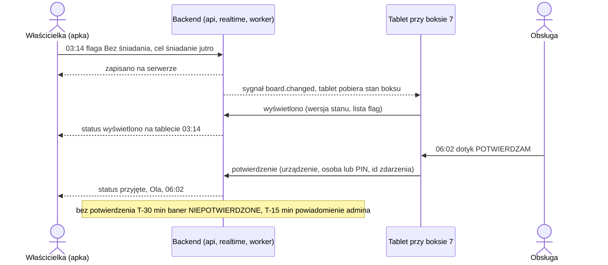

### 1.2 Zakres funkcjonalny v1

**Flagi przy boksie (rdzeń)**

- Słownik flag per stajnia (`flag_templates`). Na start domyślny zestaw: *bez śniadania*, *bez kolacji*, *nie na padok*, *tylko siano*, *wet dziś*, *kowal dziś*, *leki*, *derka na noc*, *nie jeździć*. Admin może go edytować. Do flagi można dodać własną notatkę.
- Waga flagi: `info`, `warning` albo `critical`. Flagi krytyczne zawsze są na górze ekranu jako czarny baner.
- Skutek flagi (`effect`): `suspend_meal` (wstrzymuje wskazany posiłek), `cancel_paddock`, `no_riding` albo `none`. Flaga nadpisuje grafik: przy posiłku pojawia się „WSTRZYMANE”, przy padoku „ODWOŁANY”, a przycisk „Nakarmiony” dla wstrzymanego posiłku znika.
- **Okno ważności i cel.** Flaga wygasa sama po końcu okna ważności (od–do). Skróty „najbliższy posiłek”, „jutro rano” i „do odwołania” rozwiązuje interfejs apki: użytkownik widzi podgląd („do 10:00 dziś”), a do serwera trafia konkretny cel, czyli wystąpienie posiłku (`mealSlotId`, `serviceDate`) albo momenty od–do. Serwer sprawdza cel względem harmonogramu i nigdy nie wybiera innego wystąpienia. Okno zapisuje jako `timestamptz`, więc późniejsza zmiana godzin posiłków nie zmienia istniejących flag (5.10).
- **Flaga jest niezmienna** poza odwołaniem i potwierdzeniem. „Edycja” to odwołanie i nowa flaga z `replaces_flag_id` w jednej transakcji, więc wyświetlenie i potwierdzenie zawsze dotyczą treści, którą obsługa widziała.
- **Statusy dla właściciela:** zapisano na serwerze, wyświetlono na tablecie, przyjęto (kto, kiedy). Statusy negatywne właściciel widzi od razu po zapisie: „tablet boksu 7 offline od 01:20” i „NIEPOTWIERDZONE”.
- **Flaga po czasie:** jeśli wskazany posiłek już minął, serwer odrzuca flagę (`422 target_passed`), a apka proponuje kolejne wystąpienie. Jeśli posiłek został już odhaczony albo trwa (planowa godzina minus margines z ustawień stajni), flaga zapisuje się z ostrzeżeniem `meal_possibly_served`, a apka pokazuje telefon do stajni.
- **Eskalacja dwustopniowa z wyprzedzeniem.** Czasy ustawia się per stajnia, domyślnie T-30 i T-15 przed `ack_deadline_at`. Poziom `board_warning`: baner „NIEPOTWIERDZONE” na tablecie i pozycja na górze listy dnia. Poziom `admin_notify`: e-mail i SMS do admina stajni. Push dla obsługi jest poza v1.
- **Flaga w imieniu właściciela:** admin lub obsługa wpisuje flagę ze źródłem (`on_behalf_phone`, `on_behalf_sms`, `on_behalf_in_person`), a właściciel widzi ją w apce.
- Pełna historia zmian (kto, co, kiedy, przed i po) w `audit_log`.

**Grafik karmienia i padoku**

- Stały plan na slot posiłku (`feeding_plans`): pasza, ilość, jednostka, suplementy, leki. Sloty mają godziny per stajnia i mogą się różnić w weekendy i sezonowo.
- Padok (`paddock_plans`): dni tygodnia, godziny, padok, towarzysze.
- Tablet pokazuje wynik „co obowiązuje teraz” (plan i aktywne flagi). Odhaczanie „Nakarmiony” działa na tablecie i w apce (`feeding_checks`).
- Ustawienie stajni decyduje, czy właściciel zmienia plan bezpośrednio (pytanie otwarte w 15.1 dotyczy wariantu z zatwierdzaniem).

**Zdrowie, jazdy i zadania**

- **Zdrowie:** wet, kowal, dentysta, odrobaczanie, szczepienia; opis, załączniki (`FileStorage`), termin następnej wizyty. Właściciel ma w apce listę „zbliża się” (`health_events.next_due_at`). Na tablet trafia tylko typ i godzina („JUTRO szczepienie”), nigdy opis ani załączniki.
- **Jazdy (minimalnie):** koń, jeździec, instruktor, czas, hala lub plac; serwer wykrywa kolizje. Moduł można wyłączyć w ustawieniach stajni (`stables.settings.features.rides`); polityki i snapshot to uwzględniają.
- **Zadania dla obsługi:** jednorazowe i cykliczne (dni tygodnia i godzina lokalna, tak jak sloty posiłków), opcjonalnie przypięte do konia lub boksu; odhaczanie w apce i na tablecie. Reguły RRULE są w rozdziale 16.

**Cykl życia konia i dostępów**

- Koń należy do stajni (`horses.stable_id`). Dostępy mają ramy czasowe (`horse_access`: `valid_from`, `valid_to`, `revoked_at`, rola `owner`, `co_owner`, `lessee` albo `viewer`). Każda rola to osobny wiersz, więc koniec dzierżawy albo współwłasności ustawia `revoked_at` tylko w wierszu tej roli, a pozostałe dostępy się nie zmieniają.
- Wyprowadzenie konia ustawia `horses.left_at`, odbiera dostępy, zamyka flagi i plany. Eksport historii konia (JSON) jest dostępny jako zadanie workera.
- Zmiana właściciela: nowy dostaje dostęp, a stary go traci. Nowy widzi historię zdrowia, ale nie notatki z widocznością `owner_private`.
- Archiwizacja konia sprawia, że tablet pokazuje dla tego boksu „boks wolny”.

**Prywatność na ekranie przy boksie** (ustawienia per stajnia i per flaga)

- Autor flagi na tablecie może być pokazany jako rola albo inicjał („właściciel”, „A.”) zamiast imienia.
- `note_visibility = app_only`: tablet pokazuje sam typ flagi i dopisek „notatka tylko w apce”, a treść notatki jest widoczna tylko w apce.
- Historia zdrowia i załączniki nigdy nie trafiają do snapshotu tabletu. To jest wymuszone w kodzie budującym snapshot i sprawdzane testem.

### 1.3 Wymagania niefunkcjonalne

| Obszar | Wymaganie | Jak spełniamy | Jak mierzymy |
|---|---|---|---|
| Opóźnienie flaga → ekran | p95 < 10 s od zatwierdzenia transakcji do obrazu na tablecie | Outbox z numeracją z kodu odpytywany co 1 s, sygnał przez WebSocket, pobranie stanu z `ETag`, budżet w ADR-06 | Histogram `konska_flag_display_latency_seconds` (`flag_displays.displayed_at` − `horse_flags.created_at`, oba w czasie serwera), test E2E na tablecie |
| Aktualność ekranu | Tablet online pokazuje bieżącą wersję stanu boksu | `board/seen` z wersją po każdym renderze, porównanie z `boxes.board_version` | `konska_device_board_lag_seconds`, alert `board_stale`, `konska_flags_undisplayed` (5.9) |
| Tablet 24/7 | Ekran zawsze pokazuje ostatni znany stan z godziną aktualności | Kiosk (Device Owner), autostart, natywny watchdog, kolejka zapisów, stan lokalny w SQLCipher, obecność z WebSocket, telemetria | `device_alerts`, `device_presence`, błędy klientów (5.14) |
| Offline | Odczyt i potwierdzenia bez sieci, bez utraty i bez duplikatów | Snapshot z horyzontem co najmniej 48 h, kolejka z identyfikatorami klienta, idempotentne endpointy z wynikiem per zdarzenie | Testy integracyjne kolejki, licznik `pending_writes` w telemetrii |
| Multi-tenant | Brak dostępu do danych innej stajni | Repozytoria związane z `TenantScope`, polityki, wielokolumnowe FK, lint, strażnik zapytań, macierz testów | Testy izolacji w CI dla każdej trasy i wiadomości WebSocket |
| i18n | PL, UA (`uk`), EN w apce, na tablecie i w panelu; treści słowników per język | `packages/i18n` (i18next), `labels` jako jsonb `{pl, uk, en}` | Test kompletności kluczy w CI |
| Bezpieczeństwo | Krótkie tokeny, odwołanie sesji i urządzenia działa od razu, brak sekretów w logach | 5.3, ADR-08, ADR-11, redakcja logów | Testy uwierzytelniania, metryka `konska_auth_refresh_reuse_total` |
| Wiele replik | Każda rola działa poprawnie w N replikach, bez sticky sessions | Bezstanowość, outbox per replika, `SKIP LOCKED` z fencingiem, `dedupe_key` (5.13) | Testy integracyjne z kilkoma instancjami na jednej bazie |
| Zgodność wersji | Starsze apki tabletu w terenie działają po wdrożeniu nowego backendu | Addytywny kontrakt, okno zgodności, wyniki reguł liczone na serwerze, expand/contract (5.12) | Testy kontraktu między wersjami (12) |
| Burza połączeń | Powrót Wi-Fi albo restart backendu nie przeciąża systemu | Backoff z pełnym jitterem, limit przyjęć połączeń z `goaway overloaded`, `goaway` z rozłożonym `retryAfterMs`, `304 Not Modified` | Test obciążenia ponownych połączeń (12) |
| Obserwowalność | Logi JSON na stdout, metryki Prometheus, endpointy zdrowia, błędy klientów | Kontrakt w rozdziale 10, raportowanie błędów w 5.14 | – |

## 2. Założenia i ograniczenia

| Temat | Ustalenie | Skutek dla architektury |
|---|---|---|
| Logika w kodzie | Wszystko, co się da, jest w kodzie TypeScript | Izolacja, autoryzacja, uwierzytelnianie, reguły czasu, harmonogram, eskalacje, wykrywanie offline, fan-out, audit, wersjonowanie stanu, numeracja zdarzeń i migracje są w kodzie |
| Baza danych | PostgreSQL, wyłącznie do przechowywania | Dozwolone: tabele, PK, FK (bez akcji kaskadowych), `NOT NULL`, unikalności (także częściowe), indeksy, transakcje i blokady wierszy. Bez mechanizmów wykonywanych przez bazę: polityk dostępu do wierszy, funkcji i procedur, wyzwalaczy, widoków, reguł, harmonogramów i powiadomień w bazie, rozszerzeń, typów wyliczeniowych, ograniczeń `CHECK`, wartości `DEFAULT`, kolumn generowanych, sekwencji i kolumn identity. Statusy i rodzaje to `text` walidowany przez zod. Wartości i identyfikatory nadaje kod. Jedyny wyjątek to tabela migracji Drizzle (`drizzle.__drizzle_migrations`, `id SERIAL`), którą tworzy i obsługuje biblioteka, a aplikacja tylko ją czyta. Zasady egzekwuje bramka w CI (5.12) |
| Platforma | Klaster Kubernetes i osobna baza | Aplikacja spełnia kontrakt z rozdziału 10. Nie wymaga Redisa, brokera, object storage ani innych komponentów |
| Infrastruktura | Decyzja Dawida, poza zakresem dokumentu | Nie opisujemy rozmieszczenia, regionów, dostawców, ingressu, TLS, DNS, backupów, manifestów ani liczby replik |
| Usługi zewnętrzne | SMS, e-mail, pliki i opcjonalne raportowanie błędów za interfejsami | Wybór dostawcy i miejsca: Dawid. Adaptery dev działają lokalnie bez zewnętrznych usług |
| Multi-tenant | Od pierwszej migracji | `stable_id` w każdej tabeli danych stajni; kategorie tabel w 5.4 |
| Tablet | E-ink z Androidem i dotykiem; potwierdzenia na tablecie | Apka Expo z natywnym modułem Kotlin do kiosku. Do developmentu Boox Go 10.3 Gen II (alternatywnie Go 7) |
| Apka mobilna | React Native (Expo) | Jedna apka dla wszystkich ról; ekrany zależą od roli |
| Język | TypeScript wszędzie | Kotlin tylko w cienkim module natywnym tabletu |
| Zakres v1 | Flagi (rdzeń), grafik karmienia i padoku, zdrowie i wet, jazdy i zadania | Push dla obsługi poza v1. Interfejs `PushSender` jest zarezerwowany, ale nie implementowany. Elementy przesunięte poza v1 są w rozdziale 16 |

## 3. Architektura ogólna

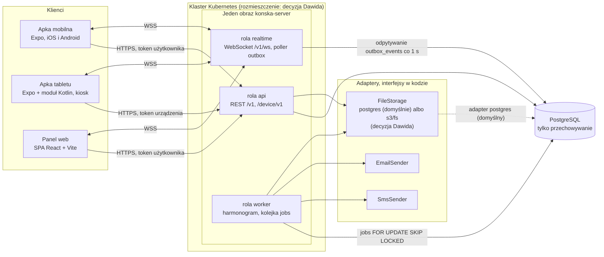

- **Jeden obraz, trzy role.** `ROLES=api,realtime,worker` (domyślnie wszystkie w jednym procesie). `api` i `realtime` mogą dzielić port HTTP. Gdy działają osobno, żądania upgrade na `/v1/ws` muszą trafiać do instancji z rolą `realtime`, a sposób ich kierowania należy do platformy.
- **Komunikacja między rolami tylko przez bazę.** Rola `api` zapisuje zmianę razem z wpisem w `outbox_events` i ewentualnym wpisem w `jobs`. Rola `realtime` odczytuje `outbox_events`, a `worker` pobiera `jobs`. Role nie wywołują się wzajemnie po sieci.
- **Panel web** to statyczny build SPA. Domyślnie serwuje go rola `api` z tego samego originu (`WEB_PANEL_ENABLED=true`). Można go serwować w innym miejscu (decyzja Dawida) przy warunkach z ADR-14.
- **Pliki APK** (`/device/v1/apk`) obsługuje ten sam backend.
- **Operator** (Dawid) w v1 nie ma panelu w przeglądarce: działa komendami CLI z tego samego obrazu (5.15).

### 3.1 Granice zaufania

| Podmiot | Poświadczenie | Zakres | Gdzie sprawdzane |
|---|---|---|---|
| Użytkownik (apka, panel) | Nieprzezroczysty token dostępu (15 min, w bazie tylko SHA-256) związany z sesją; refresh token rotowany (apka: secure store, panel: cookie httpOnly) | Członkostwa w `stable_members` i dostępy w `horse_access`, sprawdzane w bazie przy każdym żądaniu i każdej subskrypcji | Potok żądania (5.2), gateway przy `hello` i `subscribe` |
| Urządzenie (tablet) | Nieprzezroczysty token urządzenia (12 h) wydany po challenge-response kluczem z Android Keystore; bez refresh tokenu | Boksy z `device_boxes` swojej stajni; `devices.status` i `revoked_at` sprawdzane przy każdym żądaniu | Potok żądania, gateway |
| Operator | Dostęp do CLI `konska-server` w klastrze (sposób dostępu: Dawid) i parametr `--as` z nazwą operatora | Komendy z 5.15; każda trafia do `audit_log` jako `actor_type = operator` | Kod komendy |
| System (worker) | Brak tokenu, działa w procesie | Zadanie jawnie tworzy `TenantScope` dla `stable_id` z payloadu | Kod zadania, testy |
| Adaptery zewnętrzne | Sekrety ze zmiennych środowiskowych albo plików (`X_FILE`) | Tylko ruch wychodzący | – |

## 4. Decyzje architektoniczne (ADR)

Format: kontekst, decyzja, odrzucone alternatywy, konsekwencje.

### ADR-01. Własny backend w TypeScript, modularny monolit, jeden obraz z rolami

- **Kontekst.** v2 opierała się na usłudze BaaS z logiką w bazie. Nowe założenie: logika w kodzie, baza tylko do przechowywania, uruchomienie na Kubernetes. Projekt rozwija jedna osoba.
- **Decyzja.** Modularny monolit w Node.js (TypeScript) w jednym repozytorium. Moduły domenowe mają jawne publiczne API (5.1). Jeden obraz z rolami `api`, `realtime` i `worker`, włączanymi przez `ROLES`.
- **Odrzucone.** *Supabase* (podstawa v2): izolacja przez polityki w bazie, logika w funkcjach i wyzwalaczach, harmonogram i realtime w bazie lub usłudze, a więc sprzeczne z założeniem. *Firebase i inne BaaS*: z tego samego powodu, a do tego model danych spoza PostgreSQL. *Mikroserwisy*: osobne wdrożenia, kontrakty między usługami i rozproszone transakcje to dla jednej osoby za dużo; outbox i spójność „zmiana + zdarzenie” wymagają jednej transakcji.
- **Konsekwencje.** Jedna baza kodu, wspólne typy i transakcje. Moduły można później wydzielić, bo komunikują się przez publiczne API modułu i tabele zdarzeń. Granice modułów trzeba pilnować regułami lint (ADR-09, 5.1). Rola `worker` w jednym procesie z `realtime` wymaga, żeby zadania obciążające CPU nie blokowały pętli zdarzeń (ADR-07).

### ADR-02. Framework HTTP: Fastify

- **Kontekst.** Potrzebne są: walidacja schematami zod, generowanie OpenAPI, WebSocket w tym samym serwerze, hooki dla potoku żądania i testy bez sieci.
- **Decyzja.** Fastify z `fastify-type-provider-zod` (walidacja i serializacja z zod), `@fastify/swagger` (OpenAPI), `@fastify/websocket`, `@fastify/rate-limit`, `@fastify/under-pressure`, `@fastify/multipart`, `@fastify/static` (panel), `@fastify/cors` (tylko gdy panel działa pod innym originem, ADR-14). Moduły rejestrują się jako pluginy Fastify. Zależności przekazujemy jawnie przez fabryki, bez kontenera DI.
- **Odrzucone.** *NestJS*: daje strukturę i DI, ale dekoratory i klasy DTO dublują schematy zod (łagodzi to `nestjs-zod`), jest więcej „magii” i warstw. Wymuszaną przez Nest strukturę zastępujemy regułami lint granic modułów. *Express*: brak wbudowanej walidacji i serializacji schematami, słabsze typowanie.
- **Konsekwencje.** Potok żądania (5.2) to jawne hooki `onRequest` i `preHandler` oraz wrappery `command()` i `query()`. Testy HTTP działają przez `app.inject()` bez otwierania portu. `@fastify/websocket` domyślnie zamyka wszystkie połączenia naraz przy `fastify.close()`, dlatego drenowanie działa w opcji `preClose` pluginu (10.6).

### ADR-03. Dostęp do danych i migracje: Drizzle ORM + drizzle-kit

- **Kontekst.** Schemat ma być zdefiniowany w kodzie, migracje wersjonowane w repo, a zapytania typowane. Potrzebne są blokady wierszy (`FOR UPDATE SKIP LOCKED`) i pełna kontrola nad SQL.
- **Decyzja.** Drizzle ORM (schemat w TS w `infra/db/schema/*.ts`) i drizzle-kit `generate`, który tworzy pliki SQL migracji commitowane i przeglądane w review. Migracje uruchamia komenda `konska-server migrate` (5.12), która używa programowego `migrate()` z Drizzle. Blokady wierszy: `.for('update', { skipLocked: true })`. Driver: `pg`. W schemacie Drizzle wartości domyślne tylko przez `$defaultFn` i `$onUpdateFn` (liczone w kodzie), bez `.default()`, `.defaultNow()`, `.defaultRandom()`, `serial` i `pgEnum`.
- **Wersja Drizzle (decyzja na M1).** Stabilna wersja `drizzle-orm` w rejestrze npm to 0.45.x (tag `latest`), a 1.0 ma tag `rc` (1.0.0-rc.4) i zmienia format katalogu migracji: migrator 1.0 czyta osobny podkatalog na migrację z plikiem `migration.sql`, a stary układ z `meta/_journal.json` trzeba przekonwertować przez `drizzle-kit up`. Na M1 wybieramy jedno z dwóch: start od razu na 1.0 (RC albo stabilna, jeśli wyjdzie) albo przypięcie 0.45.x z zaplanowanym `drizzle-kit up`. Logikę porównania migracji w `/readyz` (5.12) opieramy na formacie wybranej wersji.
- **Odrzucone.** *Prisma*: schemat we własnym DSL zamiast TS, mniej kontroli nad SQL (blokady przez surowe zapytania), cięższy łańcuch generowania. *Kysely*: świetny builder zapytań, ale typy schematu i migracje pisze się ręcznie, osobno od definicji tabel. Kysely zostaje opcją dla pojedynczych złożonych zapytań raportowych.
- **Konsekwencje.** Uaktualnienia Drizzle trzeba robić ostrożnie, a każdy wygenerowany SQL przechodzi review, linter migracji (squawk) i bramkę zakazanych obiektów (5.12). Migrator Drizzle wykonuje wszystkie oczekujące migracje w jednej transakcji i nie ma własnej blokady, dlatego `migrate` trzyma blokadę wiersza w osobnej tabeli przez cały przebieg (5.12). Indeksy budowane `CONCURRENTLY` idą osobną fazą tej samej komendy, poza transakcją migratora.

### ADR-04. Kontrakt API: REST + OpenAPI ze schematów zod, wersjonowanie i minimalna wersja klienta

- **Kontekst.** Tablety w stajniach mogą przez tygodnie działać na starszej wersji apki: aktualizacje wchodzą etapami, część urządzeń jest offline. Apki mobilne aktualizują się przez sklepy. Kontrakt musi być typowany i stabilny.
- **Decyzja.**
  - Pakiet `packages/contract` zawiera schematy zod i deskryptory tras (metoda, ścieżka, wejście, wyjście, wymagana polityka, deklaracja audytu, `exemptFromMinVersion`), komunikaty WebSocket i kody błędów. Serwer rejestruje trasy z deskryptorów, a klienci (apka, tablet, panel) używają typowanego klienta zbudowanego z tych samych deskryptorów. Pod `/openapi.json` serwer publikuje OpenAPI 3.1 do dokumentacji i testów zgodności.
  - Wersja główna jest w ścieżce (`/v1`, `/device/v1`). W obrębie wersji wolno tylko dodawać: nowe trasy, nowe pola opcjonalne, nowe wartości enumów. Klienci ignorują nieznane pola. Nieznane wartości enumów mapują na `unknown` przez `z.enum([...values, 'unknown']).catch('unknown')` (typ wyjściowy musi zawierać `'unknown'`). `.catch` zamienia na `'unknown'` także brakujące pole, więc wymagalność pól sprawdza osobno test kontraktu serwera. Jak tablet renderuje nieznane wartości flag, opisuje ADR-10.
  - Klient wysyła nagłówki `x-client-name` (`mobile`, `tablet`, `web`) i `x-client-version`. **Bramka minimalnej wersji** obowiązuje tylko trasy funkcjonalne (np. `/device/v1/board` i trasy apki): dla wersji niższej niż `CLIENT_MIN_VERSIONS` serwer zwraca `403` z `application/problem+json`, kodem `client_upgrade_required` i polem `minVersion`. Klienci rozpoznają ten przypadek po `code`, nie po statusie. Status `426` odrzuciliśmy, bo według RFC 9110 dotyczy zmiany protokołu i wymaga nagłówka `Upgrade`.
  - **Wyjątki od bramki** (`exemptFromMinVersion: true` w deskryptorze): `/device/v1/pairing-requests*`, `/device/v1/activate`, `/device/v1/auth/*`, `/device/v1/events`, `/device/v1/heartbeat`, `/device/v1/commands*`, `/device/v1/apk/*`, `/device/v1/diagnostics/*` oraz `/v1/auth/*` i `/v1/client-errors`. Tablet poniżej minimum dostaje w `welcome` i w odpowiedzi na telemetrię pole `upgrade {required: true, minVersion, releaseId}`, pokazuje ostatni snapshot z paskiem „WYMAGANA AKTUALIZACJA”, sam pobiera APK i wysyła zaległą kolejkę.
  - **Okno zgodności:** minimalną wersję tabletu podnosimy dopiero wtedy, gdy telemetria (`devices.app_version`) pokazuje, że żadne aktywne urządzenie nie ma starszej. Schematy zdarzeń `POST /device/v1/events` starszych wersji serwer przyjmuje tak długo, aż w kolejkach terenowych nie ma już zdarzeń w tych formatach (telemetria podaje liczbę zaległych zdarzeń według `formatVersion`).
  - Błędy w formacie `application/problem+json` z polem `code`.
- **Odrzucone.** *tRPC*: własny protokół RPC, wersjonowanie dla urządzeń w terenie jest trudniejsze, a OpenAPI nie jest natywne. *ts-rest*: model „kontrakt jako obiekt” bardzo pasuje, ale własne deskryptory to cienka warstwa (kilkaset linii) pod naszą kontrolą, bez zależności od tempa rozwoju biblioteki. Do ponownej oceny. *GraphQL*: nadmiarowy dla tego zakresu; trudniej cache'ować i limitować.
- **Konsekwencje.** Każde wydanie apki zapisuje migawkę OpenAPI, a CI sprawdza zgodność wstecz względem migawek wersji, które wciąż działają w terenie (12). Pola usuwamy w procesie expand/contract (5.12). Test kontraktowy sprawdza, że klient z wersją `0.0.1` przejdzie ścieżkę uwierzytelnienie → APK → instalacja i wyśle zaległe zdarzenia.

### ADR-05. Realtime: WebSocket z sygnałami, stan przez REST

- **Kontekst.** Tablet musi w kilka sekund dowiedzieć się o zmianie, a gdy dostęp się zmieni, nie może zobaczyć nic ponad to, do czego ma prawo. Połączenie jest długotrwałe, przez Wi-Fi stajni.
- **Decyzja.** Jedno połączenie WebSocket na klienta pod `/v1/ws` (protokół w 5.7). Wiadomości niosą tylko sygnały: typ, identyfikatory, wersję, bez treści flag. Stan klient pobiera przez REST (`GET /device/v1/board` z `ETag`), a ten endpoint zawsze sprawdza aktualne uprawnienia. Po każdym `welcome` klient sprawdza aktualność stanu (tablet: `GET /device/v1/board` z `If-None-Match`, apka: unieważnienie zapytań aktywnych ekranów), więc nie potrzebuje odtwarzania zdarzeń z czasu rozłączenia. Heartbeat działa w obie strony.
- **Odrzucone.** *SSE*: przesyła dane tylko od serwera do klienta, więc subskrypcje, ponowne uwierzytelnienie i ping klienta wymagałyby osobnych żądań. React Native ma wbudowany WebSocket, a EventSource wymaga dodatkowej biblioteki. *Dane w wiadomościach WebSocket*: każda zmiana uprawnień wymagałaby odfiltrowania treści w gatewayu, a sygnał + REST upraszcza autoryzację. *Sam polling REST*: przy p95 < 10 s generuje ciągły ruch z każdego tabletu.
- **Konsekwencje.** Na jedną zmianę przypada dodatkowe żądanie GET; `ETag` i `304` ograniczają je przy burzach połączeń. Polling co 30–60 s zostaje jako tryb awaryjny, gdy WebSocket nie działa dłużej niż 2 min. Wznawianie od kursora z odtwarzaniem zdarzeń jest w rozdziale 16.

### ADR-06. Fan-out między replikami bez brokera: `outbox_events` z numeracją nadawaną w kodzie

- **Kontekst.** Klienci są podłączeni do różnych replik z rolą `realtime`. Zmiana zapisana przez dowolną replikę `api` musi dotrzeć do wszystkich zainteresowanych połączeń. Nie dodajemy komponentów infrastruktury ani logiki w bazie. Numer z sekwencji albo kolumny identity jest nadawany przy INSERT, a nie przy COMMIT, więc wiersz o niższym numerze może stać się widoczny później niż wiersz o wyższym. Wymagałoby to wykrywania luk z limitem czasu, a żadne ustawienie PostgreSQL 16 nie ogranicza czasu całej transakcji, więc zdarzenie mogłoby przepaść.
- **Decyzja.**
  - **Outbox transakcyjny:** w tej samej transakcji co zmiana kod zapisuje zdarzenie (klucze routingu `stable_id`, `box_id`, `horse_id`, `device_id`, `user_id`, `session_id`, typ, wersja, `request_id`, bez treści). `outbox.emit()` tylko buforuje zdarzenia w `unitOfWork`.
  - **Numeracja z kodu:** tuż przed COMMIT `unitOfWork` blokuje jedyny wiersz licznika (`SELECT value FROM outbox_seq WHERE id = 1 FOR UPDATE`), sam liczy kolejne numery, wstawia wiersze `outbox_events` i zapisuje nową wartość licznika. Blokada trwa do końca zatwierdzenia, a następna transakcja dostaje ją dopiero, gdy poprzednia jest już widoczna. Dlatego numery stają się widoczne w kolejności zatwierdzeń i bez luk, a rollback cofa też licznik. Szczegóły i warunki w 5.8.
  - **Każda replika `realtime` odpytuje tabelę niezależnie** co `OUTBOX_POLL_INTERVAL_MS` (domyślnie 1000 ms) zapytaniem `id > maxSeen` i rozsyła zdarzenia do swoich lokalnych połączeń według subskrypcji.
  - **Lokalne przyspieszenie:** gdy `api` i `realtime` działają w jednym procesie, zatwierdzenie transakcji wywołuje `poller.nudge()`, więc lokalne połączenia dostają zdarzenie bez czekania na interwał. Dla pozostałych replik obowiązuje interwał.
- **Budżet opóźnienia (p95 < 10 s):**

  | Odcinek | Typowo | Górna granica przyjęta w budżecie |
  |---|---|---|
  | Commit → odczyt przez poller | 0,5 s (średnio pół interwału) | 1,1 s |
  | Gateway → tablet (WebSocket przez Wi-Fi) | < 0,1 s | 0,5 s |
  | `GET /device/v1/board` | 0,2 s | 1,5 s |
  | Render i odświeżenie EPD | 0,5–1 s (do weryfikacji w fazie 0) | 2 s |
  | **Razem** | **ok. 1,5–2 s** | **ok. 5 s**, co zostawia ok. 5 s zapasu na retransmisje Wi-Fi |

  Interwał 1 s to jedno zapytanie po indeksie PK na sekundę na replikę, zwykle z pustym wynikiem. Interwał 2 s nadal mieści się w budżecie, a zejście poniżej 0,5 s praktycznie nie skraca czasu, który widzi użytkownik.
- **Odrzucone.** *Kolumna identity z wykrywaniem luk i limitem czasu*: poprawność zależy od maksymalnego czasu transakcji; `statement_timeout` i `idle_in_transaction_session_timeout` go nie ograniczają, a `transaction_timeout` istnieje dopiero od PostgreSQL 17. Do tego luki przy starcie repliki i przy `CACHE > 1` w sekwencji. Licznik w kodzie usuwa całą tę klasę błędów i jest zgodny z zasadą „numerację nadaje kod”. *LISTEN/NOTIFY*: mechanizm powiadomień w bazie, czyli logika i stan po stronie bazy; do tego połączenie nasłuchujące wymaga osobnej obsługi. *Redis pub/sub, NATS, Kafka i inne brokery*: dodatkowy komponent infrastruktury. *Komunikacja między podami (adresy replik)*: wymaga wykrywania replik, czyli wiedzy o platformie. *Sticky sessions*: nie rozwiązują fan-outu, a uzależniają od konfiguracji ingressu.
- **Konsekwencje.** Transakcje emitujące zdarzenia są szeregowane na czas samego zatwierdzenia (blokada trwa od pobrania licznika do końca COMMIT). Przepustowość to jedno zatwierdzenie naraz, czyli rząd setek do tysięcy transakcji emitujących na sekundę, zależnie od czasu zatwierdzenia w bazie; mierzy to `konska_outbox_seq_lock_wait_seconds`. Jeśli kiedyś to nie wystarczy: liczniki per partycja (rozdział 16). Zawieszona transakcja trzymająca blokadę wstrzymuje wszystkie emitujące zapisy do czasu przerwania przez limity z 5.8. Opóźnienie do 1 s na odcinku serwera (akceptowalne). `outbox_events` rośnie, więc `retention.prune` usuwa wiersze starsze niż `OUTBOX_RETENTION_DAYS`. Kolejność i brak luk sprawdzają testy współbieżności (12).

### ADR-07. Zadania w tle: tabela `jobs`, blokowanie z kodu, harmonogram w kodzie

- **Kontekst.** Potrzebne są: eskalacje co minutę, wykrywanie tabletów offline i nieaktualnych ekranów, wysyłka SMS i e-mail z ponowieniami, generowanie zadań cyklicznych, retencja i eksporty. Wiele replik nie może dublować pracy.
- **Decyzja.**
  - **Kolejka:** tabela `jobs` (`status`, `run_at`, `attempts`, `max_attempts`, `locked_by`, `locked_until`, `dedupe_key` unikalny). Worker w krótkiej transakcji wybiera zadania przez `SELECT ... WHERE status = 'pending' AND run_at <= $now ORDER BY priority, run_at LIMIT n FOR UPDATE SKIP LOCKED`, ustawia `status = 'running'`, `locked_by = $me` (identyfikator procesu nadany przy starcie), `locked_until = $now + JOB_LEASE_MS` i `attempts = attempts + 1`, po czym zatwierdza. Zadanie wykonuje już poza tą transakcją, a każdy jego efekt idzie w osobnej, krótkiej transakcji.
  - **Fencing:** para (`locked_by`, `attempts`) z chwili pobrania to token zadania. Przedłużenie i zakończenie są wyłącznie warunkowe: `UPDATE jobs SET … WHERE id = $1 AND locked_by = $me AND attempts = $n`. Wynik 0 wierszy albo nieudane przedłużenie oznacza utratę dzierżawy: handler dostaje `AbortSignal` i przerywa pracę przed kolejnym efektem.
  - **Dzierżawa:** długie zadania przedłużają `locked_until` co 20 s. Zadania `running` z wygasłą dzierżawą każdy worker może przywrócić do `pending`. Po `max_attempts` zadanie dostaje status `dead` i jest widoczne w CLI operatora (5.15).
  - **Idempotencja:** każde zadanie musi być bezpieczne do ponownego wykonania, a każdy efekt ma klucz idempotencji: unikalności (np. `flag_escalations (flag_id, level)`), deterministyczne identyfikatory (np. `file_id` eksportu wyliczony z `exportId`), `notifications.id` jako klucz u dostawcy.
  - **Harmonogram w kodzie:** `infra/jobs/schedules.ts` z wyrażeniami cron (biblioteka `croner`, czas UTC). Każda replika z rolą `worker` co 10 s wylicza należne uruchomienia i wstawia `jobs` z `dedupe_key = '<nazwa>:<termin UTC>'` przez `ON CONFLICT DO NOTHING`. Nie potrzeba wyboru lidera. Zadania harmonogramu sprawdzają aktualny stan, a nie konkretny takt, więc pominięty takt (np. gdy żaden worker nie działał) nie gubi pracy.
  - Zadania wywołane zmianą danych (np. `notifications.send`) wstawiamy do `jobs` w tej samej transakcji co zmianę.
  - **CPU:** zadania obciążające procesor (eksport dużej stajni, w przyszłości PDF i CSV) działają w puli `worker_threads` (`piscina`) albo strumieniowo z oddawaniem pętli zdarzeń, z limitem czasu na zadanie. Dzięki temu rola `worker` może dzielić proces z `realtime` bez blokowania WebSocketów i `/livez`.
- **Odrzucone.** *Harmonogram w bazie*: logika w bazie. *BullMQ*: wymaga Redisa. *graphile-worker*: opiera się na funkcjach w bazie i powiadomieniach bazy. *pg-boss*: z tego samego powodu; aktualna wersja instaluje we własnym schemacie funkcje plpgsql (np. `create_queue`, `job_table_run`) i opcjonalnie używa LISTEN/NOTIFY, więc wnosi logikę do bazy. *CronJob w Kubernetes*: rozmieszczenie należy do Dawida, a harmonogram ma działać tak samo lokalnie i w testach.
- **Konsekwencje.** Opóźnienie zadań minutowych zależy od taktu harmonogramu (≤ 10 s) i interwału pobierania (`WORKER_POLL_INTERVAL_MS`, domyślnie 1000 ms). Tabela `jobs` wymaga retencji. Własna implementacja to kilkaset linii, które wymagają testu fencingu (12). Lista zadań jest w 5.9.

### ADR-08. Uwierzytelnianie własne w kodzie

- **Kontekst.** Obsługa często nie ma e-maila, rotuje i dzieli telefony. Właściciele logują się z zaproszenia. Tablety muszą wracać do sesji bez udziału człowieka. Nie chcemy dodatkowego komponentu ani zewnętrznej usługi.
- **Decyzja.**
  - **Logowanie bez haseł:** kod OTP (6 cyfr) wysłany SMS-em lub e-mailem (`otp_challenges`, kod przechowywany jako HMAC z `OTP_PEPPER`, ważność 10 min, maks. 5 prób). Limity są przede wszystkim per cel (`target_hash`); limit per adres IP ma wysoki próg i chroni tylko przed masowym nadużyciem, bo cała stajnia wychodzi do internetu z jednego adresu (5.13). Liczniki są w tabeli `rate_limit_buckets`, aktualizowanej upsertem z kodu, więc działają spójnie we wszystkich replikach.
  - **Tokeny nieprzezroczyste:** token dostępu to losowe 256 bitów (15 min), w bazie tylko SHA-256 (`access_tokens`). Przy każdym żądaniu serwer i tak sprawdza w bazie sesję albo urządzenie, więc JWT nie oszczędziłby zapytania, a dołożyłby klucze podpisu, `kid` i ich rotację. Refresh token to także losowe 256 bitów; w bazie trzymamy tylko SHA-256 (`refresh_tokens`) w rodzinie `auth_sessions`.
  - **Rotacja z wykrywaniem ponownego użycia** (zgodnie z RFC 9700, OAuth 2.0 Security BCP). Całe odświeżenie to jedna transakcja z `SELECT ... FROM refresh_tokens WHERE token_hash = $1 FOR UPDATE`, co szereguje równoległe odświeżenia tego samego tokenu:
    - token aktywny (`used_at`, `revoked_at` puste, nie wygasł) → `used_at = $now`, nowy następca (`replaced_by_id`);
    - token użyty w ciągu `REFRESH_REUSE_GRACE_S` (domyślnie 30 s), z pustym `grace_used_at`, a jego następca nie był jeszcze użyty (`used_at IS NULL`) → traktujemy to jako zgubioną odpowiedź: następca dostaje `revoked_at` z `revoke_reason = superseded_in_grace`, wydajemy nowego następcę i ustawiamy `grace_used_at`. Okno łaski działa tylko raz na token;
    - każdy inny przypadek (token z `revoked_at`, użyty po oknie łaski, drugi raz w oknie albo z użytym już następcą) → unieważnienie całej rodziny (`auth_sessions.revoked_at` i `revoked_at` wszystkich jej tokenów), wpis w `audit_log`, metryka `konska_auth_refresh_reuse_total` i zdarzenie `session.revoked`.
  - **Sesja sprawdzana przy każdym żądaniu:** wyszukanie `access_tokens` po kluczu głównym razem z `auth_sessions.revoked_at`, więc wylogowanie wszędzie i dezaktywacja pracownika działają natychmiast. Zdarzenie `session.revoked` z outboxu zamyka WebSockety tej sesji.
  - **Panel web:** refresh token w cookie `httpOnly`, `Secure`, `SameSite` z `AUTH_COOKIE_SAMESITE` (domyślnie `Strict`), `path=/v1/auth`, opcjonalnie `Domain` z `AUTH_COOKIE_DOMAIN`; access token tylko w pamięci. Panel pod innym originem niż API musi być w tej samej witrynie (ta sama domena rejestrowa) i wymaga `WEB_ORIGINS` (CORS). Wariant z panelem w innej witrynie wymaga `SameSite=None` i tokenu CSRF w modelu podwójnego cookie; nie jest domyślny (ADR-14).
  - **Operator:** w v1 bez logowania w aplikacji; komendy CLI (5.15). MFA TOTP i sesje wsparcia są w rozdziale 16.
  - **Urządzenia:** osobny mechanizm (ADR-11).
- **Odrzucone.** *Keycloak, Zitadel i inne IdP uruchamiane w klastrze*: dodatkowy komponent ze stanem i bazą. *Auth0, Clerk i inne usługi zewnętrzne*: zależność zewnętrzna, a logowanie OTP obsługi i uwierzytelnianie urządzeń i tak wymagają własnego kodu. *JWT (np. `jose`)*: patrz wyżej. *better-auth* (biblioteka w kodzie z adapterem Drizzle): rozważona. Odrzucona na start, bo dopasowanie jej modelu sesji do naszych podmiotów (użytkownik, urządzenie, operator) i do naszej polityki rotacji to praca porównywalna z cienkim własnym modułem. Do ponownej oceny przy dodawaniu passkeys.
- **Konsekwencje.** Bezpieczeństwo uwierzytelniania jest naszą odpowiedzialnością, więc potrzebne są testy przypadków brzegowych (ponowne użycie, równoległe odświeżenia, wyścig w oknie łaski), przegląd kodu modułu `auth` i limity prób. Każde wydanie tokenu dostępu to wiersz w `access_tokens` (retencja w `retention.prune`). Dostawcę SMS wybiera Dawid; adapter `console` wypisuje kody w logu i przy `NODE_ENV=production` blokuje start, chyba że `ALLOW_CONSOLE_ADAPTERS=true` (10.2).

### ADR-09. Izolacja stajni w kodzie

- **Kontekst.** System obsługuje wiele stajni w jednej bazie. Baza nie egzekwuje polityk dostępu do wierszy, więc izolacja musi wynikać z kodu i być sprawdzana automatycznie.
- **Decyzja (kilka warstw):**
  1. **Typ `TenantScope`** (`{ stableId, actor, role }` z prywatnym znacznikiem typu). Tworzy go tylko middleware tenanta (z trasy `/v1/stables/{stableId}/...` po sprawdzeniu członkostwa albo z tokenu urządzenia) i jawnie worker (`tenantScopeForJob(stableId)`).
  2. **Repozytoria związane ze scope:** `unitOfWork(scope, async tx => …)` i `readScope(scope, …)` zwracają repozytoria już związane z kontekstem (`tx.horses.get(horseId)`). W miejscu wywołania nie ma parametru `scope`, więc nie da się go pominąć ani podać niewłaściwego. Repozytoria budują zapytania przez pomocnik `scoped(table)`, który zawsze dodaje `stable_id = scope.stableId`.
  3. **Lint:** klient bazy (`infra/db/client`) można importować tylko w `infra/db/**` i `modules/*/repo/**` (`eslint-plugin-boundaries`, `no-restricted-imports`). Poza `infra/db/**` reguły `no-restricted-syntax` i `no-restricted-imports` zabraniają relacyjnego API (`db.query.*`), surowego `sql` z `drizzle-orm` oraz `.innerJoin` i `.leftJoin`. Złączenia tylko przez pomocnik `joinScoped(a, b, on)`, który dokłada `a.stable_id = b.stable_id`.
  4. **Zapytania przekrojowe** (worker, CLI operatora, gateway) tylko w plikach `*.cross-tenant.ts` z jawnej listy w konfiguracji lint, przez `crossTenant()`, każde z testem.
  5. **Polityki autoryzacji** to funkcje TS (`modules/*/policies.ts`), np. `flag.create`, `horse.read`, `device.command`, z macierzą testów rola × akcja. Dostęp właściciela sprawdzamy z datami (`valid_from`, `valid_to`, `revoked_at`) w chwili żądania.
  6. **Wielokolumnowe klucze obce** `(stable_id, x_id) → x(stable_id, id)` (każda tabela tenantowa ma `UNIQUE (stable_id, id)`): baza odrzuci wiersz wskazujący obiekt innej stajni nawet przy błędzie w kodzie. To ograniczenie integralności, a nie logika.
  7. **Odpowiedź 404, nie 403,** przy próbie dostępu do obiektu innej stajni, żeby nie zdradzać jego istnienia.
  8. **Strażnik w testach:** w trybie testowym logger zapytań parsuje każdy SQL prawdziwym parserem (`pgsql-ast-parser` albo `libpg-query`) i dla każdej referencji do tabeli tenantowej wymaga predykatu `stable_id = $n`, gdzie wartość `$n` równa się `scope.stableId` bieżącego kontekstu. Obejmuje to złączenia, podzapytania i zapytania z pomocników.
  9. **Gateway** przed wysłaniem zdarzenia sprawdza, czy `event.stable_id` należy do stajni połączenia, niezależnie od dopasowania tematu.
  10. **Testy:** audyt schematu według kategorii tabel z 5.4 oraz macierz izolacji dla każdej trasy i tematu WebSocket. Meta-test kończy się błędem, gdy nowa trasa nie ma przypadku w macierzy (12).
- **Odrzucone.** *RLS (polityki w bazie)*: logika w bazie, sprzeczna z założeniem. *Schemat na stajnię*: migracje razy liczba stajni, pula połączeń per schemat, trudniejszy fan-out. *Baza na stajnię*: decyzja infrastrukturalna i duża złożoność operacyjna.
- **Konsekwencje.** Siła izolacji zależy od dyscypliny kodu, dlatego warstwy 2–10 są obowiązkowe od pierwszej migracji.

### ADR-10. Logika „co obowiązuje teraz”: wyniki na serwerze, na tablecie tylko porównania z czasem

- **Kontekst.** Tablet musi pokazywać poprawny stan także offline: flaga wygasa o 10:00, posiłek jest „WSTRZYMANY”, baner „NIEPOTWIERDZONE” pojawia się na T-30. Obliczenia na strefach czasowych w silniku JS na urządzeniu są ryzykowne, a zegar urządzenia bywa niedokładny. Tablety działają tygodniami na starszych wersjach apki, więc jeśli reguły (nadpisywanie posiłku, progi eskalacji) liczyłby tablet, poprawka reguły zmieniłaby wynik na serwerze, a na tablecie nie.
- **Decyzja.**
  - **Serwer liczy wszystko, co nie zależy od bieżącej chwili** (pakiet `@konska/rules`, czyste funkcje bez I/O, `now` zawsze jako argument): `expandMealOccurrences`, `utcOffsetSchedule`, `resolveFlagTarget`, `resolveOverrides`, `escalationInstants`, `lateFlagWarning`, `bannerText`. Serwer (Node.js z pełnym ICU) rozwija reguły kalendarzowe w strefie stajni (`temporal-polyfill`, `Temporal.ZonedDateTime` z jawnym `disambiguation`) do momentów UTC. Do snapshotu trafiają gotowe wyniki: `meals[].suspendedBy` (identyfikatory flag), `paddock[].cancelledBy`, dla każdej flagi `warnAt` i `notifyAt` (momenty eskalacji) oraz `bannerText` w językach stajni.
  - **Tablet tylko porównuje** `now` z momentami: flaga aktywna (`validFrom ≤ now < validTo`), poziom eskalacji (`now ≥ warnAt` albo `now ≥ notifyAt` bez potwierdzenia), posiłek wstrzymany (niepusta lista `suspendedBy`). Robi to mały, stabilny moduł `@konska/rules/board` (`resolveBoardView(snapshot, now)`, `formatLocal(instant, utcOffsets)`), bez API stref czasowych.
  - **Nieznane wartości** `effect` i `severity` (`unknown` po `.catch`, ADR-04) tablet renderuje jako krytyczny baner z `bannerText` i nigdy ich nie pomija.
  - **Format snapshotu** ma pole `snapshotFormat`. Test kontraktu: renderer z najstarszej wersji w oknie zgodności poprawnie wyświetla fixture'y snapshotu z bieżącego serwera.
  - **Czas na tablecie:** kotwica `{serverNowMs, elapsedRealtimeMs, bootId}` z każdej odpowiedzi serwera (`serverNow` skorygowany o połowę RTT), a `now = serverNowMs + (elapsedRealtime() − elapsedRealtimeMs)`, bez `Date.now()`. `bootId` to `Settings.Global.BOOT_COUNT` z modułu natywnego. Zegar ścienny Androida skacze przy automatycznej synchronizacji czasu i po zaniku zasilania, a `elapsedRealtime` jest monotoniczny w obrębie jednego uruchomienia. Po restarcie bez sieci tablet nie ma kotwicy dla bieżącego uruchomienia: wyświetla czas z zegara systemowego z oznaczeniem „czas niepotwierdzony”, a zdarzenia z kolejki dostają `timeQuality` według 5.11.
  - Ten sam kod serwera liczy eskalacje w workerze i momenty `warnAt`/`notifyAt` w snapshocie, więc oba miejsca dają ten sam wynik niezależnie od wersji apki na tablecie.
- **Odrzucone.** *Obliczenia w SQL*: logika w bazie. *Tablet jako czysty wyświetlacz z gotowym obrazem z serwera*: nie działa offline i każda zmiana stanu w czasie (wygaśnięcie flagi) wymagałaby sieci. *Pełne reguły na tablecie*: rozjazd wyników przy różnych wersjach apki. *Obliczenia stref czasowych na urządzeniu*: zależność od wsparcia `Intl` w silniku JS i od strefy ustawionej w systemie.
- **Konsekwencje.** Snapshot jest większy (posiłki, okna i momenty na cały horyzont, `utcOffsets` na 12 miesięcy), ale nadal mały (kilka kB na boks). Po wyjściu poza horyzont bez połączenia tablet pokazuje pełnoekranowe „DANE NIEAKTUALNE”. `@konska/rules` ma pełne pokrycie testami, w tym testy właściwości (`fast-check`) i noce zmiany czasu (12).

### ADR-11. Tożsamość urządzenia: klucz w Android Keystore i challenge-response

- **Kontekst.** Rotowane refresh tokeny przy niestabilnym Wi-Fi mogą „wylogować” tablet: gdy odpowiedź z nowym tokenem zginie, jedyną drogą powrotu jest ponowne parowanie na miejscu. Przy flocie tabletów awaria sieci mogłaby wylogować wiele z nich naraz.
- **Decyzja.** Przy parowaniu tablet generuje w Android Keystore nieeksportowalną parę kluczy EC P-256 (`KeyGenParameterSpec`, podpis `SHA256withECDSA`) i wysyła klucz publiczny. Serwer zapisuje go w `devices.public_key`. Gdy token wygaśnie albo serwer zwróci `401`, tablet pobiera jednorazowy `nonce` (`device_auth_challenges`), podpisuje kontekst `konska-device-auth-v1|challengeId|nonce|deviceId` i dostaje nowy nieprzezroczysty token urządzenia (`DEVICE_TOKEN_TTL_S`, domyślnie 12 h; odwołanie działa od razu, bo każde żądanie sprawdza urządzenie w bazie). Serwer weryfikuje podpis przez `crypto.verify` z Node. Odwołanie: `devices.revoked_at` sprawdzane przy każdym żądaniu, zamknięcie WebSocket przez zdarzenie `device.revoked`. Po aktywacji tablet dostaje `service_secret` i importuje go do Keystore jako nieeksportowalny klucz HMAC (`KeyProtection`, `PURPOSE_SIGN`); służy do weryfikatorów PIN-ów i kodów serwisowych (5.3, 7.8). Atestacja klucza (`setAttestationChallenge`) jest opcjonalna; jej łańcuch na Boox jest do weryfikacji w fazie 0.
- **Odrzucone.** *Refresh tokeny dla urządzeń*: problem opisany wyżej. *Stały sekret w pamięci urządzenia*: można go wykraść z kopii danych. *mTLS z certyfikatem klienta*: wymaga konfiguracji terminacji TLS, czyli decyzji platformy.
- **Konsekwencje.** Moduł natywny musi udostępniać generowanie klucza, podpis, eksport klucza publicznego, import klucza HMAC i HMAC. Utrata klucza (np. reset urządzenia) oznacza ponowne parowanie, co jest pożądane.

### ADR-12. Aktualizacje tabletu w v1: tylko APK z własnego backendu

- **Kontekst.** Tablety nie są w sklepie (APK, kiosk), mają działać bez Google Play Services i dostawać aktualizacje etapami (najpierw tablet dev, potem wybrane stajnie). Dwa kanały (natywny APK i osobno JS przez OTA) dają dwie osie wersji, a wadliwa paczka JS, która nie wysypuje się przy starcie, ale psuje synchronizację, może odciąć tablet od każdej poprawki dostarczanej przez JS.
- **Decyzja.**
  - **Jeden kanał:** tablet aktualizowany wyłącznie przez APK z wbudowaną paczką JS, bez `expo-updates` na tablecie. Jedna oś wersji (`versionCode`). Cofnięcie to nowy APK z wyższym `versionCode` i starym kodem.
  - **APK:** `app_releases` (plik w `FileStorage`, `sha256`, `version_code`, `signing_cert_sha256`, `rollout`). Tablet pobiera plik z `GET /device/v1/apk/{releaseId}/file` (wznawianie przez `Range`), weryfikuje hash i instaluje przez `PackageInstaller` jako Device Owner. Według dokumentacji Androida instalacja wykonywana przez Device Ownera kończy się bez udziału użytkownika. Restart po aktualizacji zapewnia odbiornik `ACTION_MY_PACKAGE_REPLACED`.
  - **Rollout:** `app_releases.rollout` (procent według hasha `deviceId`, lista stajni, lista urządzeń). Instalacja tylko w oknie serwisowym stajni, przy pustej kolejce zapisów i co najmniej 30 min przed najbliższym posiłkiem, chyba że tablet jest poniżej minimalnej wersji.
  - **Strażnik wydania:** zadanie `releases.rollout-guard` zatrzymuje rollout, gdy urządzenia z nową wersją znikają z `device_presence`, nie zgłaszają udanej synchronizacji albo zgłaszają więcej błędów (`client_errors`, 5.14).
  - **Natywna ścieżka ratunkowa (Kotlin, niezależna od JS):** watchdog (WorkManager albo AlarmManager) restartuje proces apki, gdy JS przy działającej sieci przez `N` minut nie zgłosił udanej synchronizacji. Jeśli to nie pomaga, natywny kod sam wykonuje challenge-response kluczem z Keystore, pyta `GET /device/v1/apk/latest`, pobiera, weryfikuje i instaluje APK. Dzięki temu tablet z wadliwym JS da się naprawić bez wizyty.
  - **Lokalna baza po zmianie wersji:** snapshot i ustawienia to cache, który można usunąć i odbudować z serwera. `write_queue` przechowuje nieprzezroczyste ciała żądań JSON z `formatVersion`, kompatybilne wstecz w oknie zgodności. Nieznana (nowsza) wersja schematu lokalnego po cofnięciu oznacza usunięcie cache i zachowanie kolejki.
  - **Apka mobilna w v1:** buildy natywne przez sklepy; aktualizacje OTA są w rozdziale 16.
- **Odrzucone.** *`expo-updates` na tablecie w v1*: druga oś wersji, ryzyko utknięcia na wadliwej paczce; wraca jako opcja w rozdziale 16 z warunkami. *EAS Update*: zewnętrzna usługa, a rollout per stajnia i strażnik wydania chcemy mieć w swoim kodzie. *Zarządzany Google Play*: wymaga certyfikacji Play Protect i Android Enterprise (prawdopodobnie odpada na Boox, 7.4).
- **Konsekwencje.** Każda poprawka JS na tablecie to nowy build APK (wolniej niż OTA, ale prościej i bezpieczniej). Klucz podpisu APK jest krytyczny: bez niego zainstalowanych tabletów nie da się zaktualizować (14). Ścieżka ratunkowa w Kotlinie wymaga testów na urządzeniu (7.5).

### ADR-13. Zarządzanie tabletami: własny DPC w apce tabletu

- **Kontekst.** Kiosk, autostart, restrykcje, Wi-Fi, strefa czasowa, aktualizacje i wymazanie wymagają uprawnień Device Ownera. Android Enterprise zależy od certyfikacji Play Protect, której Boox może nie mieć.
- **Decyzja.** Apka tabletu sama jest Device Ownerem (moduł Kotlin z `DeviceAdminReceiver`). Polityki stosuje z kodu (`DevicePolicyManager`), a komendy zdalne dostaje przez `device_commands`.
- **Odrzucone.** *Android Management API, zero-touch*: wymagają certyfikowanego urządzenia. *Zewnętrzny MDM (np. Headwind MDM)*: dodatkowy system do utrzymania; wsparcie Boox do weryfikacji w fazie 0. Zostaje planem awaryjnym, jeśli własny DPC okaże się niewystarczający.
- **Konsekwencje.** Provisioning wymaga USB i adb, chyba że w fazie 0 zadziała provisioning z kodu QR. Moduł natywny jest krytyczny i ma własne testy na urządzeniu.

### ADR-14. Panel web: SPA React + Vite

- **Kontekst.** Panel to narzędzie po zalogowaniu (rejestracja stajni, konfiguracja masowa, urządzenia stajni). SEO nie ma znaczenia. Nie chcemy drugiego backendu.
- **Decyzja.** SPA: React, Vite, TanStack Router i TanStack Query, ten sam `packages/contract`, `packages/rules` i `packages/i18n`. Statyczny build domyślnie serwuje rola `api` z tego samego originu, więc nie trzeba CORS, a cookie refresh działa z `SameSite=Strict`. **Warunek dla innego miejsca serwowania:** panel pod innym originem musi być w tej samej witrynie co API (ta sama domena rejestrowa); wtedy `WEB_ORIGINS` włącza CORS (`@fastify/cors`, z `credentials`), a `AUTH_COOKIE_DOMAIN` ustawia domenę cookie. Panel w innej witrynie wymaga `AUTH_COOKIE_SAMESITE=none` i tokenu CSRF w modelu podwójnego cookie (cookie czytelne dla JS + nagłówek `x-csrf-token` porównywany w kodzie na trasach `/v1/auth/*`). Ten wariant jest opisany, ale nie domyślny.
- **Odrzucone.** *Next.js*: osobny runtime serwerowy do uruchomienia i zabezpieczenia, a route handlers i server actions kuszą, żeby dopisać logikę obok backendu. Zalety SSR i SEO nie są tu potrzebne. *Expo Router (web)*: panel jest desktopowy i oparty na gęstych tabelach i formularzach, więc współdzielenie komponentów React Native daje niewiele.
- **Konsekwencje.** Jedna ścieżka logiki (backend). Panel jest zwykłym klientem API, testowanym tak samo jak apki. Origin panelu to decyzja Dawida (15.2).

### ADR-15. Soft delete, wersjonowanie i audit log w kodzie

- **Decyzja.**
  - **Soft delete** (`deleted_at`) dla `feeding_plans`, `paddock_plans`, `health_events`, `attachments`, `rides`, `tasks`. Repozytoria domyślnie filtrują `deleted_at IS NULL`. Unikalności dla aktywnych wierszy to indeksy częściowe `WHERE deleted_at IS NULL`. Trwałe usuwanie po retencji wykonuje `retention.prune`. Flag się nie usuwa: są niezmienne poza `cancelled_at` i `acknowledged_at` (1.2).
  - **Wersjonowanie:** każdy edytowalny obiekt ma `version`. `PATCH` wymaga `If-Match`: niezgodność daje `412 Precondition Failed` z kodem `version_conflict`, a brak nagłówka `428 Precondition Required` (RFC 9110). `boxes.board_version` kod zwiększa w transakcji przy każdej zmianie wpływającej na stan boksu (5.6).
  - **Audit:** `audit.record(tx, ...)` w tej samej transakcji co zmiana: aktor (`user`, `device`, `operator`, `system`), akcja, encja i zmienione pola przed i po, bez sekretów, oraz `request_id`. Deskryptor każdej trasy zapisującej deklaruje `audit: { action }` albo `audit: { exempt: 'telemetry' | 'auth-refresh' }`, a meta-test wymaga jawnej deklaracji jednego z wariantów. Telemetria, obecność i `board/seen` nie trafiają do `audit_log` (ich śladem są `flag_displays` i metryki). Potwierdzenia, odhaczenia, flagi i zmiany konfiguracji zawsze mają wpis.
- **Odrzucone.** *Wyzwalacze audytu w bazie*: logika w bazie i brak kontekstu aktora. *CDC z WAL*: dodatkowy komponent i brak kontekstu żądania.
- **Konsekwencje.** Audit jest kompletny tylko dla zmian przez kod aplikacji. Ręczne zmiany w bazie są poza nim; operator działa przez CLI, które zapisuje audit tak jak API.

### ADR-16. Usługi zewnętrzne i pliki za interfejsami; identyfikatory i czas z kodu

- **Decyzja.**
  - Interfejsy w `infra/adapters`: `SmsSender`, `EmailSender`, `FileStorage`, `ErrorReporter` (opcjonalny), `Clock`, `IdGenerator`. Adaptery wybiera konfiguracja (rozdział 10):
    - `SmsSender`: `console` (dev, testy) i adapter HTTP dla dostawcy wybranego przez Dawida;
    - `EmailSender`: `console` i `smtp` (`nodemailer`, protokół niezależny od dostawcy);
    - `FileStorage`: `postgres` (domyślny; pliki w porcjach w `stored_file_chunks`, odczyt zakresami dla `Range`), `s3` (dowolne API zgodne z S3, `@aws-sdk/client-s3`), `fs` (katalog lokalny; przy wielu replikach wymaga współdzielonego wolumenu);
    - `ErrorReporter`: domyślnie `none` (błędy klientów i serwera trafiają do własnej tabeli i logów, 5.14); adapter do zewnętrznej usługi tylko, jeśli Dawid ją wybierze.
  - **Identyfikatory:** UUIDv7 nadawane w kodzie (`uuid`). Obiekty tworzone przez klientów (potwierdzenia, odhaczenia, flagi) mają identyfikator z klienta, co daje idempotencję przez klucz główny. W apce tabletu i apce mobilnej `uuid` wymaga polyfillu `crypto.getRandomValues`: `react-native-get-random-values` importowany jako pierwszy moduł w punkcie wejścia. Numery `outbox_events` pochodzą z licznika w kodzie (ADR-06).
  - **Czas:** `timestamptz` w UTC, ustawiany z `Clock` w kodzie. Wymagamy zsynchronizowanego zegara węzłów (kontrakt w rozdziale 10), a dzierżawy mają margines większy niż możliwa rozbieżność.
- **Konsekwencje.** Do działania wystarczy klaster i baza. Duże pliki (APK) w adapterze `postgres` zwiększają rozmiar bazy, więc wybór adaptera plików to decyzja Dawida. Przy `NODE_ENV=production` adaptery `console` blokują start, chyba że `ALLOW_CONSOLE_ADAPTERS=true` (środowiska testowe).

## 5. Backend w kodzie

### 5.1 Monorepo i moduły

```
konskaappka/
├─ apps/
│  ├─ server/                  # Node.js, Fastify, jeden obraz konska-server
│  │  ├─ src/main.ts           # konska-server serve: czyta ROLES, składa moduły
│  │  ├─ src/cli.ts            # migrate, seed-dev, komendy operatora (5.15)
│  │  ├─ src/platform/         # config (zod z env), logger, metryki, health, shutdown, serwer HTTP i WS
│  │  ├─ src/infra/db/         # klient Drizzle, schema/*.ts, scoped(), joinScoped(), unitOfWork, strażnik testowy
│  │  ├─ src/infra/outbox/     # emit() z buforem, licznik outbox_seq, poller
│  │  ├─ src/infra/jobs/       # kolejka z fencingiem, runner, pula worker_threads, schedules.ts
│  │  ├─ src/infra/adapters/   # sms/, email/, files/, errors/ (interfejsy + implementacje)
│  │  ├─ src/modules/
│  │  │  ├─ auth/              # OTP, sesje, tokeny, uwierzytelnianie urządzeń
│  │  │  ├─ tenancy/           # stajnie, członkowie, zaproszenia, TenantScope, polityki
│  │  │  ├─ devices/           # parowanie, flota, obecność, telemetria, komendy, alerty
│  │  │  ├─ horses/            # konie, dostępy
│  │  │  ├─ flags/             # szablony, flagi, wyświetlenia, potwierdzenia, eskalacje
│  │  │  ├─ care/              # sloty posiłków, karmienie, padok, zdrowie, załączniki
│  │  │  ├─ work/              # jazdy, zadania
│  │  │  ├─ board/             # snapshot stanu boksów dla tabletów
│  │  │  ├─ realtime/          # gateway WebSocket, subskrypcje, protokół
│  │  │  ├─ releases/          # wydania APK, rollout, strażnik wydania
│  │  │  ├─ notifications/     # szablony i wysyłka (worker)
│  │  │  ├─ diagnostics/       # błędy klientów (5.14)
│  │  │  ├─ operator/          # komendy CLI operatora
│  │  │  └─ audit/
│  │  └─ drizzle/              # wygenerowane migracje SQL (review, squawk, bramka); concurrent/*.sql
│  ├─ mobile/                  # Expo: właściciel, obsługa, instruktor, admin
│  ├─ tablet/                  # Expo + modules/konska-kiosk (Kotlin)
│  └─ web/                     # SPA React + Vite: panel stajni
├─ packages/
│  ├─ contract/                # zod: trasy, komunikaty WS, kody błędów
│  ├─ rules/                   # reguły serwera; podmoduł rules/board dla tabletu i apek
│  ├─ write-queue/             # kolejka zapisów offline (tablet i mobile)
│  ├─ api-client/              # typowany klient z contract, odświeżanie tokenów
│  ├─ i18n/                    # PL, UA (uk), EN
│  └─ ui-native/               # komponenty wspólne mobile i tablet
└─ tools/                      # reguły eslint, bramka SQL, skrypty provisioningu (adb), testy obciążenia
```

Narzędzia: pnpm workspaces i Turborepo. Granice modułów: moduł importuje inne moduły tylko przez ich `index.ts` (`eslint-plugin-boundaries`, `dependency-cruiser` w CI); `packages/rules` nie importuje niczego z I/O.

### 5.2 Potok żądania

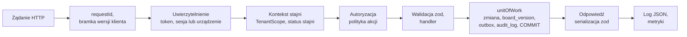

1. **`onRequest`:** `requestId` (z nagłówka `x-request-id` albo nowy), logger potomny, bramka minimalnej wersji dla tras bez `exemptFromMinVersion` (`403 client_upgrade_required`, ADR-04).
2. **Uwierzytelnienie:** SHA-256 tokenu → wiersz `access_tokens` po kluczu głównym, jednym zapytaniem razem z `auth_sessions.revoked_at` (użytkownik) albo `devices.status` i `revoked_at` (urządzenie). Wynik: `principal`.
3. **Kontekst stajni:** dla tras `/v1/stables/{stableId}/...`: `stables.status` i aktywne `stable_members`. Dla urządzenia: stajnia z `devices`. Wynik: `TenantScope`. Stajnia `suspended` daje `403 stable_suspended`.
4. **Autoryzacja:** deskryptor trasy deklaruje politykę; polityki zależne od zasobu (dostęp do konia z datami) handler wywołuje po wczytaniu zasobu przez `tx.authorize(action, resource)`.
5. **Handler** we wrapperze `command()` (zapisy, wymaga deklaracji `audit`, ADR-15) albo `query()` (odczyty).
6. **Transakcja (`unitOfWork(scope, tx => …)`):** repozytoria związane ze scope, zmiany domenowe, `boxes.board_version`, `audit.record` i ewentualne `jobs`. Przed COMMIT: zapis buforowanych zdarzeń outboxu z licznikiem (5.8). Izolacja `READ COMMITTED`. Przy błędach `40001` (serialization failure), `40P01` (deadlock) i `55P03` (lock not available) `unitOfWork` ponawia całą transakcję do 3 razy.
7. **Serializacja** schematem odpowiedzi zod, który usuwa pola spoza kontraktu.
8. **`onResponse`:** metryki i log.

Przykład (szkic):

```ts
export const createFlag = command({
  route: contract.flags.create,          // POST /v1/stables/{stableId}/horses/{horseId}/flags
  audit: { action: 'flag.created' },
  async run({ tx, input, clock }) {      // tx: repozytoria związane z TenantScope
    const horse = await tx.horses.get(input.horseId);                  // stable_id dokłada repozytorium
    tx.authorize('flag.create', { horse });                             // rola albo aktywny dostęp z datami
    const schedule = await tx.schedule.around(input.target, clock.now());
    const resolved = resolveFlagTarget(input.target, schedule, clock.now()); // nigdy nie wybiera innego wystąpienia
    if (resolved.kind === 'passed') throw problem(422, 'target_passed');
    const res = await tx.flags.insertIdempotent({ ...input, ...resolved.window }); // wyniki z 5.11
    if (res.kind !== 'inserted') return res.response;                  // duplicate albo id_conflict
    if (input.replacesFlagId) await tx.flags.cancel(input.replacesFlagId, 'replaced');
    if (horse.boxId) {
      const version = await tx.boxes.bumpBoardVersion(horse.boxId);
      tx.outbox.emit({ type: 'board.changed', boxId: horse.boxId, version });
    }
    tx.outbox.emit({ type: 'flag.changed', horseId: horse.id, entityId: res.flag.id });
    return { flag: res.flag, warnings: resolved.warnings };            // np. meal_possibly_served
  },
});
```

### 5.3 Role i polityki autoryzacji

| Rola | Gdzie zapisana | Zakres | Co może |
|---|---|---|---|
| Operator | Dostęp do CLI w klastrze (5.15) | Wszystkie stajnie przez jawne komendy | Status stajni, flota, wydania APK, zadania `dead`, kody wyjścia z kiosku, błędy klientów |
| Admin stajni | `stable_members.role = admin` | Swoja stajnia | Boksy, sloty, konie, dostępy, urządzenia i parowanie, PIN serwisowy, kody serwisowe tabletów, zaproszenia i role, słownik flag, ustawienia prywatności, eskalacji i modułów, eksport |
| Obsługa | `stable_members.role = staff` | Wszystkie konie stajni | Lista dnia, potwierdzanie flag, flagi w imieniu właściciela, odhaczanie karmienia i zadań |
| Instruktor | `stable_members.role = instructor` | Jazdy w stajni | Swoje jazdy i konie przypisane do jazd; bez danych kontaktowych właścicieli |
| Właściciel konia | `stable_members.role = member` + `horse_access` (`owner`, `co_owner`, `lessee`, `viewer`) | Konie z aktywnym dostępem | Flagi (`viewer` tylko odczyt), grafik według ustawień stajni, zdrowie, statusy wyświetlenia i potwierdzeń |
| Urządzenie | `devices` + `device_boxes` | Przypisane boksy | Snapshot boksów, potwierdzenia, odhaczenia, telemetria, wyniki komend, zgłaszanie błędów |

- **Dostęp do konia, nie do urządzenia.** Łańcuch: właściciel → koń → boks ← tablet (jeden tablet może obsługiwać kilka boksów). Przeprowadzka konia ani wymiana tabletu nie zmieniają uprawnień.
- **Jedno konto, wiele stajni.** Rola należy do pary użytkownik–stajnia; apka ma przełącznik stajni.
- **Kto potwierdził na tablecie:** `stables.settings.ackIdentity` = `device` (tylko „tablet boksu 7”), `person` (wybór osoby z listy) albo `person_pin` (osoba + PIN). PIN obsługi ma 4 cyfry i **służy do przypisania osoby, a nie jako zabezpieczenie**: 10^4 kombinacji da się sprawdzić offline w ułamku sekundy niezależnie od liczby iteracji funkcji wyprowadzania klucza. Serwer przechowuje `pin_verifier` = PBKDF2-SHA256(PIN, sól). Do snapshotu trafia weryfikator związany z urządzeniem: HMAC-SHA256(`service_secret` tego tabletu, `pin-v1|memberId|pin_verifier`). Klucz HMAC jest nieeksportowalny w Android Keystore (ADR-11), więc wyciągnięty snapshot nie pozwala sprawdzać PIN-ów poza tym tabletem. Tablet liczy PBKDF2 i HMAC w module natywnym i porównuje wynik w czasie stałym, z lokalnym limitem prób i rosnącą blokadą per osoba.
- **PIN serwisowy** admina stajni ma co najmniej 8 cyfr, ten sam schemat weryfikatora (`service-pin-v1|…`) i rosnącą blokadę lokalną. Podstawową drogą wejścia w tryb serwisowy jest kod challenge-response z apki admina (7.9).
- **Pracownik odchodzi:** `stable_members.active = false`, `deactivated_at`, usunięcie `pin_verifier` (osoba znika z listy w snapshocie, bo zmiana podnosi `board_version` wszystkich boksów stajni, 5.6), unieważnienie jego `auth_sessions` (zdarzenie `session.revoked`), zdarzenie `access.changed` (gateway zamyka jego subskrypcje), wpis w `audit_log`.

### 5.4 Model danych

Zasady:

- **Identyfikatory:** UUIDv7 z kodu. `outbox_events.id` to `bigint` nadawany z licznika w kodzie (`outbox_seq`, 5.8). Jedynym obiektem z wartością nadawaną przez bazę jest tabela migracji Drizzle (`drizzle.__drizzle_migrations`, `id SERIAL`), tworzona i zarządzana przez bibliotekę; aplikacja tylko ją czyta.
- **Bez logiki w schemacie:** kolumny statusów i rodzajów jako `text` walidowany przez zod (bez `pgEnum` i `CHECK`); klucze obce bez akcji kaskadowych (zależne wiersze usuwa kod, np. `retention.prune`); w schemacie Drizzle tylko `$defaultFn` i `$onUpdateFn`, bez `.default*()`, `serial` i identity; bez kolumn generowanych. Pilnuje tego bramka w CI (5.12).
- **Czas** w `timestamptz` (UTC), godziny lokalne w typie `time` ze strefą ze `stables.timezone`. Kolumny `jsonb` mają schematy zod z polem wersji. Wszystkie wartości ustawia kod.
- **Kategorie tabel** (audyt schematu w ADR-09 czyta tę listę z `infra/db/categories.ts`):

| Kategoria | Tabele | Reguły |
|---|---|---|
| Globalne | `users`, `otp_challenges`, `auth_sessions`, `refresh_tokens`, `rate_limit_buckets`, `app_releases`, `outbox_seq` | Bez `stable_id`; dostęp przez repozytoria globalne modułów `auth`, `tenancy`, `releases` i `infra/outbox` |
| Korzeń tenanta | `stables` | `id` jest identyfikatorem stajni |
| Tenantowe | wszystkie pozostałe tabele domenowe | `stable_id NOT NULL`, `UNIQUE (stable_id, id)`, wielokolumnowe FK, indeksy z `stable_id` na początku, dostęp przez `scoped()` |
| Łączące i 1:1 | `device_boxes` (PK `device_id`, `box_id`), `device_presence` (PK `device_id`) | `stable_id NOT NULL`, PK złożony albo 1:1 zamiast `UNIQUE (stable_id, id)`, wielokolumnowe FK |
| Mieszane (`stable_id` może być NULL) | `access_tokens`, `device_pairing_requests`, `jobs`, `outbox_events`, `audit_log`, `client_errors`, `stored_files` (z `stored_file_chunks`) | Dostęp tylko przez `crossTenant()` albo `scoped()` z warunkiem `stable_id = scope.stableId`; osobne testy |
| Techniczne poza schematem Drizzle | `konska_ops.migration_lock`, `konska_ops.migration_concurrent_steps` | Tworzy je komenda `migrate` (5.12); schemat `konska_ops` jest poza `schemaFilter` drizzle-kit |

**Konta**

| Tabela | Najważniejsze kolumny | Klucze i indeksy |
|---|---|---|
| `users` | `id`, `display_name`, `phone_e164`, `email`, `locale`, `created_at`, `deleted_at` | UNIQUE `phone_e164`, UNIQUE `email` (częściowe, gdy nie NULL) |
| `stable_members` | `id`, `stable_id`, `user_id`, `role` (`admin`, `staff`, `instructor`, `member`), `pin_verifier` (PBKDF2 4-cyfrowego PIN-u z solą, tylko atrybucja), `active`, `deactivated_at`, `version` | UNIQUE (`stable_id`, `user_id`), indeks `user_id` |
| `invitations` | `id`, `stable_id`, `channel`, `target`, `role`, `horse_id`, `access_role`, `token_hash`, `expires_at`, `accepted_at`, `accepted_by`, `created_by` | UNIQUE `token_hash` |

**Sesje i tokeny**

| Tabela | Najważniejsze kolumny | Klucze i indeksy |
|---|---|---|
| `otp_challenges` | `id`, `channel`, `target_hash`, `code_hash`, `purpose`, `attempts`, `expires_at`, `consumed_at`, `created_at` | indeks (`target_hash`, `created_at`) |
| `auth_sessions` | `id` (rodzina tokenów), `user_id`, `client` (`mobile`, `web`), `client_info`, `last_used_at`, `revoked_at`, `revoke_reason` | indeks `user_id` |
| `access_tokens` | `token_hash` (SHA-256), `kind` (`user`, `device`), `session_id`, `device_id`, `stable_id` (dla urządzenia), `expires_at`, `created_at` | PK `token_hash`, indeks `expires_at` |
| `refresh_tokens` | `id`, `session_id`, `token_hash`, `parent_id`, `expires_at`, `used_at`, `replaced_by_id`, `grace_used_at`, `revoked_at`, `revoke_reason` (`superseded_in_grace`, `family_revoked`, `logout`) | UNIQUE `token_hash`, indeks `session_id` |
| `device_auth_challenges` | `id`, `stable_id`, `device_id`, `nonce`, `expires_at`, `used_at` | indeks `expires_at` |
| `rate_limit_buckets` | `key`, `window_start`, `count` | PK `key` |

**Stajnia**

| Tabela | Najważniejsze kolumny | Klucze i indeksy |
|---|---|---|
| `stables` | `id`, `name`, `timezone` (IANA), `locales`, `status` (`active`, `suspended`), `settings` (jsonb: `ackIdentity`, prywatność ekranu, eskalacje, margines flagi po czasie, okno serwisowe, kto zmienia grafik, `features` np. `rides`), `service_pin_verifier` (PBKDF2, PIN ≥ 8 cyfr), `version` | PK `id` |
| `meal_slots` | `id`, `stable_id`, `code` (np. `breakfast`), `labels` (jsonb i18n), `local_time`, `days_of_week` (smallint[]), `valid_from`, `valid_to`, `sort_order` | UNIQUE (`stable_id`, `code`, `valid_from`) |
| `boxes` | `id`, `stable_id`, `label`, `building`, `active`, `board_version`, `board_changed_at`, `version` | UNIQUE (`stable_id`, `label`) |
| `paddocks`, `arenas` | `id`, `stable_id`, `name`, (`capacity`) | UNIQUE (`stable_id`, `name`) |
| `data_exports` | `id`, `stable_id`, `kind` (`stable`, `horse_history`), `status`, `file_id`, `created_by`, `created_at`, `finished_at` | indeks (`stable_id`, `created_at`) |

**Urządzenia i wydania**

| Tabela | Najważniejsze kolumny | Klucze i indeksy |
|---|---|---|
| `devices` | `id`, `stable_id`, `name`, `status` (`pending_confirmation`, `active`, `revoked`), `public_key`, `key_algorithm`, `key_attestation`, `model`, `firmware`, `app_version`, `version_code`, `connectivity` (`online`, `offline`), `connectivity_changed_at`, `last_telemetry` (jsonb, m.in. `wifi_ssid`, `wifi_rssi`, bateria, zasilanie, offset zegara, `pending_writes`), `last_telemetry_at`, `last_sync_ok_at`, `service_secret_enc`, `paired_at`, `paired_by`, `revoked_at`, `revoked_by` | indeks (`stable_id`, `status`) |
| `device_presence` | `device_id`, `stable_id`, `last_seen_at` | PK `device_id`, FK (`stable_id`, `device_id`); bez indeksu na `last_seen_at`, więc częste aktualizacje są typu HOT |
| `device_boxes` | `stable_id`, `device_id`, `box_id`, `position`, `seen_board_version`, `seen_at` | PK (`device_id`, `box_id`), FK (`stable_id`, `device_id`), (`stable_id`, `box_id`) |
| `device_pairing_requests` (mieszana do chwili przypisania) | `id`, `public_key`, `key_algorithm`, `model`, `firmware`, `app_version`, `code_hash`, `status` (`pending`, `claimed`, `expired`), `stable_id`, `device_id`, `claimed_by`, `expires_at` | indeks `expires_at` |
| `device_alerts` | `id`, `stable_id`, `device_id`, `kind` (`offline`, `power_lost`, `clock_drift`, `battery_full_long`, `board_stale`, `flag_undisplayed`, `firmware_changed`, `time_config_failed`), `opened_at`, `closed_at`, `notified_at` | UNIQUE częściowe (`device_id`, `kind`) `WHERE closed_at IS NULL` |
| `device_commands` | `id`, `stable_id`, `device_id`, `type`, `payload_enc`, `status` (`pending`, `delivered`, `succeeded`, `failed`, `expired`), `created_by`, `delivered_at`, `finished_at`, `expires_at`, `result` | indeks (`device_id`, `status`) |
| `app_releases` | `id`, `version_name`, `version_code`, `file_id`, `sha256`, `signing_cert_sha256`, `min_sdk`, `rollout`, `status` (`draft`, `rolling`, `complete`, `halted`) | UNIQUE `version_code` |

**Konie i dostępy**

| Tabela | Najważniejsze kolumny | Klucze i indeksy |
|---|---|---|
| `horses` | `id`, `stable_id`, `box_id`, `name`, `photo_file_id`, `breed`, `birth_date`, `notes`, `left_at`, `archived_at`, `version` | UNIQUE częściowe (`stable_id`, `box_id`) dla koni aktywnych |
| `horse_access` | `id`, `stable_id`, `horse_id`, `user_id`, `role`, `valid_from`, `valid_to`, `granted_by`, `revoked_at` | indeks `user_id`, indeks (`stable_id`, `horse_id`) |

**Flagi i potwierdzenia**

| Tabela | Najważniejsze kolumny | Klucze i indeksy |
|---|---|---|
| `flag_templates` | `id`, `stable_id`, `code`, `labels`, `icon`, `severity`, `effect`, `meal_slot_code`, `default_window`, `requires_ack`, `active`, `sort_order` | UNIQUE (`stable_id`, `code`) |
| `horse_flags` | `id` (z klienta), `stable_id`, `horse_id`, `template_id`, `custom_text`, `severity`, `effect`, `note`, `note_visibility` (`board`, `app_only`), `valid_from`, `valid_to` (NULL = do odwołania), `meal_slot_id`, `service_date`, `ack_deadline_at`, `source`, `replaces_flag_id`, `created_by`, `created_at` (czas serwera z `Clock`), `client_created_at`, `cancelled_at`, `cancelled_by`, `cancel_reason`, `acknowledged_at`, `request_hash` | indeks (`stable_id`, `horse_id`, `valid_to`); indeks częściowy `ack_deadline_at` `WHERE acknowledged_at IS NULL AND cancelled_at IS NULL`. Bez `version` i `deleted_at`: flaga jest niezmienna poza `cancelled_*` i `acknowledged_at` |
| `flag_displays` | `id`, `stable_id`, `flag_id`, `device_id`, `box_id`, `board_version`, `displayed_at` (`renderedAt` skorygowany kotwicą czasu, 7.2), `received_at`, `cause_event_id` | UNIQUE (`flag_id`, `device_id`) |
| `flag_acknowledgements` | `id` (identyfikator zdarzenia z klienta), `stable_id`, `flag_id`, `device_id`, `member_id`, `method` (`tablet_device`, `tablet_person`, `tablet_person_pin`, `app`), `occurred_at`, `time_quality` (`synced`, `unknown`), `received_at`, `conflict` (`none`, `flag_ended`, `flag_cancelled`), `request_hash` | PK `id` (idempotencja), indeks (`stable_id`, `flag_id`) |
| `flag_escalations` | `id`, `stable_id`, `flag_id`, `level` (`board_warning`, `admin_notify`), `escalated_at` | UNIQUE (`flag_id`, `level`) |

**Opieka**

| Tabela | Najważniejsze kolumny | Klucze i indeksy |
|---|---|---|
| `feeding_plans` | `id`, `stable_id`, `horse_id`, `meal_slot_id`, `items` (jsonb `FeedingItem[]`), `valid_from`, `valid_to`, `deleted_at`, `version` | indeks (`stable_id`, `horse_id`) |
| `feeding_checks` | `id` (z klienta), `stable_id`, `horse_id`, `meal_slot_id`, `service_date`, `device_id`, `member_id`, `occurred_at`, `time_quality`, `received_at`, `conflict` (`none`, `meal_suspended`), `request_hash` | UNIQUE (`stable_id`, `horse_id`, `meal_slot_id`, `service_date`) |
| `paddock_plans` | `id`, `stable_id`, `horse_id`, `paddock_id`, `days_of_week`, `start_local`, `end_local`, `companions`, `valid_from`, `valid_to`, `deleted_at` | indeks (`stable_id`, `horse_id`) |
| `health_events` | `id`, `stable_id`, `horse_id`, `type`, `occurred_on`, `scheduled_at`, `next_due_at`, `description`, `visibility` (`stable`, `owner_private`), `created_by`, `deleted_at`, `version` | indeks (`stable_id`, `horse_id`, `occurred_on`), indeks (`stable_id`, `next_due_at`) |
| `attachments` | `id`, `stable_id`, `owner_type`, `owner_id`, `file_id`, `file_name`, `mime`, `size_bytes`, `created_by`, `deleted_at` | indeks (`stable_id`, `owner_type`, `owner_id`) |
| `stored_files`, `stored_file_chunks` (tylko adapter `postgres`) | `id`, `stable_id` (NULL dla plików globalnych, np. APK), `size_bytes`, `sha256`, `content_type`; porcje: `file_id`, `idx`, `data` (bytea) | PK (`file_id`, `idx`) |

**Praca**

| Tabela | Najważniejsze kolumny | Klucze i indeksy |
|---|---|---|
| `rides` | `id`, `stable_id`, `horse_id`, `rider_member_id`, `rider_name`, `instructor_member_id`, `arena_id`, `starts_at`, `ends_at`, `status`, `deleted_at`, `version` | indeks (`stable_id`, `arena_id`, `starts_at`), indeks (`stable_id`, `horse_id`, `starts_at`) |
| `tasks` | `id`, `stable_id`, `title`, `horse_id`, `box_id`, `due_at` (jednorazowe), `days_of_week` i `local_time` (cykliczne), `assignee_role`, `active`, `created_by`, `deleted_at` | indeks (`stable_id`, `active`) |
| `task_occurrences` | `id`, `stable_id`, `task_id`, `due_at`, `status`, `done_by_member_id`, `done_by_device_id`, `completion_event_id`, `occurred_at`, `time_quality`, `received_at`, `request_hash` | UNIQUE (`task_id`, `due_at`), UNIQUE `completion_event_id` |

**Zdarzenia, zadania, powiadomienia i błędy**

| Tabela | Najważniejsze kolumny | Klucze i indeksy |
|---|---|---|
| `outbox_seq` | `id` (zawsze 1), `value` (ostatni nadany numer) | PK `id`; wiersz tworzy `migrate` (`INSERT ... ON CONFLICT DO NOTHING`) |
| `outbox_events` | `id` (bigint z `outbox_seq`), `stable_id` (NULL dla zdarzeń sesji użytkownika), `type`, `box_id`, `horse_id`, `device_id`, `user_id`, `session_id`, `entity_id`, `version`, `request_id`, `created_at` | PK `id`, indeks `created_at`. Bez kluczy obcych (dziennik routingu), więc wstawienie po zablokowaniu licznika nie czeka na inne blokady |
| `jobs` | `id`, `type`, `payload`, `stable_id`, `dedupe_key`, `status`, `priority`, `run_at`, `attempts`, `max_attempts`, `locked_by`, `locked_until`, `last_error`, `request_id`, `finished_at` | UNIQUE `dedupe_key`; indeks częściowy (`priority`, `run_at`) `WHERE status = 'pending'`; indeks częściowy `locked_until` `WHERE status = 'running'` |
| `notifications` | `id`, `stable_id`, `channel` (`sms`, `email`), `recipient_user_id`, `template`, `params`, `related_flag_id`, `status` (`pending`, `sent`, `failed`, `cancelled`), `provider_message_id`, `attempts`, `sent_at`, `created_at` | indeks (`stable_id`, `created_at`) |
| `client_errors` | `id`, `stable_id`, `subject` (`device:<id>`, `user:<id>`, `anonymous`), `client` (`tablet`, `mobile`, `web`), `app_version`, `fingerprint`, `message`, `stack`, `count`, `first_seen_at`, `last_seen_at` | UNIQUE (`client`, `app_version`, `fingerprint`, `subject`), indeks `last_seen_at` |

**Audit**

| Tabela | Najważniejsze kolumny | Klucze i indeksy |
|---|---|---|
| `audit_log` | `id`, `stable_id` (NULL dla zdarzeń globalnych), `actor_type`, `actor_id`, `action`, `entity_type`, `entity_id`, `changes` (przed i po, bez sekretów), `request_id`, `created_at` | indeks (`stable_id`, `entity_type`, `entity_id`, `created_at`), indeks (`stable_id`, `created_at`) |

**Techniczne (schemat `konska_ops`, poza Drizzle)**

| Tabela | Najważniejsze kolumny | Klucze i indeksy |
|---|---|---|
| `konska_ops.migration_lock` | `id` (zawsze 1) | PK `id`; służy tylko jako wiersz do zablokowania (5.12) |
| `konska_ops.migration_concurrent_steps` | `name`, `status`, `started_at`, `finished_at` | PK `name` |

### 5.5 API: najważniejsze endpointy

Wszystkie trasy stajni mają prefiks `/v1/stables/{stableId}`, skracany niżej jako `…`. Trasy urządzeń mają prefiks `/device/v1`. Gwiazdka (*) oznacza trasę zwolnioną z bramki minimalnej wersji (ADR-04).

| Metoda | Ścieżka | Opis |
|---|---|---|
| POST | `/v1/auth/otp` (*) | Wysłanie kodu (`channel`, `target`, `purpose`); limity w `rate_limit_buckets` |
| POST | `/v1/auth/otp/verify` (*) | Kod → `accessToken`, `refreshToken` (panel: cookie) |
| POST | `/v1/auth/refresh` (*) | Rotacja refresh tokenu z wykrywaniem ponownego użycia |
| POST | `/v1/auth/logout` (*) | Unieważnienie rodziny (`auth_sessions`), `session.revoked` |
| GET, PATCH, DELETE | `/v1/me` | Profil; `DELETE` usuwa konto (8.5) |
| GET | `/v1/me/memberships` | Stajnie i role użytkownika |
| POST | `/v1/invitations/{token}/accept` | Przyjęcie zaproszenia po zalogowaniu |
| POST | `/v1/client-errors` (*) | Partia błędów z apki mobilnej i panelu (5.14) |
| POST | `/v1/stables` | Rejestracja stajni (panel web); twórca zostaje adminem |
| GET, PATCH | `…` | Ustawienia stajni (`If-Match`: `412` przy niezgodności, `428` bez nagłówka) |
| GET, PUT | `…/meal-slots` | Sloty posiłków |
| GET | `…/schedule?from=&to=` | Wystąpienia posiłków i `utcOffsets` do podglądu celu flagi w apce |
| GET, POST, PATCH, DELETE | `…/boxes[/{boxId}]` | Boksy |
| GET, PATCH | `…/members[/{memberId}]` | Role, dezaktywacja, PIN |
| GET, POST, DELETE | `…/invitations[/{invitationId}]` | Zaproszenia SMS i e-mail z deep linkiem |
| PUT | `…/service-pin` | PIN serwisowy tabletów (≥ 8 cyfr) |
| GET, PUT | `…/flag-templates` | Słownik flag |
| GET, POST | `…/horses` | Konie |
| GET, PATCH | `…/horses/{horseId}` | Dane konia |
| POST | `…/horses/{horseId}/move-out`, `…/horses/{horseId}/archive` | Cykl życia konia |
| GET, POST, DELETE | `…/horses/{horseId}/access[/{accessId}]` | Dostępy z datami |
| POST | `…/horses/{horseId}/flags` | Utworzenie flagi; `id` z klienta, `templateId` albo `customText`, `target` (`{mealSlotId, serviceDate}` albo `{validFrom, validTo}`), `clientCreatedAt`, `note`, `noteVisibility`, `source`, opcjonalnie `replacesFlagId`; `422 target_passed` albo `201` z `warnings` |
| GET | `…/horses/{horseId}/flags?state=active\|upcoming\|history` | Flagi konia |
| GET | `…/flags/{flagId}` | Flaga z osią statusów (zapisano, wyświetlono, przyjęto, eskalacje) |
| POST | `…/flags/{flagId}/cancel` | Odwołanie |
| POST | `…/flags/{flagId}/acknowledgements` | Potwierdzenie z apki (obsługa); `id` z klienta |
| GET | `…/day?date=` | Lista dnia obsługi (wszystkie boksy, flagi krytyczne i niepotwierdzone na górze) |
| GET, PUT | `…/horses/{horseId}/feeding-plan`, `…/horses/{horseId}/paddock-plan` | Grafik |
| POST | `…/feeding-checks` | Odhaczenie posiłku; `id` z klienta |
| GET, POST, PATCH, DELETE | `…/horses/{horseId}/health-events[/{eventId}]` | Historia zdrowia; `…/health-events?dueBefore=` dla listy „zbliża się” |
| POST | `…/attachments` | Upload strumieniowy (`@fastify/multipart`) do `FileStorage`, do `MAX_UPLOAD_BYTES` |
| GET | `…/attachments/{attachmentId}/content` | Pobranie po sprawdzeniu uprawnień (`Range`) |
| GET, POST, PATCH, DELETE | `…/rides[/{rideId}]` | Jazdy; `409 ride_conflict` |
| GET, POST, PATCH | `…/tasks[/{taskId}]` | Zadania |
| GET | `…/task-occurrences?date=` | Wystąpienia zadań |
| POST | `…/task-occurrences/{occurrenceId}/complete` | Odhaczenie; `id` zdarzenia z klienta |
| POST | `…/devices` | Parowanie: `pairingRequestId`, `code`, `name`, `boxIds` |
| GET, PATCH | `…/devices[/{deviceId}]` | Lista, statusy, boksy, nazwa, ostatnia telemetria (w tym SSID) |
| POST | `…/devices/{deviceId}/revoke` | Odłączenie |
| POST | `…/devices/{deviceId}/commands` | Komenda zdalna (7.7) |
| POST | `…/devices/{deviceId}/service-code` | `challenge` z ekranu tabletu → 8-cyfrowy kod wejścia w tryb serwisowy (7.9); wpis w `audit_log` |
| POST, GET | `…/exports[/{exportId}]` | Eksport danych stajni lub historii konia (JSON) |
| POST | `/device/v1/pairing-requests` (*) | Tablet: klucz publiczny, model, firmware → `requestId`, `code`, `expiresAt` |
| GET | `/device/v1/pairing-requests/{requestId}` (*) | Status (`pending`, `claimed`, `expired`) i `deviceId` |
| POST | `/device/v1/auth/challenge`, `/device/v1/auth/token` (*) | Challenge-response (ADR-11) |
| POST | `/device/v1/activate` (*) | Potwierdzenie parowania dotykiem na tablecie; odpowiedź zawiera `service_secret` do importu w Keystore |
| GET | `/device/v1/board` | Snapshot boksów (5.6); `ETag`, `304`, nagłówek `x-server-now` |
| POST | `/device/v1/board/seen` | `boxId`, `version`, `flagIds`, `renderedAt`, `causeEventId` → `flag_displays`, `device_boxes.seen_board_version` |
| POST | `/device/v1/events` (*) | Partia zapisów z kolejki (`flag.ack`, `feeding.check`, `task.complete`, maks. 50) z wynikiem dla każdego zdarzenia |
| POST | `/device/v1/heartbeat` (*) | Telemetria co 10 min i natychmiast przy zmianie zasilania; odpowiedź z `serverNow` i ewentualnym `upgrade` |
| GET | `/device/v1/commands` (*) | Oczekujące komendy (także po ponownym połączeniu) |
| POST | `/device/v1/commands/{commandId}/result` (*) | Wynik komendy |
| GET | `/device/v1/apk/latest`, `/device/v1/apk/{releaseId}/file` (*) | Wydanie APK dla urządzenia i plik |
| POST | `/device/v1/diagnostics/errors` (*) | Partia błędów JS i natywnych z tabletu (5.14) |
| GET (upgrade) | `/v1/ws` | WebSocket (5.7) |
| GET | `/livez`, `/readyz`, `/version`, `/openapi.json`, `/.well-known/assetlinks.json`, `/.well-known/apple-app-site-association` | Platforma i deep linki; `/metrics` na osobnym porcie |

### 5.6 Snapshot stanu boksów dla tabletu

`GET /device/v1/board` zwraca stan wszystkich boksów urządzenia.

- **Spójność:** snapshot powstaje w jednej transakcji `BEGIN ISOLATION LEVEL REPEATABLE READ, READ ONLY`, więc wersje (`boxes.board_version`) i treść pochodzą z tej samej migawki bazy. W `READ COMMITTED` zmiana zatwierdzona między odczytem treści a odczytem wersji dałaby starą treść z `ETag` nowej wersji, a tablet ignorowałby potem sygnał tej wersji.
- **Horyzont w kubełkach:** serwer wyrównuje horyzont do kubełka `BOARD_HORIZON_BUCKET_H` (domyślnie 6 h): `bucketStart = floor(now, 6 h)`, horyzont od `bucketStart − 12 h` do `bucketStart + 54 h`. Koniec horyzontu jest więc zawsze co najmniej 48 h przed `now`, także gdy serwer odpowiada `304`.
- **`ETag`** = hash(`snapshotFormat`, `bucketStart`, lista par `boxId:board_version` boksów urządzenia). Niezmieniony stan w tym samym kubełku kończy się `304`. Dodatkowo tablet pobiera snapshot bez `If-None-Match`, gdy do końca horyzontu zostało mniej niż 24 h.
- **Czas serwera:** nagłówek `x-server-now` (ISO, milisekundy) jest w każdej odpowiedzi, także `304`, i odświeża kotwicę zegara tabletu.

```ts
type BoardSnapshot = {
  snapshotFormat: 2;
  serverNow: string;                     // ISO, do kotwicy zegara
  horizon: { from: string; to: string }; // bucketStart - 12 h ... bucketStart + 54 h
  upgrade: null | { required: boolean; minVersion: string; releaseId: string | null };
  stable: {
    id: string; status: 'active' | 'suspended'; locales: Locale[];
    utcOffsets: { from: string; offsetMinutes: number }[]; // harmonogram przesunięć na 12 miesięcy
    display: { authorMode: 'role' | 'initial' | 'name'; ackIdentity: 'device' | 'person' | 'person_pin' };
    maintenanceWindow: { from: string; to: string } | null;
    servicePinVerifier: string;          // HMAC kluczem tego tabletu (5.3)
  };
  staff?: { memberId: string; name: string; pinSalt?: string; pinVerifier?: string }[]; // gdy ackIdentity != device
  boxes: {
    boxId: string; label: string; version: number;
    horse: null | { id: string; name: string };
    flags: { id: string; label: I18n; bannerText: I18n; severity: Severity | 'unknown'; effect: Effect | 'unknown';
             validFrom: string; validTo: string | null; ackDeadlineAt: string | null;
             warnAt: string | null; notifyAt: string | null;     // momenty eskalacji liczone na serwerze
             note: string | null; noteHidden: boolean;           // noteHidden: note_visibility = app_only, note = null
             author: string; createdAt: string;
             acknowledged: null | { by: string; at: string } }[];
    meals: { occurrenceId: string; slotCode: string; label: I18n; at: string; items: FeedingItem[];
             suspendedBy: string[];                               // flagi wstrzymujące to wystąpienie
             checked: null | { by: string; at: string } }[];
    paddock: { from: string; to: string; paddock: string; companions: string[]; cancelledBy: string[] }[];
    upcoming: { type: HealthType; at: string }[];  // bez opisu
    tasks: { occurrenceId: string; title: string; dueAt: string; doneAt: string | null }[];
  }[];
};
```

Snapshot buduje moduł `board` w kodzie. Test kontraktu sprawdza, że nie zawiera pól z `health_events.description`, `attachments` ani treści notatek z `note_visibility = app_only` (przy `noteHidden = true` pole `note` jest `null`).

**Co podnosi `boxes.board_version`** (i ustawia `board_changed_at`, emituje `board.changed`): zmiana flag konia w boksie, planów, przypisania konia, przypisania urządzenia, odhaczeń, eskalacji. Zmiany dotyczące całej stajni podnoszą `board_version` wszystkich jej boksów: ustawienia wpływające na ekran (w tym `ackIdentity`, prywatność, moduły), zmiana członków z rolą `staff` (dodanie, dezaktywacja), `pin_verifier`, `service_pin_verifier`.

### 5.7 Protokół WebSocket

- **Endpoint:** `/v1/ws`. Wersja protokołu w `hello.protocol` (obecnie `1`). Token przesyłamy w pierwszej wiadomości, a nie w URL, żeby nie trafiał do logów pośredników.
- **Format:** JSON, każda wiadomość ma `type`. Nieznane typy i pola obie strony ignorują, więc nowe typy można dodawać bez zmiany wersji.

| Kierunek | Wiadomość | Pola | Znaczenie |
|---|---|---|---|
| K → S | `hello` | `protocol`, `token`, `client {name, version}` | Pierwsza wiadomość; bez niej po 10 s serwer zamyka połączenie (4001) |
| S → K | `welcome` | `connectionId`, `serverNow`, `heartbeatIntervalMs`, `upgrade?` | Urządzenie jest automatycznie subskrybowane do `box:*` swoich boksów i `device:{id}`. Po `welcome` klient zawsze sprawdza aktualność stanu (ADR-05) |
| K → S | `subscribe`, `unsubscribe` | `requestId`, `topics` (`stable:{id}`, `horse:{id}`, `box:{id}`) | Gateway sprawdza politykę dla każdego tematu |
| S → K | `subscribed` | `requestId`, `topics`, `denied` | Wynik subskrypcji |
| S → K | `event` | `eventId`, `type`, `stableId`, `boxId?`, `horseId?`, `deviceId?`, `entityId?`, `version?` | Typy: `board.changed`, `flag.changed`, `flag.displayed`, `flag.acknowledged`, `flag.escalated`, `day.changed`, `device.status`, `device.command`, `device.revoked`, `session.revoked`, `stable.status`, `access.changed` |
| K → S | `auth` | `token` | Nowy access token bez zrywania połączenia |
| S → K | `auth_expiring` | `expiresAt` | 60 s przed wygaśnięciem tokenu |
| K ↔ S | `ping`, `pong` | `t`, `serverNow` | Heartbeat aplikacyjny; klient co 30 s |
| S → K | `goaway` | `reason` (`shutdown`, `revoked`, `auth_expired`, `upgrade_required`, `overloaded`), `retryAfterMs` | Zamknięcie kontrolowane z rozłożeniem ponownych połączeń |
| S → K | `error` | `code`, `message` | Błąd wiadomości |

- **Heartbeat:** serwer wysyła ramki ping protokołu WebSocket co 25 s i zamyka połączenie bez pong po 60 s. Klient wysyła `ping` co 30 s i uznaje połączenie za martwe po 75 s ciszy (wykrywanie połączeń półotwartych przez NAT i Wi-Fi).
- **Kody zamknięcia:** `4001` brak lub błąd uwierzytelnienia, `4003` brak uprawnień, sesja albo urządzenie odwołane, `4008` przekroczony limit, `4026` wymagana aktualizacja, `1001` wyłączanie serwera, `1013` (Try Again Later) przeciążenie.
- **Brak luki przy połączeniu:** gateway rejestruje subskrypcje połączenia w pollerze przed wysłaniem `welcome`, a klient pobiera stan dopiero po `welcome`. Zmiana zatwierdzona przed rejestracją jest w pobranym stanie, a późniejsza przyjdzie jako `event`. Duplikaty są możliwe, a klienci obsługują je idempotentnie przez porównanie `version`.
- **Filtrowanie:** zdarzenie trafia do połączenia, jeśli klucze routingu pasują do zautoryzowanego tematu **i** `event.stable_id` należy do stajni połączenia (sprawdzane niezależnie). Zdarzenia sesji (`session.revoked`) trafiają tylko do połączeń tej sesji. `access.changed` z `user_id` powoduje ponowną ocenę subskrypcji tego użytkownika.
- **Obecność urządzeń:** każda replika co 30 s wykonuje `UPDATE device_presence SET last_seen_at = $now WHERE device_id = ANY($connected)` dla swoich połączeń urządzeń. Żądania REST urządzenia (tryb awaryjny bez WebSocket) też aktualizują obecność, najwyżej raz na 30 s na urządzenie w replice.
- **Limity:** maks. rozmiar wiadomości 16 kB, limit wiadomości na połączenie, limit przyjmowania nowych połączeń na replikę (`WS_ACCEPT_RATE`, nowych połączeń na sekundę). Klient WebSocket w React Native na Androidzie i w przeglądarce nie dostaje statusu ani nagłówków odrzuconej odpowiedzi handshake, dlatego nadmiarowe połączenie jest przyjmowane, od razu dostaje `goaway {reason: 'overloaded', retryAfterMs: losowo}` i jest zamykane kodem `1013`. Klient bez `retryAfterMs` stosuje własny backoff z pełnym jitterem.

### 5.8 Outbox: zapis i odpytywanie

- **Zapis:** `tx.outbox.emit(event)` tylko wewnątrz `unitOfWork` (wywołanie wymaga typu `Tx`; poza transakcją lint i typy zgłaszają błąd). `emit` buforuje zdarzenia w pamięci transakcji.
- **Nadanie numerów przed COMMIT** (gdy bufor nie jest pusty), jako ostatnie instrukcje transakcji:

```ts
// wewnątrz unitOfWork, po handlerze; transakcja w READ COMMITTED
await tx.execute(sql.raw(`SET LOCAL lock_timeout = ${cfg.outboxSeqLockTimeoutMs}`)); // SET nie przyjmuje parametrów; liczba z configu zod
const [{ value }] = await tx.select({ value: outboxSeq.value }).from(outboxSeq)
  .where(eq(outboxSeq.id, 1)).for('update');                       // blokada do końca COMMIT
const rows = buffer.map((e, i) => ({ ...e, id: value + BigInt(i + 1), createdAt: clock.now() }));
await tx.insert(outboxEvents).values(rows);
await tx.update(outboxSeq).set({ value: value + BigInt(rows.length) }).where(eq(outboxSeq.id, 1));
// COMMIT wykonuje unitOfWork zaraz potem
```

- **Dlaczego nie ma luk:** blokada wiersza licznika trwa do końca zatwierdzenia. W PostgreSQL transakcja staje się widoczna, zanim zwolni blokady, więc następna transakcja pobiera licznik dopiero wtedy, gdy wiersze poprzedniej są już widoczne. W `READ COMMITTED` `SELECT ... FOR UPDATE` po oczekiwaniu czyta najnowszą zatwierdzoną wartość. Rollback cofa wstawione wiersze i licznik razem. Każdy czytelnik, który widzi numer `n`, widzi więc wszystkie numery mniejsze od `n`.
- **Warunki:** transakcje emitujące działają w `READ COMMITTED` (w `REPEATABLE READ` blokada zmienionego wiersza dałaby błąd serializacji, który `unitOfWork` i tak ponawia). `outbox_events` nie ma kluczy obcych. Licznik blokujemy jako ostatnią operację, więc blokada trwa tylko przez wstawienie, aktualizację i COMMIT. Kolejność blokad jest stała (najpierw wiersze domenowe, na końcu licznik), więc licznik nie tworzy zakleszczeń.
- **Zawieszony posiadacz blokady:** `idle_in_transaction_session_timeout` (`DATABASE_IDLE_IN_TX_TIMEOUT_MS`) i `transaction_timeout` (`DATABASE_TRANSACTION_TIMEOUT_MS`, PostgreSQL 17+) ustawiane przy otwieraniu każdego połączenia przerywają transakcję, która przestała robić postęp. Czekający kończą się po `lock_timeout` i są ponawiani przez `unitOfWork`. Na PostgreSQL 16 zamiast `transaction_timeout` działa timer w `unitOfWork`, który po przekroczeniu limitu niszczy połączenie klienta (serwer wycofuje transakcję najpóźniej po zakończeniu bieżącego polecenia). Te limity obowiązują wszystkie transakcje aplikacji: import, eksport i backfill zawsze dzielimy na partie w osobnych krótkich transakcjach.
- **Poller w każdej replice `realtime`:**

```ts
// stan: maxSeen (najwyższe dostarczone id)
async function pollOnce() {
  const rows = await db.select().from(outboxEvents)
    .where(gt(outboxEvents.id, maxSeen)).orderBy(outboxEvents.id).limit(OUTBOX_BATCH_SIZE);
  for (const row of rows) deliverToLocalConnections(row);  // filtrowanie z 5.7
  if (rows.length) maxSeen = rows[rows.length - 1].id;
  if (rows.length === OUTBOX_BATCH_SIZE) queueMicrotask(pollOnce); // zaległości: od razu kolejna partia
}
```

- **Start repliki:** `maxSeen = outbox_seq.value` (odczyt bez blokady, czyli ostatni zatwierdzony numer). Nowe połączenia i tak zaczynają od pobrania stanu przez REST (5.7).
- **Metryki:** `konska_outbox_poll_duration_seconds`, `konska_outbox_delivery_lag_seconds` (teraz − `created_at`), `konska_outbox_seq_lock_wait_seconds`, `konska_db_transaction_duration_seconds`.
- **Retencja:** `retention.prune` usuwa partiami wiersze starsze niż `OUTBOX_RETENTION_DAYS` (domyślnie 7).

### 5.9 Zadania workera

| Zadanie | Wyzwalacz | Idempotencja | Co robi |
|---|---|---|---|
| `flags.escalation-scan` | co 1 min | `dedupe_key` z minutą; UNIQUE `flag_escalations (flag_id, level)` | Kandydaci: flagi z indeksu częściowego `ack_deadline_at` w zasięgu progów (zapytanie przekrojowe przez `crossTenant()`, potem `tenantScopeForJob(stableId)`). **Każda flaga we własnej krótkiej transakcji:** `SELECT … FROM horse_flags WHERE stable_id = $1 AND id = $2 FOR UPDATE`; ponowne sprawdzenie `acknowledged_at IS NULL`, `cancelled_at IS NULL` i progu; `INSERT INTO flag_escalations … ON CONFLICT DO NOTHING RETURNING id`; tylko gdy wiersz powstał: `board_warning` → `board_version`, `board.changed`, `flag.escalated`; `admin_notify` → `notifications` (z `related_flag_id`) i zadanie `notifications.send` |
| `devices.offline-scan` | co 1 min | warunkowe przejście `connectivity`; UNIQUE częściowe w `device_alerts` | Czyta `device_presence`: `online` → `offline` po 3 min bez obecności (status dla właściciela od razu), alert `offline` po 15 min, zamknięcie alertów po powrocie |
| `devices.display-check` | co 1 min | UNIQUE częściowe w `device_alerts` | Dla tabletów `online`: `device_boxes.seen_board_version < boxes.board_version` dłużej niż 2 min od `board_changed_at` → alert `board_stale` i `konska_device_board_lag_seconds`; flagi krytyczne bez `flag_displays` po 60 s → `konska_flags_undisplayed` i alert `flag_undisplayed` |
| `notifications.send` | na żądanie | `dedupe_key = notifications.id`; ten sam klucz u dostawcy, jeśli go obsługuje | Tuż przed wywołaniem adaptera sprawdza `related_flag_id`: flaga potwierdzona albo odwołana → `status = cancelled`, bez wysyłki. W przeciwnym razie `SmsSender` lub `EmailSender`, zapis `provider_message_id`, ponowienia z wykładniczym backoffem |
| `tasks.materialize` | co 1 h | UNIQUE `task_occurrences (task_id, due_at)` | Wystąpienia zadań cyklicznych (`days_of_week`, `local_time`) na 7 dni, liczone tym samym kodem `Temporal` co sloty posiłków |
| `device-commands.expire` | co 5 min | warunkowe przejście `status` | `pending` po `expires_at` → `expired`; usunięcie `payload_enc` (np. hasło Wi-Fi) po wykonaniu lub wygaśnięciu |
| `releases.rollout-guard` | co 5 min | warunkowe przejście `status` wydania | Zatrzymanie rolloutu APK, gdy urządzenia z nową wersją znikają z `device_presence`, nie zgłaszają udanej synchronizacji (`devices.last_sync_ok_at`) albo rośnie liczba `client_errors` dla tej wersji |
| `exports.stable`, `exports.horse-history` | na żądanie | `dedupe_key` z `exportId`; deterministyczny `file_id` z `exportId` | JSON do `FileStorage`, strumieniowo (ADR-07) |
| `retention.prune` | raz na dobę | stan, a nie takt | Partiami: `outbox_events`, `otp_challenges`, `device_auth_challenges`, wygasłe `access_tokens` i `refresh_tokens`, zakończone `jobs`, stare `client_errors`, trwałe usunięcie wierszy z `deleted_at` po retencji |
| `files.gc` | raz na dobę | stan | Usuwanie plików bez odwołań; pliki wskazywane przez `app_releases` są wyłączone |
| `backfill.<nazwa>` | ręcznie (krok expand/contract) | `dedupe_key` z numerem partii | Uzupełnianie nowych kolumn partiami w krótkich transakcjach, wznawialne |

- **Ścieżka potwierdzenia** blokuje ten sam wiersz co skan: `UPDATE horse_flags SET acknowledged_at = $t WHERE stable_id = $1 AND id = $2 AND acknowledged_at IS NULL`. Skan i potwierdzenia (z tabletu i z apki) są więc szeregowane, pierwsze potwierdzenie ustawia `acknowledged_at`, a kolejne trafiają tylko do `flag_acknowledgements`. SMS nie wyjdzie, jeśli potwierdzenie zatwierdzono przed sprawdzeniem w `notifications.send`.
- **Dzierżawy:** domyślnie 60 s, przedłużane co 20 s warunkowo (fencing, ADR-07). `max_attempts` zależy od typu zadania, np. 8 dla `notifications.send`.
- **Metryki globalne** (`konska_devices{connectivity}`, `konska_jobs_queue_depth`) liczy w handlerze `/metrics` każda replika z rolą `worker`, z pamięcią podręczną 15 s, i publikuje z etykietą `scope="global"`. Wszystkie repliki raportują tę samą wartość, więc zapytania używają `max`, a nie `sum`.

### 5.10 Czas, strefy i `meal_slots`

- **W bazie:** momenty jako `timestamptz` (UTC). Godziny lokalne (`meal_slots.local_time`, `paddock_plans.start_local`, `tasks.local_time`) jako `time`, a strefa stajni w `stables.timezone` (IANA). Połączenia aplikacji ustawiają `TimeZone=UTC`.
- **`meal_slots`** mają `days_of_week`, `valid_from` i `valid_to`, więc obsługują różnice między weekendem a dniem powszednim, sezony i zmianę godzin bez przepisywania historii. `service_date` to lokalna data stajni, do której należy wystąpienie posiłku.
- **Cel flagi:** klient wysyła konkretny cel, który użytkownik widział w podglądzie: wystąpienie posiłku (`mealSlotId`, `serviceDate`) albo momenty `validFrom`/`validTo`, oraz `clientCreatedAt`. `resolveFlagTarget` sprawdza cel względem harmonogramu i zapisuje `valid_from`, `valid_to`, `meal_slot_id`, `service_date` i `ack_deadline_at` (dla `suspend_meal` to moment posiłku). Nigdy nie przesuwa celu na inne wystąpienie: posiłek, który już minął, daje `422 target_passed`, a trwający albo odhaczony `meal_possibly_served`. Zmiana godzin posiłków nie przesuwa istniejących flag.
- **Klienci nie liczą stref:** serwer rozwija wystąpienia, momenty eskalacji i `utcOffsets` (ADR-10). `…/schedule` służy apce tylko do podglądu przy tworzeniu flagi online.
- **Tablet:** kotwica czasu z każdej odpowiedzi (ADR-10), dryf raportowany w telemetrii, alert `clock_drift` powyżej 2 min. DPC przy provisioningu ustawia strefę w tej kolejności: wyłączenie automatycznej strefy (`setAutoTimeZoneEnabled(admin, false)` od API 30; dla API 28–29 `setGlobalSetting(AUTO_TIME_ZONE, "0")`), potem `setTimeZone(admin, tz)` ze sprawdzeniem wyniku (zwraca `false`, gdy automatyczna strefa jest włączona), `setAutoTimeEnabled(admin, true)` i restrykcja `DISALLOW_CONFIG_DATE_TIME`. Wynik trafia do telemetrii, a porażka otwiera alert `time_config_failed`. Działanie na Boox: do weryfikacji w fazie 0. Ekran nie zależy od strefy systemu.
- **Zmiana czasu:** najbliższa w strefie `Europe/Warsaw` to 25.10.2026 (03:00 CEST → 02:00 CET, przesunięcie +120 → +60 min o 01:00 UTC). Testy obejmują noc z 25 godzinami, flagi „do odwołania” przez granicę zmiany i posiłki o stałej godzinie lokalnej po obu stronach (12). `utcOffsets` w snapshocie obejmują 12 miesięcy (2–3 wpisy), więc godziny „do śr 18:00” w przyszłym tygodniu formatują się poprawnie także po zmianie czasu.

### 5.11 Offline, kolejka zapisów i idempotencja

- **Kolejka zapisów** (`@konska/write-queue`, wspólna dla tabletu i apki): potwierdzenia flag, odhaczenia posiłków i zadań. Dotknięcie „Potwierdzam” lub „Nakarmiony” zawsze najpierw zapisuje się lokalnie (SQLite), a dopiero potem jest wysyłane. Przycisk nigdy nie jest blokowany. Tablet pokazuje licznik „N potwierdzeń czeka na wysłanie”. Wpisy kolejki to nieprzezroczyste ciała żądań JSON z `formatVersion` (ADR-12). **Tworzenie flag nie przechodzi przez kolejkę** (8.3; wariant offline w rozdziale 16).
- **Partie:** maks. 50 zdarzeń. Odrzucone zdarzenie nie blokuje kolejki: trafia na lokalną listę błędów, widoczną w trybie serwisowym i raportowaną w telemetrii.
- **Idempotencja po stronie serwera:** każde zdarzenie z partii działa we własnym `SAVEPOINT`, więc błąd jednego nie wycofuje pozostałych. Wiersze tworzone z identyfikatorem klienta mają `request_hash` (SHA-256 kanonicznej treści zdarzenia). Serwer robi `INSERT ... ON CONFLICT DO NOTHING RETURNING id` (bez wskazania kolumn, więc obejmuje każdą unikalność), a gdy nic nie wstawił:
  1. odczyt przez `scoped()` po `id`: wiersz w tej stajni z tym samym `request_hash` → `duplicate` (z wynikiem tego zdarzenia);
  2. odczyt przez `scoped()` po kluczu naturalnym (np. `feeding_checks (stable_id, horse_id, meal_slot_id, service_date)`, `task_occurrences (task_id, due_at)`): ktoś inny już to odhaczył → `already_done` z tym, kto i kiedy;
  3. w pozostałych przypadkach (identyfikator istnieje w innej stajni albo z inną treścią) → `rejected` z kodem `id_conflict`, **bez żadnych danych** istniejącego wiersza.
- **Wyniki per zdarzenie** z `POST /device/v1/events`: `accepted`, `duplicate`, `already_done`, `conflict`, `rejected`. Kolejka usuwa `accepted`, `duplicate` i `already_done`; `conflict` pokazuje w UI; `rejected` przenosi na listę błędów.
- **Dwa czasy:** `occurred_at` i `received_at`. Każde zdarzenie w kolejce zapisuje `bootId` i `elapsedRealtimeMs`. Jeśli w chwili utworzenia istnieje kotwica dla bieżącego uruchomienia, `occurredAt` jest liczone od razu (`timeQuality: 'synced'`). Jeśli nie (restart bez sieci), `occurredAt` liczy się przy wysyłce z pierwszej kotwicy uzyskanej w tym samym uruchomieniu. Zdarzenie z innego uruchomienia bez kotwicy idzie z `timeQuality: 'unknown'`: serwer używa wtedy `received_at`, oznacza wpis jako niepewny czasowo i nie wyprowadza z niego automatycznych konfliktów czasowych. `occurred_at` nigdy nie może wypaść później niż `received_at`.
- **Konflikty:** potwierdzenie flagi, która w międzyczasie wygasła albo została odwołana, zapisuje się z `conflict` i nie wskrzesza flagi. Odhaczenie posiłku wstrzymanego flagą w chwili `occurred_at` zapisuje się z `conflict = meal_suspended`, widocznym w historii flagi i na liście dnia (automatyczne `incidents` są w rozdziale 16).
- **Negatywny status dla właściciela od razu po zapisie:** „Tablet boksu 7 offline od 01:20, flaga widoczna w apce obsługi” na podstawie `devices.connectivity`.
- **Apka obsługi offline:** trwały cache listy dnia z godziną aktualności („lista z 05:40”).

### 5.12 Migracje schematu

- **Narzędzie:** drizzle-kit `generate` tworzy plik SQL z różnicy schematu TS. Plik trafia do `apps/server/drizzle/`, przechodzi review, linter `squawk` i bramkę zakazanych obiektów. Migracji nie edytujemy po scaleniu.
- **Bramka zakazanych obiektów** (`tools/sql-gate.ts`, w CI dla każdego nowego pliku SQL): odrzuca polecenia tworzące funkcje, procedury, wyzwalacze, widoki, reguły, polityki wierszy, rozszerzenia i typy wyliczeniowe, włączanie polityk wierszy na tabeli, ograniczenia `CHECK`, akcje kaskadowe kluczy obcych (`ON DELETE`/`ON UPDATE` inne niż domyślne), wartości `DEFAULT`, kolumny generowane, sekwencje i identity oraz polecenia powiadomień bazy. Wyjątki tylko z jawnej białej listy w repo, z uzasadnieniem. Dodatkowy test generuje SQL z całego schematu Drizzle i wymaga, żeby bramka nic w nim nie znalazła.
- **Uruchamianie:** `konska-server migrate` (ten sam obraz, osobna komenda, poświadczenia `MIGRATION_DATABASE_URL` z prawami DDL). Kolejność kroków w kodzie:
  1. **Bootstrap poza migracjami Drizzle:** `CREATE SCHEMA IF NOT EXISTS konska_ops`, `CREATE TABLE IF NOT EXISTS konska_ops.migration_lock (id smallint PRIMARY KEY)`, `INSERT ... (1) ON CONFLICT DO NOTHING`, tak samo `migration_concurrent_steps`.
  2. **Blokada:** osobne połączenie (bez `idle_in_transaction_session_timeout` i `transaction_timeout`) wykonuje `BEGIN; SET LOCAL lock_timeout = MIGRATE_WAIT_TIMEOUT_MS; SELECT 1 FROM konska_ops.migration_lock WHERE id = 1 FOR UPDATE` i trzyma transakcję otwartą przez cały przebieg. Blokada wiersza znika sama przy zerwaniu połączenia albo śmierci procesu, więc nie ma dzierżawy, która mogłaby wygasnąć w trakcie długiej migracji ani zostać po awarii.
  3. **Drugi proces czeka** na blokadę do `MIGRATE_WAIT_TIMEOUT_MS`; po jej uzyskaniu nie widzi oczekujących migracji i kończy się kodem 0. Krok jest więc bezpieczny niezależnie od tego, gdzie i ile razy Dawid go uruchomi (osobne zadanie, kontener init w każdym podzie, ręcznie z CI).
  4. **Migracje Drizzle** drugim połączeniem z `SET lock_timeout = MIGRATION_LOCK_TIMEOUT_MS` (domyślnie 5 s) i własnym `statement_timeout` (`MIGRATION_STATEMENT_TIMEOUT_MS`, domyślnie 5 min). DDL czekający na `ACCESS EXCLUSIVE` za długim zapytaniem ustawiałby w kolejce blokad wszystkie kolejne zapytania aplikacji do tej tabeli; `lock_timeout` przerywa go wcześniej, a cała transakcja migracji jest ponawiana z backoffem (kilka prób, potem kod błędu).
  5. **Faza indeksów współbieżnych:** pliki `apps/server/drizzle/concurrent/*.sql` (`CREATE INDEX CONCURRENTLY IF NOT EXISTS …`), każdy osobno i poza transakcją. Postęp w `konska_ops.migration_concurrent_steps`. Indeks pozostawiony jako nieważny po przerwanym przebiegu kod wykrywa w katalogu systemowym (`pg_index.indisvalid`), usuwa (`DROP INDEX CONCURRENTLY`) i buduje ponownie.
  6. **Wiersze techniczne:** `INSERT INTO outbox_seq (id, value) VALUES (1, 0) ON CONFLICT DO NOTHING`.
  7. Zatwierdzenie i zamknięcie połączenia blokady.
- **Aplikacja nie migruje sama.** Przy starcie i okresowo porównuje listę migracji wbudowaną w obraz z tabelą migracji Drizzle (w formacie wybranej wersji Drizzle, ADR-03). Gdy brakuje migracji wymaganych przez kod, `/readyz` zwraca `503` (`schema_behind`). Nowsze migracje niż znane kodowi są dopuszczalne, bo tak wygląda stan w trakcie rolling update.
- **Expand/contract na dwóch poziomach:**
  - *Baza ↔ serwer* (podczas rolling update działają stare i nowe pody): wydanie N dodaje (nowe tabele, kolumny `NULL` albo z wartością ustawianą przez kod), kod zapisuje oba warianty, `backfill.<nazwa>` uzupełnia dane. Wydanie N+1 przełącza odczyt. Wydanie N+2 usuwa stare kolumny dopiero wtedy, gdy żaden pod nie używa starego kodu.
  - *API ↔ tablety i apki* (starsze wersje w terenie przez tygodnie): pola w kontrakcie usuwamy dopiero po wyjściu wszystkich wersji, które ich używają, z okna zgodności (ADR-04). Tablety nigdy nie łączą się z bazą, więc zgodność schematu bazy i zgodność API to osobne osie.
- **Reguły dla migracji** (squawk i review): bez `DROP COLUMN` i `RENAME` w tym samym wydaniu, w którym kod przestaje używać kolumny; bez zmiany typu w miejscu; `NOT NULL` dopiero po backfillu; indeksy na dużych tabelach tylko w fazie współbieżnej (krok 5).

### 5.13 Bezpieczna praca w wielu replikach

| Obszar | Rozwiązanie |
|---|---|
| Stan w pamięci | Tylko pamięć podręczna bez wpływu na poprawność: połączenia WebSocket i ich subskrypcje (po restarcie klient łączy się ponownie i sprawdza stan), `maxSeen` pollera (odbudowywany z `outbox_seq`) |
| Fan-out | Każda replika `realtime` odpytuje `outbox_events`; numeracja bez luk z licznika w kodzie (ADR-06) |
| Zadania | `FOR UPDATE SKIP LOCKED`, dzierżawy z fencingiem, `dedupe_key`, idempotentne efekty (ADR-07) |
| Harmonogram | Każda replika `worker` uruchamia takt harmonogramu, a duplikaty odrzuca unikalność |
| Limity | Wrażliwe w `rate_limit_buckets`: OTP per `target_hash`, logowanie urządzeń per `deviceId`, parowanie per `pairingRequestId`; limit per IP tylko z wysokim progiem i tylko przy `TRUST_PROXY=true` (przy `false` limity per IP są wyłączone, bo `request.ip` to adres ingressu, a cała stajnia wychodzi z jednego adresu). Ogólne przeciążeniowe per replika (`@fastify/rate-limit`, `@fastify/under-pressure`). Gdy proces działa bez `TRUST_PROXY`, a żądania mają `X-Forwarded-For`, loguje ostrzeżenie (raz na proces) |
| Edycje równoległe | `version` + `If-Match` → `412` |
| Zapisy z klientów offline | Identyfikatory z klienta, `SAVEPOINT` per zdarzenie, wyniki z 5.11 |
| Potwierdzenia a eskalacje | Blokada wiersza `horse_flags` w obu ścieżkach (5.9) |
| Kolizje jazd | Blokada wiersza `arenas` i konia `FOR UPDATE` w transakcji, potem sprawdzenie nakładania w kodzie |
| Tokeny | Nieprzezroczyste, sprawdzane w bazie; repliki nie współdzielą kluczy podpisu |
| Pliki | Przez `FileStorage`; adapter `fs` wymaga współdzielonego wolumenu |
| Migracje | Blokada wiersza w `konska_ops.migration_lock`; równoległe przebiegi czekają i kończą się kodem 0 |
| Pula połączeń | `DATABASE_POOL_MAX` na proces; suma (repliki × pula + migracje) musi się mieścić w limicie połączeń bazy (parametr platformy) |

### 5.14 Raportowanie błędów klientów

- **Tablet** (kiosk 24/7): globalny handler błędów JS (`ErrorUtils`), granica błędów React wokół renderera i błędy natywne z modułu `konska-kiosk` (wyjątki, restart przez watchdog) trafiają do lokalnej kolejki i są wysyłane partiami przez `POST /device/v1/diagnostics/errors`.
- **Apka mobilna i panel:** `POST /v1/client-errors` (także bez logowania, z limitem per adres i per `subject`).
- **Serwer:** grupuje po `fingerprint` (typ błędu + znormalizowany pierwszy wiersz stosu + wersja), robi upsert w `client_errors` (`count`, `last_seen_at`), redaguje dane jak w 10.4 i limituje w `rate_limit_buckets`. Metryka `konska_client_errors_total{client,version}`. Retencja w `retention.prune`.
- **Wykorzystanie:** komenda CLI `client-errors top` (5.15), sygnał dla `releases.rollout-guard` (wzrost błędów po nowej wersji APK). Opcjonalny adapter `ErrorReporter` przekazuje kopię do usługi zewnętrznej, jeśli Dawid ją wybierze (15.2).

### 5.15 Narzędzia operatora (CLI)

W v1 operator nie ma panelu w przeglądarce. Komendy `konska-server` z tego samego obrazu działają na bazie przez `DATABASE_URL`. Jak uruchomić CLI w klastrze, decyduje Dawid. Każda komenda zmieniająca dane wymaga `--as <operator>` i zapisuje `audit_log` z `actor_type = operator`.

| Komenda | Działanie |
|---|---|
| `stables list`, `stables suspend <id>`, `stables activate <id>` | Stajnie i ich status (zdarzenie `stable.status`) |
| `devices list [--stable <id>] [--offline]` | Flota: łączność, firmware, wersje, bateria, zasilanie, offset zegara, SSID |
| `releases publish-apk <plik>`, `releases rollout <id> <reguła>`, `releases halt <id>` | Wydania APK: sha256 i certyfikat podpisu liczone przy publikacji, plik do `FileStorage` |
| `jobs list --status dead`, `jobs retry <id>` | Zadania martwe |
| `kiosk-exit-code --device <id> --challenge <kod>` | Kod wyjścia z kiosku (7.8) |
| `client-errors top [--client] [--version]` | Najczęstsze błędy klientów |
| `seed-dev` | Dane deweloperskie (tylko poza `production`) |

## 6. Kluczowe przepływy

### 6.1 Flaga: od zapisu do potwierdzenia

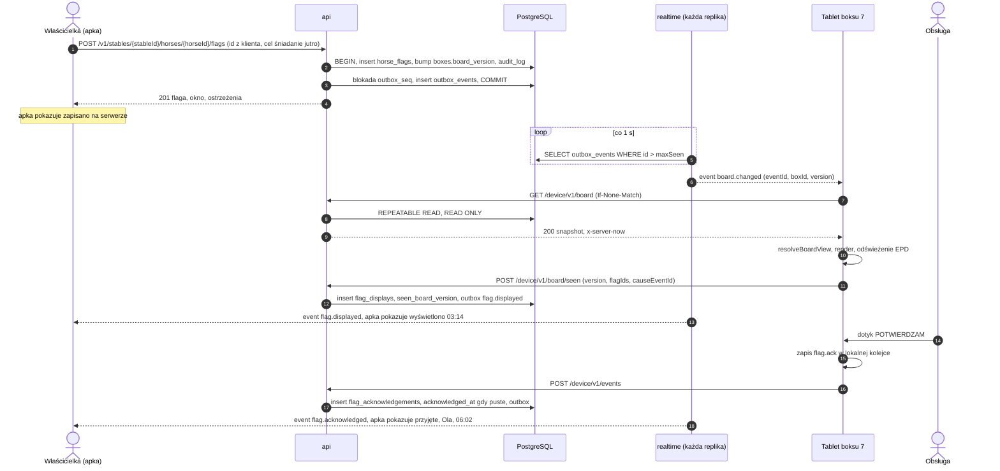

Właściciel ma zawsze widoczny jeden ze stanów: wysyłanie, zapisano na serwerze, wyświetlono, przyjęto albo stan negatywny (nie wysłano, tablet offline, NIEPOTWIERDZONE). Apka pobiera je przez `GET …/flags/{flagId}` po każdym zdarzeniu `flag.*`. Ścieżkę jednej flagi da się złożyć z logów: `request_id` żądania jest w `outbox_events` i w logu dostarczenia przez gateway, a tablet odsyła w `board/seen` identyfikator zdarzenia, które wywołało pobranie.

### 6.2 Potwierdzenie offline i synchronizacja kolejki

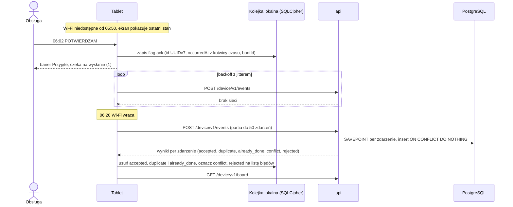

- Potwierdzenie liczy się jako złożone o 06:02 (`occurred_at`), więc eskalacja `admin_notify`, która wypadła w czasie braku sieci, zostaje w historii flagi z adnotacją „potwierdzono offline przed eskalacją”.
- Gdy flaga wygasła przed `occurred_at`, wynikiem jest `conflict = flag_ended`, a tablet pokazuje to przy wpisie.
- Gdy tablet restartował się bez sieci i nie ma kotwicy czasu z tego uruchomienia, zdarzenie idzie z `timeQuality: 'unknown'` i serwer używa `received_at` (5.11).

### 6.3 Parowanie tabletu

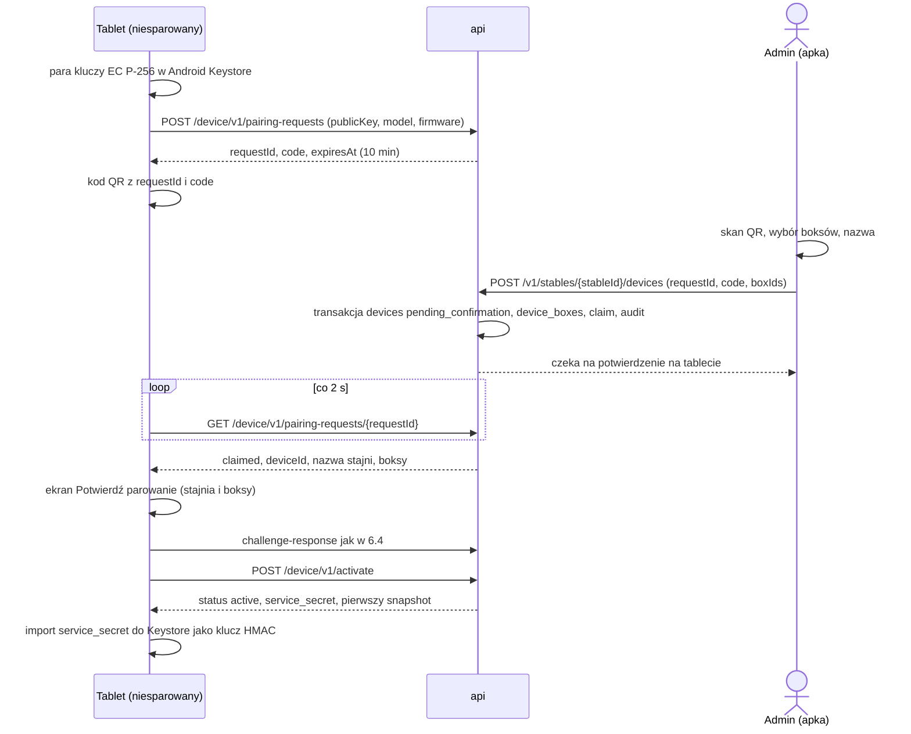

- Kod parowania: 8 znaków base32, jednorazowy, przechowywany jako hash. Klucz publiczny jest związany z żądaniem od początku, więc znajomość kodu pozwala co najwyżej przypisać *ten* tablet do stajni, którą się administruje. Fizyczne potwierdzenie na tablecie zamyka tę lukę.
- `service_secret` (losowe 256 bitów; na serwerze zaszyfrowany w `devices.service_secret_enc`) tablet importuje do Android Keystore jako nieeksportowalny klucz HMAC i usuwa kopię z pamięci JS. Służy do weryfikatorów PIN-ów (5.3) oraz kodów serwisowych i wyjścia z kiosku (7.8, 7.9).

### 6.4 Logowanie urządzenia po utracie sesji

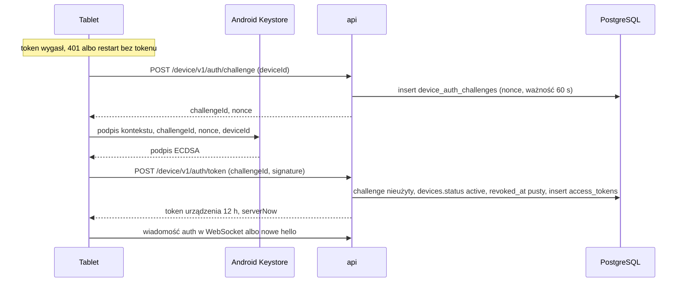

- Nie ma stanu, który można zgubić po drodze: jeśli odpowiedź z tokenem nie dotrze, tablet po prostu prosi o nowy challenge. Nieudane podpisy są limitowane per `deviceId` w `rate_limit_buckets` i trafiają do metryki `konska_device_auth_failures_total`.

### 6.5 Eskalacja niepotwierdzonej flagi

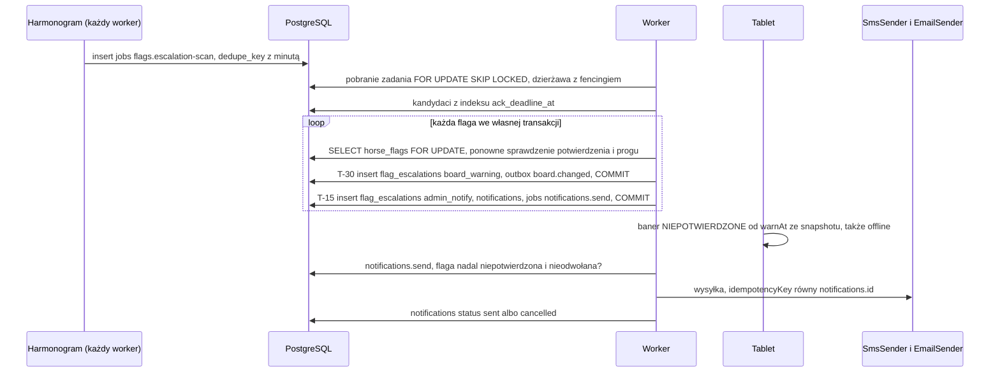

- Tablet pokazuje baner `board_warning` także offline, bo porównuje swój czas z `warnAt` ze snapshotu. `warnAt` liczy na serwerze ta sama funkcja co skan eskalacji.
- Potwierdzenie po eskalacji zamyka ją w osi statusów flagi. Czas od eskalacji do potwierdzenia trafia do histogramu `konska_escalation_to_ack_seconds`.
- Test współbieżności: potwierdzenie równoległe ze skanem daje zero SMS-ów albo SMS wysłany przed zatwierdzeniem potwierdzenia, nigdy SMS po zatwierdzonym potwierdzeniu (12).

### 6.6 Odłączenie lub kradzież tabletu

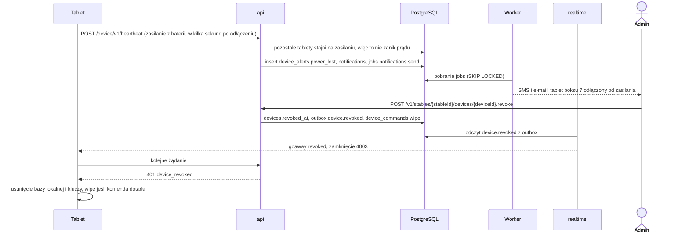

- Bez sieci tabletu nie da się zdalnie wymazać. Dane lokalne chroni SQLCipher z kluczem w Keystore, a restrykcje Device Ownera utrudniają obejście kiosku (7.8).
- Do odwołanego urządzenia nie trafiają już żadne dane: każde żądanie sprawdza `revoked_at`, a gateway zamyka połączenie w ciągu interwału pollera.

### 6.7 Burza ponownych połączeń po powrocie Wi-Fi

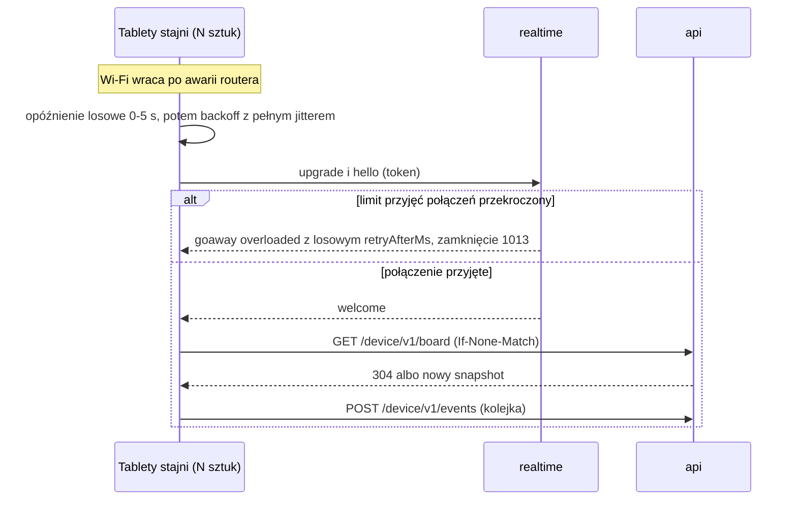

- **Backoff z pełnym jitterem:** `delay = random(0, min(60 s, 1 s × 2^attempt))`, a pierwsza próba po losowych 0–5 s. Resetuje się po 60 s stabilnego połączenia. Jeśli serwer podał `retryAfterMs`, klient czeka co najmniej tyle.
- **Restart backendu:** przy wyłączaniu repliki `goaway` dostaje losowe `retryAfterMs` z przedziału `WS_DRAIN_MS`, więc klienci wracają rozłożeni w czasie, a nie naraz.
- **Po stronie serwera:** `WS_ACCEPT_RATE` na replikę, `@fastify/under-pressure` (`503` dla REST przy przeciążeniu pętli zdarzeń), `304` dla niezmienionych snapshotów, logowanie urządzeń limitowane per `deviceId`, a nie per adres stajni.

## 7. Apka tabletu

### 7.1 Sprzęt

| Urządzenie | Ekran | System | Dotyk | Rola |
|---|---|---|---|---|
| **Boox Go 10.3 Gen II** | 10,3" Carta 1200, 300 ppi; wariant **Lumi** z regulowanym podświetleniem (ciepłe i zimne) albo wariant podstawowy bez podświetlenia | Android 15 według kart produktu i recenzji; wersja firmware i certyfikacja Play Protect do weryfikacji w fazie 0 | Tak | Development i kandydat produkcyjny nr 1 |
| Boox Go 7 | 7" Carta 1300, z podświetleniem | Android 13 według karty produktu | Tak | Alternatywa; czytelność z korytarza do sprawdzenia |

- Do developmentu i produkcji preferowany jest wariant Lumi. Wariant podstawowy wymaga oświetlenia korytarza (rozdział 11).
- Rozważane i odrzucone z powodów technicznych: Seeed reTerminal E10xx (ESP32, bez Androida), Philips Tableaux 13BDL4150IW (dotyk raczej nie), Visionect Place & Play (renderowanie na serwerze producenta), etykiety OpenEPaperLink (przyciski zamiast dotyku).
- Do sprawdzenia przed zakupem: wersja Androida i firmware, certyfikacja Play Protect (od niej zależy Android Enterprise i weryfikacja deweloperów, 7.4), zakres temperatur pracy. Dostęp do Google Play na Boox nie przesądza o certyfikacji: starsze modele wymagały ręcznej rejestracji GSF ID.
- Go 10.3 Gen II do developmentu, bo to prawdopodobny model produkcyjny: 10,3" lepiej czytać z 1,5–2 m i mieści układ dwóch boksów. Go 7 też wystarczy do developmentu, ale test kiosku trzeba wtedy powtórzyć na 10,3". Kiosk, zamrażanie apek i usypianie zależą od modelu i firmware.
- Modele Boox szybko znikają z oferty, dlatego certyfikujemy pary model + wersja firmware, a apka nie zależy od rozmiaru ekranu.

### 7.2 Architektura wewnętrzna

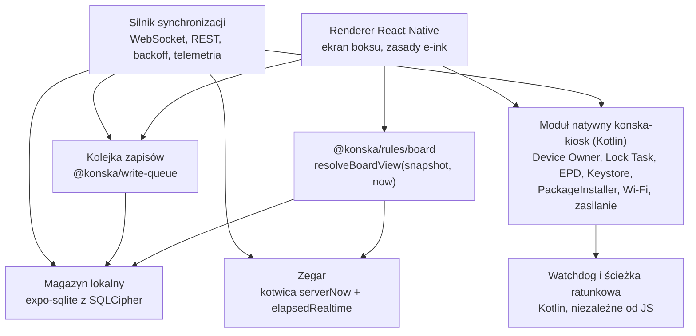

- **Moduł natywny `konska-kiosk`** (Expo Modules API, Kotlin). Config plugin dodaje `DeviceAdminReceiver`, generuje `res/xml/device_admin.xml` z `<uses-policies>` zawierającym `<wipe-data/>` (bez tego `wipeDevice` rzuca `SecurityException`), rejestruje w manifeście tylko odbiorniki `BOOT_COMPLETED`, `LOCKED_BOOT_COMPLETED` i `MY_PACKAGE_REPLACED` oraz dodaje do `android/build.gradle` repozytorium Maven z Onyx SDK (README OnyxAndroidDemo podaje adres `http://repo.boox.com/repository/maven-public/`; najpierw sprawdzamy wariant HTTPS, a w ostateczności `allowInsecureProtocol = true` tylko dla tego repozytorium, z przypiętą wersją i weryfikacją sum kontrolnych w Gradle).
  - kiosk: `isDeviceOwner()`, `applyPolicies(policy)`, `startLockTask()`, `configureTime(tz)` (kolejność z 5.10), `addWifiNetwork()`, `reboot()`, `wipe()` (`if (SDK_INT >= 34) wipeDevice(flags) else wipeData(flags)`, bo `wipeData` wywołane przez apkę z `targetSdk` ≥ 34 na Androidzie 14+ rzuca `IllegalStateException`);
  - Keystore: `generateKey(alias)`, `publicKey(alias)`, `sign(alias, bytes)`, `importHmacKey(alias, bytes)`, `hmac(alias, bytes)`, `pinCheck(alias, memberId, pin, salt, verifier)` (PBKDF2 i HMAC natywnie, porównanie w czasie stałym);
  - e-ink: `epdRefresh(mode)` przez Onyx SDK (`onyxsdk-device`); dokumentacja SDK zaleca `EpdDeviceManager` jako nakładkę na „dość prymitywny” `EpdController`. Na innym sprzęcie bez efektu;
  - aktualizacje: `installApk(path, sha256)` przez `PackageInstaller`;
  - telemetria: `deviceStatus()` (bateria, ładowanie, źródło zasilania, temperatura baterii, SSID i RSSI Wi-Fi, `elapsedRealtime`, `bootCount` z `Settings.Global.BOOT_COUNT`). Odczyt SSID wymaga uprawnienia lokalizacji, które DPC nadaje sobie przez `setPermissionGrantState` (do weryfikacji w fazie 0);
  - **zasilanie:** od Androida 8 odbiorniki z manifestu nie dostają niejawnych broadcastów spoza listy wyjątków, a `ACTION_POWER_CONNECTED` i `ACTION_POWER_DISCONNECTED` na niej nie są. Moduł rejestruje je dynamicznie (`Context.registerReceiver`) na cały czas działania apki w kiosku, a stan bieżący czyta z lepkiego `ACTION_BATTERY_CHANGED`;
  - **watchdog i ścieżka ratunkowa** (ADR-12): WorkManager albo AlarmManager restartuje proces, gdy JS przy działającej sieci przez `N` minut nie zgłosił udanej synchronizacji; gdy restart nie pomaga, natywny kod sam loguje się challenge-response i instaluje `GET /device/v1/apk/latest`.
- **Identyfikatory:** `react-native-get-random-values` importowany jako pierwszy moduł w punkcie wejścia, przed `uuid` (ADR-16).
- **Warstwa danych:** `expo-sqlite` z `useSQLCipher` (klucz bazy w `expo-secure-store`, czyli zaszyfrowany kluczem z Android Keystore). Tabele lokalne: `snapshot` (JSON, `etag`, `fetched_at`) i `settings` jako cache, który można usunąć i odbudować z serwera; `clock_anchor`; `write_queue` (nieprzezroczyste ciała żądań z `formatVersion`, `bootId`, `elapsedRealtimeMs`); `error_queue`; `pending_commands`. Nieznana wersja schematu lokalnego (np. po cofnięciu APK) oznacza usunięcie cache i zachowanie kolejek.
- **Silnik synchronizacji:** jedno połączenie WebSocket, pobieranie snapshotu po `board.changed`, po każdym `welcome`, co 5 min (zabezpieczenie) i bez `If-None-Match`, gdy do końca horyzontu zostało mniej niż 24 h; polling REST co 30–60 s, gdy WebSocket nie działa dłużej niż 2 min. Telemetria co 10 min i natychmiast przy zmianie zasilania, odbiór komend, sprawdzanie APK raz na dobę i po komendzie `check_updates`. Każda udana synchronizacja jest zgłaszana watchdogowi.
- **Renderer:** jeden ekran z widokiem na boks (lub dwie kolumny przy dwóch boksach), przerysowanie tylko przy zmianie modelu widoku. Po zatwierdzeniu renderu wywołuje `epdRefresh`, a potem `board/seen` z wersją i `causeEventId`. Granica błędów React wokół renderera zgłasza błędy (5.14) i pokazuje ostatni poprawny stan.
- **Bez Google Play Services:** bez FCM i Play Integrity; dystrybucja jako APK.

### 7.3 Maszyna stanów

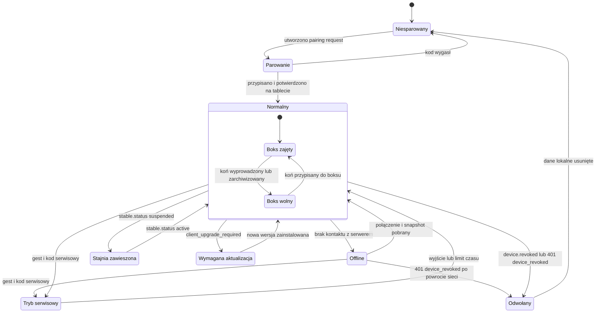

| Stan | Co pokazuje ekran | Co działa |
|---|---|---|
| Niesparowany / Parowanie | Kod QR i instrukcja; po przypisaniu nazwa stajni, boksy i przycisk „Potwierdź” | Polling statusu żądania |
| Normalny | Stan boksów, stopka „ONLINE, aktualne na 06:02” | Wszystko |
| Offline | Ostatni stan, stopka „OFFLINE od 05:50”; po 10 min pasek na całą szerokość „BRAK POŁĄCZENIA, dane z 05:50”; po wyjściu poza horyzont pełnoekranowe „DANE NIEAKTUALNE” | Potwierdzenia do kolejki, liczenie stanu lokalnie |
| Tryb serwisowy | Diagnostyka, Wi-Fi, ponowne parowanie, test dotyku, lista błędów kolejki | Bez potwierdzeń; automatyczne wyjście po 5 min bezczynności |
| Stajnia zawieszona | Pełnoekranowe „SYSTEM NIEAKTYWNY, NIE KORZYSTAJ Z TEGO EKRANU”, bez flag | Telemetria, komendy |
| Wymagana aktualizacja | Ostatni snapshot z paskiem „WYMAGANA AKTUALIZACJA, dane z 05:50” | Pobranie i instalacja APK, wysyłka kolejki, telemetria, komendy |
| Boks wolny (dla boksu) | „Boks wolny” | Pozostałe boksy tabletu normalnie |
| Odwołany | Krótko „Urządzenie odłączone”, potem ekran parowania | Usunięcie danych lokalnych i kluczy |

Najgroźniejsza sytuacja to tablet zawieszonej stajni, który nadal pokazuje ostatni stan (np. „BEZ ŚNIADANIA” albo brak flag). Dlatego zawieszenie przez zdarzenie `stable.status` i pole `stable.status` w snapshocie od razu ukrywa flagi.

### 7.4 Kiosk: Device Owner i plan B

- **Plan A:** apka tabletu jako Device Owner (`adb shell dpm set-device-owner` na świeżo zresetowanym tablecie, bez kont Google, przed aktywacją Google Play i rejestracją GSF ID). Lock Task: `setLockTaskPackages` i `setLockTaskFeatures` bez `LOCK_TASK_FEATURE_SYSTEM_INFO`, `LOCK_TASK_FEATURE_NOTIFICATIONS` i `LOCK_TASK_FEATURE_GLOBAL_ACTIONS`; w Lock Task pasek stanu i powiadomienia kontroluje wyłącznie `setLockTaskFeatures`. Apka jako launcher (`addPersistentPreferredActivity` dla HOME), start po restarcie (`BOOT_COMPLETED`), `STAY_ON_WHILE_PLUGGED_IN` przez `setGlobalSetting`. Według dokumentacji ta ostatnia działa tylko wtedy, gdy DPC nie ustawia `setMaximumTimeToLock`. Do tego `setKeyguardDisabled`. `setStatusBarDisabled` nie działa w Lock Task ani na ekranie blokady, więc stosujemy go tylko poza Lock Task (tryb serwisowy, plan B1). Wymaga własnego builda natywnego (development build w dev, build release w produkcji). Wzorem kodu jest react-native-kiosk-manager (MIT), bez zależności w produkcji.
- **Specyfika Boox (do weryfikacji w fazie 0):** wyłączyć „App Freeze” dla apki, włączyć autostart i „Stay active in the background”, ustawić usypianie na „nigdy” albo maksimum. Według dostępnych opisów w uśpieniu Boox wyłącza Wi-Fi.
- **Plan B1 (ten sam sprzęt):** apka jako launcher, przypięcie ekranu i keep-awake (`expo-keep-awake`). Słabsze rozwiązanie, bo obsługa może wyjść z apki.
- **Plan B2 (inny sprzęt):** inny tablet e-ink z Androidem i dotykiem (kandydaci do weryfikacji w fazie 0).
- **Weryfikacja deweloperów Androida:** według developer.android.com nowe zabezpieczenia obejmują aplikacje na certyfikowanych urządzeniach z Androidem; od 30.09.2026 działają dla użytkowników w Brazylii, Indonezji, Singapurze i Tajlandii, a globalnie mają objąć wszystkie certyfikowane urządzenia w 2027. Instalacja przez ADB działa bez zmian, więc provisioning przez `adb` nie jest objęty. Istnieje też konto do ograniczonej dystrybucji (do 20 urządzeń). Jeśli wybrany model jest certyfikowany, rejestrujemy pakiet apki tabletu, a w fazie 0 sprawdzamy, czy cicha instalacja APK przez Device Ownera (`PackageInstaller`) wymaga rejestracji pakietu.

### 7.5 Checklista fazy 0 (na świeżo zresetowanym tablecie)

1. `dpm set-device-owner` dla testowej apki DPC przed aktywacją Google Play; Lock Task z `setLockTaskFeatures`; czy GSF i Google Play są w ogóle potrzebne; status certyfikacji Play Protect.
2. Usypianie „nigdy” albo utrzymanie ekranu i Wi-Fi przez Device Ownera; App Freeze, autostart, „Stay active in the background”; 72 h ciągłej pracy na zasilaczu.
3. Zanik prądu: czy tablet sam się włącza, czy zostaje na ekranie ładowania; powrót Wi-Fi i WebSocket; zegar po zaniku prądu bez sieci; `BOOT_COUNT` zmienia się po restarcie.
4. Zasilanie: odłączenie zasilacza → telemetria na serwerze w < 5 s (dynamiczny odbiornik zasilania).
5. Pomiar budżetu opóźnienia (ADR-06): od `board.changed` do zakończenia `epdRefresh`; p95 flaga → ekran na prototypowym backendzie.
6. Onyx SDK z modułu Expo: dostępność repozytorium i działanie `onyxsdk-device` na wybranym firmware, `EpdDeviceManager`, pełne i częściowe odświeżenie, „duchy” po 24 h, czytelność z 1,5–2 m w świetle dziennym i sztucznym (z podświetleniem Lumi i bez), układ dwóch boksów na 10,3".
7. Dotyk w rękawicach roboczych i mokrą dłonią; noc w nieogrzewanym pomieszczeniu (bateria, odświeżanie).
8. Zabezpieczenia (7.8): wyłączenie ADB i opcji programistycznych po instalacji DPC, restrykcje. Blokada aktualizatora OTA Boox przez ukrycie albo zawieszenie jego pakietu (`setApplicationHidden` albo `setPackagesSuspended`) i ustalenie nazwy pakietu; `setSystemUpdatePolicy` jako uzupełnienie. Co z tego działa na Boox.
9. Android Keystore: generowanie klucza EC, podpis, import klucza HMAC (`KeyProtection`, `PURPOSE_SIGN`), poziom bezpieczeństwa kluczy (sprzętowy czy programowy), łańcuch atestacji.
10. Sesja: odcięcie Wi-Fi w trakcie challenge-response i po 24 h offline; powrót bez udziału człowieka.
11. Czas: sekwencja z 5.10 (`setAutoTimeZoneEnabled` albo `setGlobalSetting(AUTO_TIME_ZONE)`, `setTimeZone` z wynikiem, `setAutoTimeEnabled`, `DISALLOW_CONFIG_DATE_TIME`).
12. Aktualizacje: cicha instalacja APK przez `PackageInstaller`, restart przez `MY_PACKAGE_REPLACED`, cofnięcie przez APK z wyższym `versionCode`, watchdog i natywna ścieżka ratunkowa z celowo zepsutą synchronizacją JS; czy instalacja wymaga rejestracji pakietu (7.4).
13. Wi-Fi z poziomu DPC (`WifiManager.addNetwork`, z którego Device Owner może korzystać mimo wycofania API); odczyt SSID; SQLCipher (czas otwarcia i zapytań).
14. Provisioning: czas na jeden tablet, czy działa provisioning z QR; tryb serwisowy z kodem challenge-response.
15. Pytania techniczne do producenta (kanał BOOX for Business): Device Owner, Play Protect, polityka i harmonogram firmware, sposób blokowania OTA, nazwa pakietu aktualizatora.

Wynik fazy 0: zostajemy przy Boox (konkretny model, wariant i firmware) albo przechodzimy na plan B.

### 7.6 Flota: provisioning, aktualizacje, firmware, monitoring

- **Provisioning (`tools/provision`):** reset, `adb install`, `dpm set-device-owner`. Pierwsze uruchomienie stosuje polityki (restrykcje, czas według 5.10, ustawienia Boox według checklisty, blokada aktualizatora firmware). Na końcu `setGlobalSetting(ADB_ENABLED, "0")` wyłącza ADB, a `DISALLOW_DEBUGGING_FEATURES` blokuje jego ponowne włączenie. Tablet pokazuje QR parowania (6.3). Provisioning z QR (bez USB) do sprawdzenia w fazie 0.
- **Aktualizacje:** APK przez `/device/v1/apk` (ADR-12), etapami: tablet dev, wybrane stajnie, wszystkie. Okno serwisowe stajni i pusta kolejka zapisów są warunkiem instalacji (poza tabletem poniżej minimalnej wersji).
- **Firmware:** certyfikowane pary model + firmware; firmware raportowany w telemetrii, a jego zmiana otwiera alert `firmware_changed`. Aktualizator OTA Boox ukrywamy albo zawieszamy z poziomu Device Ownera (`setApplicationHidden` albo `setPackagesSuspended`, skuteczność do weryfikacji w fazie 0). `setSystemUpdatePolicy` tylko jako uzupełnienie (np. `createWindowedInstallPolicy` w oknie serwisowym), bo działa jedynie wobec aktualizatora, który ją respektuje, `createPostponeInstallPolicy` wstrzymuje instalację najwyżej na 30 dni, a okresy zamrożenia mogą trwać najwyżej 90 dni i muszą być oddzielone co najmniej 60 dniami. Nowy firmware testujemy najpierw na tablecie dev.
- **Monitoring:** obecność z WebSocket (`device_presence`), telemetria co 10 min i natychmiast przy zmianie zasilania (bateria, ładowanie, źródło zasilania, temperatura, SSID, RSSI, firmware, wersja apki, offset zegara, liczba niewysłanych zapisów według `formatVersion`, liczba błędów kolejki, wynik konfiguracji czasu). Ostatnia telemetria jest w `devices.last_telemetry`; historia telemetrii jest w rozdziale 16. Alerty w `device_alerts`: `offline` (15 min), `power_lost` (od razu, gdy inne tablety stajni są na zasilaniu), `clock_drift` (> 2 min), `battery_full_long` (długotrwałe 100%, ryzyko puchnięcia baterii; limit ładowania w Boox do weryfikacji w fazie 0), `board_stale`, `flag_undisplayed`, `firmware_changed`, `time_config_failed`.

### 7.7 Komendy zdalne

| Komenda (`device_commands.type`) | Kto może | Działanie na tablecie |
|---|---|---|
| `refresh_board` | admin, operator | Pobranie snapshotu |
| `full_epd_refresh` | admin, operator | Pełne odświeżenie ekranu |
| `restart_app` | admin, operator | Restart procesu apki przez moduł natywny |
| `reboot` | operator | `DevicePolicyManager.reboot` |
| `lock_with_message`, `unlock` | admin, operator | Ekran blokady z komunikatem |
| `add_wifi_network` | admin, operator | Dodanie sieci przez DPC; `payload_enc` szyfrowany, usuwany po wykonaniu |
| `check_updates` | operator | Sprawdzenie i instalacja APK |
| `upload_diagnostics` | operator | Logi apki, lista błędów kolejki i ostatnie błędy natywne do `FileStorage` |
| `wipe` | admin, operator | Usunięcie danych lokalnych, potem `wipeDevice` (API 34+) albo `wipeData` |

Komenda trafia do tabletu przez `device.command` (WebSocket) albo `GET /device/v1/commands` po ponownym połączeniu, a wynik przez `POST /device/v1/commands/{commandId}/result`. Komendy wygasają (`expires_at`). Ostatnią sieć Wi-Fi (SSID) i siłę sygnału admin widzi w liście urządzeń z telemetrii, bez osobnej komendy.

### 7.8 Zabezpieczenia tabletu

- **Po instalacji DPC:** `DISALLOW_DEBUGGING_FEATURES`, `DISALLOW_SAFE_BOOT`, `DISALLOW_FACTORY_RESET`, `DISALLOW_USB_FILE_TRANSFER`, `DISALLOW_ADD_USER`, `DISALLOW_INSTALL_UNKNOWN_SOURCES`, `DISALLOW_CONFIG_WIFI` (zmiana Wi-Fi tylko przez tryb serwisowy i komendę), `DISALLOW_CONFIG_DATE_TIME`, `setKeyguardDisabled`, Lock Task z `setLockTaskFeatures` (7.4), a ADB wyłączone przez `setGlobalSetting(ADB_ENABLED, "0")`. `setStatusBarDisabled` tylko poza Lock Task. Działanie na Boox do weryfikacji w fazie 0, w tym to, czy `DISALLOW_INSTALL_UNKNOWN_SOURCES` i `DISALLOW_CONFIG_WIFI` nie blokują cichej instalacji APK i dodawania sieci przez sam DPC.
- **Dane lokalne:** SQLCipher z kluczem w `expo-secure-store` (Android Keystore); klucz urządzenia i klucz HMAC nieeksportowalne.
- **Tokeny w JS:** token urządzenia (12 h) tylko w pamięci; odwołanie działa od razu, bo serwer sprawdza urządzenie przy każdym żądaniu. Klucze prywatne nigdy nie opuszczają Keystore.
- **PIN-y:** weryfikatory w snapshocie są związane z kluczem HMAC tego tabletu (5.3), więc wyciągnięty snapshot nie wystarcza do łamania PIN-ów offline. PIN obsługi (4 cyfry) służy do przypisania osoby, a nie jako zabezpieczenie.
- **Wyjście z kiosku** tylko jednorazowym kodem challenge-response, niezależnym od zegara: tablet pokazuje losowe wyzwanie (8 znaków), operator wpisuje je do `konska-server kiosk-exit-code`, które liczy HMAC-SHA256(`service_secret`, `kiosk-exit-v1|deviceId|wyzwanie`) obcięty do 8 cyfr. Tablet liczy to samo w Keystore offline, porównuje i unieważnia wyzwanie po pierwszej próbie. TOTP odrzuciliśmy, bo po zaniku prądu bez sieci zegar tabletu jest niepewny, a kod TOTP można użyć wielokrotnie w swoim oknie.
- **Alert kradzieży** `power_lost`, odwołanie i `wipe` (6.6). Obudowa z zamkiem (rozdział 11).

### 7.9 Tryb serwisowy i serwis w terenie

W trybie Lock Task nikt w stajni nie ma dostępu do ustawień Wi-Fi. Zmiana hasła, nowy router albo mesh odcina naraz wszystkie tablety, a nowej konfiguracji nie da się już wysłać zdalnie.

- **Wejście:** ukryty gest, potem jedna z dwóch dróg:
  - kod challenge-response z apki admina: tablet pokazuje wyzwanie, admin skanuje je albo przepisuje w apce (wystarczą dane komórkowe telefonu), serwer (`POST …/devices/{deviceId}/service-code`) liczy HMAC-SHA256(`service_secret`, `service-v1|deviceId|wyzwanie`) obcięty do 8 cyfr i zapisuje wpis w `audit_log`; tablet weryfikuje offline;
  - PIN serwisowy admina (co najmniej 8 cyfr, weryfikator związany z kluczem tabletu, rosnąca blokada po błędnych próbach).
- **Funkcje:** diagnostyka (sieć, SSID, sygnał, wersja apki i firmware, ostatni kontakt z serwerem, offset zegara, kolejka i lista błędów), dodanie sieci Wi-Fi, ponowne parowanie lub zmiana boksów (przez admina w apce), test dotyku, pełne odświeżenie EPD.
- **Zmiana Wi-Fi bez przyjazdu:** najpierw komenda `add_wifi_network` dla wszystkich tabletów stajni i odczekanie, aż wszystkie potwierdzą wykonanie (status w panelu), dopiero potem zmiana hasła lub routera.

### 7.10 Zasady UI pod e-ink

- Czarno-białe, wysoki kontrast, bez animacji, przejść, cieni i gradientów, bo animacje zostawiają „duchy”.
- Duże fonty czytelne z 1,5–2 m, przyciski min. ok. 15 mm (rękawice).
- Przerysowanie tylko przy zmianie modelu widoku. Pełne odświeżenie co godzinę i po każdej nowej fladze krytycznej.
- Hierarchia: flagi krytyczne zawsze na górze jako czarny baner, potem karmienie, padok, „dziś” i „jutro”. Flaga o nieznanej wadze albo skutku (nowsza wersja serwera) jest pokazywana jako krytyczny baner z `bannerText`.
- **Ekran zaufania:** stopka „ONLINE, aktualne na 06:02”, pasek „BRAK POŁĄCZENIA” albo „WYMAGANA AKTUALIZACJA” (7.3), licznik niewysłanych potwierdzeń, oznaczenie „czas niepotwierdzony” po restarcie bez sieci. Język przełączany jednym dotykiem (PL i UA na stałe, EN według ustawień stajni).
- **Prywatność:** autor flagi jako rola lub inicjał; przy notatce `app_only` tylko dopisek „notatka tylko w apce”.
- Teksty pochodzą z `packages/i18n`, `labels` szablonów i `bannerText` ze snapshotu. Kod nie składa tekstów z fragmentów (odmiana w PL i UA).

### 7.11 Makieta ekranu (10,3", pion)

```
+------------------------------------------------------+
| BOKS 7   KASZTAN                     wt 13.10  06:02 |
+------------------------------------------------------+
| #################################################### |
| ##  BEZ SNIADANIA  ##                  do 10:00 dzis |
| #################################################### |
| Wet o 8:00, kon na czczo.       wlasciciel, wt 03:14 |
|                                                      |
|         [       POTWIERDZAM  (dotknij)       ]       |
+------------------------------------------------------+
| NIE NA PADOK                             do sr 18:00 |
| Notatka tylko w apce obslugi.   wlasciciel, pn 15:40 |
| Przyjete: Ola, pn 17:05                              |
+------------------------------------------------------+
| KARMIENIE      rano        poludnie    wieczor       |
|   owies        WSTRZYMANE  -           1,5 kg        |
|   siano        WSTRZYMANE  bez ogr.    bez ogr.      |
|   suplement X  WSTRZYMANE  -           1 miarka      |
+------------------------------------------------------+
| PADOK  10:00-14:00, padok B  ->  ODWOLANY (flaga)    |
| DZIS   wet 8:00   |   kowal 12:00                    |
| JUTRO  szczepienie (wet)                             |
+------------------------------------------------------+
| SNIADANIE WSTRZYMANE (flaga)   [  Zadania (2)  ]     |
+------------------------------------------------------+
| ONLINE  aktualne na 06:02   do wyslania: 0   PL | UA |
+------------------------------------------------------+
```

Po dotknięciu „POTWIERDZAM” (opcjonalnie wybór osoby lub PIN) baner zmienia się na „Przyjęte: Ola, 06:02”, a flaga zostaje do końca okna ważności. Przycisk „Nakarmiony” znika, gdy posiłek jest wstrzymany flagą (`suspendedBy`). Autor jest pokazany jako rola zgodnie z ustawieniem prywatności stajni, a przy notatce oznaczonej „tylko w apce” tablet pokazuje tylko dopisek (`noteHidden`) i godzinę utworzenia flagi (`createdAt`). Makieta jest w ASCII bez polskich znaków; na ekranie są pełne znaki.

## 8. Apka mobilna

### 8.1 Architektura

- **Expo Router:** grupy `(auth)` (logowanie OTP), `invite/[token]` (zaproszenia), `(app)/[stableId]/...` z ekranami zależnymi od roli i przełącznikiem stajni w nagłówku.
- **Klient API:** `packages/api-client`, typowany z `packages/contract`, z jednym równoczesnym odświeżaniem tokenu (single-flight) i nagłówkami `x-client-name` i `x-client-version`. Błąd z kodem `client_upgrade_required` daje ekran „zaktualizuj apkę”.
- **TanStack Query** z trwałym cache (`@tanstack/react-query-persist-client` + `@tanstack/query-async-storage-persister` na `expo-sqlite/kv-store`). Zdarzenia WebSocket punktowo unieważniają zapytania (np. `flag.acknowledged` → klucz `['flag', flagId]`), a po każdym `welcome` apka unieważnia zapytania aktywnych ekranów. Godzina aktualności pochodzi z `dataUpdatedAt`.
- **Kolejka offline:** `@konska/write-queue` (ta sama co na tablecie) tylko dla potwierdzeń, odhaczeń posiłków i zadań. Identyfikatory z klienta (`uuid` z `react-native-get-random-values` importowanym jako pierwszy moduł).
- **Tworzenie flag tylko online w v1:** synchroniczny `POST` z celem wybranym w podglądzie (`target`, 5.10) i ponowieniami z tym samym `id`, dopóki ekran jest otwarty. Stan „zapisano” pojawia się dopiero po odpowiedzi serwera, więc w nocy właściciel odróżnia „na serwerze” od „w telefonie” (8.3). iOS nie gwarantuje wysłania kolejki po zablokowaniu ekranu, dlatego flaga nie czeka w kolejce.
- **i18n:** `i18next`, `react-i18next`, `expo-localization`, wspólne `packages/i18n` (PL, UA (`uk`), EN).
- **Deep linki:** zaproszenie SMS lub e-mail zawiera `https://<PUBLIC_BASE_URL>/i/<token>` jako Universal Link (iOS) i App Link (Android). Pliki `/.well-known/apple-app-site-association` i `/.well-known/assetlinks.json` serwuje backend z konfiguracji. Bez zainstalowanej apki link otwiera stronę panelu z instrukcją instalacji.
- **Tokeny:** refresh token w `expo-secure-store` (Keychain i Keystore), access token tylko w pamięci. Wylogowanie usuwa oba i cache zapytań.
- **Aktualizacje:** w v1 buildy natywne przez sklepy; OTA JS jest w rozdziale 16.
- **Błędy:** globalny handler i granice błędów wysyłają partie do `POST /v1/client-errors` (5.14).
- **Skaner QR** do parowania tabletów i kodów serwisowych: `expo-camera`.

### 8.2 Ekrany według ról

- **Właściciel:** jego konie, duże kafelki szybkich flag, statusy (wysyłanie, zapisano, wyświetlono, przyjęto, niepotwierdzone, tablet offline) z przyciskiem „Zadzwoń do stajni”, grafik, zdrowie z listą „zbliża się” (terminy z `health_events.next_due_at`).
- **Obsługa:** lista dnia (wszystkie boksy, flagi krytyczne i niepotwierdzone na górze, także dla boksów bez tabletu) z trwałym cache offline, odhaczanie, zadania, flaga w imieniu właściciela.
- **Instruktor:** kalendarz jazd, konie (gdy moduł jazd jest włączony w stajni).
- **Admin:** zaproszenia, parowanie tabletu skanem QR, słownik flag, status urządzeń i alerty, komendy (odśwież, Wi-Fi, blokada), PIN serwisowy, kod wejścia w tryb serwisowy tabletu, flaga w imieniu właściciela, wydruk awaryjny (PDF z ostatniego zsynchronizowanego stanu przez `expo-print`, działa także bez połączenia z backendem). Konfiguracja masowa jest w panelu web.

### 8.3 Szybka flaga w 2–3 stuknięciach

1. Ekran startowy z koniem (lub listą koni) i kafelkami najczęstszych flag; ostatnio używane są na górze.
2. Stuknięcie flagi: domyślny cel z szablonu (np. „najbliższy posiłek”) rozwiązany w UI na konkretne wystąpienie z podglądem „śniadanie, wt 14.10, do 10:00”; opcjonalnie notatka i „tylko w apce”.
3. „Wyślij”: ekran statusu z wyraźnymi stanami: „wysyłanie…” (ponowienia z tym samym `id`), „NIE WYSŁANO, zadzwoń do stajni” (brak sieci albo błąd po ponowieniach, z przyciskiem połączenia), „zapisano na serwerze” → „wyświetlono” → „przyjęto”. Przy `422 target_passed` apka proponuje kolejne wystąpienie, a przy `meal_possibly_served` pokazuje telefon do stajni.

Cel: poniżej 10 s od odblokowania telefonu. Tryb ciemny jest domyślny w nocy, bo scenariusz rdzeniowy dzieje się o 3 w nocy.

### 8.4 Logowanie

Logowanie bez haseł. Właściciel przechodzi z zaproszenia SMS z deep linkiem i loguje się kodem. Obsługa loguje się kodem SMS albo e-mailem. PIN-y działają tylko na tabletach.

### 8.5 Usuwanie konta

Przycisk „Usuń konto” w apce (wymaganie sklepów z aplikacjami) i strona w panelu web. `DELETE /v1/me` pseudonimizuje użytkownika: `users.deleted_at`, usunięcie telefonu i e-maila, `display_name` = „Użytkownik usunięty”. Unieważnia też wszystkie `auth_sessions`, dezaktywuje członkostwa i odbiera dostępy. Wpisy w historii stajni (flagi, potwierdzenia, audit) zostają z odwołaniem do zanonimizowanego wiersza.

## 9. Panel web

- **Technika:** SPA (React, Vite, TanStack Router i Query), ten sam kontrakt i i18n. Uwierzytelnianie: refresh token w cookie, access token w pamięci (ADR-08). Domyślnie serwowany przez rolę `api` pod `/app`; inne miejsce serwowania tylko przy warunkach z ADR-14.
- **Rejestracja stajni:** zalogowany użytkownik (OTP) zakłada stajnię (`POST /v1/stables`) i zostaje jej adminem; potem kreator: strefa czasowa, sloty posiłków, boksy, słownik flag, moduły (np. jazdy).
- **Konfiguracja masowa:** tabele boksów, koni, członków, slotów i szablonów flag z edycją wielu wierszy (wysyłane jako zwykłe żądania API, każde z `If-Match`).
- **Urządzenia stajni:** lista, łączność, SSID i sygnał, wersje, alerty (w tym `board_stale`), komendy, odłączenie.
- **Eksport:** dane stajni i historia konia (JSON) jako zadania workera.
- **Błędy:** handler błędów wysyła partie do `POST /v1/client-errors` (5.14).
- Panel operatora, import CSV i eksport PDF są w rozdziale 16.

## 10. Kontrakt aplikacji wobec platformy

Ten rozdział opisuje, czego aplikacja wymaga od platformy i co jej daje. **Rozmieszczenie, liczba replik, podział ról na deploymenty, sieć, ingress, TLS, domeny, sekrety, kopie zapasowe bazy, monitoring platformy, rejestr obrazów, środowiska, sposób uruchamiania migracji i komend CLI to decyzje Dawida.**

### 10.1 Obrazy

- `konska-server`: jeden obraz (Dockerfile wieloetapowy, obraz bazowy Node.js LTS slim), uruchamiany jako użytkownik bez uprawnień root (UID 10001), zgodny z systemem plików tylko do odczytu (10.7). Zawiera statyczny build panelu web. Etykiety OCI z wersją i commitem.
- Punkt wejścia obrazu to `konska-server` (alias `node dist/cli.js`); w całym dokumencie używamy tej formy. Komendy: `konska-server serve` (serwer z rolami z `ROLES`, domyślna komenda obrazu), `konska-server migrate`, komendy operatora (5.15).
- Obraz nie zawiera sekretów ani konfiguracji środowiska.

### 10.2 Zmienne środowiskowe

Każdy sekret `X` można podać także jako plik przez `X_FILE` (ścieżka do pliku z wartością).

| Zmienna | Domyślnie | Opis |
|---|---|---|
| `NODE_ENV` | `production` | `development` włącza logi czytelne dla człowieka i dopuszcza adaptery `console` |
| `ROLES` | `api,realtime,worker` | Role procesu |
| `PORT` | `8080` | HTTP i WebSocket (zwykłe HTTP, TLS kończy platforma) |
| `METRICS_PORT` | `9090` | `/metrics` (osobny port, niepubliczny) |
| `PUBLIC_BASE_URL` | – | Bazowy URL dla linków w SMS i e-mail, deep linków i adresów plików |
| `DATABASE_URL` | – | Połączenie aplikacji (tylko DML) |
| `MIGRATION_DATABASE_URL` | – | Połączenie dla `migrate` (DDL) |
| `DATABASE_POOL_MAX` | `10` | Pula na proces |
| `DATABASE_STATEMENT_TIMEOUT_MS` | `15000` | `statement_timeout` ustawiany przy otwieraniu połączenia |
| `DATABASE_IDLE_IN_TX_TIMEOUT_MS` | `10000` | `idle_in_transaction_session_timeout` |
| `DATABASE_TRANSACTION_TIMEOUT_MS` | `30000` | `transaction_timeout` (PostgreSQL 17+) albo timer w `unitOfWork` (5.8); walidacja: większy niż `DATABASE_STATEMENT_TIMEOUT_MS` |
| `OUTBOX_SEQ_LOCK_TIMEOUT_MS` | `5000` | `lock_timeout` przy blokadzie licznika outbox |
| `MIGRATE_WAIT_TIMEOUT_MS`, `MIGRATION_LOCK_TIMEOUT_MS`, `MIGRATION_STATEMENT_TIMEOUT_MS` | `600000`, `5000`, `300000` | `migrate`: czekanie na blokadę przebiegu, `lock_timeout` i `statement_timeout` dla DDL |
| `TRUST_PROXY` | `false` | Czy ufać nagłówkom `X-Forwarded-*` (zależy od platformy); przy `false` limity per IP są wyłączone |
| `WEB_ORIGINS` | pusta | Dozwolone originy panelu spoza originu API (CORS); pusta = ten sam origin |
| `AUTH_COOKIE_DOMAIN`, `AUTH_COOKIE_SAMESITE` | brak, `strict` | Cookie refresh tokenu panelu (ADR-08, ADR-14) |
| `ACCESS_TOKEN_TTL_S`, `DEVICE_TOKEN_TTL_S` | `900`, `43200` | Ważność tokenów |
| `REFRESH_TOKEN_TTL_DAYS`, `REFRESH_REUSE_GRACE_S` | `60`, `30` | Refresh tokeny |
| `OTP_PEPPER` | – | Sekret HMAC kodów OTP |
| `DATA_ENCRYPTION_KEYS` | – | Klucze AES-256-GCM z identyfikatorami (`payload_enc`, `service_secret_enc`) |
| `CLIENT_MIN_VERSIONS` | `{}` | JSON, np. `{"mobile":"1.2.0","tablet":"1.4.0"}` |
| `OUTBOX_POLL_INTERVAL_MS`, `OUTBOX_BATCH_SIZE`, `OUTBOX_RETENTION_DAYS` | `1000`, `1000`, `7` | Outbox |
| `BOARD_HORIZON_BUCKET_H` | `6` | Kubełek horyzontu snapshotu (5.6) |
| `WS_HEARTBEAT_INTERVAL_MS`, `WS_ACCEPT_RATE`, `WS_DRAIN_MS` | `25000`, `50`, `20000` | WebSocket; `WS_ACCEPT_RATE` to liczba nowych połączeń na sekundę na replikę |
| `SHUTDOWN_READINESS_DELAY_MS` | `5000` | Czas między `readyz = 503` a zamknięciem nasłuchu |
| `JOB_SHUTDOWN_GRACE_MS` | `15000` | Czas na dokończenie bieżących zadań workera przy wyłączaniu |
| `WORKER_CONCURRENCY`, `WORKER_POLL_INTERVAL_MS`, `JOB_LEASE_MS` | `4`, `1000`, `60000` | Worker |
| `SMS_ADAPTER` (+ `SMS_*`) | `console` | Adapter SMS i jego parametry |
| `EMAIL_ADAPTER`, `SMTP_URL`, `EMAIL_FROM` | `console` | Adapter e-mail |
| `ALLOW_CONSOLE_ADAPTERS` | `false` | Przy `NODE_ENV=production` adaptery `console` blokują start, chyba że ta zmienna jest `true` (środowiska testowe) |
| `FILE_STORAGE_ADAPTER` (+ `S3_*` albo `FILE_STORAGE_PATH`) | `postgres` | Adapter plików |
| `MAX_UPLOAD_BYTES` | `26214400` | Maksymalny rozmiar uploadu przez API (załączniki); APK publikuje CLI bez HTTP |
| `ERROR_REPORTER_ADAPTER` | `none` | Opcjonalna kopia błędów do usługi zewnętrznej (5.14) |
| `WEB_PANEL_ENABLED` | `true` | Serwowanie panelu przez rolę `api` |
| `APP_LINKS_CONFIG` | – | JSON dla `assetlinks.json` i `apple-app-site-association` |
| `LOG_LEVEL` | `info` | Poziom logów |
| `OTEL_EXPORTER_OTLP_ENDPOINT` | brak | Opcjonalnie: śledzenie (OpenTelemetry), wyłączone bez zmiennej |

Konfiguracja jest walidowana schematem zod przy starcie, łącznie z relacjami między zmiennymi (np. limity czasu bazy, adaptery `console` w produkcji); błąd kończy proces z czytelnym komunikatem.

### 10.3 Endpointy zdrowia

| Endpoint | Znaczenie |
|---|---|
| `GET /livez` | Proces odpowiada. Bez sprawdzania bazy i bez progów obciążenia (`@fastify/under-pressure`), żeby chwilowe obciążenie ani awaria bazy nie powodowały restartów. Zawieszenie procesu wykrywa sama sonda przez brak odpowiedzi; zalecana tolerancja co najmniej 30 s (konfiguracja sondy: Dawid) |
| `GET /readyz` | Gotowość: start zakończony, proces nie jest w stanie wyłączania, schemat nie jest starszy niż wymagany (sprawdzane przy starcie i co 60 s). Zależności z histerezą: baza (timeout 3 s), dla roli `realtime` udane odpytanie outboxu w ciągu 10 s, dla roli `worker` działająca pętla pobierania; `503` dopiero po 3 kolejnych porażkach, powrót po pierwszym sukcesie. Dzięki temu chwilowe obciążenie bazy nie wyjmuje z ruchu wszystkich replik naraz |
| `GET /version` | Wersja, commit, ostatnia znana migracja, role |

### 10.4 Logi

- JSON na stdout (`pino`), jedna linia na zdarzenie. Pola: `time`, `level`, `msg`, `requestId`, `role`, `route`, `statusCode`, `durationMs`, `stableId`, `actorType`, `actorId`, `jobType`, `jobId`, `eventId`.
- Bez danych osobowych i treści: redakcja nagłówków `authorization` i `cookie`, tokenów, kodów OTP, PIN i kodów serwisowych, numerów telefonów i adresów e-mail (w logach tylko hash); treści flag i notatek nie logujemy. Ta sama redakcja dotyczy `client_errors`.

### 10.5 Metryki (format Prometheus, `METRICS_PORT`)

| Metryka | Typ | Znaczenie |
|---|---|---|
| `konska_http_request_duration_seconds{route,method,status}` | histogram | Czas żądań |
| `konska_ws_connections{client}` | gauge | Połączenia WebSocket na replikę |
| `konska_ws_messages_sent_total{type}`, `konska_ws_rejected_total{reason}` | counter | Wysłane zdarzenia, odrzucone połączenia (`overloaded`) |
| `konska_outbox_delivery_lag_seconds`, `konska_outbox_poll_duration_seconds` | histogram | Od `created_at` zdarzenia do wysłania; czas odpytania |
| `konska_outbox_seq_lock_wait_seconds` | histogram | Oczekiwanie na blokadę licznika outbox |
| `konska_db_transaction_duration_seconds` | histogram | Czas transakcji `unitOfWork` |
| `konska_flag_display_latency_seconds` | histogram | Od `horse_flags.created_at` do `flag_displays.displayed_at` (p95 < 10 s) |
| `konska_device_board_lag_seconds`, `konska_flags_undisplayed` | gauge | Nieaktualne ekrany i niewyświetlone flagi krytyczne (5.9) |
| `konska_escalation_to_ack_seconds` | histogram | Od eskalacji do potwierdzenia |
| `konska_jobs_queue_depth{type,status,scope="global"}` | gauge | Globalne, w zapytaniach `max` (5.9) |
| `konska_jobs_processed_total{type,result}`, `konska_job_duration_seconds{type}`, `konska_job_lease_lost_total{type}` | counter, histogram | Zadania |
| `konska_devices{connectivity,scope="global"}` | gauge | Tablety online i offline, w zapytaniach `max` |
| `konska_client_errors_total{client,version}` | counter | Błędy klientów (5.14) |
| `konska_auth_refresh_reuse_total`, `konska_device_auth_failures_total`, `konska_otp_sent_total{channel}` | counter | Uwierzytelnianie |
| `konska_db_pool_in_use`, `konska_db_query_duration_seconds` | gauge, histogram | Baza |
| domyślne metryki procesu Node.js (`prom-client`) | – | CPU, pamięć, pętla zdarzeń, GC |

### 10.6 Graceful shutdown (SIGTERM)

1. `readyz` zaczyna zwracać `503`; proces przestaje przyjmować nowe połączenia WebSocket.
2. Czeka `SHUTDOWN_READINESS_DELAY_MS`, żeby platforma zdążyła przestać kierować ruch.
3. **Drenowanie WebSocketów** w opcji `preClose` pluginu `@fastify/websocket` (domyślnie plugin zamyka wszystkie połączenia naraz przy `fastify.close()`, a `preClose` przejmuje odpowiedzialność za zamknięcie połączeń i `websocketServer`): partiami w ciągu `WS_DRAIN_MS` wysyła `goaway {reason: 'shutdown', retryAfterMs: losowo}` i zamyka połączenia kodem `1001`, na końcu zamyka serwer WebSocket.
4. `fastify.close()` zamyka serwer HTTP, czekając na zakończenie bieżących żądań.
5. Worker przestaje pobierać zadania i czeka na bieżące do `JOB_SHUTDOWN_GRACE_MS`. Potem przerywa pozostałe handlery (`AbortSignal`) i zwalnia ich dzierżawy: `UPDATE jobs SET status = 'pending', locked_by = NULL, locked_until = NULL WHERE locked_by = $me AND status = 'running'`, więc inne repliki podejmą je od razu, bez czekania na wygaśnięcie dzierżawy.
6. Zamyka pulę bazy i kończy proces.

Wymaganie wobec platformy: czas na zakończenie podu dłuższy niż suma kroków 2–5 (przy wartościach domyślnych co najmniej 45 s).

### 10.7 Bezstanowość, wiele replik i dysk

- Procesy nie trzymają stanu, którego utrata wpływa na poprawność (5.13). Nie potrzeba sticky sessions ani wolumenów, z wyjątkiem adaptera `FILE_STORAGE_ADAPTER=fs`. Każdą rolę można uruchomić w dowolnej liczbie replik.
- **Dysk:** uploady trafiają strumieniowo do `FileStorage` bez zapisu na dysk, a eksporty są generowane strumieniowo. Aplikacja zapisuje na dysk najwyżej pliki tymczasowe bibliotek w `TMPDIR` (domyślnie `/tmp`). Przy systemie plików tylko do odczytu platforma musi zapewnić zapisywalny `TMPDIR`; sposób zależy od Dawida.

### 10.8 Migracje jako osobny krok

`konska-server migrate` z `MIGRATION_DATABASE_URL`, przed wdrożeniem nowej wersji (5.12). Krok jest idempotentny i bezpieczny przy równoległych uruchomieniach: drugi przebieg czeka na blokadę wiersza, nie widzi oczekujących migracji i kończy się kodem 0, a bez oczekujących migracji kończy się sukcesem bez zmian. Gdzie i jak go uruchomić: decyzja Dawida.

### 10.9 Wymagania wobec bazy

- **PostgreSQL 17 lub nowszy**, bo aplikacja ustawia `transaction_timeout` (5.8). Jeśli platforma ma tylko PostgreSQL 16, działa wariant z timerem w `unitOfWork` (5.8), ale wymaga to jawnej decyzji. Bez rozszerzeń: identyfikatory i hashe liczy kod.
- Kodowanie UTF8. Parametry sesji ustawia aplikacja przy otwieraniu połączenia: `TimeZone = UTC`, `statement_timeout`, `idle_in_transaction_session_timeout`, `transaction_timeout`.
- Dwa konta:
  - `konska_app`: `SELECT`, `INSERT`, `UPDATE`, `DELETE` na tabelach aplikacji oraz `GRANT USAGE ON SCHEMA drizzle` i `SELECT` na `drizzle.__drizzle_migrations` (sprawdzenie wersji schematu w `/readyz`); bez DDL i bez dostępu do `konska_ops`;
  - `konska_migrator`: właściciel schematu aplikacji (DDL), schematu `drizzle` (tabela migracji) i schematu `konska_ops`.
- Limit połączeń większy niż suma pul replik i dwóch połączeń migratora.
- Zegar węzłów zsynchronizowany (NTP), bo dzierżawy i tokeny opierają się na czasie aplikacji.

### 10.10 Wymagania wobec warstwy sieciowej i startu

Bez wyboru konkretnego ingressu:

- Aplikacja nasłuchuje zwykłym HTTP na `PORT`; TLS kończy platforma (cookie panelu ma flagę `Secure`, więc klienci muszą widzieć HTTPS).
- Upgrade WebSocket musi przechodzić na ścieżce `/v1/ws`, a limit bezczynności połączenia w warstwie sieciowej musi być dłuższy niż 60 s (serwer wysyła ping co 25 s).
- Limit rozmiaru ciała żądania co najmniej `MAX_UPLOAD_BYTES`.
- `TRUST_PROXY` zgodny z tym, czy przed aplikacją jest proxy dopisujące `X-Forwarded-For`.
- **Start bez bazy:** proces działa, `/livez` = 200, `/readyz` = 503, połączenie z bazą ponawiane z backoffem, bez wyjścia z procesu.

## 11. Wymagania instalacyjne w stajni

| Obszar | Wymaganie |
|---|---|
| Wi-Fi | 2,4 lub 5 GHz z dobrym sygnałem przy każdym boksie, sprawdzonym pomiarem telefonem przed montażem (minimalny poziom do ustalenia na tablecie dev). WPA2 lub WPA3-Personal; obsługa WPA2-Enterprise na Boox do weryfikacji w fazie 0 |
| Sieć | DHCP; wyjście do internetu (TLS, w tym WebSocket) na adres i port z `PUBLIC_BASE_URL` (ustala Dawid; sieci stajni często przepuszczają tylko 443); bez portalu logowania (captive portal); zapora nie zrywa długich połączeń przed 60 s bezczynności; izolacja klientów Wi-Fi nie przeszkadza (tablety nie komunikują się ze sobą); zalecana osobna sieć SSID dla tabletów |
| Zmiana Wi-Fi | Najpierw dodanie nowej sieci komendą `add_wifi_network` i potwierdzenie przez wszystkie tablety, potem zmiana hasła lub routera (7.9) |
| Zasilanie | Gniazdo lub zasilacz 5 V / 2 A USB-C przy boksie; opcjonalnie PoE 802.3af ze splitterem na USB-C (ok. 12–13 W). Ładowanie Boox z 5 V bez PD do weryfikacji w fazie 0 |
| Montaż | Od strony korytarza, na wysokości wzroku, kabel w osłonie i poza zasięgiem konia; przy jednym tablecie na dwa boksy między boksami |
| Obudowa | Poliwęglan odporny na amoniak, przednia szyba, wloty kabli od dołu, zamek. Sama klasa IP65 nie rozwiązuje problemu amoniaku. Gotowej obudowy pod Boox nie ma |
| Oświetlenie | Przy wariancie bez podświetlenia (Go 10.3 Gen II podstawowy): oświetlenie korytarza przy boksach w godzinach pracy obsługi. Wariant Lumi i Go 7 mają podświetlenie |
| Temperatura | W miejscu montażu powyżej 0°C (akumulatorów Li-ion nie wolno ładować poniżej 0°C, a e-ink w zimnie zwalnia). Zakres pracy Go 7 i Go 10.3 Gen II do weryfikacji w fazie 0 i w specyfikacji producenta (starsze Boox: 0–50°C) |

## 12. Testy i jakość

| Poziom | Zakres | Narzędzia |
|---|---|---|
| Jednostkowe `@konska/rules` | Cele flag (wystąpienia, `target_passed`, `meal_possibly_served`; flaga z celem w przeszłości nigdy nie trafia do innego wystąpienia), `suspendedBy` i `cancelledBy`, momenty eskalacji, `formatLocal`. Noce zmiany czasu: 29.03.2026, **25.10.2026** (25-godzinna doba, posiłki o stałej godzinie lokalnej, flaga „do odwołania” przez granicę), 28.03.2027. Testy właściwości: dla dowolnego `now` stan widoku jest spójny (flaga aktywna ⇔ `validFrom ≤ now < validTo`, posiłek wstrzymany ⇔ niepuste `suspendedBy`) | Vitest, `fast-check` |
| Kontrakt renderera tabletu | Renderer z najstarszej wersji w oknie zgodności wyświetla fixture'y snapshotu z bieżącego serwera; nieznane `effect` i `severity` dają krytyczny baner | Vitest, fixture'y z serwera |
| Jednostkowe backendu | Polityki (macierz rola × akcja), budowa snapshotu (brak pól zdrowia i treści notatek `app_only`, `noteHidden`), rotacja tokenów, kotwica czasu i `timeQuality` | Vitest |
| Integracyjne z PostgreSQL | Repozytoria, transakcje, `SKIP LOCKED` z wieloma workerami, **fencing** (dwa workery z wymuszonym wygaśnięciem dzierżawy: wygrywa dokładnie jedno zakończenie), `dedupe_key`, **outbox** (równoległe transakcje z rollbackami: poller widzi numery rosnąco i bez luk), **snapshot** (zatwierdzenie równoległe z budową snapshotu nie daje `ETag` nowszego niż treść; brak zmian przez 49 h przy działającej sieci daje aktualny horyzont), **eskalacja a potwierdzenie** (nigdy SMS po zatwierdzonym potwierdzeniu), **partia zdarzeń** z jednym zdarzeniem łamiącym klucz naturalny (wyniki per zdarzenie, nie 500), migracje od zera i N-1 → N z danymi | Testcontainers (`@testcontainers/postgresql`), prawdziwy PostgreSQL w wersji z 10.9 |
| Izolacja stajni | Dla każdej trasy z kontraktu: token stajni A z identyfikatorami stajni B daje `404`; urządzenie widzi tylko swoje boksy; subskrypcje WebSocket innej stajni są odrzucane; gateway odrzuca zdarzenie z obcym `stable_id`; `id_conflict` nie zwraca danych. Audyt schematu według kategorii tabel. Meta-test: każda trasa i temat mają przypadek w macierzy. Strażnik zapytań z parserem SQL | Vitest, `app.inject()`, klient `ws`, `pgsql-ast-parser` albo `libpg-query` |
| Wiele replik | Dwie lub trzy instancje serwera na jednej bazie: fan-out zdarzeń, brak dublowania zadań, harmonogram, trzy równoległe `migrate` (wszystkie kończą się kodem 0) | Testcontainers, procesy potomne |
| Kontrakt API między wersjami | Migawka OpenAPI każdej wydanej wersji klienta w repo; CI porównuje bieżący kontrakt z migawkami wersji w oknie zgodności (usunięte pole, zmiana typu, nowe pole wymagane w żądaniu = błąd). Odtwarzanie nagranych żądań i odpowiedzi starych wersji tabletu przeciw nowemu serwerowi. Klient `0.0.1`: uwierzytelnienie → APK → zaległe zdarzenia | Własny skrypt porównujący JSON Schema (`openapi-diff` jako pomoc), Vitest |
| Uwierzytelnianie | Ponowne użycie refresh tokenu w oknie i poza nim, wyścig prawowitego klienta i napastnika w oknie łaski (zawsze kończy się unieważnieniem rodziny), równoległe odświeżenia, challenge-response (powtórka, wygasły, odwołane urządzenie), limity OTP per cel | Vitest |
| Migracje | (1) `drizzle-kit generate` nie tworzy nowego pliku, a `drizzle-kit check` przechodzi (spójność migawek); (2) w Testcontainers wszystkie migracje na pustej bazie, potem `drizzle-kit pull` (introspekcja) i porównanie wyniku ze schematem w repo albo `drizzle-kit push --verbose` przeciw tej jednorazowej bazie z wymaganiem pustego planu zmian; `squawk` na każdym nowym pliku SQL; bramka zakazanych obiektów | squawk, drizzle-kit, `tools/sql-gate.ts` |
| E2E apka mobilna | Logowanie OTP (adapter `console`), szybka flaga ze stanami „wysyłanie”, „nie wysłano”, „zapisano na serwerze”, statusy, lista dnia offline | Maestro albo Detox |
| E2E tablet | Na tablecie dev: parowanie, snapshot, `board/seen`, potwierdzenie online i offline, restart bez sieci (`timeQuality`), tryb serwisowy z kodem challenge-response, aktualizacja APK, watchdog i ścieżka ratunkowa przy celowo zepsutej synchronizacji JS, restart po zaniku prądu (ręcznie, według checklisty) | Maestro przez adb, skrypty `tools/provision`, checklista 7.5 |
| Obciążenie ponownych połączeń | Symulacja kilku tysięcy klientów WebSocket rozłączanych naraz i wracających z backoffem: czas do pełnej synchronizacji, CPU, liczba połączeń do bazy, `goaway overloaded` z limitu, brak utraconych sygnałów. Także restart repliki z drenowaniem | k6 (moduł WebSocket) albo własny skrypt Node z `ws` |
| Opóźnienie | Test E2E: 1000 flag na środowisku testowym z tabletem dev, p95 z `konska_flag_display_latency_seconds` < 10 s | Skrypt + Prometheus |

**CI (przy każdym PR):** `pnpm install` → lint (ESLint z regułami granic, `no-restricted-imports`, `no-restricted-syntax` dla zapytań, reguła `outbox.emit` tylko z `Tx`) → typecheck (`tsc -b`) → testy jednostkowe → testy integracyjne i izolacji (Testcontainers) → porównanie kontraktu z migawkami → squawk i bramka zakazanych obiektów SQL → `drizzle-kit check` → SBOM w formacie CycloneDX dla serwera i apek (`@cdxgen/cdxgen`) → skan podatności zależności (`pnpm audit` z progiem blokującym dla `high`) → build obrazu `konska-server` → build APK tabletu (EAS Build albo lokalnie: `eas build --local` lub `expo prebuild` i Gradle; wybór zależy od tego, gdzie Dawid chce trzymać klucz podpisu).

## 13. Kolejność prac technicznych

| Kamień milowy | Zakres | Kryterium ukończenia |
|---|---|---|
| **M0. Faza 0: tablet** | Szkielet apki tabletu z modułem `konska-kiosk`, minimalny backend (snapshot + WebSocket) | Checklista 7.5 przeszła albo jest decyzja o planie B; zmierzony budżet render + EPD; Keystore (EC i HMAC) działa; wybrana para model + wariant + firmware |
| **M1. Szkielet platformy** | Monorepo, CI (z bramką SQL, SBOM i skanem podatności), obraz, konfiguracja zod, health, metryki, logi, graceful shutdown, decyzja o wersji Drizzle (ADR-03), `migrate` z blokadą wiersza i fazą współbieżną, pierwsze tabele, `TenantScope`, `unitOfWork` z repozytoriami związanymi ze scope, lint, strażnik z parserem SQL, `audit`, outbox z licznikiem i poller, `jobs` z fencingiem i harmonogram, adaptery `console`, szkielet CLI | Testy integracyjne z kilkoma replikami przechodzą; trzy równoległe `migrate` kończą się kodem 0; test kolejności outboxu; obraz uruchamia się na pustej bazie po `migrate`; `/readyz` reaguje na brak migracji |
| **M2. Uwierzytelnianie i tenancy** | OTP, tokeny nieprzezroczyste, refresh z wykrywaniem ponownego użycia, sesje, stajnie, członkowie, zaproszenia z deep linkami, polityki, raportowanie błędów klientów | Macierz izolacji i testy uwierzytelniania (z wyścigiem w oknie łaski) zielone; logowanie w apce mobilnej działa |
| **M3. Rdzeń flag end-to-end** | Boksy, sloty, konie, dostępy, szablony, flagi z celami (`@konska/rules`), snapshot (`REPEATABLE READ`, kubełki horyzontu, wyniki liczone na serwerze), WebSocket, parowanie i challenge-response, `board/seen`, potwierdzenia z kolejką, szybka flaga online w apce, statusy | Scenariusz z 1.1 przechodzi na tablecie dev; p95 < 10 s w teście 1000 flag; testy zmiany czasu i celu w przeszłości zielone |
| **M4. Odporność** | Offline (kolejki, konflikty, wyniki per zdarzenie, kotwica czasu), eskalacje z blokadą wiersza, obecność i wykrywanie offline, `devices.display-check`, `notifications` z adapterami SMS i e-mail, drenowanie WebSocketów, `goaway overloaded` | Test burzy połączeń i test restartu repliki bez utraconych sygnałów; eskalacja działa z wyłączoną siecią tabletu; test współbieżności eskalacji i potwierdzenia; test 49 h bez zmian |
| **M5. Flota** | Wydania APK, cicha instalacja, `releases.rollout-guard`, watchdog i natywna ścieżka ratunkowa, komendy zdalne, tryb serwisowy z kodami challenge-response, restrykcje, telemetria i `device_alerts`, kod wyjścia z kiosku | Aktualizacja APK na tablecie dev bez dotykania urządzenia; naprawa tabletu z celowo zepsutym JS; odwołanie i `wipe` działają; zmiana Wi-Fi komendą |
| **M6. Reszta v1** | Grafik karmienia i padoku z odhaczaniem, zdrowie z załącznikami (`FileStorage`) i listą „zbliża się”, jazdy z kolizjami, zadania cykliczne (dni tygodnia i godzina), widoki na tablecie, tłumaczenia UA i EN, wydruk awaryjny, eksport JSON | Testy integracyjne modułów; snapshot nie zawiera danych zdrowia (test) |
| **M7. Panel web i CLI operatora** | Rejestracja stajni, konfiguracja masowa, urządzenia, eksporty, pełny zestaw komend operatora (5.15) | E2E panelu; każda komenda operatora zmieniająca dane ma wpis w `audit_log` |
| **M8. Utwardzenie** | Pełna macierz izolacji, bramka zgodności kontraktu, przegląd bezpieczeństwa modułów `auth` i `devices`, runbooki techniczne (odłączenie tabletu, zmiana Wi-Fi, odtworzenie po awarii bazy po stronie aplikacji, rotacja `DATA_ENCRYPTION_KEYS`, odtworzenie klucza podpisu APK) | Zero tras bez testu izolacji i bez deklaracji audytu; runbooki przećwiczone na środowisku testowym |

## 14. Ryzyka techniczne

| Ryzyko | Wpływ | Co robimy |
|---|---|---|
| Boox nie pozwala na Device Ownera, zamraża apkę, usypia Wi-Fi, nie włącza się sam po zaniku prądu albo aktualizacja firmware psuje konfigurację | Wysoki | M0 przed resztą prac; plan B1 i B2; ukrycie aktualizatora firmware; certyfikowane pary model + firmware; alerty offline i `firmware_changed` |
| Błąd izolacji w kodzie (baza nie jest drugą linią obrony) | Wysoki | Repozytoria związane z `TenantScope`, `scoped()` i `joinScoped()`, wielokolumnowe FK, lint, strażnik z parserem SQL, kontrola `stable_id` w gatewayu, macierz izolacji z meta-testem, review modułów |
| Błąd we własnym uwierzytelnianiu | Wysoki | Proste tokeny nieprzezroczyste sprawdzane w bazie, reguła okna łaski zgodna z RFC 9700, testy przypadków brzegowych i wyścigów, limity, przegląd bezpieczeństwa (M8) |
| Tablet online pokazuje nieaktualny stan (zgubiony sygnał, zawieszony renderer) | Wysoki | `board/seen` z wersją, `devices.display-check` (`board_stale`, `flag_undisplayed`), pobranie snapshotu co 5 min, watchdog, granica błędów renderera |
| Flaga przeoczona mimo dostarczenia na tablet | Wysoki | Eskalacja T-30 i T-15, statusy negatywne dla właściciela, lista dnia z niepotwierdzonymi na górze, pole `conflict` w odhaczeniach, metryka `konska_escalation_to_ack_seconds` |
| Obsługa nie ufa ekranowi | Średni | Stopka aktualności, paski „BRAK POŁĄCZENIA” i „WYMAGANA AKTUALIZACJA”, licznik niewysłanych potwierdzeń, statusy wyświetlono i przyjęto widoczne dla właściciela |
| Wadliwa wersja APK unieruchamia tablety w kiosku | Wysoki | Rollout etapami, `releases.rollout-guard` z sygnałem błędów klientów, natywny watchdog i ścieżka ratunkowa niezależna od JS, cofnięcie przez APK z wyższym `versionCode`, okno serwisowe, test na tablecie dev |
| Utrata klucza podpisu APK | Wysoki | Wymaganie: kopia zapasowa klucza poza jednym miejscem, zaszyfrowana, z przećwiczonym odtworzeniem (runbook M8); gdzie i jak: Dawid (15.2). Bez klucza zainstalowanych tabletów nie da się zaktualizować bez ponownego provisioningu |
| Licznik outbox jako wąskie gardło albo zawieszona transakcja trzymająca blokadę | Niski–średni | Blokada tylko na czas zatwierdzenia, limity czasu transakcji i `lock_timeout`, ponawianie w `unitOfWork`, metryka `konska_outbox_seq_lock_wait_seconds`; liczniki per partycja w rozdziale 16 |
| Rozjazd reguł między serwerem a starszymi tabletami | Średni | Wyniki reguł liczone na serwerze, na tablecie tylko porównania z czasem, nieznane wartości jako krytyczny baner, test kontraktu renderera |
| Burza połączeń po awarii Wi-Fi lub restarcie backendu | Średni | Pełny jitter, `goaway` z rozłożeniem, `WS_ACCEPT_RATE` z `goaway overloaded`, `304`, limity logowania per urządzenie, `readyz` z histerezą, test obciążenia |
| Starsze wersje apki w terenie po zmianach API lub schematu | Średni | Addytywny kontrakt, okno zgodności z telemetrii, trasy samoaktualizacji zwolnione z bramki wersji, expand/contract, testy kontraktu między wersjami |
| Błędy czasu (zmiana czasu, dryf zegara, restart bez sieci) | Średni | Momenty z serwera, `utcOffsets` na 12 miesięcy, kotwica `serverNow` + `elapsedRealtime` + `bootId`, `timeQuality`, testy nocy zmiany czasu, alert `clock_drift` |
| Masowe „wylogowanie” tabletów po awarii sieci | Niski (po ADR-11) | Challenge-response bez stanu do zgubienia; test w fazie 0 |
| Zmiana Wi-Fi w stajni odcina wszystkie tablety | Średni | Tryb serwisowy z kodem z apki admina, `add_wifi_network`, instrukcja kolejności |
| Kradzież tabletu lub obejście kiosku | Średni | Restrykcje Device Ownera, wyłączone ADB, SQLCipher, klucze w Keystore, odwołanie i `wipe`, alert `power_lost`, obudowa z zamkiem |
| Drizzle przed wersją 1.0 albo na RC (zmiany API i formatu migracji, migrator w jednej transakcji) | Średni | Decyzja o wersji na M1, przypięte wersje, `drizzle-kit up` w planie, review wygenerowanego SQL, blokada przebiegu `migrate`, testy zgodności schematu z migracjami |
| Rozmiar bazy przy adapterze plików `postgres` (APK, zdjęcia) | Niski–średni | Limity rozmiaru uploadów, kompresja zdjęć w apce, możliwość przełączenia na adapter `s3` (decyzja Dawida) |
| Pula połączeń przy wielu replikach | Średni | `DATABASE_POOL_MAX`, metryki puli, wymaganie w 10.9 |
| Zadania CPU blokują pętlę zdarzeń wspólnego procesu | Średni | Pula `worker_threads` (`piscina`), przetwarzanie strumieniowe, `/livez` bez progów obciążenia, `readyz` z histerezą |
| Zimno, kurz, amoniak, puchnięcie baterii przy ciągłym ładowaniu | Średni | Wymóg temperatury powyżej 0°C, obudowa, `battery_full_long`, test zimowy w fazie 0 |
| Słabe Wi-Fi (grube mury) | Średni | Wymóg i pomiar przed montażem, kolejka zapisów, ostatni stan offline, pasek „BRAK POŁĄCZENIA”, SSID i RSSI w telemetrii |
| Krótki cykl życia modeli Boox, mieszana flota | Średni | Certyfikowane pary model + firmware, UI niezależny od rozmiaru ekranu, telemetria modeli |
| Jeden developer (wiedza w jednej głowie) | Średni | ADR-y, runbooki, wszystko w kodzie i migracjach, CI jako jedyna droga wydań, zakres v1 ograniczony (rozdział 16) |

## 15. Otwarte pytania techniczne

### 15.1 Wpływające na architekturę lub implementację

1. **Identyfikacja na tablecie:** domyślne `ackIdentity` (`device`, `person`, `person_pin`). Wpływa na snapshot (lista obsługi i weryfikatory PIN) i UI potwierdzenia.
2. **Grafik karmienia:** czy właściciel zmienia plan bezpośrednio, czy przez propozycję zatwierdzaną przez admina. Wariant z zatwierdzaniem wymaga tabeli `feeding_plan_proposals` i zdarzeń.
3. **Kanał eskalacji do admina:** e-mail zawsze, do tego SMS (zaplanowane w v1) czy push dla admina (wymagałby `PushSender` i tokenów push już w v1); czy powiadamiać też właściciela.
4. **Układ „dwa boksy na 10,3 cala”:** po fazie 0. Model danych go wspiera (`device_boxes.position`), ale renderer i testy E2E są osobną pracą.
5. **Horyzont snapshotu:** od `bucketStart − 12 h` do `bucketStart + 54 h` (propozycja) a czas pracy offline. Dłuższy horyzont oznacza większy snapshot.
6. **Minimalna wersja Androida tabletu:** od niej zależą dostępne API (`setTimeZone` od 28, `setAutoTimeEnabled` i `setAutoTimeZoneEnabled` od 30, `wipeDevice` od 34) i ścieżki zastępcze w module natywnym.
7. **Wersja Drizzle na start:** 1.0 (RC lub stabilna) czy 0.45.x z późniejszym `drizzle-kit up` (ADR-03). Decyzja na M1.
8. **Retencja techniczna:** `outbox_events` (propozycja 7 dni), `jobs` zakończone (30 dni), `client_errors` (30 dni), wygasłe tokeny (7 dni po wygaśnięciu), soft-deleted (do decyzji). Wpływa na `retention.prune`.
9. **Wydruk awaryjny:** generowany w apce (`expo-print`, działa bez backendu; propozycja) czy także jako zadanie serwera.
10. **Kopia historii konia do innej stajni** przy przeprowadzce: zadanie `exports.horse-history` plus import w stajni docelowej, oznaczone `crossTenant()` z testem. Czy jest potrzebne w v1, czy później (rozdział 16).
11. **Parametry watchdoga tabletu:** po ilu minutach bez udanej synchronizacji restart, a po ilu natywna ścieżka ratunkowa. Do ustalenia po pomiarach w fazie 0.

### 15.2 Decyzje po stronie platformy (Dawid)

Lista bez rekomendacji: rozmieszczenie i środowiska; liczba replik i podział ról (`ROLES`) na deploymenty; kierowanie `/v1/ws` do instancji `realtime`; ingress, TLS i domeny (w tym domena dla deep linków i `PUBLIC_BASE_URL`); origin panelu web (`WEB_ORIGINS`, `AUTH_COOKIE_*`); wersja PostgreSQL (17+ albo wariant dla 16, 10.9); przechowywanie i rotacja sekretów (`DATA_ENCRYPTION_KEYS`, `OTP_PEPPER`, sekrety adapterów; pliki `X_FILE` czy zmienne); sposób i miejsce uruchamiania `migrate` oraz komend CLI operatora; kopie zapasowe i odtwarzanie bazy; zbieranie metryk i logów, alerty, konfiguracja sond; zapisywalny `TMPDIR` przy systemie plików tylko do odczytu; rejestr obrazów; limity zasobów i polityki sieciowe; dostawcy SMS i e-mail; adapter plików (`postgres`, `s3`, `fs`); opcjonalny adapter `ErrorReporter`; przechowywanie klucza podpisu APK i jego kopii oraz miejsce buildów (EAS Build czy lokalnie).

## 16. Później: poza zakresem v1

Elementy świadomie przesunięte poza v1, żeby jedna osoba mogła dowieźć scenariusz rdzeniowy. Model danych i kontrakt zostawiają na nie miejsce tam, gdzie to tanie.

### 16.1 Aktualizacje OTA JS (własny serwer Expo Updates)

Dla tabletu i apki mobilnej, gdy cykl wydań APK i sklepów okaże się za wolny. Warunki, które wtedy obowiązują:

- Własny endpoint `/updates/v1/manifest` i `/updates/v1/assets/{assetId}` zgodny ze specyfikacją Expo Updates v1 (repo expo/expo, `docs/pages/technical-specs/expo-updates-1.mdx`). Przykładowy serwer `expo/custom-expo-updates-server` służy według README tylko demonstracji, więc implementacja jest własna. Alternatywa dla apki mobilnej: EAS Update (decyzja Dawida).
- **Podpis:** `expo-updates` obsługuje tylko algorytm `rsa-v1_5-sha256`, więc klucz `OTA_CODE_SIGNING_KEY` musi być kluczem RSA, a obok `updates.codeSigningCertificate` w konfiguracji buildu potrzebne jest `updates.codeSigningMetadata` (`keyid`, `alg`).
- **Dyrektywy** (np. `rollBackToEmbedded`) tylko w odpowiedzi `multipart/mixed`; `application/expo+json` dyrektyw nie obsługuje.
- **Zasoby niezmienne:** specyfikacja zabrania zmiany i usuwania zasobu pod danym URL, więc zasoby OTA są wyłączone z `files.gc` i retencji przynajmniej do czasu, aż nie ma buildu z danym `runtime_version`.
- **Rollout i nagłówki:** `runtimeVersion` z polityką `fingerprint`, kanał w `updates.requestHeaders`, `deviceId` przez `Updates.setExtraParamAsync`; tabela `ota_updates`.
- **Tablet:** `checkAutomatically: ON_LOAD` z `fallbackToCacheTimeout: 0` (sprawdzenie przy każdym zimnym starcie bez opóźniania startu), natywny watchdog i ścieżka ratunkowa z v1 pozostają. Cofnięcie przez komendę `publish-ota --rollback-to <id>`: nowa aktualizacja (nowe id, nowszy `createdAt`, zasoby poprzedniej wersji) albo dyrektywa `rollBackToEmbedded`, bo klient ładuje najnowszą aktualizację według `createdAt`. Zgodność lokalnej bazy jak w ADR-12. `Updates.isEmergencyLaunch` raportowane w telemetrii jako sygnał dla strażnika wydania.
- **Testy:** build release apki testowej z `expo-updates` wskazującym na serwer testowy (pobranie, weryfikacja podpisu, rollout, cofnięcie) na emulatorze w CI i tablecie dev.

### 16.2 Panel operatora w przeglądarce, MFA i sesje wsparcia

- Trasy `/v1/operator/*` i widok `/app/operator` (stajnie, flota, wydania, zadania `dead`, błędy klientów, kody wyjścia z kiosku) zamiast CLI z 5.15.
- MFA TOTP operatora (`otplib`, sekret szyfrowany `DATA_ENCRYPTION_KEYS`, kody zapasowe), tabela `operator_accounts`, wymóg świeżego MFA (`auth_sessions.mfa_verified_at`).
- Sesje wsparcia (`support_sessions`: powód, limit czasu), `TenantScope` z sesji wsparcia, `audit_log.support_session_id`, log sesji dla admina stajni (`GET …/support-sessions`).
- Komunikaty serwisowe do adminów stajni (`…/announcements`).

### 16.3 Pozostałe

| Element | Dlaczego później | Co jest w v1 i warunki na później |
|---|---|---|
| Wznawianie WebSocket od kursora (`hello.resume`, odtwarzanie do 500 zdarzeń, `resync`) | Revalidacja stanu po `welcome` daje to samo prościej | Dzięki numeracji bez luk kursorem może być po prostu `id` ostatniego zdarzenia; zapytanie `WHERE stable_id = ANY($stables) AND id > $cursor` wymaga indeksu (`stable_id`, `id`) |
| Tworzenie flag offline w apce mobilnej | Ryzyko „zapisano” bez serwera i niewysłanej kolejki na iOS | Cel flagi już jest jawny (5.10), więc wariant offline wymaga tylko stanu „w telefonie, nie wysłano” i wysyłki z kolejki |
| Import CSV z podglądem (dry-run) | Konfiguracja masowa w panelu wystarcza na start | Parsowanie `papaparse`, zadanie `imports.csv`, tabela `data_imports`, partie w krótkich transakcjach |
| Eksport historii konia do PDF po stronie serwera | Eksport JSON i wydruk w apce (`expo-print`) wystarczą | Biblioteka PDF do wyboru po sprawdzeniu w rejestrze npm; generowanie w puli `worker_threads` |
| Historia telemetrii (`device_heartbeats`) | Ostatnia telemetria w `devices.last_telemetry` wystarcza do alertów | Zapis próbkowany (co 15 min i przy zmianie), retencja do ustalenia |
| Automatyczne `incidents` (`fed_despite_flag`, `ack_after_end`, ręczne) | Pole `conflict` w potwierdzeniach i odhaczeniach daje ten sam sygnał | Tabela `incidents`; zdarzenia z `timeQuality = unknown` nie tworzą wpisów automatycznie |
| Reguły RRULE dla zadań | Dni tygodnia i godzina lokalna pokrywają typowe zadania; RRULE z `tzid` przy zmianie czasu to znane źródło błędów | `rrule` rozwijane w czasie „pływającym”, a każde wystąpienie konwertowane przez `Temporal.ZonedDateTime` ze strefą stajni |
| Liczniki outbox per partycja | Jeden licznik wystarcza przy obecnej skali | Gdy `konska_outbox_seq_lock_wait_seconds` rośnie: licznik per partycja (np. hash stajni) i `maxSeen` per partycja w pollerze |
| Push dla obsługi | Poza zakresem v1 | Interfejs `PushSender` zarezerwowany |
| Passkeys dla adminów i operatora | OTP wystarcza na start | `@simplewebauthn/server`; ponowna ocena `better-auth` |
| Kopia historii konia do innej stajni | Pytanie otwarte (15.1) | Eksport JSON i import w stajni docelowej przez `crossTenant()` z testem |

## 17. Źródła

**Expo i React Native**
- [Expo Updates v1: specyfikacja protokołu (repo expo/expo)](https://raw.githubusercontent.com/expo/expo/main/docs/pages/technical-specs/expo-updates-1.mdx) · [docs.expo.dev: Expo Updates v1](https://docs.expo.dev/technical-specs/expo-updates-1/) · [expo-updates: algorytm podpisu (`CodeSigningAlgorithm.kt`)](https://raw.githubusercontent.com/expo/expo/main/packages/expo-updates/android/src/main/java/expo/modules/updates/codesigning/CodeSigningAlgorithm.kt)
- [expo-updates: konfiguracja i własny serwer (dokumentacja SDK)](https://raw.githubusercontent.com/expo/expo/main/docs/pages/versions/unversioned/sdk/updates.mdx) · [expo-updates: źródło API (`setExtraParamAsync`)](https://raw.githubusercontent.com/expo/expo/main/packages/expo-updates/src/Updates.ts) · [Przykładowy serwer (demonstracyjny): expo/custom-expo-updates-server](https://github.com/expo/custom-expo-updates-server) · [EAS Update: code signing](https://raw.githubusercontent.com/expo/expo/main/docs/pages/eas-update/code-signing.mdx)
- [Expo Modules API](https://raw.githubusercontent.com/expo/expo/main/docs/pages/modules/overview.mdx) · [Config plugin i moduł natywny](https://raw.githubusercontent.com/expo/expo/main/docs/pages/modules/config-plugin-and-native-module-tutorial.mdx) · [EAS: build lokalny](https://raw.githubusercontent.com/expo/expo/main/docs/pages/build-reference/local-builds.mdx) · [EAS: internal distribution](https://raw.githubusercontent.com/expo/expo/main/docs/pages/build/internal-distribution.mdx)
- [expo-sqlite (SQLCipher, kv-store)](https://raw.githubusercontent.com/expo/expo/main/docs/pages/versions/unversioned/sdk/sqlite.mdx) · [expo-secure-store](https://raw.githubusercontent.com/expo/expo/main/docs/pages/versions/unversioned/sdk/securestore.mdx) · [Android App Links](https://raw.githubusercontent.com/expo/expo/main/docs/pages/linking/android-app-links.mdx) · [iOS Universal Links](https://raw.githubusercontent.com/expo/expo/main/docs/pages/linking/ios-universal-links.mdx) · [Expo Router](https://raw.githubusercontent.com/expo/expo/main/docs/pages/router/introduction.mdx)
- [React Native: networking i WebSocket](https://raw.githubusercontent.com/facebook/react-native-website/main/docs/network.md) · [React Native: `WebSocketModule.kt` (do JS trafia tylko komunikat błędu handshake)](https://raw.githubusercontent.com/facebook/react-native/main/packages/react-native/ReactAndroid/src/main/java/com/facebook/react/modules/websocket/WebSocketModule.kt)
- [uuid: React Native i Expo (`react-native-get-random-values`)](https://raw.githubusercontent.com/uuidjs/uuid/main/README.md) · [zod 4: `catch` (schemas.ts)](https://raw.githubusercontent.com/colinhacks/zod/main/packages/zod/src/v4/classic/schemas.ts)

**Android i Boox**
- [DevicePolicyManager](https://developer.android.com/reference/android/app/admin/DevicePolicyManager) (m.in. `setTimeZone`, `setAutoTimeZoneEnabled`, `setStatusBarDisabled`, `wipeDevice`, `wipeData`) · [Lock Task Mode](https://developer.android.com/work/dpc/dedicated-devices/lock-task-mode) · [Dedicated devices: cookbook](https://developer.android.com/work/dpc/dedicated-devices/cookbook) · [UserManager (restrykcje)](https://developer.android.com/reference/android/os/UserManager) · [SystemUpdatePolicy](https://developer.android.com/reference/android/app/admin/SystemUpdatePolicy)
- [Wyjątki od ograniczeń niejawnych broadcastów](https://developer.android.com/develop/background-work/background-tasks/broadcasts/broadcast-exceptions) · [Settings.Global (`BOOT_COUNT`)](https://developer.android.com/reference/android/provider/Settings.Global) · [KeyProtection (import klucza HMAC)](https://developer.android.com/reference/android/security/keystore/KeyProtection) · [Weryfikacja deweloperów Androida](https://developer.android.com/developer-verification)
- [PackageInstaller (instalacja przez Device Ownera)](https://developer.android.com/reference/android/content/pm/PackageInstaller) · [WifiManager](https://developer.android.com/reference/android/net/wifi/WifiManager) · [Android Keystore](https://developer.android.com/privacy-and-security/keystore) · [Atestacja kluczy](https://developer.android.com/privacy-and-security/security-key-attestation) · [Doze i App Standby](https://developer.android.com/training/monitoring-device-state/doze-standby)
- [Onyx SDK: OnyxAndroidDemo (repozytorium Maven)](https://raw.githubusercontent.com/onyx-intl/OnyxAndroidDemo/master/README.md) · [EpdController i zalecenie `EpdDeviceManager`](https://raw.githubusercontent.com/onyx-intl/OnyxAndroidDemo/master/doc/EpdController.md) · [Tryby odświeżania EPD](https://github.com/onyx-intl/OnyxAndroidDemo/blob/master/doc/EPD-Update-Mode.md)
- [Boox Go 10.3 Gen II z podświetleniem i Androidem 15 (Notebookcheck)](https://www.notebookcheck.net/Boox-upgrades-its-Go-10-3-e-ink-tablet-with-a-front-light-and-Android-15.1252347.0.html) · [Boox Go 10.3 Gen 2: warianty (The eBook Reader)](https://blog.the-ebook-reader.com/2026/03/17/new-boox-go-10-3-gen-2-released-with-frontlight-and-android-15/)
- [Android Enterprise na niecertyfikowanych urządzeniach](https://bayton.org/android/android-enterprise-faq/is-android-enterprise-supported-on-uncertified-devices) · [Headwind MDM](https://h-mdm.com/startups/) · [BOOX for Business](https://business.boox.com/) · [react-native-kiosk-manager](https://github.com/Riuhou/react-native-kiosk-manager) · [Boox App Freeze](https://www.zubersoft.com/mobilesheets/forum/thread-13001.html) · [Boox: usypianie (MobileRead)](https://www.mobileread.com/forums/showthread.php?p=3882115)
- [Obudowy w rolnictwie (amoniak)](https://www.altechcorp.com/whitepapers/Altech-Enclosures-Agriculture.pdf) · [Ładowanie Li-ion w temperaturach](https://www.elfa.nl/wp-content/uploads/2023/08/Charging-at-high-and-low-temperatures.pdf) · [E-paper w mrozie](https://www.epdtonthenet.net/article/152280/Freezer-friendly-ePaper-displays--digital-signage-in-sub-zero-conditions.aspx)
- Rozważane i odrzucone urządzenia: [Visionect PP6 RE](https://docs.visionect.com/PlaceAndPlay/Devices/PP6RE.html) · [Seeed reTerminal E10xx](https://wiki.seeedstudio.com/reterminal_e10xx_main_page/) · [Philips Tableaux (geizhals)](https://geizhals.at/philips-e-line-13bdl4150iw-a3302381.html) · [OpenEPaperLink](https://github.com/jjwbruijn/OpenEPaperLink)

**Backend, baza, protokoły, testy**
- [PostgreSQL: SELECT, klauzula blokowania (SKIP LOCKED)](https://www.postgresql.org/docs/current/sql-select.html) · [PostgreSQL 17: `transaction_timeout` (config.sgml)](https://raw.githubusercontent.com/postgres/postgres/REL_17_STABLE/doc/src/sgml/config.sgml) · [PostgreSQL 17: ustawienia klienta](https://www.postgresql.org/docs/17/runtime-config-client.html)
- [RFC 9110: HTTP Semantics (412, 428, 426)](https://www.rfc-editor.org/rfc/rfc9110) · [RFC 9700: OAuth 2.0 Security Best Current Practice (rotacja refresh tokenów)](https://www.rfc-editor.org/rfc/rfc9700)
- [Drizzle: migrator i dialekt PostgreSQL (jedna transakcja, `__drizzle_migrations`)](https://raw.githubusercontent.com/drizzle-team/drizzle-orm/main/drizzle-orm/src/pg-core/dialect.ts) · [Drizzle 1.0: migrator (gałąź beta)](https://raw.githubusercontent.com/drizzle-team/drizzle-orm/beta/drizzle-orm/src/migrator.ts) · [drizzle-kit: plik konfiguracyjny (`schemaFilter`, `tablesFilter`)](https://raw.githubusercontent.com/drizzle-team/drizzle-orm-docs/main/src/content/docs/drizzle-config-file.mdx) · [Drizzle: `LockConfig` (`skipLocked`, `noWait`)](https://github.com/drizzle-team/drizzle-orm/blob/main/drizzle-orm/src/pg-core/query-builders/select.types.ts)
- [@fastify/websocket: README (`preClose`)](https://raw.githubusercontent.com/fastify/fastify-websocket/main/README.md) · [fastify-type-provider-zod](https://github.com/turkerdev/fastify-type-provider-zod) · [pg-boss: `plans.ts` (funkcje plpgsql, odrzucone w ADR-07)](https://raw.githubusercontent.com/timgit/pg-boss/master/src/plans.ts) · [piscina](https://raw.githubusercontent.com/piscinajs/piscina/current/README.md)
- [Testcontainers: moduł PostgreSQL](https://github.com/testcontainers/testcontainers-node/blob/main/docs/modules/postgresql.md) · [squawk: linter migracji](https://github.com/sbdchd/squawk) · [k6](https://github.com/grafana/k6) · [Maestro](https://github.com/mobile-dev-inc/maestro) · [cdxgen (SBOM CycloneDX)](https://raw.githubusercontent.com/CycloneDX/cdxgen/master/README.md)
- Pakiety npm wymienione w dokumencie (istnienie sprawdzone w rejestrze npm 2026-10-12). W v1: `fastify`, `@fastify/swagger`, `@fastify/websocket`, `@fastify/rate-limit`, `@fastify/multipart`, `@fastify/static`, `@fastify/under-pressure`, `@fastify/cors`, `fastify-type-provider-zod`, `drizzle-orm` (`latest` 0.45.4, `rc` 1.0.0-rc.4), `drizzle-kit`, `pg`, `zod`, `pino`, `prom-client`, `croner`, `temporal-polyfill`, `uuid`, `react-native-get-random-values`, `nodemailer`, `@aws-sdk/client-s3`, `piscina`, `pgsql-ast-parser`, `libpg-query`, `@testcontainers/postgresql`, `vitest`, `fast-check`, `eslint-plugin-boundaries`, `dependency-cruiser`, `openapi-diff`, `ws`, `@cdxgen/cdxgen`, `@tanstack/react-query`, `@tanstack/react-query-persist-client`, `@tanstack/query-async-storage-persister`, `@tanstack/react-router`, `vite`, `i18next`, `react-i18next`, `expo-router`, `expo-sqlite`, `expo-secure-store`, `expo-localization`, `expo-camera`, `expo-print`, `expo-keep-awake`, `detox`. Rozważane albo w rozdziale 16: `expo-updates`, `otplib`, `rrule`, `papaparse`, `@simplewebauthn/server`, `better-auth`, `nestjs-zod`, `jose`, `pg-boss`.
