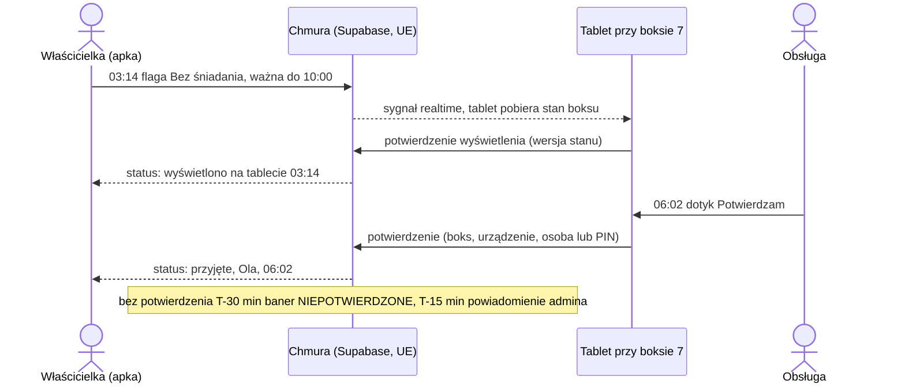
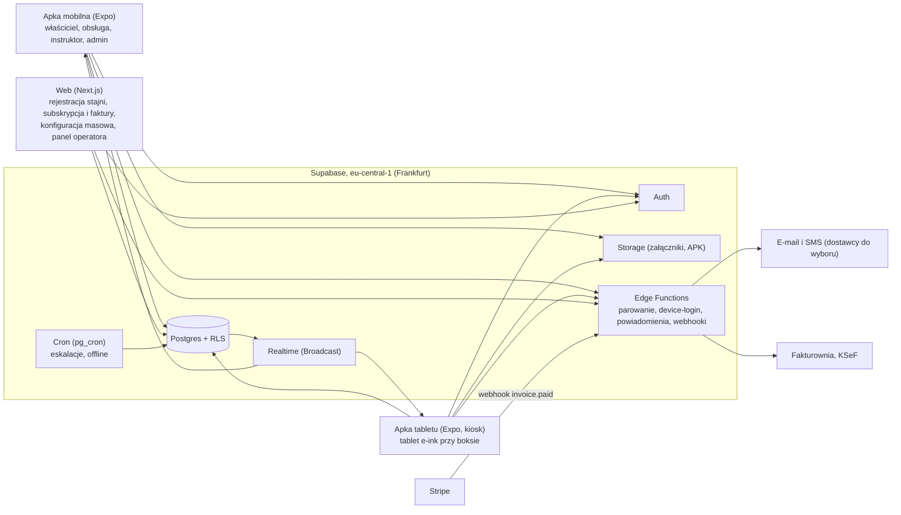
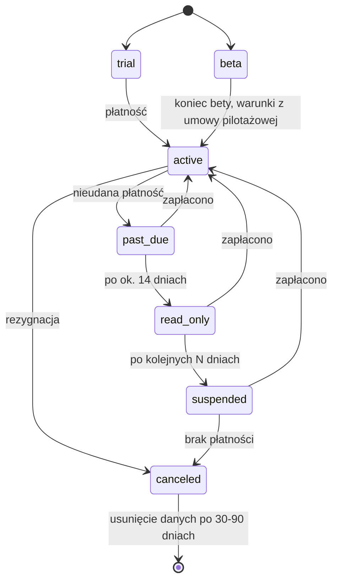
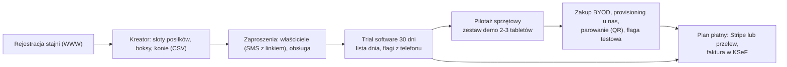

# KonskaAppka: analiza techniczno-biznesowa

> SaaS dla stajni: aplikacja dla adminów stajni, właścicieli koni i obsługi oraz dotykowy tablet e-ink przy boksie.
> KonskaAppka to nazwa robocza. Produkt od pierwszego dnia obsługuje wiele stajni; stajnia Damiana jest stajnią testową (beta, design partner).
> Wersja robocza v2 · 2026-10-12 · zastępuje v1, która błędnie traktowała projekt jako system dla jednej stajni.

## 0. W skrócie

- **Produkt:** SaaS dla wielu stajni (multi-tenant) od pierwszej migracji. Płaci stajnia, a właściciele, obsługa i instruktorzy korzystają w ramach jej abonamentu.
- **Rdzeń wartości:** flaga od właściciela jest przy boksie w kilka sekund, obsługa odhacza ją dotykiem, a właściciel widzi, kto i kiedy ją przyjął. Brak potwierdzenia przed posiłkiem uruchamia eskalację z wyprzedzeniem, a nie po fakcie.
- **Konkurencja jest blisko:** Equinox System (Wrocław, 2025) ma tę samą tezę, ten sam scenariusz i tabliczki e-paper przy boksach (opisywane od 2025, status sprzedaży niepewny). Nie sprzedajemy „e-ink przy boksie” jako innowacji, tylko szybkość i zamkniętą pętlę potwierdzeń.
- **Segment startowy:** pensjonaty z końmi prywatnych właścicieli (właściciel ≠ obsługa). Szkółek i rezerwacji jazd nie atakujemy, bo ten rynek w PL jest zatłoczony.
- **Największe ryzyko techniczne:** kiosk i praca 24/7 na tabletach Boox (Device Owner, usypianie, zamrażanie apek, sesja i zabezpieczenie urządzenia, serwis w terenie). Faza 0 rozstrzyga to przed resztą prac.
- **Największa bariera sprzedażowa:** koszt sprzętu: 23–45 tys. zł na 25 boksów przy tablecie na każdym boksie; ok. 23 tys. zł przy jednym 10,3-calowym tablecie na 2 boksy (tyle co Go 7 na każdym boksie, ale z większym ekranem). Na start BYOD z listą certyfikowanych modeli i cennik dwuczęściowy (oprogramowanie za boks z koniem + opłata za aktywny tablet), więc stopniowe wdrażanie tabletów realnie obniża abonament.
- **Lejek:** samoobsługowy trial oprogramowania (bez tabletów) → pilotaż sprzętowy na naszym zestawie demo → zakup BYOD i provisioning jako płatna usługa.
- **Przed pierwszym płatnym klientem:** umowa powierzenia, regulamin z limitem odpowiedzialności, fakturowanie przez KSeF, płatności, publiczny cennik, cykl życia subskrypcji i 2–3 płatne pilotaże poza stajnią testową. Umowa powierzenia jest potrzebna już w becie.
- **Estymacja:** ok. 775–1325 h z UX, QA, stabilizacją i rezerwą, w tym ok. 380–650 h do bety. Estymacja z v1 (ok. 385–520 h) była za niska: zakładała jedną stajnię i nie obejmowała multi-tenant, UX, QA, stabilizacji ani rezerwy.

## 1. Produkt w skrócie

### 1.1 Problem i dla kogo

- Dziś informacje o koniu są zapisane na tablicy suchościeralnej przy boksie, w telefonach i w głowie stajennego. Zmiany na ostatnią chwilę (weterynarz, leki, zakaz padoku) giną albo docierają telefonem o złej porze.
- Właściciel nie wie, czy informacja dotarła. Obsługa nie wie, czy tablica jest aktualna. Przy sporze nie ma śladu, kto co i kiedy przekazał.
- **Klient (płaci):** stajnia, czyli właściciel lub kierownik pensjonatu albo ośrodka. **Użytkownicy:** admin stajni, właściciele koni, obsługa, instruktorzy; przy boksach tablety jako urządzenia.

### 1.2 Scenariusz, który sprzedaje produkt

> Jest 3 w nocy. Właścicielce przypomina się, że rano przyjeżdża weterynarz i koń ma być na czczo. Zamiast dzwonić, otwiera apkę
> i w 2–3 stuknięciach ustawia „Bez śniadania”. Po kilku sekundach tablet przy boksie pokazuje czarny baner, a w apce widać „wyświetlono 03:14”.
> O 6:02 Ola z obsługi dotyka „Potwierdzam”, a właścicielka widzi „przyjęte: Ola, 06:02”. Gdyby 30 minut przed śniadaniem flaga nadal
> czekała na potwierdzenie, tablet i lista dnia obsługi pokazałyby „NIEPOTWIERDZONE”, a 15 minut przed śniadaniem admin stajni dostałby powiadomienie.



Wymaganie projektowe: **poniżej 10 s** od zapisu w apce do obrazu na tablecie. Mierzymy to w becie (p95), bo to główny dowód sprzedażowy.

### 1.3 Wyróżnik wobec Equinox System

| Cecha | Equinox (wg źródeł, częściowo niepotwierdzone) | KonskaAppka (cel) |
|---|---|---|
| Czas od zmiany do ekranu przy boksie | Tabliczki budzą się cyklicznie, np. raz na godzinę (wg [Bizblog](https://bizblog.spidersweb.pl/nie-tylko-owies-i-sloma-teraz-konie-maja-swoja-aplikacje-stworzyli-ja-polacy), niepotwierdzone u producenta) | Sekundy (Realtime), cel p95 < 10 s |
| Interakcja przy boksie | Brak potwierdzenia, że tabliczka ma dotyk lub przycisk | Dotyk: „Potwierdzam”, „Nakarmiony”, zadania |
| Informacja zwrotna do właściciela | Nieznana (są „zadania z potwierdzeniem”) | Wyświetlono → przyjęto (kto, kiedy), negatywne statusy (tablet offline, niepotwierdzone) |
| Flagi czasowe | Nieznane | Okno ważności liczone ze slotów posiłków, samo wygasa |
| Cennik | Niepubliczny | Publiczny cennik oprogramowania, samoobsługowy trial software; sprzęt przez pilotaż |
| Zasilanie przy boksie | Bateria ok. 50 dni, bez kabli (wg Bizblog, niepotwierdzone u producenta; ich przewaga) | Stałe zasilanie, wymóg wobec stajni |
| Etap | JDG od 08.01.2025 (GoWork), tabliczki opisywane jako „rozwijane” (data i źródło **do weryfikacji**), pierwsze wdrożenia | Przed betą |

Equinox ma przewagę czasu, klientów i bezprzewodowych tabliczek. Nasza teza: **natychmiastowość + dotyk + potwierdzenie**. Strony equinox-system.com nie udało się przeczytać (proxy), więc cechy ich tabliczek są **do weryfikacji** (demo lub wizyta w stajni, która ich używa).

### 1.4 Rola stajni testowej Damiana

Damian prowadzi stajnię i jest **testerem**: jego stajnia to pierwsza stajnia w systemie, w tym samym modelu danych i z tymi samymi uprawnieniami co kolejne (różnią się tylko warunki bety). W stajni testowej rolę admina pełni Damian, na tych samych prawach co admin każdej innej stajni.

| Daje produktowi | Dostaje | Czym nie jest |
|---|---|---|
| Realne warunki (zimno, kurz, Wi-Fi, rękawice, zmiany obsługi) | Bezpłatny dostęp na czas bety; warunki po becie zapisane w umowie pilotażowej (12.2) | Klientem zlecającym |
| Feedback od obsługi i właścicieli, listę flag, rytm dnia | Wsparcie i szybkie poprawki | Decydentem w sprawie ceny, zakresu czy marki |
| Pomiary: stan wyjściowy, opóźnienie, odsetek potwierdzeń, awaryjność tabletów | Głos przy ustalaniu priorytetów (decyzja należy do Dawida) | Właścicielem produktu ani kodu |
| Ewentualnie referencję lub case study (jeśli zechce) | | |

Ryzyko: produkt dopasowany do jednej stajni. Dlatego ustawienia (sloty posiłków, słownik flag, języki, PIN, prywatność ekranu, czasy eskalacji) są konfigurowalne per stajnia od początku, a hipotezy cenowe i funkcjonalne sprawdzamy w rozmowach z 5–10 innymi stajniami i w 2–3 płatnych pilotażach (4.7).

## 2. Ustalenia

| Temat | Decyzja |
|---|---|
| Skala | SaaS dla wielu stajni, multi-tenant od pierwszego dnia |
| Stajnia Damiana | Stajnia testowa (beta, design partner) |
| Ekran przy boksie | Tablet e-ink z Androidem, z dotykiem |
| Interakcja przy boksie | Obsługa potwierdza i odhacza dotykiem na tablecie |
| Apka dla właścicieli, admina i obsługi | Natywna, React Native (Expo) |
| Wi-Fi i zasilanie przy boksach | Wymóg wobec stajni (klienta) i jej odpowiedzialność; my podajemy wymagania |
| Sprzęt na start | 1 tablet do developmentu, dalej zależnie od fazy 0 |
| Zakres pierwszej wersji | Flagi przy boksie (rdzeń), grafik karmienia i padoku, historia zdrowia i wet, jazdy i zadania |
| Poza pierwszą wersją | Push dla obsługi |
| Stack | TypeScript, React Native (Expo), Supabase (Postgres + RLS + Realtime + Storage + Edge Functions) w regionie UE |

Kanał eskalacji do admina stajni (SMS albo push dla admina) nie był objęty decyzją o push dla obsługi; to osobne pytanie (14.1 pkt 7).

## 3. Rynek i konkurencja

### 3.1 Rynek w Polsce

| Wskaźnik | Wartość | Pewność |
|---|---|---|
| Pogłowie koni 2025 (PZHK) | 303 745, w tym 106 256 szlachetnych i 61 102 kuców (ok. 167 tys. to nasz segment) | średnia (załącznik gov.pl, niesprawdzony ponownie) |
| Liczba stajni | Brak rejestru; katalog znajdzstajnie.pl: 1282 obiekty; inne katalogi podają więcej (nazwy i liczby **do weryfikacji**) | niska |
| Kluby PZJ | 597 (2025), 484 w 2016 | niska (wywiad bez ustalonego tytułu i daty), **do weryfikacji** w danych PZJ |
| Pensjonat, boks standard 2026 | średnio ok. 1764 zł/mies. (zakres 1200–2450, tylko 7 ofert) | niska–średnia |
| Twardy punkt odniesienia | UP Lublin: 1700 zł brutto/mies. od 1.10.2026 (1500 zł od V 2025) | wysoka (BIP uczelni) |
| Szacunek rynku SaaS w PL | ok. 5,7–9,6 mln zł/rok (25–42 tys. koni w pensjonatach × 19 zł × 12 mies., przy tablecie na każdym boksie) | niska, założenia |

Realny rynek docelowy to szacunkowo 1,5–3 tys. obiektów przyjmujących konie prywatnych właścicieli (**do weryfikacji**).

VAT: nie odliczą VAT z naszej faktury stajnie rolników ryczałtowych i stajnie zwolnione podmiotowo (limit 240 tys. zł od 2026, **do weryfikacji**; np. 10 boksów × 1764 zł × 12 ≈ 212 tys. zł mieści się w limicie). Dla nich liczy się cena brutto. Stajnie czynne (zwykle 8% na pensjonat, **do weryfikacji** zależnie od zakresu usługi, np. z treningiem lub jazdami może być 23%) odliczają 23% z naszej faktury.

### 3.2 Konkurencja

Ceny i funkcje: stan na 2026-10 według wyszukiwania, niesprawdzone ponownie (proxy blokował strony konkurencji), **do weryfikacji**.

| Produkt | Kraj | Co przy boksie | Cena | Uwagi |
|---|---|---|---|---|
| Equinox System | PL (Wrocław) | Tabliczki e-paper na boks (budzenie cykliczne, np. co godzinę, wg Bizblog), duże ekrany na stajnię | Niepubliczna | Bezpośredni konkurent, ten sam scenariusz |
| Eq-Tek | USA | Wyświetlacz e-ink na boks, 89 USD, bez dotyku | Free do 5 zwierząt, Pro 19 USD/mies. | Przedsprzedaż; łączność opisana niespójnie (Wi-Fi vs Bluetooth) |
| Equicty | BE | Jeden 32" ekran dotykowy na stajnię | Oprogramowanie 35–70 €/mies. (cennik sprzed ok. 3 lat) | 26 krajów, asystent AI |
| EquineOps | USA | Jeden tablet-kiosk na stajnię, wybór osoby i PIN | 79 i 149 USD/mies. | Wzór dla identyfikacji obsługi |
| Prism | AU | Drukowane karty z kodem QR | 30–150 USD/mies. za moduł | Wyścigi i hodowla |
| Hay | USA | Tabliczka boksowa generowana z apki | Brak danych | Raczej drukowana lub link |
| Stable Secretary | USA | Brak | 6,95–69,95 USD/mies. (progi wg liczby koni) | |
| Stallpilot, equitano, horse+ | DE | Brak | 15–39 €, 89 €, od 20 €/mies. | DACH: dominuje ryczałt za stajnię |
| Horstable, Nasza Stajnia, HORSEmanago | PL | Brak | 0–299 zł, 0–240 zł, 0–79,99 zł/mies. | Szkółki, rezerwacje, karnety, SMS |
| Redini, Equita | PL | Brak | Redini ok. 200–300 zł (agregator, źródło wtórne); Equita brak danych | Equita ma moduł pensjonatowy |
| Tablica suchościeralna | wszędzie | Supra Stall Plate 44,99 USD, papierowe karty | | Prawdziwy „konkurent” do wyparcia |

Nie znaleźliśmy produktu, który łączy (1) dotykowy ekran przy **każdym** boksie, (2) czasowe flagi od właścicieli widoczne w sekundach,
(3) potwierdzenie obsługi z informacją zwrotną do właściciela. To wniosek z braku dowodów, nie dowód braku (**do weryfikacji** u Equinox).

### 3.3 Pozycjonowanie

- Komunikat: „Flaga od właściciela jest przy boksie w kilka sekund. Obsługa odhacza ją dotykiem, a właściciel widzi, kto i kiedy potwierdził.”
- Mierzalne wyróżniki do zbudowania i udowodnienia w becie: czas flaga → ekran, potwierdzenie dotykiem z autorem i godziną, informacja zwrotna do właściciela,
  eskalacja braku potwierdzenia z wyprzedzeniem przed posiłkiem, predefiniowane flagi z oknem i automatycznym wygasaniem.
- Publiczny cennik i samoobsługowy trial dotyczą części software. Sprzęt wchodzi przez pilotaż na naszym zestawie demo i wspomagany provisioning (4.6). To nadal przewaga nad niepublicznym cennikiem Equinox.
- Moduł jazd minimalny; nie konkurujemy funkcjami rezerwacji i karnetów.
- Język ukraiński dla obsługi oraz i18n i EUR w architekturze od początku. Beneluks i DACH mają dużo oprogramowania do zarządzania stajnią, ale bez ekranów na boks.

## 4. Model biznesowy

### 4.1 Kto płaci i za co

- Płaci **stajnia**, na podstawie umowy B2B i faktury. Właściciele i obsługa nic nie kupują w apce.
- Stajnia może przerzucić koszt na właścicieli w cenie pensjonatu. 19 zł netto (23,37 zł brutto) za boks z tabletem to ok. 1,1–1,3% średniej ceny pensjonatu.
- **Jednostka rozliczeniowa: dwie części** (rekomendacja, decyzja w 14.1 pkt 1):
  - **boks z koniem** (oprogramowanie: apka, lista dnia obsługi, flagi, grafik, zdrowie); liczymy maksimum w cyklu, koń wyprowadzony lub zarchiwizowany się nie liczy;
  - **aktywne urządzenie** (sparowany tablet, który w cyklu zgłosił się heartbeatem); tablet obsługujący 2 boksy liczy się raz.
- Dzięki temu stopniowe wdrażanie tabletów realnie obniża abonament, a stajnia nie ma powodu, żeby nie wprowadzać części koni do systemu (lista dnia obsługi zostaje kompletna). `usage_snapshots` zapisuje obie liczby.
- Alternatywa: jedna jednostka „boks z koniem” niezależnie od liczby tabletów. Jest prostsza, ale wtedy liczba tabletów nie zmienia abonamentu i nie można obiecywać, że start od części boksów jest tańszy.

### 4.2 Cennik (hipoteza do walidacji)

| Element | Propozycja | Uzasadnienie |
|---|---|---|
| Oprogramowanie | 10 zł netto (12,30 zł brutto) za boks z koniem/mies. | Działa także bez tabletów (lista dnia, flagi z telefonu) |
| Tablet | 9 zł netto (11,07 zł brutto) za aktywne urządzenie/mies. | Wsparcie floty, aktualizacje, monitoring |
| Pełna konfiguracja | 19 zł netto (23,37 zł brutto) za boks z tabletem; testować łącznie zakres 12–25 zł | ok. 1,1–1,3% ceny pensjonatu; widełki: 9–15 zł wg cen konkurencji, 19–29 zł wg udziału w cenie pensjonatu |
| Minimum | 149 zł netto/mies. | Małe stajnie i tak generują koszt wsparcia |
| Rozliczenie roczne | 2 miesiące gratis; przedpłata za zadeklarowaną liczbę boksów i tabletów, kwartalne wyrównanie w górę (bez zwrotu przy spadku) | Płynność, mniejszy churn, jasna reguła przy zmiennej liczbie koni |
| Trial | 30 dni, bez karty, **tylko oprogramowanie** | Konkurenci PL dają miesiąc lub darmowy plan; tabletów nie da się przygotować samoobsługowo (8.3) |
| Pilotaż sprzętowy | Zestaw demo 2–3 tabletów na 30 dni za kaucję albo opłatę zaliczaną na poczet wdrożenia (kwota do decyzji) | Rdzeń wartości (ekran przy boksie, „wyświetlono”) trzeba pokazać na sprzęcie |
| Plan darmowy do ok. 5 boksów | Do decyzji | Za: HORSEmanago, Eq-Tek, Nasza Stajnia mają. Przeciw: koszt wsparcia i sprzętu |
| Wdrożenie | Provisioning jako płatna usługa: hipoteza ok. 30–50 zł netto za tablet + dojazd | Wyliczenie z godzin pracy w 4.5 |

Ceny publikujemy netto i brutto. 25 boksów z tabletami × 19 zł = 475 zł netto/mies., czyli więcej niż polskie apki dla szkółek (do 299 zł). Bez tabletów 25 × 10 zł = 250 zł. Uzasadnieniem jest sprzęt przy boksie i oszczędność czasu obsługi, a nie liczba funkcji. Cenę weryfikujemy w rozmowach z 5–10 stajniami i w płatnych pilotażach.

### 4.3 Sprzęt: BYOD, dzierżawa czy sprzedaż

| Model | Plusy | Minusy | Kiedy |
|---|---|---|---|
| **BYOD z listą certyfikowanych modeli** (stajnia kupuje w polskim sklepie) | Brak zamrożonego kapitału; rękojmia u sprzedawcy; brak obowiązków importera, CE i BDO po naszej stronie | Wysoki próg wejścia dla stajni; tablety i tak trzeba przygotować (Device Owner); ryzyko utraty i kradzieży po stronie stajni (umowa, ubezpieczenie mienia) | **Start** |
| Dzierżawa (HaaS), najlepiej przez partnera leasingowego | Niski próg wejścia, przychód powtarzalny, kontrola nad modelem | Ok. 19–37 tys. zł netto kapitału na stajnię (25 boksów), uszkodzenia, logistyka wymian | Gdy stajnie zgłoszą barierę kosztu |
| Sprzedaż przez nas | Marża na sprzęcie | Rękojmia, zwroty, przy imporcie spoza UE obowiązki RED/CE i BDO, utrata zwolnienia z VAT przy sprzedaży na odległość | Odradzana |

Szacunek dzierżawy (własny, **do weryfikacji**) przy 36 miesiącach, według wzoru: cena netto / 36 + 25–50% na awarie, logistykę i marżę. Go 7: ok. 27–32 zł netto za boks/mies. Go 10.3 Gen II: ok. 51–61 zł netto za boks/mies.

Jeśli kiedyś będziemy sprzedawać lub dzierżawić sprzęt, kupujemy go tylko od dystrybutora w PL lub UE. Nie zmieniamy marki, bo rebranding czyni z nas producenta. W B2B ograniczamy rękojmię (art. 558 KC) i dodajemy osobną sekcję dla przedsiębiorców na prawach konsumenta.

### 4.4 Koszt dla stajni (25 boksów, BYOD)

Ceny tabletów: stan na 2026-10 (x-kom), **do weryfikacji przed zakupem**. Abonament według hipotezy z 4.2.

| Pozycja | Go 7, tablet na boks (25 szt.) | Go 10.3 Gen II, tablet na boks (25 szt.) | Go 10.3 Gen II, 1 tablet na 2 boksy (13 szt.) |
|---|---|---|---|
| Tablety (brutto) | ok. 23 475 zł | ok. 44 975 zł | ok. 23 387 zł |
| Obudowy i uchwyty | do wyceny (gotowe uniwersalne 64–168 USD, żadna pod Boox) | do wyceny | do wyceny (mniej sztuk) |
| Sprzęt rozłożony na 36 mies., za boks | ok. 26 zł | ok. 50 zł | ok. 26 zł |
| Abonament za boks (hipoteza, brutto) | 23,37 zł | 23,37 zł | ok. 18,06 zł ((25 × 10 zł + 13 × 9 zł) / 25 boksów, netto 14,68 zł) |
| Razem za boks/mies. (brutto) | ok. 49 zł | ok. 73 zł | ok. 44 zł |
| Udział w średniej cenie pensjonatu (1764 zł) | ok. 2,8% | ok. 4,2% | ok. 2,5% |

Wniosek: **sprzęt to 50–70% kosztu dla stajni**. Tańszy tablet, jego żywotność i liczba tabletów ważą więcej niż cena abonamentu, więc wybór urządzenia w fazie 0 jest decyzją biznesową, nie tylko techniczną.

Warianty dla stajni wrażliwych na cenę (domyślnie zostaje pomysł wyjściowy: tablet przy każdym boksie):

- **1 tablet na 2 sąsiednie boksy** (10,3", układ dwóch kolumn): sprzęt ok. 23 tys. zł zamiast ok. 45 tys. zł dla Go 10.3 Gen II, czyli koszt Go 7 na każdym boksie przy większym ekranie. Czytelność układu „2 boksy na 10,3 cala” sprawdzamy w fazie 0. Model danych wspiera to od pierwszej migracji (`device_boxes`, 7.5).
- **Tablet korytarzowy lub w paszarni** z flagami krytycznymi całej stajni: jeden tablet (ok. 1799 zł), abonament 25 × 10 zł + 9 zł = 259 zł netto. Bez informacji przy samym boksie, ale to tani pierwszy krok.

### 4.5 Koszty jednostkowe, unit economics i pojemność jednej osoby

**Przychód i koszty zmienne na stajnię (pełna konfiguracja, tablet na każdym boksie):**

- Przychód: 12 boksów 228 zł, 25 boksów 475 zł, 40 boksów 760 zł netto/mies.
- Infrastruktura na stajnię (12.3): ok. 95 zł przy 1 stajni, 13–33 zł przy 10 (bez PITR), ok. 15–19 zł przy 50.
- Prowizja Stripe przy karcie: ok. 2,4–2,8% (1,5–1,9% + 1 zł zależnie od typu karty + 0,7% Billing; stawki **do weryfikacji** na cenniku Stripe PL, stan na 2026-10). Przelew na fakturę bez prowizji.
- Marża po infrastrukturze i prowizjach: ok. 205 zł (12 boksów), ok. 440 zł (25 boksów), ok. 715 zł (40 boksów) miesięcznie.
- Koszty stałe bez wynagrodzenia (infrastruktura, konta deweloperskie, Fakturownia, księgowość, domena, e-mail, polisa OC, dostawca SMS): założenie 500–1500 zł/mies. (**do weryfikacji**; księgowości, Fakturowni, polisy ani SMS nie badaliśmy). Pokrywają je 1–4 stajnie po 25 boksów.

**Unit economics (założenia do zmierzenia w fazie 0 i w becie).** Godzinę pracy Dawida wyceniamy jako W / 160 h; przy W = 12 000 zł to 75 zł/h.

| Pozycja | Założenie | Skąd liczba |
|---|---|---|
| Pozyskanie stajni (CAC) | 6–10 h (rozmowy, wizyta, demo na sprzęcie) + dojazd, ok. 600–900 zł | Założenie; mierzyć od pierwszych rozmów |
| Provisioning | 15–20 min na tablet, czyli ok. 6–8 h na 25 tabletów | Cel; zmierzyć w fazie 0 |
| Dojazd, montaż testowy, szkolenie obsługi | 4–8 h na stajnię | Założenie |
| Wsparcie | pierwsze 3 mies.: 3–4 h/mies.; później 1–2 h/mies. na stajnię 25 boksów | Założenie; mierzyć w becie |
| Awarie tabletów | kilka % rocznie; przy 675 tabletach i 3% to ok. 20 interwencji rocznie | Założenie |
| Churn | nieznany; przy 2%/mies. średni czas życia klienta ok. 50 mies. | Założenie |
| Okres zwrotu CAC | ok. 1,5–2 mies. (25 boksów), ok. 3–4,5 mies. (12 boksów) | Arytmetyka z wierszy wyżej |

**Próg rentowności przy wynagrodzeniu W = 12 000 zł/mies.** (koszty stałe dodają 1–4 stajnie po 25 boksów):

| Wielkość stajni | Przychód netto | Marża | Liczba stajni | Liczba boksów |
|---|---|---|---|---|
| 12 boksów | 228 zł | ok. 205 zł | ok. 59 | ok. 700 |
| 25 boksów | 475 zł | ok. 440 zł | ok. 27 | ok. 680 |
| 40 boksów | 760 zł | ok. 715 zł | ok. 17 | ok. 680 |

Daje to ok. 27 stajni po 25 boksów (ok. 680 boksów); 27 stajni to ok. 1–2% szacowanego rynku obiektów. Próg liczony w boksach jest prawie stały, bo przychód na boks jest stały. Małe stajnie wymagają więc ponad dwa razy więcej klientów, czyli więcej sprzedaży i wsparcia.

**Pojemność jednej osoby.** Przy 160 h/mies., z czego co najmniej 80 h zostaje na rozwój produktu, 2 nowe stajnie miesięcznie zjadają ok. 40 h (2 × (8 h sprzedaży + 12 h wdrożenia)). Na wsparcie zostaje ok. 40 h, czyli przy 1–2 h na stajnię limit wynosi ok. 20–40 stajni. **Próg rentowności (ok. 27 stajni) wypada więc w przedziale, w którym kończy się pojemność jednej osoby.** Przed ok. 20 stajniami trzeba mieć partnera do montażu i provisioningu (np. lokalny serwis IT) albo pierwszą osobę do wsparcia, a jej koszt wchodzi do W.

**Opłata wdrożeniowa:** 6–8 h provisioningu + 4–8 h dojazdu i szkolenia to 10–16 h na stajnię 25 boksów. Przy 75 zł/h wychodzi ok. 750–1200 zł, czyli ok. 30–50 zł netto za tablet + dojazd.

### 4.6 Lejek: od triala do tabletów

Tabletu nie da się przygotować samoobsługowo (8.3), a żadna stajnia nie kupi 25 tabletów na 30-dniowy trial. Dlatego lejek ma dwa etapy:

1. **Samoobsługowy trial software (30 dni, bez karty):** rejestracja przez WWW, kreator, zaproszenia; apka, lista dnia obsługi, flagi i statusy „przyjęto” z telefonu. Bez tabletów i bez statusu „wyświetlono”.
2. **Pilotaż sprzętowy:** nasz zestaw demo 2–3 przygotowanych tabletów (3 × Go 10.3 Gen II: ok. 5,4 tys. zł, w 12.3), wysyłany lub wypożyczany na 30 dni za kaucję albo opłatę zaliczaną na poczet wdrożenia. Montaż na boksach koni aktywnych właścicieli.
3. **Zakup BYOD** z dostawą do nas, provisioning jako płatna usługa liczona per tablet (4.5), wysyłka lub montaż.
4. **Plan płatny:** Stripe lub przelew, faktura w KSeF.

### 4.7 Go-to-market

Plan nie może przeskoczyć z jednej stajni testowej prosto do startu komercyjnego z samoobsługą, bo ani multi-tenant, ani cena nie zostaną sprawdzone na stajniach, które płacą.

1. **Faza 1:** rozmowy z 5–10 stajniami według scenariusza pytań (baza: 14.2), z kryterium „zgoda na płatny pilotaż”.
2. **Przed fazą 3:** 2–3 płatne pilotaże z rabatem (np. 50% przez 6 miesięcy) w innych stajniach niż testowa.
3. **Kanały:** grupy pensjonatów i stajni w mediach społecznościowych, kluby PZJ, targi jeździeckie, weterynarze i kowale jako polecający, właściciele koni zapraszający swoją stajnię. Zaczynamy regionalnie: z dala od bazy Equinox (Wrocław) albo świadomie z nim konkurując (14.1 pkt 4).
4. **Program poleceń** dla stajni i właścicieli (forma do decyzji).
5. **Materiały:** wideo scenariusza z 3 w nocy, case study z liczbami z bety (za zgodą Damiana), ulotka dla stajni do wręczenia właścicielom koni.
6. **Cykl decyzji:** wydatek 23–45 tys. zł na sprzęt (25 boksów) to decyzja właściciela obiektu, często rozłożona w czasie. Skracają go pilotaż, wariant „1 tablet na 2 boksy” i start od części boksów.
7. **Budżet czasu:** 4–6 h tygodniowo na sprzedaż i rozmowy od fazy 1 (uwzględnione w 12.1).

## 5. Role i uprawnienia

### 5.1 Role

| Rola | Zakres | Co może |
|---|---|---|
| **Operator SaaS** (my) | Wszystkie stajnie | Zakładanie i blokowanie stajni, plany i subskrypcje, flota urządzeń, wsparcie. Dostęp do danych stajni tylko przez logowany tryb wsparcia (RODO: działamy na polecenie stajni). Obowiązkowe MFA |
| **Admin stajni** (kierownik lub właściciel stajni-klienta) | Swoja stajnia | Boksy, konie, urządzenia i parowanie, PIN serwisowy, zaproszenia i role, słownik flag, sloty posiłków, prywatność ekranu, subskrypcja i faktury (tylko przez WWW), eksport danych |
| **Właściciel konia** (także współwłaściciel lub dzierżawca, dostęp z datą od–do) | Swoje konie | Dane konia, flagi, grafik karmienia i padoku (wg ustawień stajni), historia zdrowia; widzi statusy wyświetlenia i potwierdzeń |
| **Obsługa** (stajenny) | Wszystkie konie w stajni | Lista dnia, potwierdzanie flag, flagi w imieniu właściciela, odhaczanie karmienia i zadań (apka lub tablet) |
| **Instruktor lub trener** | Jazdy w stajni | Swoje jazdy, konie przypisane do jazd; bez danych kontaktowych właścicieli |
| **Urządzenie** (tablet) | Przypisane boksy (1 lub więcej) | Odczyt stanu swoich boksów, zapis potwierdzeń, odhaczeń i heartbeatu |

- **Dostęp do konia, nie do urządzenia.** Pomysł wyjściowy to „admin nadaje dostęp do konkretnych urządzeń lub boksów”. W modelu: właściciel → **koń** → **boks** ← tablet (jeden tablet może obsługiwać kilka boksów). Przeprowadzka konia ani wymiana tabletu nie psują uprawnień; w UI admina nadal może to wyglądać jak „dostęp do boksu 7”.
- **Jedno konto, wiele stajni.** Rola należy do pary użytkownik–stajnia (właściciel z końmi w dwóch stajniach, instruktor w kilku). Apka ma przełącznik stajni.
- **Konto globalne a dane stajni.** Konto i logowanie: administratorem danych jesteśmy my; konie, flagi, historia i logi potwierdzeń: stajnia. Usunięcie konta usuwa profil, a wpisy w historii stajni zostają z autorem „użytkownik usunięty”.
- **Kto kliknął na tablecie:** konfigurowalne per stajnia: (a) tylko „tablet boksu 7”, (b) wybór osoby z listy, (c) wybór osoby + 4-cyfrowy PIN (wzór: kiosk EquineOps). Domyślne ustawienie ustalamy w becie.
- **Logowanie obsługi.** Obsługa często nie ma e-maila, rotuje i dzieli telefony. Loguje się kodem SMS albo linkiem z e-maila; PIN służy tylko na tabletach. Właściciel dostaje zaproszenie SMS z deep linkiem i loguje się kodem, bez hasła.
- **Pracownik odchodzi:** dezaktywacja w `stable_members`, unieważnienie PIN-u i sesji, wpis w `audit_log`.

### 5.2 Cykl życia konia i dostępów

Koń należy do stajni (`horses.stable_id`), a dostępy mają ramy czasowe (`horse_access`: `granted_at`, `revoked_at`, `granted_by`, rola owner / co_owner / lessee / viewer). RLS uwzględnia ważność dostępu.

- **Koń opuszcza stajnię:** `horses.left_at`, odebranie dostępów, zamknięcie flag i planów, eksport historii konia dla właściciela (PDF + JSON). Opcjonalnie „przenieś historię do stajni X” za zgodą właściciela, jako kopia, bez współdzielenia danych między stajniami. Przeniesienie konia to też naturalna pętla wzrostu: właściciel może wprowadzić nową stajnię.
- **Zmiana właściciela (sprzedaż):** nowy właściciel dostaje dostęp, stary go traci. Nowy widzi historię zdrowia, ale nie prywatne notatki poprzedniego.
- **Koniec dzierżawy lub współwłasności:** `revoked_at` dla danej roli, bez zmiany pozostałych dostępów.
- **Archiwizacja konia:** koń przestaje być liczony w boksach z koniem (4.1), a tablet pokazuje „boks wolny”.
- Prawo właściciela do kopii historii jego konia zapisujemy w regulaminie (11.1).

### 5.3 Prywatność na publicznym ekranie

Tablet w korytarzu widzą inni właściciele, klienci szkółki i goście. Ustawienia per stajnia i per flaga:

- autor na tablecie jako rola albo inicjał („właściciel”, „A.”) zamiast pełnego imienia;
- opcja „notatka tylko dla obsługi w apce”: tablet pokazuje sam typ flagi;
- historia zdrowia i załączniki nigdy nie trafiają na tablet (tylko terminy wizyt: typ i godzina);
- w polityce prywatności i klauzuli dla właścicieli informacja, że treść flag jest wyświetlana przy boksie.

## 6. Funkcje pierwszej wersji

### 6.1 Flagi przy boksie (rdzeń)

- Słownik flag per stajnia: domyślny zestaw od nas (np. *bez śniadania*, *bez kolacji*, *nie na padok*, *tylko siano*, *wet dziś*, *kowal dziś*, *leki*, *derka na noc*, *nie jeździć*), admin edytuje. Do tego własna notatka.
  Waga: info / ostrzeżenie / krytyczna; krytyczne zawsze na górze ekranu jako czarny baner.
- **Okno ważności** (od–do) i automatyczne wygasanie. Skróty „najbliższy posiłek”, „jutro rano”, „do odwołania” wskazują konkretne wystąpienie posiłku (slot z `meal_slots`, 7.8). Okno zapisujemy jako `timestamptz` wyliczony w chwili utworzenia w strefie stajni.
- Flaga nadpisuje grafik: przy karmieniu pojawia się „WSTRZYMANE”, przy padoku „ODWOŁANY”. Przycisk „Nakarmiony” dla wstrzymanego posiłku znika.
- **Statusy dla właściciela:** zapisano → wyświetlono na tablecie → przyjęto (kto, kiedy). Negatywne statusy od razu po zapisie: „tablet boksu 7 offline od 01:20” (7.7) i „NIEPOTWIERDZONE”.
- **Flaga po czasie:** liczona z faktycznego odhaczenia posiłku dla danego boksu, a gdy odhaczenia brak, z planowanej godziny minus margines (ustawienie stajni), bo obsługa często zaczyna wcześniej. Apka ostrzega „śniadanie mogło już zostać wydane” i pokazuje numer telefonu stajni.
- **Eskalacja dwustopniowa z wyprzedzeniem (bez push dla obsługi)**, czasy konfigurowane per stajnia:
  - ok. T-30 min przed posiłkiem: baner „NIEPOTWIERDZONE” na tablecie i pozycja na górze listy dnia obsługi; właściciel widzi „NIEPOTWIERDZONE” z przyciskiem „Zadzwoń do stajni”;
  - ok. T-15 min: powiadomienie admina stajni kanałem, który go realnie obudzi: e-mail oraz SMS albo push do admina (kanał i to, czy powiadamiamy też właściciela: pytanie 14.1 pkt 7);
  - w becie mierzymy czas od eskalacji do potwierdzenia.
- **Flaga w imieniu właściciela:** admin lub obsługa wpisuje flagę z adnotacją źródła (telefon, SMS, osobiście); właściciel widzi ją w apce.
- Pełna historia zmian (kto, co, kiedy, przed i po). Przy sporze „przecież pisałam” to najcenniejsza funkcja.

### 6.2 Grafik karmienia i padoku

- Stały plan na posiłek (sloty z `meal_slots`: godziny per stajnia, mogą się różnić w weekend i sezonowo): pasza, ilość, jednostka, suplementy, leki.
- Padok: dni, godziny, który padok, z którymi końmi.
- Tablet pokazuje wynik „co obowiązuje teraz” (plan + aktywne flagi). Odhaczanie „Nakarmiony rano” na tablecie lub w apce.
- Do ustalenia w becie: czy właściciel zmienia plan sam, czy proponuje, a admin zatwierdza (ustawienie per stajnia).

### 6.3 Zdrowie, jazdy i zadania

- **Zdrowie:** weterynarz, kowal, dentysta, odrobaczanie, szczepienia; opis i załączniki (zdjęcia, PDF) w prywatnym Storage per stajnia. Termin następnej wizyty: lista „zbliża się” w apce i linia „JUTRO” na tablecie (sam typ i godzina, bez opisu), bez push.
- **Jazdy (minimalnie):** koń, jeździec, instruktor, czas, hala lub plac; wykrywanie kolizji. Bez płatności, karnetów i rezerwacji online.
- **Zadania dla obsługi:** jednorazowe i cykliczne, opcjonalnie przy koniu lub boksie; odhaczanie w apce lub na tablecie.

### 6.4 Fundament SaaS (część produktu, nie dodatek)

| Element | Beta (stajnia Damiana) | Start komercyjny |
|---|---|---|
| Izolacja stajni (RLS) i testy izolacji w CI (tabele, Storage, Realtime, RPC, Edge Functions) | Tak | Tak |
| Onboarding stajni | Kreator prowadzony przez operatora | Samoobsługowy software (trial) + wspomagany provisioning sprzętu (pilotaż, 4.6) |
| Panel operatora | Minimalny: stajnie, urządzenia, statusy | Na start Supabase Studio + kilka widoków, potem pełny: subskrypcje, wsparcie, komunikaty |
| Flota tabletów (parowanie, heartbeat, alerty offline, tryb serwisowy) | Tak | Tak + zdalne aktualizacje natywne, zdalna blokada i wymazanie |
| Plany i subskrypcje w modelu danych | Tabele i statusy (subskrypcja ze statusem `beta`, bez opłat) | Stripe + faktury KSeF (na start ręcznie w Fakturowni), cykl życia subskrypcji (7.9) |
| i18n (PL, UA, EN) | Szkielet, PL | PL + UA, EN |
| Eksport danych stajni (Data Act) | Ręcznie przez operatora | Samoobsługowy (CSV/JSON) + eksport historii konia dla właściciela (PDF + JSON) |
| Plan awaryjny (10.2) | PDF do druku z flagami i grafikiem | Tak + strona statusu |
| Metryki (10.3) | Tabela `events`, dziennik incydentów | Health score stajni w panelu operatora |
| MFA | Operator i tryb wsparcia | Operator obowiązkowo, admin stajni opcjonalnie |

### 6.5 Świadomie później

Push dla obsługi i właścicieli (Expo Notifications, bez przebudowy), płatności za jazdy i pensjonat, rozliczenia z właścicielami, rezerwacje online, czat,
czujniki (np. poidła jak u Eq-Tek), integracje z kalendarzami, apka webowa dla właściciela, AI.

Kandydat do przyspieszenia: lekki formularz WWW z magic linkiem dla właściciela bez apki. To najtańsze zabezpieczenie adopcji, jeśli w becie odsetek koni z aktywnym właścicielem będzie poniżej celu (12.2). Decyzja w 14.1 pkt 10.

## 7. Architektura

### 7.1 Schemat



Dokumentacja Supabase o RODO zaznacza, że wybór regionu przypina Postgres, Auth i Storage, a wykonanie Edge Functions, logi, kopie zapasowe i podprocesorzy mogą wpływać na lokalizację danych. Funkcje parowania, powiadomień i webhooków przetwarzają dane osobowe. Dlatego Edge Functions wywołujemy z przypięciem regionu eu-central-1 (mechanizm wywołań regionalnych, **do weryfikacji** w dokumentacji Functions), a w umowie powierzenia uwzględniamy lokalizację logów i Edge Functions.

### 7.2 Monorepo (pnpm + Turborepo)

```
konskaappka/
├─ apps/
│  ├─ mobile/      # Expo: właściciel, obsługa, instruktor, codzienne funkcje admina (iOS + Android)
│  ├─ tablet/      # Expo + natywny moduł kiosku (EAS Build, bez Expo Go): tablet e-ink, Android, APK poza sklepem
│  └─ web/         # Next.js: strona, rejestracja stajni, subskrypcja i faktury, konfiguracja masowa, panel operatora
├─ packages/
│  ├─ shared/      # typy z bazy, schematy zod, logika „co obowiązuje teraz”, obsługa stref czasowych
│  ├─ i18n/        # tłumaczenia PL / UA / EN
│  └─ ui-native/   # komponenty wspólne dla mobile i tablet
├─ supabase/
│  ├─ migrations/  # schemat, RLS, triggery (tylko przez CI)
│  ├─ functions/   # Edge Functions
│  └─ tests/       # pgTAP i testy izolacji: tabele, Storage, Realtime, RPC, Edge Functions
└─ docs/           # w tym runbooki
```

`apps/web` jest potrzebne, bo zasady sklepów wykluczają rejestrację stajni i płatności w apce mobilnej, a panel operatora nie powinien być w apce ze sklepu. Codzienna praca admina zostaje w apce natywnej (ustalenie). Alternatywa z mniejszym stackiem: Expo Router (web) zamiast Next.js. Wybór **do decyzji Dawida**; rekomendacja: Next.js, bo strona i SEO.

### 7.3 Backend: Supabase czy własny

| | Supabase | Własny (NestJS + Postgres + WebSocket) |
|---|---|---|
| Czas do bety | Krótki: auth, baza, realtime, pliki, cron gotowe | Dłuższy: wszystko do napisania i utrzymania |
| Izolacja stajni | RLS wymuszane przez bazę | W kodzie aplikacji, łatwiej o przeciek |
| Realtime | Wbudowany, kanały prywatne z RLS | Własny serwer |
| Koszt | Pro 25 USD/mies. (Micro w cenie), skokowe progi opisane w 12.3 | Serwer + czas utrzymania |
| Uzależnienie | Umiarkowane: open source, zwykły Postgres | Brak |

**Rekomendacja: Supabase Pro, projekt produkcyjny jawnie w eu-central-1.** Ogólny region „Europe” może trafić do Londynu lub Zurychu, czyli poza UE.
Gdy zabraknie elastyczności, logika może przejść do własnego API przy tej samej bazie.

### 7.4 Multi-tenant, RLS i izolacja stajni

- `stable_id NOT NULL` w każdej tabeli danych; indeksy z `stable_id` na pierwszym miejscu; `stable_members(user_id, stable_id, role)` z osobnym indeksem na `user_id`.
- Polityki `to authenticated`, wywołania `(select auth.uid())`, funkcje pomocnicze owinięte w `select`; widoki z `security_invoker = true`.
- Role: nigdy w `user_metadata`. Rola urządzenia i operatora w `app_metadata`; role w stajni w tabeli. Claimy z Custom Access Token Hook tylko tam, gdzie liczy się szybkość,
  bo JWT pozostaje nieaktualny aż do odświeżenia tokenu; odebranie dostępu (właściciel zabrał konia, tablet odłączony) sprawdzamy w tabeli.
- Soft delete (`deleted_at`) dla flag i planów (`horse_flags`, `feeding_plans`, `paddock_plans`): zachowuje historię i obchodzi ograniczenie: RLS nie filtruje zdarzeń DELETE w Postgres Changes.

**Izolacja poza tabelami.** RLS tabel nie wystarcza; najczęstsze drogi przecieku w Supabase:

| Droga | Zasada |
|---|---|
| Edge Functions z `service_role` | Domyślnie wołane z JWT wywołującego (RLS działa). `service_role` tylko w kilku przejrzanych funkcjach (parowanie, `device-login`, webhook Stripe, powiadomienia eskalacji, eksport), z jawnym filtrem `stable_id` i testem |
| Funkcje `security definer` (np. `get_box_board`, `can_see_horse`) | Omijają RLS (właściciel postgres ma bypassrls), więc każda sama sprawdza uprawnienia wywołującego |
| Storage | Polityki `storage.objects` ze `stable_id` w ścieżce; krótka ważność podpisanych URL-i |
| Realtime | Polityki `realtime.messages` po nazwie tematu, oparte na `device_boxes` i członkostwie w stajni |
| Nowa tabela bez RLS | W schemacie `public` jest od razu dostępna przez Data API. W CI linter bazy albo event trigger, który włącza RLS na każdej nowej tabeli i odrzuca widoki bez `security_invoker` |
| Konto operatora | MFA (TOTP, `aal2` w politykach) dla operatora i trybu wsparcia; opcjonalnie dla admina stajni |

**Testy izolacji w CI:** pgTAP dla każdej tabeli oraz testy dla Storage, tematów Realtime, każdej RPC `security definer` i każdej Edge Function. Wzorzec: token użytkownika stajni A z identyfikatorami ze stajni B musi dostać odmowę; „urządzenie widzi tylko swoje boksy”.

### 7.5 Model danych (szkic)

| Obszar | Tabela | Najważniejsze pola |
|---|---|---|
| Konta | `profiles` | imię, telefon, język (globalne) |
| | `stable_members` | user, stajnia, rola, PIN (hash), aktywny, `deactivated_at` |
| | `invitations` | stajnia, e-mail lub telefon, rola, koń, token, ważność |
| Stajnia | `stables` | nazwa, NIP, strefa czasowa (IANA), języki, ustawienia (PIN, kto zmienia grafik, prywatność ekranu, czasy eskalacji, margines „flagi po czasie”), PIN serwisowy (hash) |
| | `meal_slots` | stajnia, kod, godzina lokalna, dni tygodnia, `valid_from`, `valid_to` |
| | `boxes` | stajnia, numer, budynek, aktywny |
| | `devices` | stajnia, model, firmware, wersja apki, `last_seen_at`, bateria, ładowanie, zasilanie, temperatura, RSSI Wi-Fi, ostatnia sieć Wi-Fi, dryf zegara, wersja stanu, klucz publiczny lub hash sekretu, `revoked_at` |
| | `device_boxes` | urządzenie, boks, pozycja na ekranie (relacja 1..N) |
| | `device_pairing_codes` | kod, stajnia, ważność, użyty przez |
| | `device_commands` | urządzenie, komenda (odśwież, restart, zablokuj, wymaż, dodaj Wi-Fi), status, kto zlecił |
| Koń | `horses` | stajnia, boks, imię, zdjęcie, rasa, data ur., notatki, `left_at`, `archived_at` |
| | `horse_access` | koń, user, rola (owner / co_owner / lessee / viewer), `granted_at`, `revoked_at`, `granted_by` |
| Flagi | `flag_templates` | stajnia, etykieta (i18n), ikona, waga, domyślne okno |
| | `horse_flags` | koń, szablon lub tekst, slot posiłku, `valid_from`, `valid_to` (`timestamptz`), autor, źródło (apka / w imieniu: telefon, SMS, osobiście), widoczność notatki (tablet / tylko apka), `deleted_at` |
| | `acknowledgements` | obiekt (flaga, posiłek, zadanie), urządzenie, osoba, typ (wyświetlono / przyjęto), `client_event_id` (unikalny), `occurred_at`, `received_at`, adnotacja konfliktu |
| Opieka | `feeding_plans`, `paddock_plans` | koń, slot posiłku lub dni, pozycje, padok, towarzysze, `deleted_at` |
| | `health_events`, `attachments` | koń, typ, data, opis, pliki, `next_due_at`, widoczność (stajnia / prywatna notatka właściciela) |
| Praca | `rides` | stajnia, koń, jeździec, instruktor, start, koniec, miejsce |
| | `tasks`, `task_occurrences` | stajnia, koń lub boks, tytuł, reguła powtarzania, status, kto i czym odhaczył, `client_event_id` |
| SaaS | `plans` | kod, cena za boks z koniem, cena za aktywne urządzenie, minimum, waluta, limity |
| | `subscriptions` | stajnia, plan, status (trial / beta / active / past_due / read_only / suspended / canceled), okres, `stripe_customer_id` |
| | `usage_snapshots` | stajnia, miesiąc, maks. liczba boksów z koniem, maks. liczba aktywnych urządzeń |
| | `invoices` | stajnia, numer z Fakturowni, kwoty, status KSeF |
| Ślad i metryki | `audit_log` | kto (user lub urządzenie), co, kiedy, przed i po |
| | `support_access_log` | operator, stajnia, powód, od–do |
| | `incidents` | stajnia, koń, opis „coś poszło nie tak”, zgłaszający, źródło (ręczne / automatyczne) |
| | `events` | zdarzenia produktowe do metryk (bez treści flag) |

### 7.6 Realtime i „stan tablicy boksu”

- Tablet jest cienkim wyświetlaczem: RPC `get_box_board(box_ids)` zwraca gotowy stan boksów przypisanych do urządzenia (plan, flagi z oknami, dziś i jutro) z wersją oraz `server_now`.
  Logika „co obowiązuje teraz” jest jedna (SQL), a `packages/shared` tylko filtruje okna co minutę według czasu serwera (7.8).
- Trigger na zmianach wysyła przez Broadcast z bazy sygnał `{version}` na prywatny kanał `stable:{id}:box:{id}` (RLS na `realtime.messages` oparte na `device_boxes`). Tablet subskrybuje kanały swoich boksów i pobiera stan przez RPC. W payloadach nie ma danych, tylko `{version}`.
  Jedna zmiana to kilka wiadomości, a nie strumień danych; skaluje się lepiej niż Postgres Changes, który sprawdza RLS osobno dla każdego subskrybenta.
- Autoryzacja kanału Realtime jest cache'owana do wygaśnięcia JWT (dokumentacja Supabase), więc odłączony tablet może jeszcze chwilę dostawać sygnały `{version}`. Dane pobiera jednak przez RPC, która sprawdza `revoked_at` w tabeli, a krótki JWT (8.4) zawęża to okno.
- Po każdym ponownym połączeniu i co 5 minut pełne pobranie stanu (nie zakładamy ciągłości zdarzeń); ostatni stan lokalnie, więc ekran działa bez sieci (7.7).
  Po narysowaniu tablet wywołuje `board_seen(version)`: stąd status „wyświetlono” u właściciela.
- Heartbeat: RPC `device_heartbeat()` co 1–5 min (bateria, ładowanie, zasilanie, temperatura, Wi-Fi, firmware, wersja apki, wersja stanu, dryf zegara, liczba niewysłanych zapisów). Tabela `devices` (heartbeat) jest poza publikacją Realtime, bo każda zmiana byłaby płatną wiadomością.
- Cron co 1–5 min: eskalacje niepotwierdzonych flag (T-30, T-15), oznaczanie tabletów offline po 15 min ciszy, alert odłączenia zasilania (8.5), powiadomienia do admina stajni.

### 7.7 Offline, kolejka zapisów i idempotencja

W murowanej stajni zasięg komórkowy bywa zerowy, a Wi-Fi jest tylko przy boksach. Sam odczyt offline nie wystarczy.

- **Kolejka zapisów na tablecie i w apce.** Dotknięcie „Potwierdzam” lub „Nakarmiony” zawsze zapisuje się lokalnie i jest wysyłane po powrocie sieci; przycisk nie jest blokowany. Na tablecie licznik „N potwierdzeń czeka na wysłanie”.
- **Idempotencja.** Każdy zapis dostaje `client_event_id` (UUID z klienta) z unikalnym indeksem, więc zapis to upsert. Podwójne dotknięcie albo ponowienie po timeoucie nie daje dwóch potwierdzeń ani dwóch odhaczeń.
- **Dwa czasy.** `occurred_at` (zegar urządzenia skorygowany o offset serwera) i `received_at`.
- **Konflikty.** Potwierdzenie flagi, która w międzyczasie wygasła lub została odwołana, zapisuje się z adnotacją i nie wskrzesza flagi. Odhaczenie posiłku, który w chwili `occurred_at` był już wstrzymany flagą, zapisuje się z adnotacją i trafia automatycznie do dziennika incydentów.
- **Negatywny status dla właściciela, od razu po zapisie:** „Tablet boksu 7 offline od 01:20, flaga widoczna w apce obsługi; jeśli pilne, zadzwoń: [tel]”.
- **Apka obsługi offline:** trwały cache listy dnia z godziną aktualności („lista z 05:40”).
- **Cache na tablecie** jest szyfrowany (klucz w Android Keystore, 8.5).

### 7.8 Czas, strefy i sloty posiłków

- `get_box_board` zwraca `server_now`. Tablet liczy offset i renderuje wszystko w jawnie podanej strefie stajni (IANA, `stables.timezone`), nigdy w strefie urządzenia. W bazie czas w UTC.
- DPC ustawia strefę i automatyczny czas przy provisioningu (`setTimeZone`, `setAutoTimeEnabled`; działanie na Boox **do weryfikacji**). Heartbeat raportuje dryf zegara; alert przy odchyłce ponad 2 min.
- `meal_slots(stable_id, code, local_time, days_of_week, valid_from, valid_to)` zamiast pola w `stables`: obsługuje różnice weekend/dzień powszedni (14.2 pkt 5), sezony i zmianę godzin bez przepisywania historii.
- `feeding_plans` i skróty flag odwołują się do slotu; okno flagi zapisujemy jako `timestamptz` wyliczony w chwili utworzenia w strefie stajni.
- Testy jednostkowe „co obowiązuje teraz” dla nocy zmiany czasu w marcu i w październiku. Najbliższa zmiana czasu: 25.10.2026.

### 7.9 Cykl życia subskrypcji i wyjście stajni



| Status | Apka | Tablety | Dane |
|---|---|---|---|
| trial, beta, active | Pełna funkcja | Normalnie | |
| past_due (np. 14 dni) | Pełna funkcja, banery dla admina | Normalnie | |
| read_only | Tylko odczyt, eksport dostępny | Pełnoekranowe „SYSTEM NIEAKTYWNY, NIE KORZYSTAJ Z TEGO EKRANU”, bez flag | Bez zmian |
| suspended | Brak dostępu poza eksportem dla admina | Jak wyżej | Bez zmian |
| canceled | Brak dostępu | Jak wyżej, potem odłączenie | Eksport, usunięcie po 30–90 dniach z potwierdzeniem dla stajni |

Najgroźniejszy przypadek to zawieszona stajnia, w której tablet dalej pokazuje ostatni stan („BEZ ŚNIADANIA” albo brak flag) bez ostrzeżenia. Dlatego tablet przestaje pokazywać flagi już w `read_only`, gdy nie da się dodawać nowych. Nocne dumpy są rotowane z jawną retencją (11.2), więc usunięte dane znikają też z naszych kopii. Procedurę wyjścia (Data Act) opisujemy w regulaminie.

### 7.10 Onboarding stajni



Ścieżka D → G to stajnia, która na razie korzysta tylko z oprogramowania. W becie kroki A–F wykonuje operator razem z adminem stajni testowej; każda przeszkoda w tym przejściu to zadanie do samoobsługowego kreatora.
Akceptacja regulaminu i umowy powierzenia jest częścią kroku A (w becie: podpisana umowa pilotażowa).

### 7.11 Panel operatora

- Lista stajni: plan, status subskrypcji, boksy z koniem i aktywne urządzenia, ostatnia aktywność, health score (10.3).
- Flota: wszystkie urządzenia, offline, firmware, wersje apki, bateria, ładowanie i zasilanie, dryf zegara. Zdalnie: odśwież, restart apki, odłącz, zablokuj z komunikatem, wymaż (`wipeData`), dodaj sieć Wi-Fi, pokaż ostatnią sieć Wi-Fi, jednorazowy kod wyjścia z kiosku. Część komend (blokada, Wi-Fi) dostępna też dla admina stajni.
- Tryb wsparcia: wejście w kontekst stajni tylko z MFA i powodem, ograniczone czasowo i zapisywane w `support_access_log`.
- Komunikaty serwisowe do adminów stajni, flagi funkcji (np. moduł jazd), eksport danych stajni.
- Na start fazy 3 panel może się opierać na Supabase Studio i kilku widokach. Wejścia w dane stajni przez Studio też zapisujemy w `support_access_log` (z powodem), dopóki nie ma pełnego trybu wsparcia.

## 8. Tablet e-ink przy boksie

### 8.1 Sprzęt

| Urządzenie | Ekran | System | Dotyk | Cena | Stan na dzień / źródło | Rola |
|---|---|---|---|---|---|---|
| **Boox Go 10.3 Gen II** | 10,3" Carta 1200, 300 ppi; podświetlenie wg karty brak, **do weryfikacji** | Android 15 i Google Play wg karty produktu, **do weryfikacji**; certyfikacja Play Protect **do weryfikacji** | Tak | 1799 zł (x-kom), 1777–2048 zł | 2026-10, x-kom i e-katalog, niesprawdzone ponownie | **Dev + kandydat produkcyjny nr 1** |
| Boox Go 7 | 7" Carta 1300; podświetlenie **do weryfikacji** | Android 13 wg karty, **do weryfikacji** | Tak | 939 zł (prawdopodobnie cena promocyjna) | 2026-10, x-kom, niesprawdzone ponownie | Tańszy wariant; czytelność z korytarza do sprawdzenia |

Rozważane i odrzucone, bo nie spełniają ustaleń (Android + dotyk + potwierdzenie na tablecie): Seeed reTerminal E10xx (ESP32, bez Androida), Philips Tableaux 13BDL4150IW (dotyk raczej nie), Visionect Place & Play (renderowanie na serwerze producenta, licencja na urządzenie), etykiety OpenEPaperLink (AP na ESP32, przyciski zamiast dotyku).

**Do sprawdzenia przed zakupem** (strona producenta i karta produktu z datą):

- wersja Androida;
- podświetlenie: czy jest wariant 10,3" z podświetleniem; obsługa czyta ekran o 6:00 w świetle stajni, więc bez podświetlenia wymagamy oświetlenia korytarza (8.9);
- certyfikacja Play Protect: dostęp do Google Play nie przesądza o certyfikacji (na Boox bywa wymagana rejestracja GSF ID), a od niej zależy Android Enterprise (8.3) i weryfikacja deweloperów (8.2);
- zakres temperatur pracy.

Go 10.3 Gen II do developmentu, bo większy ekran to prawdopodobny model produkcyjny (10,3" lepiej czytać z 1,5–2 m i mieści układ 2 boksów), a kiosk, zamrażanie apek i usypianie zależą od modelu i firmware. Wersję Androida potwierdzamy przed zakupem. Go 7 też wystarczy, ale wtedy test kiosku trzeba powtórzyć na 10".
Modele Boox szybko znikają z oferty (np. Page), więc stajniom obiecujemy listę certyfikowanych par model + wersja firmware, nie konkretny model.

### 8.2 Kiosk: Device Owner i plan B

- **Plan A:** nasza apka jako Device Owner (`adb shell dpm set-device-owner` na świeżo zresetowanym tablecie, bez kont Google, przed aktywacją Google Play przez GSF ID),
  Lock Task z `setLockTaskPackages`, BootReceiver (start po restarcie), `expo-keep-awake`, `STAY_ON_WHILE_PLUGGED_IN` ustawiane przez Device Ownera (działa tylko, gdy DPC nie ustawia `setMaximumTimeToLock`).
  Wymaga własnego builda natywnego (development build w dev, EAS Build w produkcji) i cienkiego modułu Expo w Kotlinie z config pluginem (DeviceAdminReceiver). Wzór kodu: react-native-kiosk-manager (MIT), bez zależności w produkcji.
- **Specyfika Boox:** wyłączyć „App Freeze” dla apki, włączyć autostart i „Stay active in the background”, ustawić usypianie na maksimum lub „nigdy”.
  W uśpieniu Boox wyłącza Wi-Fi. Pełne odświeżenie ekranu przez Onyx SDK (`EpdController`) z natywnego modułu.
- **Plan B1 (ten sam sprzęt):** apka jako launcher + przypięcie ekranu + keep-awake. Słabsze: obsługa może wyjść z apki.
- **Plan B2 (inny sprzęt):** inny tablet e-ink z Androidem i dotykiem (kandydaci do weryfikacji w fazie 0).
- Apka tabletu **nie zależy od Google Play Services**: bez FCM (Realtime + polling), bez Play Integrity (tablet uwierzytelnia się poświadczeniem z parowania, 8.4), dystrybucja jako APK.
- **Weryfikacja deweloperów Androida:** według zapowiedzi Google z 08.2025 aplikacje instalowane spoza Google Play na urządzeniach z certyfikatem Play Protect mają pochodzić od zweryfikowanego dewelopera (od IX 2026 w kilku krajach, globalnie od 2027; **do weryfikacji**). Jeśli wybrany model jest certyfikowany, rejestrujemy pakiet apki tabletu w konsoli deweloperskiej. Status certyfikacji modelu sprawdzamy w fazie 0.

**Faza 0, checklista na świeżo zresetowanym tablecie** (w tej kolejności):

1. `dpm set-device-owner` dla testowej apki DPC i Lock Task; czy GSF i Google Play są w ogóle potrzebne (APK + EAS Update); status certyfikacji Play Protect.
2. Usypianie „nigdy” lub utrzymanie ekranu i Wi-Fi przez Device Ownera (`STAY_ON_WHILE_PLUGGED_IN` bez `setMaximumTimeToLock`); App Freeze, autostart, „Stay active in the background”; 72 h na zasilaczu.
3. Zanik prądu: czy tablet sam się włącza, czy zostaje na ekranie ładowania; powrót Wi-Fi i Realtime; czas flaga → ekran (cel p95 < 10 s); zegar po zaniku prądu bez sieci.
4. Pełne odświeżenie przez Onyx SDK z modułu Expo; „duchy” po 24 h; czytelność z 1,5–2 m w świetle dziennym i sztucznym; układ „2 boksy na 10,3 cala”.
5. Dotyk w rękawicach roboczych i mokrą dłonią; noc w nieogrzewanej stajni testowej zimą (bateria, odświeżanie).
6. Zabezpieczenia (8.5): wyłączenie ADB i opcji programistycznych po instalacji DPC, restrykcje Device Ownera, blokada lub ukrycie aktualizatora OTA Boox. Co z tego działa na Boox.
7. Sesja (8.4): odcięcie Wi-Fi w trakcie odświeżania tokenu i po 24 h offline; powrót przez `device-login` bez udziału człowieka.
8. Czas: strefa i automatyczny czas ustawione przez DPC.
9. Provisioning: czas na tablet (cel 15–20 min) i czy działa provisioning z QR; tryb serwisowy (8.6).

Wynik: zostajemy przy Boox (który model i firmware) albo plan B. Równolegle pytamy sprzedaż Boox (business.boox.com) o kiosk, Device Ownera, Play Protect, zakupy hurtowe, politykę firmware i blokowanie OTA.

### 8.3 Flota: provisioning, aktualizacje, monitoring

- **Android Enterprise prawdopodobnie odpada.** Jeśli model nie ma certyfikatu Play Protect (do sprawdzenia, 8.1), zarządzany Google Play, Android Management API i zero-touch nie zadziałają.
  Zostaje własny DPC (nasza apka) albo MDM dla urządzeń bez GMS (Headwind MDM Community Edition, open source; wsparcie dla Boox **do weryfikacji**). Na start: własny DPC.
- **Provisioning nowej stajni:**
  1. Stajnia kupuje certyfikowany model (BYOD) z dostawą do nas (domyślnie) albo przywozimy laptop przy wdrożeniu. Provisioning to płatna usługa per tablet (4.2).
  2. Skrypt: reset, `set-device-owner`, instalacja APK, ustawienia Boox, strefa czasowa i automatyczny czas, restrykcje (8.5), na końcu wyłączenie ADB i opcji programistycznych. Wymaga USB i adb, więc stajnia nie zrobi tego sama (chyba że zadziała provisioning z QR, **do sprawdzenia** w fazie 0).
  3. Tablet pokazuje kod QR parowania; admin skanuje go w apce i wybiera boks lub boksy. Edge Function tworzy konto techniczne urządzenia (`app_metadata: role=device, stable_id`), wpisy w `device_boxes` i trwałe poświadczenie urządzenia (8.4).
  4. Montaż po stronie stajni według wymagań (8.9), flaga testowa, wpis w panelu operatora.
- **Aktualizacje:** JS przez EAS Update (kanały preview i production, `runtimeVersion` z fingerprint). Część natywna: apka jako Device Owner sama pobiera APK ze Storage i instaluje go po cichu, etapami (najpierw tablet dev, potem stajnia testowa).
- **Firmware:** certyfikujemy pary model + wersja firmware; firmware raportowany w heartbeat. Aktualizator OTA Boox blokujemy lub ukrywamy z poziomu Device Ownera (np. `setApplicationHidden`, `setSystemUpdatePolicy`; skuteczność na Boox **do weryfikacji** w fazie 0), bo OTA może zresetować App Freeze i usypianie albo zmienić zachowanie kiosku. Nowy firmware testujemy najpierw na tablecie dev.
- **Odłączenie tabletu:** `revoked_at` + ban konta technicznego. RPC sprawdzają `revoked_at` w tabeli, więc odczyt danych blokuje się od razu; subskrypcja Realtime wygasa najpóźniej z JWT (7.6).
- **Monitoring:** heartbeat (bateria, ładowanie, zasilanie, temperatura jeśli dostępna, Wi-Fi, firmware, wersja apki, wersja stanu, dryf zegara), alert offline po 15 min, natychmiastowy alert przy odłączeniu zasilania (8.5), ostrzeżenie o długotrwałym utrzymywaniu 100% naładowania (ryzyko puchnięcia baterii). Limit ładowania w Boox **do weryfikacji**.

### 8.4 Tożsamość i sesja urządzenia

- **Problem.** Zwykła sesja Supabase Auth trzyma refresh token w `expo-secure-store`. Supabase rotuje refresh tokeny (każdy jest jednorazowy). Przy niestabilnym Wi-Fi odpowiedź z nowym tokenem może zginąć, a ponowne użycie starego poza krótkim oknem może unieważnić sesję (zależy od ustawień Auth, **do weryfikacji**). Bez dodatkowego mechanizmu jedyną drogą powrotu jest ponowne parowanie na miejscu, a przy flocie kilkuset tabletów awaria sieci może „wylogować” wiele naraz.
- **Trwałe poświadczenie urządzenia.** Przy parowaniu tablet generuje parę kluczy w Android Keystore albo dostaje losowy sekret; w `devices` trzymamy tylko klucz publiczny lub hash. Edge Function `device-login` sprawdza `revoked_at` oraz podpis lub sekret i bez udziału człowieka wydaje nową sesję konta technicznego. Tablet korzysta z niej zawsze, gdy odświeżenie tokenu się nie uda.
- **Krótki JWT** (np. 10–15 min) i żadnych danych w payloadach Broadcast (tylko `{version}`). Czy czas życia JWT da się ustawić tylko dla urządzeń, czy dotyczy całego projektu, **do weryfikacji** w fazie 1.
- Test w fazie 0: checklista 8.2, pkt 7.

### 8.5 Zabezpieczenie tabletu: kradzież i obejście kiosku

Urządzenie za ok. 1800 zł wisi w publicznym korytarzu. Po provisioningu przez adb debugowanie USB zostaje włączone, więc każdy z kablem obejdzie kiosk.

- **Po instalacji DPC:** wyłączyć ADB i opcje programistyczne oraz ustawić restrykcje Device Ownera: `DISALLOW_DEBUGGING_FEATURES`, `DISALLOW_SAFE_BOOT`, `DISALLOW_FACTORY_RESET`, `DISALLOW_USB_FILE_TRANSFER`, `DISALLOW_ADD_USER`, `setStatusBarDisabled`, `setKeyguardDisabled`. Działanie na Boox **do weryfikacji** w fazie 0.
- **Cache stanu boksu** szyfrowany (klucz w Android Keystore).
- **Komendy zdalne** z panelu operatora i admina: „zablokuj z komunikatem”, „wymaż” (`wipeData`), „pokaż ostatnią sieć Wi-Fi”.
- **Alert kradzieży:** natychmiast, gdy heartbeat zgłosi odłączenie zasilania, a pozostałe tablety stajni działają (to nie jest zanik prądu). Zwykły alert offline po 15 min zostaje dla pozostałych przypadków.
- **Obudowa z zamkiem** (8.9).
- **Umowa:** ryzyko utraty sprzętu BYOD po stronie stajni, z ubezpieczeniem mienia.
- **Runbook „skradziony lub uszkodzony tablet”:** odłącz, wymaż, sparuj zapasowy.

### 8.6 Tryb serwisowy i serwis w terenie

W trybie Lock Task nikt w stajni nie dostanie się do ustawień Wi-Fi. Zmiana hasła, nowy router lub mesh odcina naraz wszystkie tablety stajni, a nowej konfiguracji nie da się już wysłać zdalnie.

- **Tryb serwisowy na tablecie:** ukryty gest + PIN serwisowy admina stajni (hash, zmieniany z panelu). W nim: diagnostyka (sieć, sygnał, wersje apki i firmware, ostatni kontakt z serwerem, dryf zegara), zmiana sieci Wi-Fi, ponowne parowanie lub zmiana boksu, test dotyku.
- **Wyjście z kiosku** tylko jednorazowym kodem operatora.
- **Zmiana Wi-Fi bez przyjazdu:** komenda zdalna „dodaj sieć Wi-Fi” i instrukcja dla admina: najpierw dodaj nową sieć w panelu, poczekaj, aż wszystkie tablety ją potwierdzą, potem zmień hasło lub router.
- **Firmware:** blokada OTA i certyfikowane pary model + firmware (8.3).

### 8.7 Zasady UI pod e-ink

- Czarno-białe, wysoki kontrast, bez animacji, przejść, cieni i gradientów (animacje zostawiają „duchy”).
- Duże fonty czytelne z 1,5–2 m, przyciski min. ok. 15 mm (rękawice).
- Przerysowanie tylko przy zmianie; okresowe pełne odświeżenie (np. co godzinę i po każdej nowej fladze krytycznej).
- Hierarchia: flagi krytyczne zawsze na górze jako czarny baner, potem karmienie, padok, dziś i jutro.
- **Ekran zaufania:** stopka „aktualne na 06:02”; po 10 min bez połączenia pasek na całą szerokość ekranu „BRAK POŁĄCZENIA, dane z 03:14”; licznik niewysłanych potwierdzeń (7.7). Język przełączany jednym dotykiem (PL / UA).
- **Stany specjalne:** „SYSTEM NIEAKTYWNY, NIE KORZYSTAJ Z TEGO EKRANU” (7.9), „boks wolny” (5.2), ekran parowania.
- **Prywatność:** autor flagi jako rola lub inicjał, notatki „tylko w apce” niewidoczne (5.3).

### 8.8 Makieta ekranu (10,3", pion)

```
+------------------------------------------------------+
| BOKS 7   KASZTAN                     wt 13.10  06:02 |
+------------------------------------------------------+
| #################################################### |
| ##  BEZ SNIADANIA  ##                  do 10:00 dzis |
| #################################################### |
| Wet o 8:00, kon na czczo.       wlasciciel, wt 03:14 |
|                                                      |
|         [       POTWIERDZAM  (dotknij)       ]       |
+------------------------------------------------------+
| NIE NA PADOK                             do sr 18:00 |
| Notatka tylko w apce obslugi.   wlasciciel, pn 15:40 |
| Przyjete: Ola, pn 17:05                              |
+------------------------------------------------------+
| KARMIENIE      rano        poludnie    wieczor       |
|   owies        WSTRZYMANE  -           1,5 kg        |
|   siano        WSTRZYMANE  bez ogr.    bez ogr.      |
|   suplement X  WSTRZYMANE  -           1 miarka      |
+------------------------------------------------------+
| PADOK  10:00-14:00, padok B  ->  ODWOLANY (flaga)    |
| DZIS   wet 8:00   |   kowal 12:00                    |
| JUTRO  szczepienie (wet)                             |
+------------------------------------------------------+
| SNIADANIE WSTRZYMANE (flaga)   [  Zadania (2)  ]     |
+------------------------------------------------------+
| ONLINE  aktualne na 06:02                    PL | UA |
+------------------------------------------------------+
```

Po dotknięciu „POTWIERDZAM” (opcjonalnie wybór osoby lub PIN) baner zmienia się na „Przyjęte: Ola, 06:02”, a flaga zostaje do końca okna ważności.
Przycisk „Nakarmiony” znika, gdy posiłek jest wstrzymany flagą. Autor jest pokazany jako rola zgodnie z ustawieniem prywatności stajni, a notatka oznaczona „tylko w apce” nie trafia na tablet (5.3).

### 8.9 Wymagania instalacyjne dla stajni

| Obszar | Wymaganie |
|---|---|
| Wi-Fi | 2,4 lub 5 GHz z dobrym sygnałem przy każdym boksie; pomiar telefonem przed wdrożeniem (minimalny poziom sygnału do ustalenia w becie). Zmiana sieci: najpierw dodać nową sieć w panelu (8.6) |
| Zasilanie | Gniazdo lub zasilacz 5 V / 2 A USB-C przy boksie; opcjonalnie PoE 802.3af ze splitterem na USB-C (ok. 12–13 W; model splittera do wyboru). Ładowanie Boox z 5 V bez PD **do weryfikacji** |
| Montaż | Od strony korytarza, na wysokości wzroku, kabel w osłonie i poza zasięgiem konia; przy 1 tablecie na 2 boksy między boksami |
| Obudowa | Poliwęglan odporny na amoniak, przednia szyba, wloty kabli w dół, zamek. IP65 nie rozwiązuje problemu amoniaku. Gotowej obudowy pod Boox nie ma: wskazujemy lub dostarczamy (do decyzji) |
| Oświetlenie | Jeśli wybrany model nie ma podświetlenia: oświetlenie korytarza przy boksach w godzinach pracy obsługi |
| Temperatura | W miejscu montażu powyżej 0°C (Li-ion nie wolno ładować poniżej 0°C, e-ink w zimnie zwalnia). Zakres pracy Go 7 i Go 10.3 Gen II **do weryfikacji** (starsze Boox: 0–50°C) |
| Ubezpieczenie | Tablety BYOD objęte ubezpieczeniem mienia stajni (8.5) |

## 9. Aplikacja mobilna

### 9.1 Ekrany według roli i szybka flaga

- Jedna apka; ekrany zależą od roli w wybranej stajni, przełącznik stajni w nagłówku.
- **Właściciel:** jego konie, duże kafelki szybkich flag, statusy (wyświetlono / przyjęto / niepotwierdzone / tablet offline) z przyciskiem „Zadzwoń do stajni”, grafik, zdrowie.
- **Obsługa:** lista dnia (wszystkie boksy, flagi krytyczne i niepotwierdzone na górze, także dla boksów bez tabletu) z trwałym cache offline, odhaczanie, zadania, flaga w imieniu właściciela.
- **Instruktor:** kalendarz jazd, konie.
- **Admin:** codzienne rzeczy w apce (zaproszenia, parowanie tabletu skanem QR, słownik flag, status urządzeń, PIN serwisowy, plan awaryjny PDF, flaga w imieniu właściciela). Konfiguracja masowa, subskrypcja i faktury w panelu WWW.
- **Logowanie:** właściciel z zaproszenia SMS z deep linkiem i kodem, bez hasła; obsługa kodem SMS lub linkiem z e-maila (5.1).
- **Szybka flaga (2–3 stuknięcia):** ekran startowy z koniem i kafelkami najczęstszych flag → stuknięcie flagi (domyślne okno „najbliższy posiłek”, opcjonalnie notatka i widoczność „tylko w apce”) → „Wyślij” i ekran statusu zapisano → wyświetlono → przyjęto.
  Cel: poniżej 10 s od odblokowania telefonu. Ostatnio używane flagi na górze; tryb ciemny, bo scenariusz dzieje się w nocy.

### 9.2 Sklepy przy modelu B2B SaaS

- **Zero sprzedaży w apce:** brak cenników, przycisków „kup” i „załóż stajnię” oraz linków do płatności. Konta tylko z zaproszenia admina stajni.
- **Apple:** podstawa to 3.1.3(f) Free Stand-alone Apps, czyli darmowa apka towarzysząca płatnemu narzędziu webowemu, bez zakupów i bez wezwań do zakupu poza apką, plus 3.1.3(c) Enterprise Services dla kont personelu stajni (obsługa, instruktorzy, admin). Właściciel konia niczego nie kupuje, dostęp opłaca stajnia na podstawie umowy B2B. 3.1.3(c) sam nie wystarcza, bo dotyczy pracowników i uczniów organizacji, a właściciele koni są klientami stajni.
  W notatce dla recenzenta przywołujemy oba punkty, opisujemy model B2B (umowa i faktura dla stajni) i dajemy konto demo z przykładową stajnią. Brzmienie wytycznych sprawdzone 2026-10-12. Recenzenci bywają niekonsekwentni, więc liczymy się z jedną lub dwiema rundami.
- **Google Play:** apka „consumption-only”, bez Google Play Billing; bez linków ani zachęt do zakupu poza apką.
- **Usuwanie konta:** przycisk „Usuń konto” w apce (Apple 5.1.1(v)) i strona WWW z prośbą o usunięcie, podana w Data safety (Google).
- **Konta deweloperskie:** Apple 99 USD/rok (potwierdzone, w walucie lokalnej), Google 25 USD jednorazowo.
  - Apple: konto organizacji wymaga osoby prawnej (Apple nie przyjmuje DBA ani nazw handlowych) i numeru D-U-N-S; przy koncie indywidualnym (także JDG) sprzedawcą w App Store jest imię i nazwisko. D-U-N-S bezpłatny; Apple podaje do 5 dni roboczych + 2 dni robocze na przekazanie do Apple (w praktyce bywa dłużej, rezerwujemy 2–3 tygodnie).
  - Google: konto organizacji wymaga D-U-N-S. Nowe konto osobiste przed produkcją musi przejść test zamknięty z min. 12 testerami przez 14 dni. Czy JDG może założyć konto organizacji i ominąć ten test, **do weryfikacji** w pomocy Play Console.
  - Formę prawną rozstrzygnąć **przed** założeniem kont (beta wymaga TestFlight i testów w Google Play).
- **Tablet:** apka kiosk nie trafia do sklepu (APK z EAS Build, na etapie testów internal distribution; rejestracja pakietu, jeśli obejmie nas weryfikacja deweloperów, 8.2).

## 10. Operacje SaaS

### 10.1 Środowiska, wdrożenia i bezpieczeństwo

| Obszar | Rozwiązanie |
|---|---|
| Środowiska | Lokalnie Supabase CLI; staging (osobny projekt, ok. 10 USD/mies. albo osobna organizacja Free z pauzowaniem); produkcja Pro w eu-central-1 |
| Wdrożenia | Migracje wyłącznie przez GitHub Actions; EAS Build i kanały EAS Update; etapowe wydania na tablety (najpierw tablet dev, potem stajnia testowa) |
| Monitoring | Sentry (apki, Edge Functions), logi Supabase (7 dni na Pro), heartbeat tabletów, alerty offline i odłączenia zasilania, metryki (10.3) |
| Kopie zapasowe | Codzienne kopie zapasowe Pro (7 dni) + własny nocny `supabase db dump` z GitHub Actions do bucketa w UE, rotowany z jawną retencją (11.2); kopii fizycznych nie da się pobrać. PITR (100 USD/mies., wymaga compute Small) od kilkunastu płatnych stajni |
| Odporność | Awaria chmury: tablety pokazują ostatni stan z ostrzeżeniem, apka sugeruje telefon do stajni, plan awaryjny (10.2). Procedura odtworzenia przećwiczona przed startem |
| Limity | Pro z limitem wydatków (spend cap): twardy limit 500 równoczesnych połączeń Realtime (ok. 15 stajni po 25 boksów, licząc tablety i telefony; ok. 34 połączenia na stajnię). Przed tym progiem wyłączyć limit wydatków |
| Bezpieczeństwo (dane) | Testy izolacji w CI (7.4), MFA operatora, `service_role` tylko w przejrzanych funkcjach, restrykcje i zdalne wymazanie tabletów (8.5) |
| Bezpieczeństwo (CRA) | SBOM z zależności npm i Expo, proces zgłaszania i łatania podatności, polityka aktualizacji apek. Obowiązki raportowania obowiązują od 11.09.2026 (już teraz), pełne stosowanie od 11.12.2027 |

### 10.2 Wsparcie, awarie i plan awaryjny

Produkt działa 7 dni w tygodniu, a krytyczne chwile to 5–7 rano i weekendy. Awaria w sobotę o 5:30 przy wsparciu tylko w dni robocze oznacza brak reakcji do poniedziałku.

| Obszar | Rozwiązanie |
|---|---|
| Kanały | E-mail i formularz w panelu; ścieżka pilna dla awarii P1 („tablety w całej stajni nie pokazują flag”, „wszystkie tablety offline”) |
| Godziny | Do decyzji (14.1 pkt 9): (a) wsparcie best-effort 7 dni w tygodniu w godz. 6–20 tylko dla P1, reszta w dni robocze; albo (b) jawny brak wsparcia poza dniami roboczymi, ale z automatycznym powiadomieniem i planem awaryjnym. Rekomendacja na betę i pierwszych klientów: (a), z automatycznymi alertami P1 do Dawida |
| SLA (zarys) | Cel dostępności 99,5%/mies. bez kar w pierwszym roku; P1 według wariantu wyżej; pozostałe krytyczne do 4 h roboczych, inne do 2 dni roboczych; Wi-Fi, zasilanie, montaż i uszkodzenia fizyczne po stronie stajni wyłączone |
| Plan awaryjny | Jednym kliknięciem PDF do druku z aktualnymi flagami i grafikiem wszystkich boksów, generowany w apce z ostatniego zsynchronizowanego stanu (działa także przy awarii po naszej stronie); do tego lista dnia w apce obsługi z cache |
| Strona statusu | Publiczna strona statusu i automatyczny e-mail lub SMS do adminów stajni przy awarii po naszej stronie |
| Naruszenie danych | Runbook: jako podmiot przetwarzający zgłaszamy naruszenie stajni bez zbędnej zwłoki, żeby mogła zgłosić je do UODO w 72 h; dla danych, których jesteśmy administratorem, sami zgłaszamy do UODO w 72 h |
| Bus factor 1 | Runbooki w `docs/` od pierwszej bety: odtworzenie bazy, wydanie APK, odłączenie tabletu, skradziony tablet, zmiana Wi-Fi w stajni, naruszenie danych |

### 10.3 Metryki i instrumentacja

| Rodzaj | Metryka |
|---|---|
| North Star | Odsetek flag krytycznych potwierdzonych przed posiłkiem we wszystkich stajniach |
| Aktywacja stajni | ≥80% koni z przypisanym właścicielem, ≥1 sparowany tablet (w trialu software: ≥1 aktywny użytkownik obsługi) i pierwsza potwierdzona flaga w ciągu 7 dni |
| Adopcja | Odsetek koni z aktywnym właścicielem (logowanie w ostatnich 30 dniach); udział flag tworzonych przez właścicieli vs admina i obsługę; flagi na konia tygodniowo; użycie tabletu przez obsługę |
| Biznes | Tygodniowo aktywne stajnie i właściciele, retencja, churn, MRR |
| Technika | Opóźnienie flaga → ekran (p95), czas od eskalacji do potwierdzenia, odsetek czasu online tabletów, niewysłane zapisy w kolejkach |
| Zdrowie stajni | Health score w panelu operatora: tablety offline, spadek aktywności, niepotwierdzone flagi, zaległe płatności; wczesny sygnał odejścia |

Instrumentacja: własna tabela `events` w Postgresie (bez nowego podprocesora). Ewentualne narzędzie analityczne tylko hostowane w UE i dopisane do listy podprocesorów.

## 11. Prawo i formalności

### 11.1 Umowy, regulamin i podatki

| Temat | Co robimy | Kiedy |
|---|---|---|
| RODO: role | Stajnia jest administratorem danych właścicieli, obsługi i logów; my podmiotem przetwarzającym. Dla kont, bezpieczeństwa i rozliczeń ze stajnią jesteśmy administratorem. Dane o zdrowiu konia nie są szczególną kategorią danych (art. 9), ale w powiązaniu z właścicielem mogą być danymi osobowymi. W umowie powierzenia traktujemy całą kartotekę konia i historię jako dane powierzone (ocena prawnika do potwierdzenia) | Przed betą |
| Umowa powierzenia (art. 28) | Załącznik z podprocesorami (Supabase Frankfurt na SCC, dostawca e-maili, dostawca SMS, Sentry, Expo, ewentualne narzędzie analityczne) i procedurą sprzeciwu; lokalizacja logów i wykonania Edge Functions (7.1); usunięcie lub zwrot danych po zakończeniu umowy (art. 28 ust. 3 lit. g, 11.2). Potrzebna **także w bezpłatnej becie**. Status Supabase w EU-US DPF **do weryfikacji**. Przy podpisaniu notujemy wersję DPA Supabase | Przed betą |
| Umowa pilotażowa ze stajnią testową i polityka prywatności | Bezpłatny dostęp na czas bety, data końca bety i warunki po becie (np. 6–12 miesięcy gratis albo stały rabat w zamian za referencję, do decyzji), zakres testów, poufność, standardowa klauzula o wykorzystaniu feedbacku w produkcie, opcjonalnie zgoda na referencję. Polityka prywatności dla użytkowników (w tym informacja, że treść flag jest wyświetlana przy boksie), link w apce i sklepach | Przed betą |
| Regulamin (art. 8 UŚUDE) | Rodzaj usług, wymagania techniczne, zawieranie i rozwiązywanie umów, reklamacje; osobno krótki regulamin konta dla zaproszonych użytkowników. Zapisy: system wspiera, a nie zastępuje bezpośredniej komunikacji w sprawach krytycznych dla zdrowia konia; limit odpowiedzialności (np. do opłat z 12 miesięcy) i wyłączenie utraconych korzyści; ryzyko utraty sprzętu BYOD po stronie stajni; prawo właściciela do kopii historii jego konia; procedura wyjścia | Przed płatnym startem |
| Przedsiębiorca na prawach konsumenta | Stajnie-JDG mogą mieć 14 dni na odstąpienie i ochronę przed klauzulami abuzywnymi; osobna sekcja w regulaminie; ocena prawnika obejmuje też limit odpowiedzialności | Przed płatnym startem |
| Ubezpieczenie | Polisa OC działalności IT (koszt do wyceny, 12.3) | Przed płatnym startem |
| Data Act | Eksport danych (konie, historia, flagi) w otwartym formacie i procedura wyjścia (7.9); od 12.01.2027 zakaz opłat za zmianę dostawcy | Przed płatnym startem |
| VAT | Czynny VAT od pierwszej faktury; SaaS B2B w PL 23% (klient z UE: odwrotne obciążenie). Ceny netto i brutto | Przed płatnym startem |
| KSeF | Od 1.04.2026 obowiązek dla małych firm; do 31.12.2026 można poza KSeF do 10 tys. zł brutto/mies.; od 1.01.2027 bez wyjątków. Pierwsze płatne stajnie najpewniej w 2027, więc od razu przez KSeF. Rolnik ryczałtowy bez NIP: faktura poza KSeF (komentarze branżowe, **do weryfikacji**) | Przed płatnym startem |
| Faktury i płatności | Na start faktury cykliczne ręcznie w Fakturowni (integracja z KSeF wg strony Fakturowni, **do weryfikacji**), przelew; automatyzacja Stripe → Fakturownia później. Stripe (karta; BLIK cykliczny: dostępność i tryb włączenia **do weryfikacji**) jako bramka, faktura Stripe nie jest fakturą główną. Bez zagranicznego Merchant of Record (stajnia zwolniona z VAT rozliczałaby import usług) | Przed płatnym startem |
| Sprzęt | BYOD: gwarancja i rękojmia u sprzedawcy, my wsparcie oprogramowania. Przy sprzedaży lub dzierżawie: dystrybutor PL/UE, CE i deklaracja RED, instrukcja po polsku, art. 558 KC w B2B | Przy zmianie modelu |
| Forma prawna | Rozważyć sp. z o.o. (nazwa firmy w App Store, konto organizacji Apple i Google, ograniczenie odpowiedzialności) | Przed kontami deweloperskimi |
| IP | Kwerenda patentów i wzorów (UPRP, EPO), znak towarowy dla nazwy (EUIPO, UPRP) | Przed publiczną komunikacją |

### 11.2 Retencja danych (propozycja)

| Dane | Retencja | Uwagi |
|---|---|---|
| Konto użytkownika (profil) | Do usunięcia konta | Wpisy w historii stajni zostają z autorem „użytkownik usunięty” |
| Dane stajni (konie, flagi, plany, historia zdrowia, załączniki) | Przez czas umowy; po rozwiązaniu eksport i usunięcie po 30–90 dniach z potwierdzeniem dla stajni | Art. 28 ust. 3 lit. g RODO |
| Logi potwierdzeń (`acknowledgements`) i `audit_log` | Np. 2–3 lata, do decyzji stajni w ustalonych granicach | Wartość dowodowa w sporze kontra minimalizacja danych |
| `support_access_log` | Jak `audit_log` | Rozliczalność operatora |
| Heartbeat i dane techniczne urządzeń | Np. 90 dni szczegółowo, potem agregaty | Diagnostyka floty |
| Zdarzenia produktowe (`events`) | Np. 13 miesięcy, bez treści flag | Metryki rok do roku |
| Kopie zapasowe Supabase | 7 dni (Pro) | |
| Własne nocne dumpy | Rotowane, np. 30 dni | Usunięte dane znikają z kopii po tym czasie |
| Logi Supabase | 7 dni (Pro) | |
| Faktury | Zgodnie z przepisami podatkowymi | Okres do potwierdzenia z księgowością |

## 12. Plan i estymacja

### 12.1 Fazy

Estymaty dla jednej osoby znającej TypeScript i React Native; do korekty po fazie 0.

| Faza | Zakres | Godziny |
|---|---|---|
| **0. Test sprzętu** | Zakup Go 10.3 Gen II (lub Go 7), szkielet apki tabletu z modułem kiosku, checklista z 8.2 (w tym zabezpieczenia, sesja, czas, czas provisioningu, układ 2 boksów), pomiar opóźnienia. Decyzja: Boox (model + firmware) albo plan B | 20–40 |
| **1. Rdzeń SaaS → beta w stajni testowej** | Monorepo, CI, środowiska; schemat multi-tenant, RLS i testy izolacji (tabele, Storage, Realtime, RPC, Edge Functions); auth, zaproszenia SMS, wiele stajni na koncie, MFA operatora; stajnia, boksy, `meal_slots`, konie, dostępy z datami; słownik flag, flagi z oknami, statusy wyświetlono/przyjęto i negatywne, eskalacja dwustopniowa; apka tabletu (kiosk, parowanie, `device_boxes`, trwałe poświadczenie, restrykcje, tryb serwisowy, stan boksu, kolejka offline, ekran zaufania, heartbeat); apka mobilna (szybka flaga, lista dnia z cache, flaga w imieniu właściciela); dziennik incydentów, tabela `events`; minimalny panel operatora; i18n (szkielet); `plans`/`subscriptions` ze statusem `beta`; umowa powierzenia, umowa pilotażowa, polityka prywatności; TestFlight i testy w Google Play | 230–350 |
| **2. Reszta pierwszej wersji** | Grafik karmienia i padoku z odhaczaniem, historia zdrowia z załącznikami i terminami, jazdy z kolizjami, zadania cykliczne, widoki na tablecie, powiadomienia eskalacji (e-mail + SMS lub push admina), eksport danych i historii konia, cykl konia (wyprowadzka, zmiana właściciela), plan awaryjny PDF, ustawienia prywatności ekranu, tłumaczenie UA | 125–205 |
| **3. Start komercyjny** | Strona i cennik, samoobsługowy trial software, zestaw demo do pilotaży, Stripe (faktury na start ręcznie w Fakturowni z KSeF, automatyzacja później), cykl życia subskrypcji, regulamin i dokumenty online, publikacja w sklepach (recenzje), panel operatora (na start Supabase Studio + widoki, zdalne komendy floty), ciche aktualizacje APK, dokumentacja instalacyjna dla stajni, strona statusu, proces wsparcia i SLA, runbooki | 130–210 |
| Suma prac deweloperskich | | 505–805 |
| UX/UI | Trzy powierzchnie (apka, tablet, web), prototyp ekranu e-ink | 40–80 |
| QA | Testy end-to-end i na urządzeniach (15–20% czasu dev) | 75–160 |
| Stabilizacja po becie | Poprawki z feedbacku i incydentów | 60–100 |
| Rezerwa | 25–30% faz 0, 1 i 3 (Boox, recenzje Apple, niewiadome) | 95–180 |
| **Razem** | | **ok. 775–1325** |

Estymacja z v1 była niższa, bo zakładała jedną stajnię i nie obejmowała multi-tenant od początku, UX, QA, stabilizacji, rezerwy ani obsługi offline, sesji i zabezpieczeń urządzeń, trybu serwisowego oraz cyklu życia subskrypcji i konia.

- **Do bety** (fazy 0–1 z częścią UX, QA i rezerwą): ok. 380–650 h. Przy 15–20 h tygodniowo na kod to ok. 4,5–10 miesięcy, przy pełnym etacie ok. 2–4 miesiące.
- **Całość:** przy 15–20 h tygodniowo na kod ok. 9–20 miesięcy, przy pełnym etacie ok. 4,5–8 miesięcy.
- **Poza kodem** (osobny budżet): 6–10 h tygodniowo, w tym wsparcie bety 2–4 h, sprzedaż i rozmowy ze stajniami 4–6 h od fazy 1, okresowo prawnik i księgowość.
- Fazy 2 i 3 mogą iść równolegle z betą. Rozmowy z 5–10 stajniami (cena, segment) robimy w trakcie fazy 1, przed budową płatności; płatne pilotaże przed fazą 3 (4.7).

### 12.2 Proces i kryteria bety w stajni testowej

**Przebieg:**

- **Tydzień 0, pomiar bazowy:** zanim pojawią się tablety, obsługa przez 2 tygodnie prowadzi dziennik telefonów, SMS-ów i pomyłek (co zginęło, co przyszło za późno). Bez tego nie da się pokazać poprawy.
- **Skala:** 3–5 tabletów na boksach koni aktywnych właścicieli (liczba i finansowanie do decyzji, 14.1 pkt 2). Tablety z bety mogą potem stać się zestawem demo (4.6).
- **Długość liczona w zdarzeniach, nie w tygodniach:** co najmniej 30 flag, w tym 10 krytycznych. Docelowa data końca bety jest wpisana w umowę pilotażową, z możliwością przedłużenia, jeśli zdarzeń będzie za mało.
- **Źródło prawdy:** dziennik incydentów w apce („coś poszło nie tak”: koń nakarmiony mimo flagi, flaga nie dotarła), prowadzony przez obsługę, admina i właścicieli, plus adnotacje automatyczne (7.7) i cotygodniowy przegląd.
- **Rytm:** cotygodniowa 15-minutowa rozmowa z Damianem i obsługą; ankieta po 4 tygodniach (obsługa i właściciele).
- **Wartość:** pytamy Damiana jako typową stajnię, czy taki system byłby wart płacenia i ile. To punkt danych do walidacji cennika, nie decyzja o cenie (ta należy do Dawida).
- **Warunki po becie** (np. 6–12 miesięcy gratis albo stały rabat w zamian za referencję) zapisujemy w umowie pilotażowej już teraz.

**Kryteria (decyzja go/no-go przed fazą 3):**

| Obszar | Kryterium |
|---|---|
| Technika | p95 opóźnienia flaga → ekran < 10 s; ponad 99% czasu online na tablet (poza przerwami w zasilaniu lub Wi-Fi po stronie stajni); 0 incydentów „flaga nie dotarła” z przyczyn po naszej stronie |
| Skuteczność | 0 przegapionych flag krytycznych według dziennika incydentów; każda flaga krytyczna niepotwierdzona przed posiłkiem przeanalizowana (dlaczego); czas od eskalacji do potwierdzenia zmierzony |
| Adopcja | ≥70% koni z aktywnym właścicielem; udział flag tworzonych przez właścicieli i przez admina lub obsługę zmierzony; obsługa używa tabletu bez przypominania (obserwacja i ankieta) |
| Zmiana zachowań | Właściciele przestają dzwonić do stajni w sprawach, które można zgłosić flagą, a obsługa nie dopytuje telefonicznie o flagi już potwierdzone (porównanie z pomiarem bazowym i wywiad po becie) |
| Wartość | Deklaracja chęci zapłaty i jej wysokość (ankieta, rozmowa) |

Reguła go/no-go: technika i skuteczność spełnione → faza 3. Adopcja poniżej celu → najpierw środki z sekcji 13 (zaproszenia SMS, flaga w imieniu właściciela, ewentualnie formularz WWW). Brak deklaracji płacenia → rewizja ceny w rozmowach i pilotażach z innymi stajniami.

### 12.3 Koszty

**Jednorazowe i roczne:** tablet dev 1799 zł (Go 10.3 Gen II) lub 939 zł (Go 7) (ceny stan na 2026-10, **do weryfikacji**); tablety bety (3–5 szt., finansowanie do decyzji); zestaw demo do pilotaży (3 × Go 10.3 Gen II: ok. 5,4 tys. zł; mogą to być tablety z bety); Apple 99 USD/rok; Google Play 25 USD; domena i skrzynka e-mail; obudowa testowa z zamkiem (do wyceny); dokumenty prawne (wycena prawnika, **do weryfikacji**); polisa OC działalności IT (do wyceny); ewentualnie założenie sp. z o.o.

**Miesięcznie (infrastruktura, bez VAT, kurs orientacyjny 1 USD ≈ 3,7 zł do weryfikacji):**

| Skala | Założenia | Składniki | USD/mies. | ok. zł/mies. |
|---|---|---|---|---|
| 1 stajnia (beta) | ok. 55 MAU, ok. 35 połączeń | Supabase Pro 25 (Micro w kredycie), staging lokalnie lub Free, Expo Free, Sentry Developer | ok. 25 | ok. 95 |
| 10 stajni | ok. 550 MAU, ok. 340 połączeń, ok. 1 mln wiadomości | Pro 25 + compute 0–5 + staging 10 + Expo 0–19 + Sentry 0–29; z PITR: + PITR 100 i compute Small (ok. +5 po kredycie) | 35–90 (z PITR 140–190) | 130–330 (z PITR 520–700) |
| 50 stajni | ok. 2750 MAU, ok. 1700 połączeń, 4–5 mln wiadomości | Pro 25 + compute 5–50 + Realtime 20 + staging 10 + PITR 100 + Expo Starter 19 + Sentry Team 29 | 208–253 | ok. 770–940 |

Skoki kosztów: PITR (+100 USD), przekroczenie 500 połączeń Realtime (wyłączenie limitu wydatków, potem 10 USD za 1000), EAS Update powyżej 1000 MAU (Starter 19 USD). Ruch Realtime (ok. 20 zmian na boks dziennie, 30% osób online) to założenie do zmierzenia w becie. Ceny Sentry ze źródła wtórnego, **do weryfikacji** w oficjalnym cenniku.
Poza tabelą: SMS (kody logowania, zaproszenia, eskalacje; dostawca obsługujący Polskę, w Supabase Auth przez hook wysyłki SMS, **do weryfikacji**; ceny do wyceny), Fakturownia, księgowość, polisa OC i prowizje płatnicze (4.5).

## 13. Ryzyka

| Ryzyko | Wpływ | Co robimy |
|---|---|---|
| Boox nie pozwala na Device Ownera, zabija apkę (App Freeze, usypianie, Wi-Fi), nie włącza się sam po zaniku prądu albo OTA psuje konfigurację | Wysoki | Faza 0 przed resztą prac; plan B1 (launcher) i B2 (inny tablet e-ink z Androidem i dotykiem); blokada OTA, certyfikowane pary model + firmware; alert offline do admina |
| Szkoda u konia przez niedostarczoną lub przeoczoną flagę (np. karmienie przed narkozą) i roszczenie | Wysoki | Eskalacja z wyprzedzeniem (T-30, T-15), negatywne statusy dla właściciela, kolejka offline, plan awaryjny; regulamin (system wspiera, nie zastępuje komunikacji), limit odpowiedzialności, polisa OC |
| Niska adopcja wśród właścicieli (rzadko bywają w stajni, nie chcą kolejnej apki) i obsługi (rotacja, praca bez telefonu) | Wysoki | Metryka aktywacji (cel w becie ≥70% koni z aktywnym właścicielem); zaproszenie SMS z deep linkiem i logowaniem kodem; flaga w imieniu właściciela z adnotacją źródła; lekki formularz WWW z magic linkiem jako zabezpieczenie (6.5); materiały dla stajni do wręczenia właścicielom |
| Equinox (Wrocław, od 2025) jest dalej i ma ten sam scenariusz | Wysoki | Pozycjonowanie na szybkość i potwierdzenia, publiczny cennik, metryki z bety; monitorować ich ofertę i zamówić demo |
| Koszt sprzętu odstrasza stajnie | Wysoki | Cennik dwuczęściowy (stopniowe wdrażanie tabletów obniża abonament), wariant 1 tablet na 2 boksy, tańszy model, pilotaż na zestawie demo, dzierżawa przez partnera |
| Pojemność jednej osoby (wsparcie i wdrożenia zjadają czas rozwoju) | Wysoki | Unit economics i limit pojemności (4.5); partner do montażu i provisioningu przed ok. 20 stajniami; pomiar godzin wsparcia w becie |
| Przeciek danych między stajniami | Wysoki | RLS od pierwszej migracji, testy izolacji w CI (tabele, Storage, Realtime, RPC, Edge Functions), event trigger włączający RLS, `security_invoker`, `service_role` tylko w przejrzanych funkcjach, MFA operatora |
| Produkt dopasowany do jednej stajni | Średni | Konfiguracja per stajnia; rozmowy z 5–10 innymi stajniami; 2–3 płatne pilotaże przed fazą 3 |
| Kradzież tabletu lub obejście kiosku | Średni | Restrykcje Device Ownera, wyłączone ADB, zdalne wymazanie, alert odłączenia zasilania, obudowa z zamkiem, ryzyko BYOD po stronie stajni |
| Masowe „wylogowanie” tabletów po awarii sieci | Średni | Trwałe poświadczenie urządzenia i `device-login` (8.4), test w fazie 0 |
| Zmiana Wi-Fi w stajni odcina wszystkie tablety | Średni | Tryb serwisowy, komenda „dodaj sieć Wi-Fi”, instrukcja dla admina (8.6) |
| Zimno, kurz, amoniak, puchnięcie baterii przy ciągłym ładowaniu | Średni | Wymóg temperatury powyżej 0°C, obudowa z poliwęglanu, monitoring baterii, test zimowy |
| Słabe Wi-Fi (grube mury) | Średni | Wymóg i pomiar przed wdrożeniem; kolejka zapisów, ostatni stan offline i pasek „BRAK POŁĄCZENIA” |
| Obsługa nie ufa ekranowi i dalej dzwoni | Średni | Godzina aktualizacji na ekranie, statusy wyświetlono/przyjęto, eskalacja |
| Odrzucenie w App Store (3.1.1 vs 3.1.3(f) i 3.1.3(c)) | Średni | Zero sprzedaży w apce, notatka B2B z oboma punktami, konto demo, zapas czasu na recenzję |
| Krótki cykl życia modeli Boox, mieszana flota | Średni | Lista certyfikowanych par model + firmware zamiast jednego modelu; apka niezależna od rozmiaru ekranu |
| Niedoszacowana estymacja | Średni | Rezerwa 25–30%, uproszczenia fazy 3 (faktury ręcznie, panel na Supabase Studio), korekta po fazie 0 |
| Bus factor 1 (jeden developer) | Średni | Runbooki, wszystko w migracjach i CI, ograniczony SLA |
| Patenty, znaki towarowe; stajnie-JDG z prawami konsumenta | Niski–średni | Kwerenda UPRP, EPO, EUIPO przed komunikacją; sekcja w regulaminie i ocena prawnika |

## 14. Otwarte pytania

### 14.1 Produktowe i biznesowe (do decyzji Dawida)

1. Cennik: dwuczęściowy (boks z koniem + aktywny tablet, hipoteza 10 + 9 zł netto) czy jedna jednostka „boks z koniem”; minimum 149 zł; plan darmowy do ok. 5 boksów czy tylko trial; reguła planu rocznego.
2. Sprzęt: BYOD na start; czy i kiedy dzierżawa; opłata wdrożeniowa (hipoteza 30–50 zł netto za tablet + dojazd); kto dostarcza obudowy; tablet dev Go 10.3 Gen II (rekomendacja) czy Go 7; ile tabletów w becie (propozycja 3–5) i kto je finansuje; zestaw demo do pilotaży (kaucja czy opłata zaliczana na wdrożenie).
3. Forma prawna (JDG czy sp. z o.o.) przed założeniem kont Apple i Google; docelowa nazwa i marka (kwerenda znaków).
4. Segment i region startu: pensjonaty (rekomendacja) czy także szkółki; start z dala od Wrocławia czy wprost konkurując z Equinox; kiedy DACH i Beneluks, czy od razu EUR w cenniku.
5. Web: Next.js (rekomendacja) czy Expo Router web.
6. Ile godzin tygodniowo na projekt, osobno na kod i poza kodem (wyznacza termin bety i startu, 12.1).
7. Eskalacja w v1: kanał do admina stajni (e-mail zawsze, do tego SMS czy push dla admina; push dla obsługi zostaje poza v1), czy powiadamiać też właściciela, domyślne czasy T-30 i T-15.
8. Czy zamówić demo Equinox lub odwiedzić stajnię, która go używa.
9. Wsparcie poza dniami roboczymi: best-effort 7 dni w godz. 6–20 dla awarii P1 czy jawny brak z planem awaryjnym (10.2).
10. Lekki formularz WWW z magic linkiem dla właściciela bez apki: zostaje „później” czy przyspieszamy, jeśli adopcja w becie spadnie poniżej 70%.
11. Retencja logów potwierdzeń (propozycja 2–3 lata) i czas przechowywania danych po rozwiązaniu umowy (30–90 dni).
12. Skalowanie wdrożeń: partner do montażu i provisioningu czy zatrudnienie, i przy ilu stajniach.

### 14.2 Do Damiana jako testera (realia stajni)

1. Jak dziś przekazywane są zmiany (tablica, telefony, grupa na komunikatorze)? Co najczęściej ginie?
2. Ile boksów i koni, ilu pracowników, jakie zmiany i kto karmi o której?
3. Kto klika na tablecie i czy trzeba wiedzieć, *który* stajenny (wybór z listy, PIN), czy wystarczy „tablet boksu 7”?
4. Startowa lista flag: co skreślić, co dopisać, które są krytyczne?
5. Godziny posiłków (od nich zależy, co znaczy „bez śniadania jutro”) i czy różnią się w weekend lub sezonowo.
6. Czy właściciel sam zmienia grafik karmienia, czy obsługa lub admin zatwierdza?
7. Montaż: z jakiej odległości czytelny ekran, strona korytarza czy boksu, gdzie są gniazdka, jak jest z Wi-Fi przy boksach, jakie jest oświetlenie korytarza o 6 rano? Czy korytarz jest ogrzewany zimą i jakie są w nim temperatury?
8. Jazdy: kto je planuje, czy są instruktorzy, hala z ograniczeniem miejsc?
9. Języki obsługi: czy potrzebny ukraiński lub inny? Czy obsługa ma własne telefony, e-mail, zasięg komórkowy w stajni?
10. Warunki testów: czy obsługa zgodzi się przez 2 tygodnie prowadzić dziennik telefonów i pomyłek (pomiar bazowy), ilu właścicieli zgodzi się na betę, na ilu boksach, czy możliwa noc testowa zimą, kto zgłasza problemy i jak?
11. Czy zna Equinox System lub inne systemy i czy ktoś mu je oferował?
12. Prywatność: czy imię właściciela i notatki mogą być widoczne na tablecie w korytarzu, czy lepiej rola lub inicjał?
13. Jako typowa stajnia: czy taki system byłby wart płacenia i ile (punkt danych do walidacji cennika, decyzja należy do Dawida)?
14. Czy stajnia ma ubezpieczenie mienia, które obejmie tablety?

## Źródła

Ceny i funkcje konkurencji, sprzętu i Stripe: stan na 2026-10 według wyszukiwania, niesprawdzone ponownie (proxy), **do weryfikacji**.

**Konkurencja**
- [Equinox System](https://equinox-system.com/) · [Bizblog: tabliczki e-paper Equinox](https://bizblog.spidersweb.pl/nie-tylko-owies-i-sloma-teraz-konie-maja-swoja-aplikacje-stworzyli-ja-polacy) · [InnovationCoach o Equinox](https://www.innovationcoach.pl/historie-sukcesu/porzadek-w-stajni-zaczyna-sie-od-dobrego-systemu/)
- [LinkedIn: Jan Gajos](https://pl.linkedin.com/in/jangajos) · [GoWork: dane firmy](https://www.gowork.pl/equinox-system-jan-gajos,26657665/dane-kontaktowe-firmy)
- [Eq-Tek](https://www.eq-tek.com/) · [Equicty Smart Stable](https://www.equicty.com/smart-stable) · [Equicty cennik](https://www.equicty.com/pricing) · [EquineOps: porównanie i kiosk](https://equineops.com/blog/the-best-barn-management-software-for-horse-trainers-%E2%80%94-equineops-vs.-barnmanager-vs.-stable-secretary)
- [Hay](https://hay-for-horses.com/) · [Prism cennik](https://www.prism.horse/pricing) · [Stable Secretary cennik](https://app.stablesecretary.com/purchase) · [BarnManager (Capterra)](https://www.capterra.com/p/164823/BarnManager/) · [Capterra UK: przegląd](https://www.capterra.co.uk/software/1237970/Horse-Barn-Management-Software)
- [Stallpilot](https://stallpilot.flexidienst.de/) · [equitano](https://www.equitano.de/) · [horse+](https://www.horseplus.app/stallbesitzer)
- [Nasza Stajnia](https://nasza-stajnia.pl/) · [HORSEmanago](https://www.horsemanago.net/) · [Horstable](https://horstable.com/) · [Redini (saasbrowser, agregator, źródło wtórne)](https://saasbrowser.com/pl/saas/1477182/redini) · [Equita](https://equita.pl/schedule) · [Supra Stall Plate](https://us.greenhawk.com/products/supra-stall-plate)

**Rynek**
- [PZHK: pogłowie koni (gov.pl)](https://www.gov.pl/attachment/e57110d8-cf91-4686-afa7-34caa563beb3) · [KPODR: stan hodowli koni](https://kpodr.pl/wp-content/uploads/2024/12/Aktualny-stan-hodowli-koni-w-Polsce.pdf) · [znajdzstajnie.pl](https://znajdzstajnie.pl/stajnie/) · [PZJ: kluby (wywiad bez ustalonego tytułu i daty; liczba do weryfikacji)](https://xyz.pl/?p=245960)
- [cenauslug.pl: pensjonat](https://cenauslug.pl/uslugi-dla-zwierzat/pensjonat-dla-konia-boks-standard) · [UP Lublin: cennik od 1.10.2026](https://up.lublin.pl/bip/wp-content/uploads/sites/9/2026/08/zal.-do-Z-80-2026.pdf)

**Prawo, podatki, sklepy**
- [VAT pensjonatu dla koni](https://www.prawo.pl/podatki/usluga-pensjonatu-dla-koni-zwolniona-z-vat,522854.html) · [Miejsce świadczenia usług elektronicznych](https://poradnikprzedsiebiorcy.pl/-miejsce-swiadczenia-uslug-elektronicznych-vat-jak-je-prawidlowo-ustalic) · [Import usług a zwolnienie z VAT](https://poradnikprzedsiebiorcy.pl/-import-uslug-a-podatnik-zwolniony-z-vat)
- [KSeF: luty i kwiecień 2026](https://ksiegowosc.infor.pl/ksef/7433785,ksef-co-konkretnie-zmieni-sie-od-lutego-i-kwietnia-2026-roku.html) · [KSeF 2027](https://www.ifirma.pl/blog/ksef-2027-co-zmieni-sie-kogo-dotyczyc-bedzie-ostatni-z-etapow-wdrozenia-ksef/) · [KSeF: dla kogo](https://jpk.info.pl/faktury/e-faktura-ustrukturyzowana-ksef/dla-kogo/)
- [Fakturownia: KSeF](https://fakturownia.pl/integracja-z-ksef) · [Fakturownia: Stripe](https://fakturownia.pl/apps/stripe-app) · [inFakt API](https://infakt.pl/developers/)
- [Umowa powierzenia](https://rpms.pl/powierzenie-przetwarzania-danych-i-umowa-z-procesorem-co-trzeba-wiedziec/) · [RODO art. 28](https://gdpr-text.com/pl/read/article-28/) · [Supabase DPA](https://supabase.com/legal/dpa) · [UŚUDE art. 8](https://lexlege.pl/ustawa-o-swiadczeniu-uslug-droga-elektroniczna/art-8/)
- [Przedsiębiorca na prawach konsumenta](https://www.podatki.biz/artykuly/ochrona-konsumencka-dla-firm-dopiero-od-2021-r_34_44244.htm) · [Art. 558 KC (omówienie; tekst ustawy do sprawdzenia w ISAP)](https://standardyprawa.pl/standardy/23452) · [Import i dystrybucja w UE](https://rpms.pl/import-w-ue-i-dystrybucja/) · [Rejestr BDO](https://poradnikprzedsiebiorcy.pl/-rejestr-bdo-jak-prawidlowo-dokonac-wpisu)
- [Data Act](https://www.osborneclarke.com/insights/are-you-ready-data-act) · [Cyber Resilience Act](https://www.crowell.com/en/insights/client-alerts/eu-cyber-resilience-act-countdown-11-september-2026-incidentvulnerability-reporting-deadline-is-less-than-100-days-away)
- [Apple App Review Guidelines (3.1.3(c), 3.1.3(f); sprawdzone 2026-10-12)](https://developer.apple.com/app-store/review/guidelines/) · [Apple 5.1.1(v)](https://developer.apple.com/help/app-review/guideline-reference/5-1-1-account-deletion) · [Apple D-U-N-S](https://developer.apple.com/support/D-U-N-S/) · [Apple: rejestracja w programie](https://developer.apple.com/programs/enroll/)
- [Google Play: consumption-only](https://support.google.com/googleplay/android-developer/answer/10281818?hl=en) · [Google Play: 12 testerów](https://support.google.com/googleplay/android-developer/answer/14151465?hl=en-GB) · [Google Play: usuwanie konta](https://support.google.com/googleplay/android-developer/answer/13327111?hl=en-GB)

**Sprzęt i Android**
- [x-kom: Boox Go 10.3 Gen II](https://www.x-kom.pl/p/1542742-czytnik-ebook-onyx-boox-go-103-ii-gen-64gb-szary.html) · [x-kom: Boox Go 7](https://www.x-kom.pl/p/1542817-czytnik-ebook-onyx-boox-go-7-64gb-czarny.html) · [e-katalog: Go 10.3 Gen II](https://e-katalog.pl/list/182/pr-3962/)
- [Android: Lock Task Mode](https://developer.android.com/work/dpc/dedicated-devices/lock-task-mode) · [Android: DevicePolicyManager](https://developer.android.com/reference/android/app/admin/DevicePolicyManager) · [Android Enterprise na niecertyfikowanych urządzeniach](https://bayton.org/android/android-enterprise-faq/is-android-enterprise-supported-on-uncertified-devices) · [Headwind MDM](https://h-mdm.com/startups/) · [BOOX for Business](https://business.boox.com/)
- [Boox App Freeze](https://www.zubersoft.com/mobilesheets/forum/thread-13001.html) · [Boox usypianie (MobileRead)](https://www.mobileread.com/forums/showthread.php?p=3882115)
- Rozważane i odrzucone: [Visionect PP6 RE](https://docs.visionect.com/PlaceAndPlay/Devices/PP6RE.html) · [Seeed reTerminal E10xx](https://wiki.seeedstudio.com/reterminal_e10xx_main_page/) · [Philips Tableaux (geizhals)](https://geizhals.at/philips-e-line-13bdl4150iw-a3302381.html) · [OpenEPaperLink](https://github.com/jjwbruijn/OpenEPaperLink)
- [Obudowy w rolnictwie (amoniak)](https://www.altechcorp.com/whitepapers/Altech-Enclosures-Agriculture.pdf) · [Ładowanie Li-ion w temperaturach](https://www.elfa.nl/wp-content/uploads/2023/08/Charging-at-high-and-low-temperatures.pdf) · [E-paper w mrozie](https://www.epdtonthenet.net/article/152280/Freezer-friendly-ePaper-displays--digital-signage-in-sub-zero-conditions.aspx)

**Architektura i koszty**
- [Supabase plans.ts](https://raw.githubusercontent.com/supabase/supabase/master/packages/shared-data/plans.ts) · [Supabase pricing.ts](https://raw.githubusercontent.com/supabase/supabase/master/packages/shared-data/pricing.ts) · [Supabase compute](https://raw.githubusercontent.com/supabase/supabase/master/apps/docs/content/guides/platform/manage-your-usage/compute.mdx)
- [Supabase Realtime limits](https://supabase.com/docs/guides/realtime/limits) · [Supabase Realtime authorization](https://raw.githubusercontent.com/supabase/supabase/master/apps/docs/content/guides/realtime/authorization.mdx) · [Supabase PITR](https://supabase.com/docs/guides/platform/manage-your-usage/point-in-time-recovery) · [Supabase RODO](https://raw.githubusercontent.com/supabase/supabase/master/apps/docs/content/guides/security/gdpr-compliance.mdx)
- [Supabase RLS](https://raw.githubusercontent.com/supabase/supabase/master/apps/docs/content/guides/database/postgres/row-level-security.mdx) · [Supabase custom claims i RBAC](https://raw.githubusercontent.com/supabase/supabase/master/apps/docs/content/guides/api/custom-claims-and-role-based-access-control-rbac.mdx) · [Supabase Postgres Changes](https://raw.githubusercontent.com/supabase/supabase/master/apps/docs/content/guides/realtime/postgres-changes.mdx) · [Supabase środowiska](https://raw.githubusercontent.com/supabase/supabase/master/apps/docs/content/guides/deployment/managing-environments.mdx)
- [Expo: usage-based pricing](https://raw.githubusercontent.com/expo/expo/main/docs/pages/billing/usage-based-pricing.mdx) · [Expo Modules API](https://raw.githubusercontent.com/expo/expo/main/docs/pages/modules/overview.mdx) · [EAS internal distribution](https://raw.githubusercontent.com/expo/expo/main/docs/pages/build/internal-distribution.mdx) · [react-native-kiosk-manager](https://github.com/Riuhou/react-native-kiosk-manager)
- [Stripe Polska: cennik](https://stripe.com/en-pl/pricing) · [Stripe: BLIK cykliczny (dostępność do weryfikacji)](https://docs.stripe.com/changelog/dahlia/2026-04-22/stripe-billing-blik-recurring-payments) · [Sentry: przegląd cen (cubeapm, źródło wtórne)](https://cubeapm.com/blog/sentry-pricing-review/)
