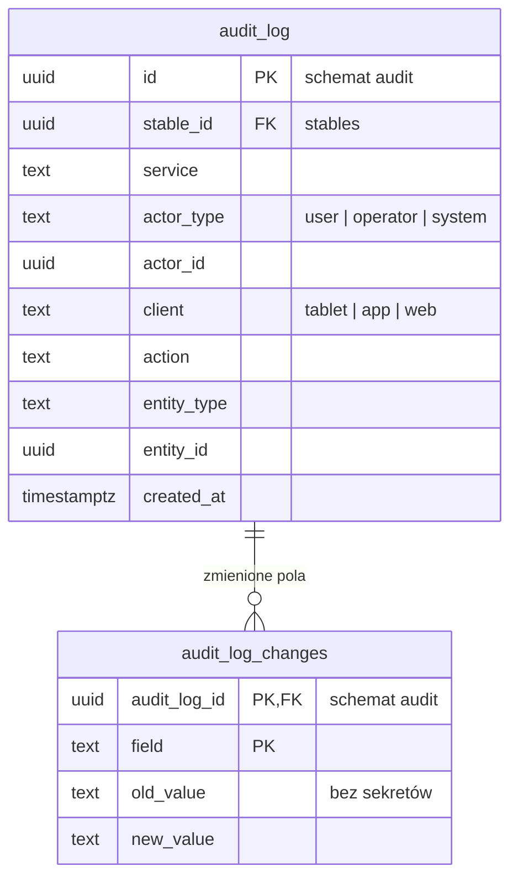

# KonskaAppka: model danych (ERD) do zatwierdzenia

> Wersja robocza v3 · 2026-10-12. Uwzględnia decyzje:
> - każdy moduł i każdy cron to osobny mikroserwis w monorepo;
> - płatności (serwis `billing`);
> - Cognito jako serwer autoryzacji (OTP przez SMS i TOTP z RFC 6238);
> - pliki w S3;
> - koń i boks w relacji 0..1 do 0..1 (koń może stać bez boksu, boks bez konia);
> - bez WebSocketów i bez outboxów; zdarzenia między serwisami idą przez SNS + SQS;
> - użytkownik logowany na tabletach, który może zablokować na tablecie wybrany boks (blokada trzymana na tablecie, bez tabeli urządzeń);
> - boks jako kontener z podstawowymi danymi (ostatnie czyszczenie, ostatnio dorzucona karma itd.), z podglądem dla najemcy miejsca;
> - sesje tylko w Cognito, bez tabel sesji w bazie.

## Do zatwierdzenia

1. **Koń ↔ boks: najwyżej jeden do najwyżej jednego.**
   - `horses.box_id` ma unikalny indeks i dopuszcza `NULL`, więc jeden boks ma najwyżej jednego konia, a koń jest w najwyżej jednym boksie.
   - Koń może stać bez boksu, np. nowo kupiony i jeszcze nieprzypisany. Taki koń nie pojawia się na żadnym tablecie, a jego flagi widać w apce i na liście dnia obsługi.
   - Boks może stać pusty.
   - Koń, który opuścił stajnię (`status = left`), zwalnia boks. Zostaje w bazie razem z historią flag i zdrowia.
   - Zamiana dwóch koni to jedna transakcja w kodzie: koń A na chwilę bez boksu, koń B do boksu A, koń A do boksu B.
   - Każda zmiana zamyka i otwiera wpisy w `horse_box_history`. Unikalne indeksy pilnują, żeby otwarty był najwyżej jeden wpis na konia i jeden na boks.
   - Relacji pilnuje baza kluczem obcym i unikalnością, bez logiki w bazie.
2. **Tablet: logowanie użytkownika i blokada boksu, bez tabeli urządzeń.**
   - Tablet nie ma własnego konta ani wiersza w bazie. Loguje się na nim użytkownik tym samym kontem co w apce; sesja i tokeny są w Cognito.
   - Jeden użytkownik może być zalogowany na kilku tabletach naraz i wszędzie widzi te same dane, bo decydują jego uprawnienia.
   - Blokada boksu to ustawienie samego tabletu, zapamiętane w apce. Użytkownik wybiera boks, blokuje go i tablet pokazuje tylko ten boks. Serwer o blokadzie nie wie, a jeden boks może być pokazywany na kilku tabletach.
   - Odblokowuje się na tablecie: ten, kto zablokował, admin albo serwisant. Apka sprawdza rolę zalogowanego użytkownika.
   - Wylogowanie użytkownika ze wszystkich urządzeń robi Cognito (global sign-out).
   - Czy flaga dotarła na tablet, widać po `flag_displays` (wyświetlono przy boksie). Osobnego śledzenia, czy tablet działa, nie ma.
   - Bez tabeli urządzeń nie ma zdalnych komend, telemetrii (bateria, Wi-Fi) ani listy tabletów w panelu. Diagnostyka tabletów, jeśli będzie potrzebna, trafia do logów i metryk, nie do bazy.
   - Założenia do potwierdzenia:
     - na tablecie jest zalogowany jeden użytkownik naraz (pilnuje apka);
     - zablokować boks na tablecie mogą tylko członkowie stajni z rolą `admin`, `staff` albo `technician`;
     - po wylogowaniu blokada zostaje, a tablet czeka na kolejne logowanie i wraca do tego samego boksu.
3. **Boks jako kontener i podgląd dla najemcy.**
   - Boks ma tylko podstawowe dane. To, co się z nim dzieje, zapisuje się jako zdarzenia w `box_care_events`.
   - Rodzaje zdarzeń to lista (słownik `box_care_types`) per stajnia, z etykietami w językach (`box_care_type_labels`). Na start kod wstawia domyślne: czyszczenie, ścielenie, siano, karma, woda. Admin może dodawać własne, zmieniać kolejność i wyłączać nieużywane.
   - Wpisy robi obsługa na tablecie (jedno stuknięcie) albo w apce.
   - „Ostatnie czyszczenie” czy „ostatnio dorzucona karma” to najnowsze zdarzenie danego rodzaju dla boksu (indeks po boksie, rodzaju i czasie). Nie trzymamy osobnych kolumn „ostatnio”, więc zostaje też historia.
   - Najemca miejsca dostaje dostęp do boksu przez `box_access` z rolą `tenant`, także przez zaproszenie (`invitations.box_id`). Widzi tylko podstawowe dane boksu: ostatnie zdarzenia i ich historię.
   - Najemca nie steruje boksem ani tabletem: nie ustawia flag, nie zmienia planów, nie blokuje boksu na tablecie.
   - Dostęp ma ramy czasowe (`valid_from`, `valid_to`) i można go odebrać (`revoked_at`), np. po końcu najmu.
   - Każde zaproszenie ma obowiązkowy termin ważności (`invitations.expires_at`, domyślny czas ustawia kod). Po terminie nie da się go przyjąć, a admin może wysłać nowe.
   - Do potwierdzenia:
     - czy najemca widzi też konia, który stoi w jego boksie.
4. **Jedna baza: schemat `app` dla wszystkich serwisów i osobny schemat `audit`.**
   - Każda tabela ma jeden serwis-właściciela (tabela niżej). Tylko właściciel do niej pisze; pozostałe serwisy mogą ją czytać.
   - Klucze obce są normalne, także między tabelami różnych serwisów.
   - Dzięki temu nie ma replik ani synchronizacji danych między serwisami. Na przykład `board` składa stan tablicy, czytając wprost konie, flagi i plany karmienia.
   - Serwisy czytają te same tabele, więc mają jeden schemat `app`. Definicja tabel i migracje leżą w jednym pakiecie monorepo (`packages/db`), a serwisy importują z niego typy tabel.
   - Audit jest w osobnym schemacie `audit` (`audit_log`, `audit_log_changes`), bez kluczy obcych do `app`.
     - Każdy serwis dopisuje wpis audytu w tej samej transakcji co zmiana, więc nie da się zmienić danych bez śladu i nie potrzeba do tego kolejki.
     - Role bazy serwisów mają w schemacie `audit` tylko `INSERT`, bez odczytu, zmiany i usuwania.
     - Czytać i sprzątać po okresie retencji może tylko serwis `audit`.
   - Koszt: zmiana kolumny czytanej przez inne serwisy musi być zgodna wstecz (najpierw dodać, potem usunąć).
5. **Tożsamość w Cognito.**
   - `users.cognito_sub` wiąże nasz profil z kontem w puli Cognito.
   - Hasła, kody OTP (SMS, TOTP), sesje i tokeny trzyma Cognito. Cognito jest też źródłem prawdy dla telefonu i e-maila, a `users` trzyma ich kopię do powiadomień.
   - Serwis `identity` tworzy wiersz `users` przy pierwszym uwierzytelnionym żądaniu (upsert po `cognito_sub`).
   - Usunięcie konta to pseudonimizacja w `users` i usunięcie konta w Cognito.
   - Zaproszenie nie ma własnego tokenu: po zalogowaniu przez Cognito serwis `access` dopasowuje zweryfikowany telefon albo e-mail z tokenu do `invitations.target`.
   - Tablet wysyła token zalogowanego użytkownika i numer zablokowanego boksu.
6. **Pliki w S3.**
   - `files` trzyma metadane, `s3_key` (z prefiksem `stable_id/`) i właściciela (`owner_service`, `owner_id`).
   - Link do pobrania wydaje tylko serwis-właściciel po sprawdzeniu uprawnień. Na przykład `health` sprawdza widoczność wpisu i dostęp do konia, a dopiero potem prosi `files` o krótko ważny presigned URL.
7. **Bez WebSocketów.**
   - Tablet sam regularnie, co kilka sekund, pyta serwis `board` o stan zablokowanego boksu. Serwer nie trzyma żadnego stanu tablic.
   - `board` nie ma własnych tabel: przy każdym zapytaniu składa odpowiedź z danych w bazie. `ETag` to hash odpowiedzi, więc gdy nic się nie zmieniło, tablet dostaje `304`.
   - Wyświetlenie flagi tablet zgłasza z numerem boksu (`flag_displays`).
   - Między serwisami: kolejki **SNS + SQS**, bez outboxów.
     - Serwis po zatwierdzeniu transakcji publikuje zdarzenie do tematu SNS (jeden temat na rodzaj zdarzenia).
     - Każdy konsument ma własną kolejkę SQS z kolejką błędów (DLQ).
     - SQS może dostarczyć wiadomość więcej niż raz, więc obsługa jest idempotentna: zapisy opierają się na unikalnych kluczach w tabelach docelowych, bez osobnej tabeli `inbox`.
   - Bez outboxu zdarzenie może zginąć, gdy serwis padnie między zapisem w bazie a publikacją. Dlatego żadna krytyczna ścieżka nie opiera się wyłącznie na zdarzeniu:
     - eskalacje liczy cron prosto z bazy;
     - `board` przy odpytywaniu porównuje wersje w bazie;
     - cron uzgadniający poprawia skutki `horse.left`.
   - E-maile z `notifications` mogą iść przez SES (adapter `EmailSender`).
8. **Sloty posiłków i padoki należą do `care`, a hale do `rides`**, bo te serwisy z nich korzystają.
9. **Płatności (`billing`).**
   - Płaci stajnia: ma konto rozliczeniowe (dane do faktury) i subskrypcję planu.
   - Comiesięczny cron zapisuje zużycie (np. boksy z koniem). Z niego powstaje faktura z pozycjami, a płatności przychodzą od dostawcy przez webhooki.
   - Kwoty są w groszach (`bigint`).
   - Status subskrypcji steruje `stables.status`: brak płatności daje `suspended`.
   - Dostawca płatności i system faktur (KSeF) są do wyboru; w modelu są tylko identyfikatory zewnętrzne.

## Zasady wspólne

- **Identyfikatory i typy:**
  - identyfikatory UUIDv7 nadaje kod;
  - czas w `timestamptz` (UTC), godziny lokalne w `time` ze strefą stajni;
  - statusy jako `text` walidowany w kodzie.
- **Izolacja stajni:** każda tabela danych stajni ma `stable_id`, a filtruje po nim kod. Tabele-rodzice mają `UNIQUE (stable_id, id)`, a klucze obce są wielokolumnowe (`stable_id`, `x_id`), więc koń nie trafi do boksu innej stajni.
- **Wersje:** tabele edytowalne mają `version` (`bigint`, zwiększany w kodzie) i `updated_at`. Wersja służy do `If-Match` przy edycji i do `ETag` tablicy.
- **Czego nie rysujemy:** `version`, `created_at` i `updated_at` pomijamy na diagramach.
- **Dozwolone w bazie:**
  - PK;
  - FK bez akcji kaskadowych (zależne wiersze usuwa kod);
  - `NOT NULL`;
  - unikalności, także częściowe;
  - indeksy.
- **Zakazane w bazie:** RLS, triggery, funkcje, `CHECK`, `DEFAULT`, sekwencje i identity, kolumny generowane, enumy, `jsonb` i tablice.
- **Dane wielowartościowe w osobnych tabelach**, np. etykiety w językach (`*_labels`), pozycje planu karmienia, towarzysze na padoku, ceny planu, zmienione pola w audycie. Dni tygodnia zapisujemy jako maskę bitową `days_mask` (`smallint`, pn = 1 … nd = 64).

## Mikroserwisy i tabele, które do nich należą

| Mikroserwis | Kolor na ERD | Tabele (tylko ten serwis do nich pisze) |
|---|---|---|
| `identity` | różowy | `users` |
| `access` | fioletowy | `stable_members`, `horse_access`, `box_access`, `invitations` |
| `stable` | niebieski | `stables`, `stable_locales`, `stable_settings`, `boxes`, `horses`, `horse_box_history` |
| `board` | — (bez tabel) | brak; składa stan tablicy z tabel innych serwisów przy każdym zapytaniu tabletu |
| `flags` | czerwony | `flag_templates`, `flag_template_labels`, `horse_flags`, `flag_acknowledgements`, `flag_displays`, `flag_escalations` |
| `care` | zielony | `meal_slots`, `meal_slot_labels`, `feeds`, `paddocks`, `feeding_plans`, `feeding_plan_items`, `feeding_checks`, `box_care_types`, `box_care_type_labels`, `box_care_events`, `paddock_plans`, `paddock_plan_companions` |
| `health` | limonkowy | `health_events`, `health_attachments` |
| `rides` | bursztynowy | `arenas`, `rides` |
| `tasks` | pomarańczowy | `tasks`, `task_occurrences` |
| `billing` | żółty | `billing_accounts`, `billing_plans`, `billing_plan_prices`, `subscriptions`, `usage_snapshots`, `invoices`, `invoice_lines`, `payments`, `payment_provider_events` |
| `files` | szary | `files` (metadane; treść w S3) |
| `releases` | grafitowy | `app_releases`, `app_release_targets` |
| `notifications` | purpurowy | `notifications` |
| `audit` | — (osobny diagram) | `audit_log`, `audit_log_changes` (schemat `audit`; wpisy dodają wszystkie serwisy, czyta i usuwa tylko `audit`) |

**Crony to osobne mikroserwisy bez własnych tabel.** Czytać mogą wprost z bazy, ale zmiany zlecają serwisom-właścicielom przez API albo kolejki. Idempotencję zapewniają unikalności po stronie tych serwisów, np. `notifications.dedupe_key`.

| Cron | Serwisy | Co robi |
|---|---|---|
| `escalation-scheduler` | `flags`, `notifications` | Znajduje flagi z minionym `warn_at` albo `notify_at` i bez potwierdzenia |
| `flag-display-check` | `flags`, `notifications` | Szuka krytycznych flag, które po N minutach nie zostały wyświetlone przy żadnym tablecie boksu, i powiadamia admina |
| `task-occurrence-generator` | `tasks` | Tworzy wystąpienia zadań cyklicznych |
| `health-due-reminders` | `health`, `notifications` | Przypomnienia o zbliżających się wizytach |
| `files-gc` | `files` | Usuwa z S3 pliki `pending` starsze niż 24 h i pliki `deleted` po retencji |
| `billing-usage-snapshot` | `billing` (czyta `horses`) | Raz w okresie zapisuje zużycie: boksy z koniem |
| `billing-invoicing` | `billing`, `files` | Wystawia faktury z pozycjami, PDF do S3, przekazuje do systemu faktur |
| `billing-dunning` | `billing`, `notifications` | Przypomnienia o zaległych płatnościach, po terminie `past_due`, potem `suspended` |
| `horse-left-reconciler` | `access`, `flags`, `care`, `tasks`, `rides` | Szuka koni `left` z otwartymi dostępami, flagami albo planami i zleca ich zamknięcie właścicielom (na wypadek zgubionego zdarzenia) |
| `retention-pruner` | wszystkie | Woła endpoint `prune` każdego serwisu, bo usuwać może tylko właściciel tabeli |

## Współpraca serwisów

- **Odczyt:** każdy serwis może czytać tabele innych serwisów. `board` składa stan tablicy z `stables`, `boxes`, `horses`, `horse_flags`, `feeding_plans`, `feeding_checks`, `paddock_plans`, `health_events` (sam typ i termin) i `task_occurrences`. Uprawnienia sprawdza w `stable_members`, `horse_access` i `box_access`.
- **Zapis:** tylko przez serwis-właściciela, czyli przez jego REST albo jego kolejkę SQS. Zapisy z tabletu i apki (potwierdzenia, odhaczenia) idą synchronicznym REST, bo klient potrzebuje wyniku dla każdego zdarzenia.
- **Zdarzenia** (SNS + SQS, publikowane po zatwierdzeniu transakcji) służą reakcjom, a nie kopiowaniu danych:
  - `horse.left` zamyka flagi, plany i dostępy w serwisach-właścicielach;
  - `subscription.status_changed` zmienia `stables.status`.
- **Widoczność:** notatki flag są widoczne wszędzie, gdzie widać boks albo konia (tablet, apka, panel), bez podziału na „tylko w apce”. Na tablet nie trafiają tylko opisy wizyt z historii zdrowia; pilnuje tego kod `board`.

## Legenda

- **Jeden ERD aplikacji:** wszystkie tabele schematu `app` na jednym diagramie. Audit ma osobny, mały diagram, bo leży w schemacie `audit` i nie ma kluczy obcych do `app`.
- **Kolor tabeli** to jej serwis-właściciel (kolumna „Kolor na ERD” w tabeli serwisów).
- **Kolumny:** `PK` to klucz główny, `FK` klucz obcy, `UK` unikalność. Komentarz przy `FK` podaje tabelę docelową.
- **Linie:** relacje między tabelami. Dla czytelności nie rysujemy dwóch rodzajów linii; ich klucze obce są zaznaczone w kolumnach:
  - linii do `stables` (kolumna `stable_id` jest prawie w każdej tabeli);
  - linii do `users` z pól atrybucji (`created_by`, `granted_by`, `uploaded_by`, `moved_by` i podobnych).
- **Krotności.** Znacznik przy tabeli mówi, ile jej wierszy przypada na jeden wiersz tabeli po drugiej stronie:
  - `||` dokładnie jeden;
  - `o|` (zapisane po lewej stronie jako `|o`) zero albo jeden;
  - `o{` (po lewej `}o`) zero lub wiele.

  Przykład: `boxes |o--o| horses` znaczy, że koń ma zero albo jeden boks, a boks ma zero albo jednego konia.
- **Pliki:** PNG do szybkiego podglądu, SVG do powiększania (tekst zostaje ostry).

## ERD aplikacji (schemat `app`)


Wersja do powiększania: [erd/app.svg](erd/app.svg). Diagram ma 48 tabel i 64 relacji.

<details>
<summary>Źródło mermaid</summary>

```mermaid
erDiagram
    stables {
        uuid id PK
        text name
        text timezone "IANA, np. Europe/Warsaw"
        text status "active | suspended"
    }
    stable_locales {
        uuid stable_id PK, FK
        text locale PK "pl | uk | en"
        int sort_order
    }
    stable_settings {
        uuid stable_id PK, FK "1:1 ze stajnią"
        int warn_offset_min "baner NIEPOTWIERDZONE, np. 30"
        int notify_offset_min "powiadomienie admina, np. 15"
        int late_margin_min "flaga po czasie"
        text author_display "role | initial | name"
        boolean owner_edits_feeding
        boolean rides_enabled
        time maintenance_from "okno instalacji APK"
        time maintenance_to
    }
    boxes {
        uuid id PK
        uuid stable_id FK
        text label "unikalny w stajni"
        text building
        boolean active
    }
    horses {
        uuid id PK
        uuid stable_id FK
        uuid box_id FK, UK "najwyżej jeden koń w boksie; NULL = bez boksu"
        text status "active | left"
        text name
        text breed
        date birth_date
        uuid photo_file_id FK "files"
        timestamptz left_at
    }
    horse_box_history {
        uuid id PK
        uuid stable_id FK
        uuid horse_id FK "jeden otwarty wpis na konia"
        uuid box_id FK "jeden otwarty wpis na boks"
        text reason "arrival | move | swap | left"
        uuid moved_by FK "users"
        timestamptz from_at
        timestamptz to_at "NULL = obecnie"
    }
    users {
        uuid id PK
        text cognito_sub UK
        text display_name
        text phone_e164 "kopia z Cognito"
        text email "kopia z Cognito"
        text locale
        timestamptz contact_synced_at
        timestamptz deleted_at
    }
    stable_members {
        uuid id PK
        uuid stable_id FK "stables"
        uuid user_id FK "users, unikalne ze stable_id"
        text role "admin | staff | instructor | technician | member"
        boolean active
        timestamptz deactivated_at
    }
    horse_access {
        uuid id PK
        uuid stable_id FK "stables"
        uuid horse_id FK "horses"
        uuid user_id FK "users"
        text role "owner | co_owner | lessee | viewer"
        timestamptz valid_from
        timestamptz valid_to
        timestamptz revoked_at
        uuid granted_by FK "users"
    }
    box_access {
        uuid id PK
        uuid stable_id FK "stables"
        uuid box_id FK "boxes"
        uuid user_id FK "users"
        text role "tenant: tylko podgląd"
        timestamptz valid_from
        timestamptz valid_to "koniec najmu"
        timestamptz revoked_at
        uuid granted_by FK "users"
    }
    invitations {
        uuid id PK
        uuid stable_id FK "stables"
        text channel "sms | email"
        text target "porównywany z claimem z Cognito"
        text role
        uuid horse_id FK "horses, opcjonalnie"
        uuid box_id FK "boxes, opcjonalnie"
        text access_role "np. owner, tenant"
        uuid created_by FK "users"
        timestamptz expires_at "wymagane"
        timestamptz accepted_at
        uuid accepted_by FK "users"
        timestamptz revoked_at
    }
    flag_templates {
        uuid id PK
        uuid stable_id FK "stables"
        text code "unikalny w stajni"
        text icon
        text severity "info | warning | critical"
        text effect "suspend_meal | cancel_paddock | no_riding | none"
        text meal_slot_code
        text default_window "np. next_meal"
        boolean requires_ack
        boolean active
        int sort_order
    }
    horse_flags {
        uuid id PK "z klienta"
        uuid stable_id FK "stables"
        uuid horse_id FK "horses"
        uuid template_id FK "opcjonalnie"
        text custom_text
        text severity
        text effect
        text note
        text author_role "owner | staff | admin"
        timestamptz valid_from
        timestamptz valid_to "NULL = do odwołania"
        uuid meal_slot_id FK "meal_slots"
        date service_date
        timestamptz ack_deadline_at
        timestamptz warn_at "liczone przy zapisie"
        timestamptz notify_at "liczone przy zapisie"
        text source "app | on_behalf_*, lista pod diagramem"
        uuid replaces_flag_id FK, UK
        uuid created_by FK "users"
        timestamptz client_created_at
        text request_hash
        timestamptz cancelled_at
        uuid cancelled_by FK "users"
        text cancel_reason
        timestamptz acknowledged_at
    }
    flag_template_labels {
        uuid template_id PK, FK
        text locale PK "pl | uk | en"
        text label
    }
    flag_acknowledgements {
        uuid id PK "id zdarzenia z klienta"
        uuid stable_id FK "stables"
        uuid flag_id FK
        uuid user_id FK "users, zalogowany użytkownik"
        uuid box_id FK "boxes, gdzie potwierdzono"
        text method "tablet | app"
        timestamptz occurred_at
        text time_quality "synced | unknown"
        timestamptz received_at
        text conflict "none | flag_ended | flag_cancelled"
        text request_hash
    }
    flag_displays {
        uuid id PK
        uuid stable_id FK "stables"
        uuid flag_id FK "unikalne z box_id"
        uuid box_id FK "boxes"
        timestamptz displayed_at
        timestamptz received_at
    }
    flag_escalations {
        uuid id PK
        uuid stable_id FK "stables"
        uuid flag_id FK "unikalne z level"
        text level "board_warning | admin_notify"
        timestamptz escalated_at
    }
    meal_slots {
        uuid id PK
        uuid stable_id FK "stables"
        text code "np. breakfast"
        time local_time
        smallint days_mask "bity: pn=1 ... nd=64"
        date valid_from
        date valid_to
        int sort_order
    }
    meal_slot_labels {
        uuid meal_slot_id PK, FK
        text locale PK "pl | uk | en"
        text label
    }
    feeds {
        uuid id PK
        uuid stable_id FK "stables"
        text name "np. owies, siano, suplement X"
        text kind "feed | supplement | medicine"
        text default_unit "kg | g | miarka | szt"
        boolean active
    }
    paddocks {
        uuid id PK
        uuid stable_id FK "stables"
        text name
    }
    feeding_plans {
        uuid id PK
        uuid stable_id FK "stables"
        uuid horse_id FK "horses"
        uuid meal_slot_id FK
        date valid_from
        date valid_to
        timestamptz deleted_at
    }
    feeding_plan_items {
        uuid id PK
        uuid feeding_plan_id FK
        uuid feed_id FK
        numeric quantity
        text unit
        int sort_order
    }
    box_care_types {
        uuid id PK
        uuid stable_id FK "stables"
        text code "unikalny w stajni, np. cleaning"
        text icon
        boolean show_on_board "pokazywać na tablecie"
        int sort_order
        boolean active
    }
    box_care_type_labels {
        uuid type_id PK, FK
        text locale PK "pl | uk | en"
        text label "np. Czyszczenie boksu"
    }
    box_care_events {
        uuid id PK "z klienta"
        uuid stable_id FK "stables"
        uuid box_id FK "boxes"
        uuid type_id FK "box_care_types"
        timestamptz occurred_at
        uuid user_id FK "users"
        text source "tablet | app"
        text note
        text time_quality "synced | unknown"
        timestamptz received_at
        text request_hash
    }
    feeding_checks {
        uuid id PK "z klienta"
        uuid stable_id FK "stables"
        uuid horse_id FK "horses"
        uuid meal_slot_id FK
        date service_date "unikalne z horse_id i meal_slot_id"
        uuid user_id FK "users"
        text source "tablet | app"
        uuid box_id FK "boxes"
        timestamptz occurred_at
        text time_quality "synced | unknown"
        timestamptz received_at
        text conflict "none | meal_suspended"
        text request_hash
    }
    paddock_plans {
        uuid id PK
        uuid stable_id FK "stables"
        uuid horse_id FK "horses"
        uuid paddock_id FK
        smallint days_mask "bity: pn=1 ... nd=64"
        time start_local
        time end_local
        date valid_from
        date valid_to
        timestamptz deleted_at
    }
    paddock_plan_companions {
        uuid paddock_plan_id PK, FK
        uuid horse_id PK, FK "horses"
    }
    health_events {
        uuid id PK
        uuid stable_id FK "stables"
        uuid horse_id FK "horses"
        text type "vet | farrier | dentist | deworming | vaccination"
        date occurred_on
        timestamptz scheduled_at
        timestamptz next_due_at
        text description
        text visibility "stable | owner_private"
        uuid created_by FK "users"
        timestamptz deleted_at
    }
    health_attachments {
        uuid id PK
        uuid stable_id FK "stables"
        uuid health_event_id FK
        uuid file_id UK, FK "files"
        text file_name
        uuid created_by FK "users"
        timestamptz deleted_at
    }
    arenas {
        uuid id PK
        uuid stable_id FK "stables"
        text name
        int capacity
    }
    rides {
        uuid id PK
        uuid stable_id FK "stables"
        uuid horse_id FK "horses"
        uuid rider_member_id FK "stable_members, opcjonalnie"
        text rider_name
        uuid instructor_member_id FK "stable_members"
        uuid arena_id FK
        timestamptz starts_at
        timestamptz ends_at
        text status
        timestamptz deleted_at
    }
    tasks {
        uuid id PK
        uuid stable_id FK "stables"
        text title
        uuid horse_id FK "horses, opcjonalnie"
        uuid box_id FK "boxes, opcjonalnie"
        timestamptz due_at "zadanie jednorazowe"
        smallint days_mask "zadanie cykliczne; bity pn..nd"
        time local_time
        text assignee_role
        boolean active
        timestamptz deleted_at
    }
    task_occurrences {
        uuid id PK
        uuid stable_id FK "stables"
        uuid task_id FK
        timestamptz due_at "unikalne z task_id"
        text status
        uuid completion_event_id UK "id zdarzenia z klienta"
        uuid done_by_user_id FK "users"
        text source "tablet | app"
        timestamptz occurred_at
        text time_quality "synced | unknown"
        timestamptz received_at
        text request_hash
    }
    files {
        uuid id PK
        uuid stable_id FK "stables, NULL dla APK"
        text s3_key UK "prefiks stable_id/"
        text owner_service "np. health, stable, releases"
        uuid owner_id
        text original_name
        text content_type
        bigint size_bytes
        text sha256
        text status "pending | attached | deleted"
        uuid uploaded_by FK "users"
        timestamptz deleted_at
    }
    app_releases {
        uuid id PK
        int version_code UK
        text version_name
        uuid file_id UK, FK "files"
        text sha256
        text signing_cert_sha256
        int min_sdk
        int min_required_version_code
        text status "draft | rolling | complete | halted"
        smallint rollout_percent
    }
    app_release_targets {
        uuid id PK
        uuid release_id FK
        uuid stable_id FK "stables"
    }
    notifications {
        uuid id PK
        uuid stable_id FK "stables"
        text channel "sms | email"
        uuid recipient_user_id FK "users, NULL dla zaproszeń"
        text recipient_address "E.164 albo e-mail w chwili wysyłki"
        text template
        text subject "wyrenderowane przy tworzeniu"
        text body
        uuid related_flag_id FK "horse_flags"
        uuid related_invitation_id FK "invitations"
        text dedupe_key UK
        text status "pending | sent | failed | cancelled"
        text provider_message_id
        int attempts
        timestamptz sent_at
    }
    billing_accounts {
        uuid id PK
        uuid stable_id FK, UK "jedno konto na stajnię"
        text legal_name
        text tax_id "NIP"
        text address_line1
        text address_line2
        text postal_code
        text city
        text country_code "PL"
        text invoice_email
        text payment_provider "do wyboru"
        text provider_customer_id
    }
    billing_plans {
        uuid id PK
        text code UK
        text name
        text currency "PLN"
        text period "month | year"
        bigint minimum_minor "minimalna kwota w okresie"
        boolean active
    }
    billing_plan_prices {
        uuid plan_id PK, FK
        text metric PK "np. boxes_with_horse"
        bigint unit_price_minor "grosze za jednostkę"
    }
    subscriptions {
        uuid id PK
        uuid stable_id FK
        uuid billing_account_id FK
        uuid plan_id FK
        text status "trial | active | past_due | suspended | canceled"
        timestamptz trial_ends_at
        timestamptz current_period_start
        timestamptz current_period_end
        timestamptz cancel_at
        timestamptz canceled_at
        text provider_subscription_id
    }
    usage_snapshots {
        uuid id PK
        uuid stable_id FK
        uuid subscription_id FK "unikalne z period_start i metric"
        timestamptz period_start
        timestamptz period_end
        text metric "np. boxes_with_horse"
        int quantity
    }
    invoices {
        uuid id PK
        uuid stable_id FK
        uuid subscription_id FK
        text number UK
        timestamptz period_start
        timestamptz period_end
        text currency
        bigint net_minor "grosze"
        bigint vat_minor
        bigint gross_minor
        text status "draft | issued | paid | overdue | void"
        timestamptz issued_at
        timestamptz due_at
        timestamptz paid_at
        uuid file_id FK "PDF w S3"
        text external_ref "system faktur, KSeF"
    }
    invoice_lines {
        uuid id PK
        uuid invoice_id FK
        text description
        text metric
        int quantity
        bigint unit_price_minor
        bigint net_minor
        text vat_rate
    }
    payments {
        uuid id PK
        uuid stable_id FK
        uuid invoice_id FK
        text provider
        text provider_payment_id UK
        text method "karta | BLIK | przelew"
        bigint amount_minor
        text currency
        text status "pending | succeeded | failed | refunded"
        timestamptz paid_at
    }
    payment_provider_events {
        uuid id PK
        text provider
        text provider_event_id UK "idempotencja webhooków"
        text type
        text payload_s3_key "surowe body webhooka w S3"
        timestamptz received_at
        timestamptz processed_at
    }
    stables ||--o{ stable_locales : "języki"
    stables ||--|| stable_settings : "ustawienia"
    stables ||--o{ boxes : "ma"
    stables ||--o{ horses : "ma"
    boxes |o--o| horses : "zajmuje (0..1 : 0..1)"
    horses ||--o{ horse_box_history : "historia"
    boxes ||--o{ horse_box_history : "historia"
    users ||--o{ stable_members : "jest członkiem"
    stables ||--o{ stable_members : "członkowie"
    users ||--o{ horse_access : "ma dostęp"
    horses ||--o{ horse_access : "dostęp"
    stables ||--o{ invitations : "zaprasza"
    horses |o--o{ invitations : "do konia"
    flag_templates ||--o{ flag_template_labels : "etykiety"
    flag_templates |o--o{ horse_flags : "szablon"
    horse_flags |o--o| horse_flags : "zastępuje"
    horse_flags ||--o{ flag_acknowledgements : "potwierdzenia"
    horse_flags ||--o{ flag_displays : "wyświetlenia"
    horse_flags ||--o{ flag_escalations : "eskalacje"
    horses ||--o{ horse_flags : "flagi"
    meal_slots |o--o{ horse_flags : "cel: posiłek"
    users ||--o{ flag_acknowledgements : "kto potwierdził"
    meal_slots ||--o{ meal_slot_labels : "etykiety"
    meal_slots ||--o{ feeding_plans : "posiłek"
    feeding_plans ||--o{ feeding_plan_items : "pozycje"
    feeds ||--o{ feeding_plan_items : "pasza"
    meal_slots ||--o{ feeding_checks : "posiłek"
    paddocks ||--o{ paddock_plans : "gdzie"
    paddock_plans ||--o{ paddock_plan_companions : "z kim"
    horses ||--o{ paddock_plan_companions : "towarzysz"
    horses ||--o{ feeding_plans : "plan"
    horses ||--o{ feeding_checks : "odhaczenia"
    horses ||--o{ paddock_plans : "padok"
    horses ||--o{ health_events : "zdrowie"
    health_events ||--o{ health_attachments : "załączniki"
    files ||--o| health_attachments : "plik w S3"
    arenas |o--o{ rides : "miejsce"
    horses ||--o{ rides : "jazdy"
    tasks ||--o{ task_occurrences : "wystąpienia"
    horses |o--o{ tasks : "dotyczy"
    boxes |o--o{ tasks : "dotyczy"
    files ||--o| app_releases : "APK w S3"
    app_releases ||--o{ app_release_targets : "do kogo"
    users |o--o{ notifications : "odbiorca"
    horse_flags |o--o{ notifications : "dotyczy"
    invitations |o--o{ notifications : "zaproszenie"
    stables ||--o| billing_accounts : "płaci"
    billing_accounts ||--o{ subscriptions : "subskrypcje"
    billing_plans ||--o{ billing_plan_prices : "ceny"
    billing_plans ||--o{ subscriptions : "plan"
    stables ||--o{ subscriptions : "abonament"
    subscriptions ||--o{ usage_snapshots : "zużycie"
    subscriptions ||--o{ invoices : "faktury"
    invoices ||--o{ invoice_lines : "pozycje"
    invoices ||--o{ payments : "płatności"
    files |o--o| invoices : "PDF"
    boxes |o--o{ invitations : "do boksu"
    boxes ||--o{ box_access : "najem"
    users ||--o{ box_access : "najemca"
    boxes ||--o{ box_care_events : "zdarzenia"
    box_care_types ||--o{ box_care_type_labels : "etykiety"
    box_care_types ||--o{ box_care_events : "rodzaj"
    boxes ||--o{ flag_displays : "wyświetlono przy boksie"
    boxes |o--o{ flag_acknowledgements : "potwierdzono przy boksie"
    classDef svc_stable fill:#dbeafe,stroke:#1d4ed8
    classDef svc_access fill:#ede9fe,stroke:#6d28d9
    classDef svc_identity fill:#fce7f3,stroke:#be185d
    classDef svc_flags fill:#fee2e2,stroke:#b91c1c
    classDef svc_care fill:#dcfce7,stroke:#15803d
    classDef svc_health fill:#ecfccb,stroke:#4d7c0f
    classDef svc_rides fill:#fef3c7,stroke:#b45309
    classDef svc_tasks fill:#ffedd5,stroke:#c2410c
    classDef svc_billing fill:#fef9c3,stroke:#a16207
    classDef svc_files fill:#e5e7eb,stroke:#374151
    classDef svc_releases fill:#f1f5f9,stroke:#475569
    classDef svc_notifications fill:#fae8ff,stroke:#a21caf
    class stables,stable_locales,stable_settings,boxes,horses,horse_box_history svc_stable
    class stable_members,horse_access,box_access,invitations svc_access
    class users svc_identity
    class flag_templates,flag_template_labels,horse_flags,flag_acknowledgements,flag_displays,flag_escalations svc_flags
    class meal_slots,meal_slot_labels,feeds,paddocks,feeding_plans,feeding_plan_items,feeding_checks,box_care_types,box_care_type_labels,box_care_events,paddock_plans,paddock_plan_companions svc_care
    class health_events,health_attachments svc_health
    class arenas,rides svc_rides
    class tasks,task_occurrences svc_tasks
    class billing_accounts,billing_plans,billing_plan_prices,subscriptions,usage_snapshots,invoices,invoice_lines,payments,payment_provider_events svc_billing
    class files svc_files
    class app_releases,app_release_targets svc_releases
    class notifications svc_notifications
```

</details>

## ERD audytu (schemat `audit`)


<details>
<summary>Źródło mermaid</summary>



</details>

## Słowniki wartości

- `box_care_types`: słownik per stajnia. Domyślne pozycje wstawiane przez kod: `cleaning` (czyszczenie), `bedding` (ścielenie), `hay` (dorzucone siano), `feed` (dorzucona karma), `water` (woda).
- `horse_flags.source`: `app` (właściciel w apce) albo flaga wpisana w imieniu właściciela: `on_behalf_phone`, `on_behalf_sms`, `on_behalf_in_person`.

## Zmiany względem modelu z analizy v3

- **Przejmuje Cognito:** `otp_challenges`, `auth_sessions`, `access_tokens`, `refresh_tokens`, `device_auth_challenges`, `rate_limit_buckets`, a także `invitations.token_hash` (zaproszenie dopasowuje się do zweryfikowanego telefonu albo e-maila).
- **Tablety:**
  - nie ma parowania (`device_pairing_requests`) ani PIN-ów obsługi (`stable_members.pin_verifier`, `stables.service_pin_verifier`): na tablecie zawsze jest zalogowany konkretny użytkownik;
  - nie ma tabel urządzeń (`devices`, `device_boxes`, `device_presence`, komendy, alerty): blokada boksu jest trzymana na tablecie, sesje w Cognito;
- **Przejmuje S3:** `stored_files` i `stored_file_chunks`.
- **Serwisy:** dochodzi `billing` (płatności). Każda tabela ma serwis-właściciela; wszystko jest w schemacie `app`, poza audytem w schemacie `audit`.
- **Odpada razem z WebSocketami i monolitem:**
  - `outbox_seq` i `outbox_events`; zdarzenia idą wprost do SNS + SQS, bez outboxów;
  - `jobs`, bo crony są serwisami;
  - `boxes.board_version` znika razem z cache tablic: serwis `board` nie trzyma stanu.
- **Bez jsonb:** ustawienia stajni, języki, etykiety, pozycje karmienia, towarzysze na padoku, rollout APK, ceny planów, adres do faktury i zmiany w audycie mają własne kolumny albo tabele.
- **Załączniki:** ogólne `attachments` zastępuje `health_attachments`, bo w v1 załączniki są tylko w zdrowiu.
- **Poza v1, do decyzji:**
  - eksporty danych (`data_exports`, w przyszłości osobny serwis `exports`, który czyta dane wprost z bazy);
  - błędy klientów (`client_errors`, albo zewnętrzne narzędzie wybrane przez Dawida);
  - odhaczanie padoku (`paddock_checks`, analogicznie do `feeding_checks`).
