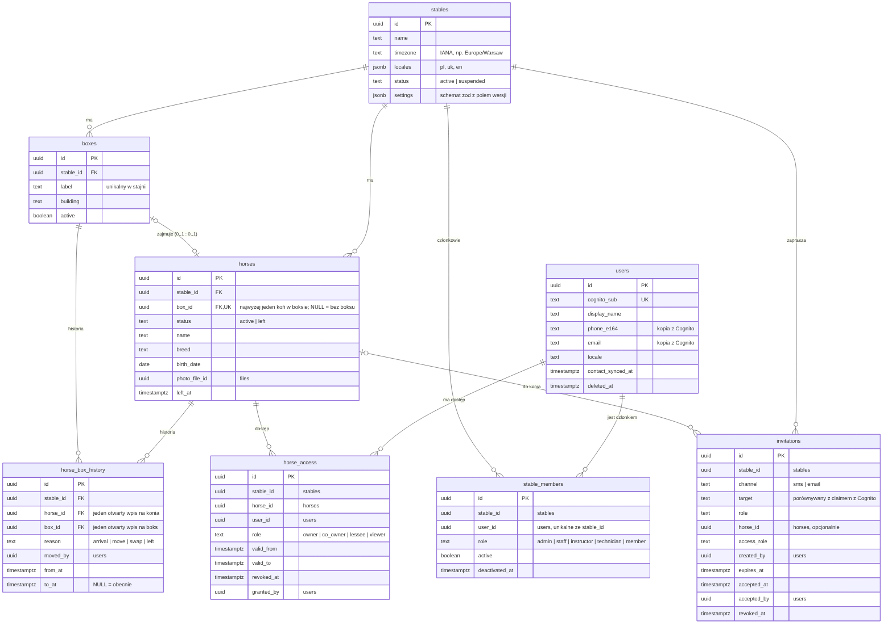
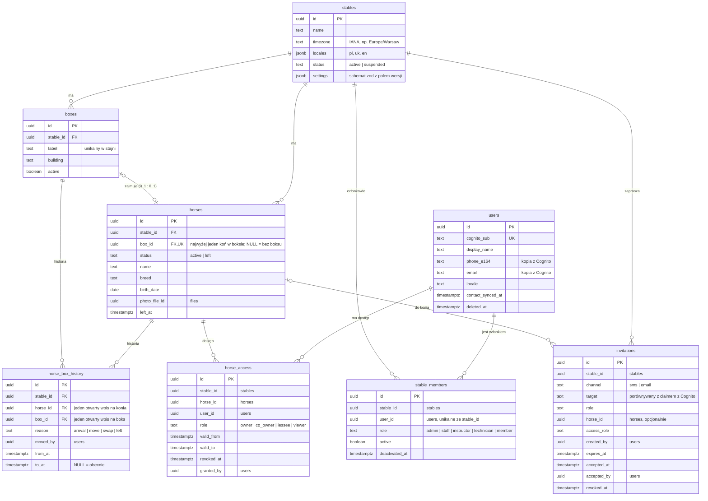
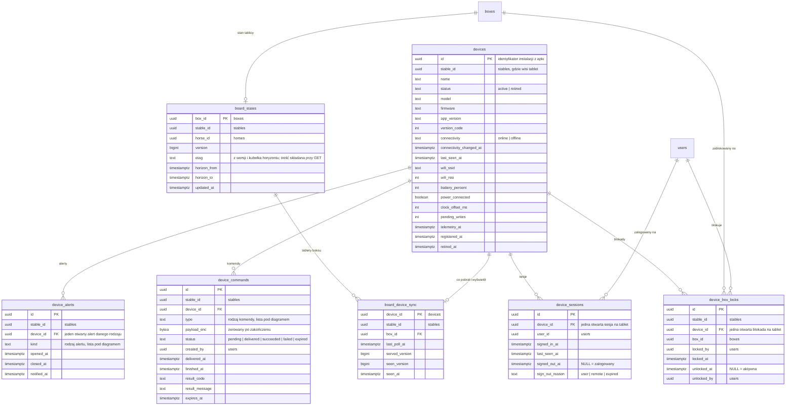
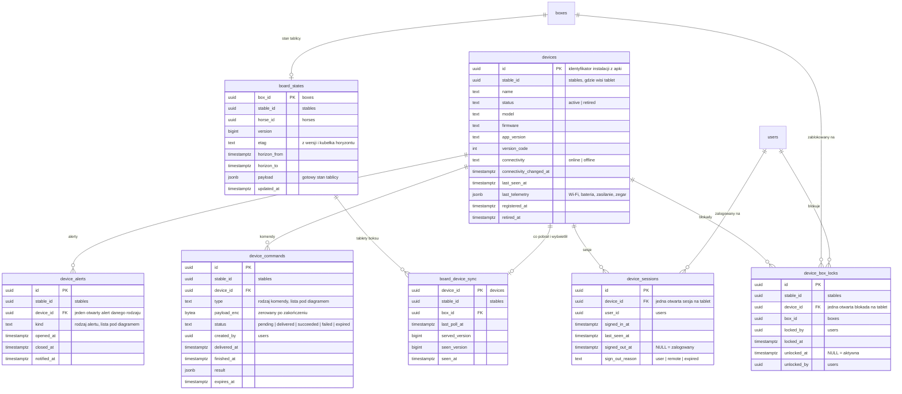
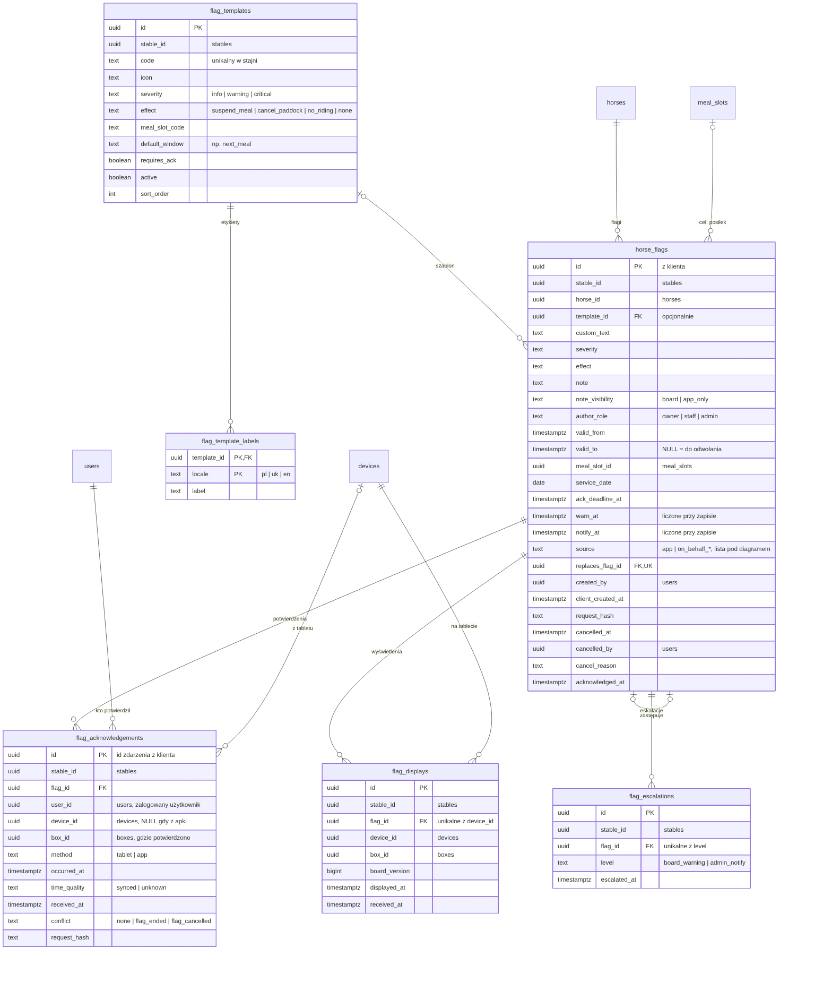
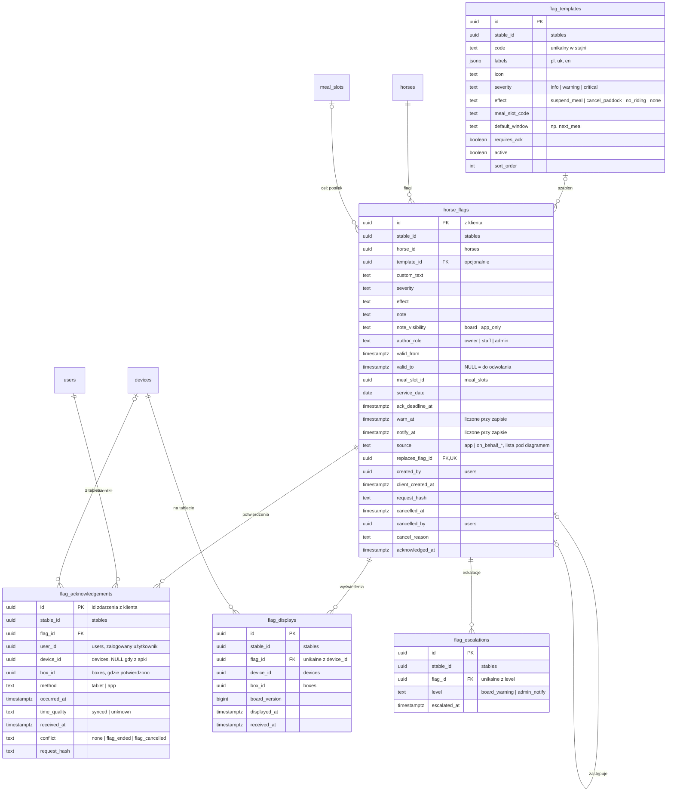
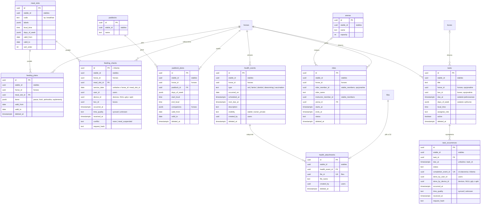
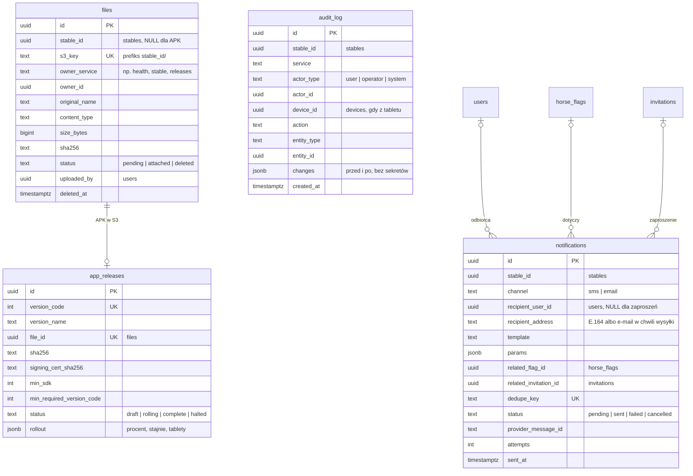
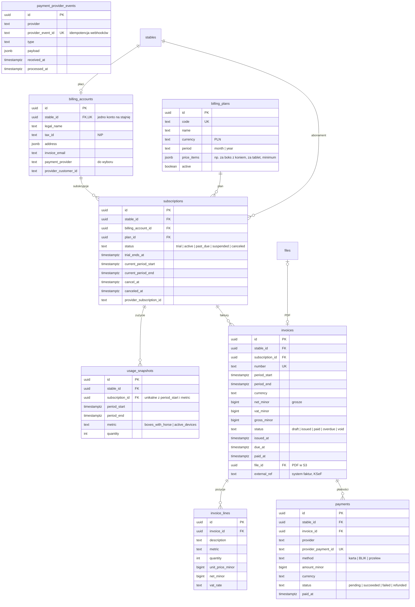

# KonskaAppka: model danych (ERD) do zatwierdzenia

> Wersja robocza v3 · 2026-10-12. Uwzględnia decyzje:
> - każdy moduł i każdy cron to osobny mikroserwis w monorepo;
> - płatności (serwis `billing`);
> - Cognito jako serwer autoryzacji (OTP przez SMS i TOTP z RFC 6238);
> - pliki w S3;
> - koń i boks w relacji 0..1 do 0..1 (koń może stać bez boksu, boks bez konia);
> - bez WebSocketów i bez outboxów; zdarzenia między serwisami idą przez SNS + SQS;
> - użytkownik logowany na tabletach, który może zablokować na tablecie wybrany boks.

## Do zatwierdzenia

1. **Koń ↔ boks: najwyżej jeden do najwyżej jednego.**
   - `horses.box_id` ma unikalny indeks i dopuszcza `NULL`, więc jeden boks ma najwyżej jednego konia, a koń jest w najwyżej jednym boksie.
   - Koń może stać bez boksu, np. nowo kupiony i jeszcze nieprzypisany. Taki koń nie pojawia się na żadnym tablecie, a jego flagi widać w apce i na liście dnia obsługi.
   - Boks może stać pusty.
   - Koń, który opuścił stajnię (`status = left`), zwalnia boks. Zostaje w bazie razem z historią flag i zdrowia.
   - Zamiana dwóch koni to jedna transakcja w kodzie: koń A na chwilę bez boksu, koń B do boksu A, koń A do boksu B.
   - Każda zmiana zamyka i otwiera wpisy w `horse_box_history`. Unikalne indeksy pilnują, żeby otwarty był najwyżej jeden wpis na konia i jeden na boks.
   - Relacji pilnuje baza kluczem obcym i unikalnością, bez logiki w bazie.
2. **Tablet: logowanie użytkownika i blokada boksu.**
   - Tablet nie ma własnego konta. Loguje się na nim użytkownik tym samym kontem co w apce.
   - Jeden użytkownik może być zalogowany na kilku tabletach naraz i wszędzie widzi te same dane, bo decydują jego uprawnienia, a nie tablet.
   - Na danym tablecie użytkownik wybiera boks i go blokuje (`device_box_locks`). Tablet pokazuje wtedy tylko ten boks.
   - Na tablecie jest najwyżej jedna aktywna blokada, a jeden boks może być zablokowany na kilku tabletach.
   - Założenia do potwierdzenia:
     - na tablecie jest zalogowany jeden użytkownik naraz;
     - zablokować można tylko boks, który użytkownik ma prawo widzieć;
     - odblokować może ten, kto zablokował, admin stajni albo serwisant (rola `technician` w `stable_members`; propozycja do potwierdzenia);
     - po wylogowaniu blokada zostaje, a tablet czeka na kolejne logowanie i wraca do tego samego boksu.
3. **Jedna baza, jeden schemat, właściciel tabeli.**
   - Każda tabela ma jeden serwis-właściciela (tabela niżej). Tylko właściciel do niej pisze; pozostałe serwisy mogą ją czytać.
   - Klucze obce są normalne, także między tabelami różnych serwisów.
   - Dzięki temu nie ma replik ani synchronizacji danych między serwisami. Na przykład `board` składa stan tablicy, czytając wprost konie, flagi i plany karmienia.
   - Serwisy czytają te same tabele, więc mają jeden schemat. Definicja tabel i migracje leżą w jednym pakiecie monorepo (`packages/db`), a serwisy importują z niego typy tabel.
   - Koszt: zmiana kolumny czytanej przez inne serwisy musi być zgodna wstecz (najpierw dodać, potem usunąć).
4. **Tożsamość w Cognito.**
   - `users.cognito_sub` wiąże nasz profil z kontem w puli Cognito.
   - Hasła, kody OTP (SMS, TOTP), sesje i tokeny trzyma Cognito. Cognito jest też źródłem prawdy dla telefonu i e-maila, a `users` trzyma ich kopię do powiadomień.
   - Serwis `identity` tworzy wiersz `users` przy pierwszym uwierzytelnionym żądaniu (upsert po `cognito_sub`).
   - Usunięcie konta to pseudonimizacja w `users` i usunięcie konta w Cognito.
   - Zaproszenie nie ma własnego tokenu: po zalogowaniu przez Cognito serwis `access` dopasowuje zweryfikowany telefon albo e-mail z tokenu do `invitations.target`.
   - Tablet wysyła token zalogowanego użytkownika i identyfikator instalacji (`devices.id`).
5. **Pliki w S3.**
   - `files` trzyma metadane, `s3_key` (z prefiksem `stable_id/`) i właściciela (`owner_service`, `owner_id`).
   - Link do pobrania wydaje tylko serwis-właściciel po sprawdzeniu uprawnień. Na przykład `health` sprawdza widoczność wpisu i dostęp do konia, a dopiero potem prosi `files` o krótko ważny presigned URL.
6. **Bez WebSocketów.**
   - Tablet co kilka sekund odpytuje przez REST stan zablokowanego boksu (`board_states`) z `ETag`; gdy nic się nie zmieniło, dostaje `304`.
   - `board_device_sync` zapisuje, co tablet pobrał i co wyświetlił.
   - Między serwisami: kolejki **SNS + SQS**, bez outboxów.
     - Serwis po zatwierdzeniu transakcji publikuje zdarzenie do tematu SNS (jeden temat na rodzaj zdarzenia).
     - Każdy konsument ma własną kolejkę SQS z kolejką błędów (DLQ).
     - SQS może dostarczyć wiadomość więcej niż raz, więc obsługa jest idempotentna: zapisy opierają się na unikalnych kluczach w tabelach docelowych, bez osobnej tabeli `inbox`.
   - Bez outboxu zdarzenie może zginąć, gdy serwis padnie między zapisem w bazie a publikacją. Dlatego żadna krytyczna ścieżka nie opiera się wyłącznie na zdarzeniu:
     - eskalacje liczy cron prosto z bazy;
     - `board` przy odpytywaniu porównuje wersje w bazie;
     - cron uzgadniający poprawia skutki `horse.left`.
   - E-maile z `notifications` mogą iść przez SES (adapter `EmailSender`).
7. **Sloty posiłków i padoki należą do `care`, a hale do `rides`**, bo te serwisy z nich korzystają.
8. **Płatności (`billing`).**
   - Płaci stajnia: ma konto rozliczeniowe (dane do faktury) i subskrypcję planu.
   - Comiesięczny cron zapisuje zużycie (np. boksy z koniem, aktywne tablety). Z niego powstaje faktura z pozycjami, a płatności przychodzą od dostawcy przez webhooki.
   - Kwoty są w groszach (`bigint`).
   - Status subskrypcji steruje `stables.status`: brak płatności daje `suspended`.
   - Dostawca płatności i system faktur (KSeF) są do wyboru; w modelu są tylko identyfikatory zewnętrzne.

## Zasady wspólne

- **Identyfikatory i typy:**
  - identyfikatory UUIDv7 nadaje kod;
  - czas w `timestamptz` (UTC), godziny lokalne w `time` ze strefą stajni;
  - statusy jako `text` walidowany w kodzie.
- **Izolacja stajni:** każda tabela danych stajni ma `stable_id`, a filtruje po nim kod. Tabele-rodzice mają `UNIQUE (stable_id, id)`, a klucze obce są wielokolumnowe (`stable_id`, `x_id`), więc koń nie trafi do boksu innej stajni.
- **Wersje:** tabele edytowalne mają `version` (`bigint`, zwiększany w kodzie) i `updated_at`. Wersja służy do `If-Match` przy edycji i do `ETag` tablicy.
- **Czego nie rysujemy:** `version`, `created_at` i `updated_at` pomijamy na diagramach.
- **Dozwolone w bazie:**
  - PK;
  - FK bez akcji kaskadowych (zależne wiersze usuwa kod);
  - `NOT NULL`;
  - unikalności, także częściowe;
  - indeksy.
- **Zakazane w bazie:** RLS, triggery, funkcje, `CHECK`, `DEFAULT`, sekwencje i identity, kolumny generowane, enumy.

## Mikroserwisy i tabele, które do nich należą

| Mikroserwis | Tabele (tylko ten serwis do nich pisze) |
|---|---|
| `identity` | `users` |
| `access` | `stable_members`, `horse_access`, `invitations` |
| `stable` | `stables`, `boxes`, `horses`, `horse_box_history` |
| `devices` | `devices`, `device_sessions`, `device_box_locks`, `device_commands`, `device_alerts` |
| `board` | `board_states` (cache stanu tablicy), `board_device_sync` |
| `flags` | `flag_templates`, `horse_flags`, `flag_acknowledgements`, `flag_displays`, `flag_escalations` |
| `care` | `meal_slots`, `paddocks`, `feeding_plans`, `feeding_checks`, `paddock_plans` |
| `health` | `health_events`, `health_attachments` |
| `rides` | `arenas`, `rides` |
| `tasks` | `tasks`, `task_occurrences` |
| `billing` | `billing_accounts`, `billing_plans`, `subscriptions`, `usage_snapshots`, `invoices`, `invoice_lines`, `payments`, `payment_provider_events` |
| `files` | `files` (metadane; treść w S3) |
| `releases` | `app_releases` |
| `notifications` | `notifications` |
| `audit` | `audit_log` |

**Crony to osobne mikroserwisy bez własnych tabel.** Czytać mogą wprost z bazy, ale zmiany zlecają serwisom-właścicielom przez API albo kolejki. Idempotencję zapewniają unikalności po stronie tych serwisów, np. `notifications.dedupe_key`.

| Cron | Serwisy | Co robi |
|---|---|---|
| `escalation-scheduler` | `flags`, `notifications` | Znajduje flagi z minionym `warn_at` albo `notify_at` i bez potwierdzenia |
| `device-offline-detector` | `devices` | Oznacza tablety bez kontaktu, otwiera alert `offline` |
| `board-display-check` | `board`, `flags` | Szuka tabletów, które nie wyświetliły aktualnej wersji (`board_stale`, `flag_undisplayed`) |
| `board-horizon-refresher` | `board` | Przelicza stan tablic na granicy kubełka horyzontu, także gdy nic się nie zmieniło |
| `task-occurrence-generator` | `tasks` | Tworzy wystąpienia zadań cyklicznych |
| `health-due-reminders` | `health`, `notifications` | Przypomnienia o zbliżających się wizytach |
| `device-commands-expirer` | `devices` | Wygasza komendy i zeruje zaszyfrowane payloady (np. hasła Wi-Fi) |
| `releases-rollout-guard` | `releases`, `devices` | Wstrzymuje rollout APK, gdy tablety po aktualizacji przestają się synchronizować |
| `files-gc` | `files` | Usuwa z S3 pliki `pending` starsze niż 24 h i pliki `deleted` po retencji |
| `billing-usage-snapshot` | `billing` (czyta `horses`, `devices`) | Raz w okresie zapisuje zużycie: boksy z koniem, aktywne tablety |
| `billing-invoicing` | `billing`, `files` | Wystawia faktury z pozycjami, PDF do S3, przekazuje do systemu faktur |
| `billing-dunning` | `billing`, `notifications` | Przypomnienia o zaległych płatnościach, po terminie `past_due`, potem `suspended` |
| `horse-left-reconciler` | `access`, `flags`, `care`, `tasks`, `rides` | Szuka koni `left` z otwartymi dostępami, flagami albo planami i zleca ich zamknięcie właścicielom (na wypadek zgubionego zdarzenia) |
| `retention-pruner` | wszystkie | Woła endpoint `prune` każdego serwisu, bo usuwać może tylko właściciel tabeli |

## Współpraca serwisów

- **Odczyt:** każdy serwis może czytać tabele innych serwisów. `board` składa stan tablicy z `stables`, `boxes`, `horses`, `horse_flags`, `feeding_plans`, `feeding_checks`, `paddock_plans`, `health_events` (sam typ i termin), `task_occurrences` i `device_box_locks`. Uprawnienia sprawdza w `stable_members` i `horse_access`.
- **Zapis:** tylko przez serwis-właściciela, czyli przez jego REST albo jego kolejkę SQS. Zapisy z tabletu i apki (potwierdzenia, odhaczenia) idą synchronicznym REST, bo klient potrzebuje wyniku dla każdego zdarzenia.
- **Zdarzenia** (SNS + SQS, publikowane po zatwierdzeniu transakcji) służą reakcjom, a nie kopiowaniu danych:
  - `flag.changed` unieważnia cache `board_states`;
  - `horse.left` zamyka flagi, plany i dostępy w serwisach-właścicielach;
  - `subscription.status_changed` zmienia `stables.status`.
- **Prywatność:** treść notatek `app_only` i opisy wizyt nigdy nie trafiają do `board_states`. Pilnuje tego kod `board` i jego testy.

## Legenda

- **Linie:** każda linia to klucz obcy (jeden schemat). Pod każdym diagramem jest obrazek, a pod nim w zwijanej sekcji źródło mermaid.
- **Krotności.** Znacznik przy tabeli mówi, ile jej wierszy przypada na jeden wiersz tabeli po drugiej stronie:
  - `||` dokładnie jeden;
  - `o|` (zapisane po lewej stronie jako `|o`) zero albo jeden;
  - `o{` (po lewej `}o`) zero lub wiele.

  Przykład: `boxes |o--o| horses` znaczy, że koń ma zero albo jeden boks, a boks ma zero albo jednego konia.
- **Co pominięto dla czytelności:**
  - linie do `stables`;
  - pola atrybucji (`created_by`, `uploaded_by`, `granted_by`, `moved_by`).

  Wyjątek stanowią potwierdzenia i odhaczenia: tam informacja, kto i na którym tablecie, jest istotą modelu.

## 1. Stajnia, boksy, konie i dostęp

Serwisy: `stable` (stables, boxes, horses, horse_box_history), `identity` (users), `access` (stable_members, horse_access, invitations).

Źródło mermaid

## 2. Tablety: logowanie, blokada boksu i stan tablicy

Serwisy: `devices` (devices, device_sessions, device_box_locks, device_commands, device_alerts), `board` (board_states, board_device_sync).

Źródło mermaid

Wartości:
- `device_alerts.kind`: `offline`, `power_lost`, `clock_drift`, `board_stale`, `flag_undisplayed`, `battery_full_long`, `firmware_changed`.
- `device_commands.type`: `refresh_board`, `restart_app`, `sign_out`, `unlock_box`, `add_wifi_network`, `check_updates`, `wipe`.

## 3. Flagi i potwierdzenia

Serwis: `flags`.

Źródło mermaid

Wartości `horse_flags.source`: `app` (właściciel w apce) albo flaga wpisana w imieniu właściciela: `on_behalf_phone`, `on_behalf_sms`, `on_behalf_in_person`.

## 4. Opieka, zdrowie, jazdy i zadania

Serwisy: `care` (meal_slots, paddocks, feeding_plans, feeding_checks, paddock_plans), `health` (health_events, health_attachments), `rides` (arenas, rides), `tasks` (tasks, task_occurrences).

Źródło mermaid

## 5. Pliki, wydania APK, powiadomienia i audit

Serwisy: `files`, `releases`, `notifications`, `audit`.

Źródło mermaid

## 6. Płatności

Serwis: `billing`.

Źródło mermaid

## Zmiany względem modelu z analizy v3

- **Przejmuje Cognito:** `otp_challenges`, `auth_sessions`, `access_tokens`, `refresh_tokens`, `device_auth_challenges`, `rate_limit_buckets`, a także `invitations.token_hash` (zaproszenie dopasowuje się do zweryfikowanego telefonu albo e-maila).
- **Tablety:**
  - nie ma parowania (`device_pairing_requests`) ani PIN-ów obsługi (`stable_members.pin_verifier`, `stables.service_pin_verifier`): na tablecie zawsze jest zalogowany konkretny użytkownik;
  - `device_box_locks` zastępuje `device_boxes`;
  - `board_device_sync.last_poll_at` i `devices.last_seen_at` (z telemetrii) zastępują `device_presence`.
- **Przejmuje S3:** `stored_files` i `stored_file_chunks`.
- **Serwisy:** dochodzi `billing` (płatności). Każda tabela ma serwisu-właściciela, ale wszystko jest w jednym schemacie.
- **Odpada razem z WebSocketami i monolitem:**
  - `outbox_seq` i `outbox_events`; zdarzenia idą wprost do SNS + SQS, bez outboxów;
  - `jobs`, bo crony są serwisami;
  - `boxes.board_version` przechodzi do `board_states.version`.
- **Załączniki:** ogólne `attachments` zastępuje `health_attachments`, bo w v1 załączniki są tylko w zdrowiu.
- **Poza v1, do decyzji:**
  - eksporty danych (`data_exports`, w przyszłości osobny serwis `exports`, który czyta dane wprost z bazy);
  - błędy klientów (`client_errors`, albo zewnętrzne narzędzie wybrane przez Dawida);
  - odhaczanie padoku (`paddock_checks`, analogicznie do `feeding_checks`).
