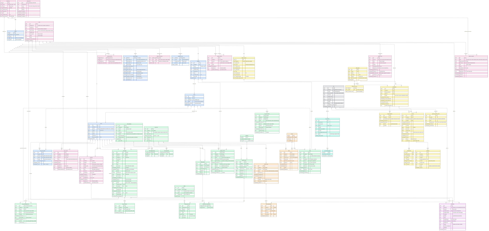
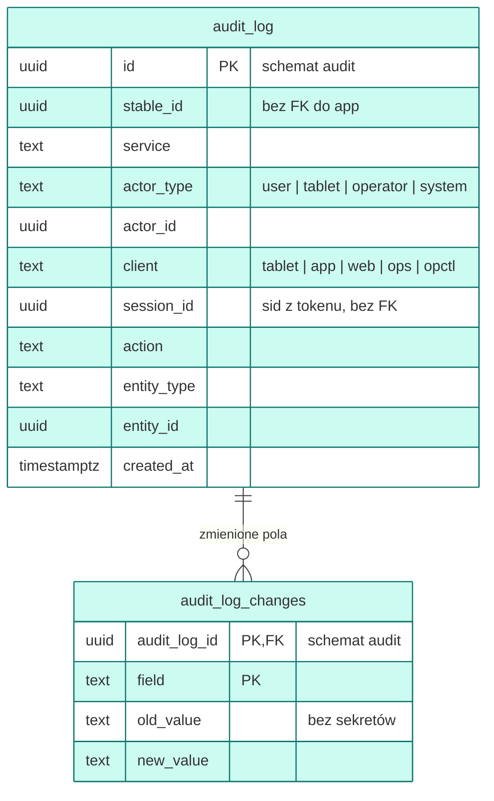

# EQUENOR: model danych (ERD) do zatwierdzenia

> Wersja robocza v3 · 2026-10-13, po feedbacku ze stajni, uwagach z 13.10 i decyzjach W3–W9. Podział na mikroserwisy i autoryzację opisuje [mikroserwisy.md](mikroserwisy.md); przy sprzeczności obowiązuje tamten dokument. Uwzględnia decyzje:
> - wyłącznie B2B: konto firmy z NIP (`businesses`, 1 konto = 1 NIP), NIP podaje się raz, przy rejestracji; admin konta ma dostęp do wszystkich stajni firmy;
> - 11 mikroserwisów w monorepo (decyzja 13.10: `operations`, `schedule`, `platform`, osobny `files`; nazwy serwisów po angielsku, np. `stables`), a każdy cron to osobny mikroserwis;
> - **crony piszą do bazy bezpośrednio** (W3), bez tokenów i bez wołania serwisów;
> - płatności (serwis `billing`);
> - **z Cognito rozmawia tylko `auth`** (W6): aplikacje logują, rejestrują i resetują hasło wyłącznie trasami `auth`, a tokeny Cognito nie wychodzą poza `auth`; tokeny EQUENOR i uprawnienia wydaje wyłącznie `auth`, a pozostałe serwisy tylko weryfikują podpis tokenu (W2);
> - **logowanie e-mailem albo telefonem i hasłem, zawsze z MFA:** po haśle kod e-mailem albo SMS-em, dla każdego konta, także technicznego i zespołu EQUENOR (W8, W9); bez logowania bez hasła, passkey i TOTP;
> - **weryfikacja konta po rejestracji:** konto działa dopiero po potwierdzeniu kodem (W8);
> - **kody generuje i sprawdza Cognito, a dostarczają je nasze serwisy `email` i `sms`** (W7);
> - **bez tabel sesji** (W4): access token i refresh token to JWT podpisane przez `auth`, nigdzie niezapisywane;
> - **SMS-y i e-maile wysyłają niezależne serwisy `sms` i `email`** bez tabel i dostępu do bazy; wszystko, także kody (W7), dostają z kolejki (W5);
> - pliki w S3, które obsługuje tylko serwis `files`;
> - koń i boks w relacji 0..1 do 0..1 (koń może stać bez boksu, boks bez konia);
> - bez WebSocketów i bez outboxów; zdarzenia między serwisami idą przez SNS + SQS;
> - tablet loguje się kontem technicznym z rolą Tablet (jedno na stajnię, propozycja), nie kontem osoby; boks wybiera się na tablecie przyciskiem „Zmień boks”, a wybór jest zapamiętany na tablecie (bez blokady i bez tabeli urządzeń); język tablicy też ustawia się na każdym tablecie osobno;
> - telewizor loguje się w zwykłym panelu kontem technicznym z rolą Wyświetlacz; widok tablicy wynika z roli;
> - stajnia może mieć kilka hal z boksami (`buildings`), każda z własnym adresem;
> - status flagi to tylko „potwierdzona” albo „niepotwierdzona” (w stajni, która wymaga potwierdzeń), bez śledzenia wyświetleń na tablecie;
> - boks jako kontener: obsługa zapisuje „Boks gotowy” jednym tapnięciem, a posiłki i padok jedną akcją dla całej hali; klient widzi boks swojego konia;
> - flagi mają godziny od–do i tylko one mogą wymagać potwierdzenia obsługi; czy wymagają, zależy od ustawień stajni;
> - ustawienia per stajnia: usługi (np. derki, moczenie paszy, szybkie przyciski), potwierdzenia flag, widoczność per rola i powiadomienia;
> - zakładanie stajni w 2 krokach: stajnia (z konfiguracją każdego boksu), potem powiadomienia;
> - role: Admin to rola konta firmy (wszystkie stajnie firmy); w stajni: Klient (właściciel albo dzierżawca konia), Obsługa, Instruktor oraz konta techniczne z rolą Wyświetlacz albo Tablet; Wsparcie IT to zespół EQUENOR, nie rola stajni; admin globalny (zespół EQUENOR) ma dostęp do każdej firmy, stajni i serwisu (wymaganie z 13.10);
> - konto firmy → stajnie → hale → boksy (`businesses`);
> - bez tabeli urządzeń i bez sesji tabletów w bazie (W4).

## Do zatwierdzenia

1. **Koń ↔ boks: najwyżej jeden do najwyżej jednego.**
   - `horses.box_id` ma unikalny indeks i dopuszcza `NULL`, więc jeden boks ma najwyżej jednego konia, a koń jest w najwyżej jednym boksie.
   - Koń może stać bez boksu, np. nowo kupiony i jeszcze nieprzypisany. Taki koń nie pojawia się na żadnym tablecie, a jego flagi widać w apce i na liście dnia obsługi.
   - Boks może stać pusty.
   - Koń, który opuścił stajnię (`status = left`), zwalnia boks. Zostaje w bazie razem z historią flag i zdrowia.
   - Zamiana dwóch koni to jedna transakcja w kodzie: koń A na chwilę bez boksu, koń B do boksu A, koń A do boksu B.
   - Każda zmiana zamyka i otwiera wpisy w `horse_box_history`. Unikalne indeksy pilnują, żeby otwarty był najwyżej jeden wpis na konia i jeden na boks.
   - Relacji pilnuje baza kluczem obcym i unikalnością, bez logiki w bazie.
2. **Tablet: konto techniczne tabletów i wybór boksu, bez tabeli urządzeń.**
   - Tablet loguje się kontem technicznym z rolą `tablet` w `stable_members` (pkt 14), nie kontem osoby. Propozycja: jedno konto tabletów na stajnię, np. „Tablety Pod Lipami” z e-mailem boksy@stajnielipowe.pl. Zaprasza je admin przez „Zaproś osobę” → „Konto techniczne: Tablet przy boksie” (`invitations.role = tablet`), a loguje się jak każde konto (pkt 6): e-mailem albo telefonem, hasłem i kodem, który przychodzi na skrzynkę albo telefon konta tabletów. Przy pierwszym logowaniu od razu wybór boksu, potem tablica boksu; przy zapamiętanym boksie od razu tablica. Samo urządzenie nie ma wiersza w bazie, a sesji w bazie nie ma wcale (W4): tablet trzyma refresh token (JWT od `auth`) w Android Keystore.
   - Jedno konto tabletów jest zalogowane na wszystkich tabletach stajni naraz.
   - Tablet pokazuje jeden boks. Wybrany boks zapamiętuje apka na tablecie. Serwer o tym wyborze nie wie, a jeden boks może być pokazywany na kilku tabletach.
   - Nie ma blokady boksu. Na tablicy jest przycisk „Zmień boks”, który otwiera listę boksów stajni konta tabletów pogrupowaną po halach. Stuknięcie w boks od razu przełącza tablet. Bez wyboru tablet po 30 s wraca do poprzedniego boksu.
   - Konto tabletów należy do jednej stajni, więc tablet nie wybiera stajni (bez osobnego ekranu wyboru stajni i bez przełącznika stajni): od razu po pierwszym zalogowaniu wybiera się boks.
   - **Język tablicy to ustawienie lokalne tabletu**, tak jak wybrany boks: ustawia się go w ustawieniach tabletu, osobno na każdym tablecie, a przełącznik PL | UA w stopce tablicy zostaje. Wybór zapamiętuje apka na tablecie i wysyła go w zapytaniu do `board` (propozycja). Bez tabeli i bez języków na poziomie stajni. Tłumaczenia nazw (np. pory posiłków po ukraińsku) to opcjonalne etykiety `*_labels` z `locale`; gdy etykiety w danym języku nie ma, tablica pokazuje nazwę po polsku (propozycja).
   - Tablica boksu nie pokazuje, kto jest zalogowany. Logowanie i wylogowanie są w ustawieniach tabletu.
   - Wylogowanie osoby, także ze wszystkich urządzeń, nie dotyka tabletów. Zgubiony tablet: jednego tabletu nie da się odłączyć, bo to wymagałoby sesji w bazie (W4). Admin klika w Ludziach przy koncie tabletów „Wyloguj wszystkie tablety” (podbija `users.token_version` tego konta) albo blokuje konto („Zablokuj”, pkt 14). W ciągu 5 min wszystkie tablety stajni tracą dostęp, a pozostałe loguje się ponownie hasłem i kodem; zgubiony tablet bez hasła i nowego kodu nie wraca (propozycja).
   - Na tablecie jest zalogowane konto techniczne, a nie osoba, więc akcji z tabletu (potwierdzenie flagi, „Boks gotowy”, „Woda” przy poidle ręcznym, „Podano śniadanie” i „Wyprowadzono na padok” dla hali tego boksu) nie przypisujemy nikomu. Zapisujemy `source = tablet`, boks i czas. Osobę zapisujemy tylko przy akcjach z apki albo panelu.
   - Status flagi to tylko „potwierdzona” (z godziną) albo „niepotwierdzona”. Tak pokazują go apka, panel, tablet i wyświetlacz. Dotyczy to stajni, która wymaga potwierdzeń (pkt 16). W stajni bez potwierdzeń flaga obowiązuje od razu i nie ma statusu. Nie śledzimy, czy flaga wyświetliła się na tablecie, ani tego, czy tablet działa. Skąd przyszło potwierdzenie (`flag_acknowledgements.method`, `box_id`), zostaje tylko w danych do audytu.
   - **Blokada ekranu (dotyku).**
     - Ekran jest dotykowy, więc przycisk „Zablokuj ekran” (kłódka) włącza blokadę na czas mycia albo wycierania tabletu.
     - Zablokowana tablica dalej się odświeża i jest czytelna, ale dotyk nic nie zmienia. Pasek mówi: „przytrzymaj kłódkę 3 s, aby odblokować”.
     - Pop-up nowej flagi (tylko w stajni z potwierdzeniami) pojawia się mimo blokady; żeby ją potwierdzić, trzeba odblokować ekran.
     - Blokada sama zdejmuje się po 10 minutach (propozycja), żeby tablet nie został zablokowany na stałe.
     - Stan trzyma tylko tablet, bez tabel. To blokada dotyku, a nie blokada boksu (tej nie ma).
   - Bez tabeli urządzeń i bez sesji w bazie nie ma zdalnych komend, telemetrii (bateria, Wi-Fi) ani listy tabletów i sesji w panelu. Diagnostyka tabletów, jeśli będzie potrzebna, trafia do logów i metryk, nie do bazy.
   - Założenia do potwierdzenia:
     - na tablecie jest zalogowane jedno konto naraz (pilnuje apka);
     - boks może zmienić każdy, kto stoi przy tablecie;
     - ustawienia tabletu otwiera się dłuższym przytrzymaniem, żeby nikt nie trafił w nie przypadkiem;
     - po wylogowaniu tablet pamięta wybrany boks i język i wraca do nich po kolejnym logowaniu.
3. **Boks jako kontener, rutyna obsługi i widok klienta.**
   - Boks ma tylko podstawowe dane. Codzienna rutyna obsługi to trzy szybkie akcje, żeby było jak najmniej klikania:
     - **„Boks gotowy”** (sprzątanie i ścielenie razem): per boks, jedno tapnięcie na tablecie przy boksie albo zaznaczenie kilku boksów w apce i jeden zapis. Wpis trafia do `box_care_events` (`kind = tidy`). Boks ogarnia się codziennie, czasem 2–3 razy dziennie, więc wpisów może być kilka, a „Boks gotowy dziś 07:10” to najnowszy.
     - **„Podano śniadanie”** (tak samo obiad, kolację i każdą porę ze słownika `meal_slots`, np. „Siano 21:00”): jedna akcja dla całej hali w `building_routines` (`kind = meal_served`), z apki obsługi albo z tabletu przy dowolnym boksie tej hali. Etykieta przycisku idzie za porą posiłku. Koń z flagą, która wstrzymuje ten posiłek w jego godzinie, jest pomijany i wypisany jako pominięty. Nie ma potwierdzania karmienia per koń.
     - **„Wyprowadzono na padok”**: jedna akcja dla całej hali (`kind = paddock_out`), też z apki albo z tabletu. Obejmuje konie z planem padoku na teraz i pomija konie z flagą „Nie na padok” obowiązującą w tym czasie.
     - Zasada spójności: gdzie pokazujemy, kiedy coś zrobiono (posiłek, padok, sprzątanie boksu), obsługa ma też przycisk, żeby to zapisać. Tablet przy boksie ma więc trzy szybkie akcje: „Boks gotowy” (ten boks), posiłek i padok (cała hala), o ile stajnia ich nie wyłączyła (pkt 16). Klient i wyświetlacz tylko je oglądają.
     - Każdą akcję można cofnąć przez godzinę od zapisu (`cancelled_at`, propozycja), np. gdy ktoś stuknął niewłaściwą halę. Z tabletu akcja nie ma autora, z apki ma.
   - **Poidło to ustawienie boksu** (`boxes.auto_waterer`). Ustawia je admin już przy tworzeniu boksów (pkt 11) albo później w szczegółach boksu. Formularz podpowiada poidło automatyczne (wartość nadaje kod).
     - Przy automatycznym poidle znacznik wody nie wyświetla się nigdzie, bo zawsze jest w porządku.
     - Boks z poidłem ręcznym (np. wiadro, gdy automat czeka na wymianę) pokazuje na tablecie, wyświetlaczu, w apce i panelu znacznik „Poidło ręczne” z godziną ostatniego dolania. Ma też szybką akcję „Woda” (`box_care_events.kind = water`), dostępną tylko dla takiego boksu.
   - Nie ma osobnych wpisów „siano” i „karma”.
   - Pozycja planu karmienia może mieć informację „namoczyć” i ile (`feeding_plan_items.soak`, `soak_note`, np. „w 2 l wody”), jeśli stajnia ma włączone moczenie paszy (pkt 16). To wersja prosta: model karmienia jest otwartą kwestią.
   - **Historia boksu** to flagi konia (utworzenie, potwierdzenie, odwołanie) i zdarzenia z przycisków obsługi. Widzi ją klient konia, który stoi w boksie (od dnia, w którym koń do niego trafił), obsługa i admin.
   - **Tablet nie pokazuje historii**, tylko „Ostatnie akcje”: najwyżej 5 najnowszych wpisów boksu i konia, bez przewijania i bez przycisku „Cała historia”. Pełną historię widać w apce i panelu web.
   - **Klient** (rola `client`) to osoba, która przyprowadza konia do stajni: właściciel albo dzierżawca konia. Dla stajni to ten sam klient.
     - Dostęp ma przez `horse_access` (rola `client`), także przez zaproszenie (`invitations.horse_id`).
     - Widzi swojego konia i boks, w którym koń stoi, oraz ustawia i odwołuje jego flagi.
     - Osobnego najmu boksu bez konia nie ma, więc tabela `box_access` odpada.
   - **Widok klienta jest maksymalnie prosty:** kafelki flag włączonych w ustawieniach stajni, opcjonalna notatka i godziny podpowiedziane przez szablon, które można zmienić. Na ekranie „Mój boks” sekcja „Ostatnio” pokazuje tylko zdarzenia z przycisków obsługi (gdy stajnia je wyłączyła, sekcji nie ma), a „Historia” flagi (z potwierdzeniami) i zdarzenia z przycisków obsługi.
   - **Obsługa** (`staff`) może z apki i panelu web robić to samo co klient, ale dla wszystkich koni w stajni, oraz wykonuje szybkie akcje i zadania.
   - Dostęp ma ramy czasowe (`valid_from`, `valid_to`) i można go odebrać (`revoked_at`), np. gdy koń opuszcza stajnię albo kończy się dzierżawa.
   - Każde zaproszenie ma obowiązkowy termin ważności (`invitations.expires_at`, domyślny czas ustawia kod). Wygasłe zaproszenie nie dopasowuje się (pkt 6), a admin może wysłać nowe.
4. **Wyświetlacz centralny (TV z Raspberry Pi).**
   - Telewizor z Raspberry Pi otwiera w przeglądarce, w trybie kiosku, zwykłą stronę logowania panelu web, bez osobnego adresu. Strona nie wie, że to telewizor: po zalogowaniu kontem z rolą `display` panel sam pokazuje widok tablicy (wszystkie boksy), bo tak każe rola (routing po roli). Strona sama odpytuje serwer co kilka sekund, tak jak tablet.
   - Wyświetlacz loguje się kontem technicznym z rolą `display` w `stable_members`: e-mailem albo numerem telefonu i hasłem, a potem kodem, który przychodzi e-mailem albo SMS-em na skrzynkę albo telefon tego konta, tak jak każde konto (pkt 6). Konto zaprasza admin przez „Zaproś osobę” → „Konto techniczne: Wyświetlacz” (`invitations.role = display`). Bez osobnego ekranu logowania, adresu technicznego do kodu i formularza wyświetlacza. Zalogowanie podtrzymuje refresh token (JWT od `auth` w ciasteczku `HttpOnly`, bez sesji w bazie, W4): 30 dni bezczynności, najwyżej 365 dni (propozycja). Admin blokuje konto w Ludziach („Zablokuj”, pkt 14).
   - Rola `display` daje tylko odczyt widoku wszystkich boksów: konie, flagi, posiłki, zdarzenia przy boksie. Bez danych osobowych (telefony, e-maile) i bez zapisu.
   - Przy kilku halach strona pokazuje wszystkie hale, każdą w osobnej sekcji.
   - Każda sekcja hali ma przycisk „Pełny ekran”. Hala zajmuje wtedy cały ekran, większymi kaflami, a pasek pilnych flag i panel boczny pokazują tylko tę halę. Przycisk „Wszystkie hale” wraca do widoku wszystkich.
   - Wybór widoku zapamiętuje przeglądarka na tym telewizorze, tak jak tablet pamięta wybrany boks. Telewizor w hali głównej ustawia się więc raz na pełny ekran tej hali (myszką przy instalacji albo pilotem przez HDMI-CEC). Serwer o tym nie wie i nie potrzeba tabeli wyświetlaczy.
   - Jedno konto `display` może obsłużyć wszystkie telewizory stajni. Admin może też zaprosić osobne konto na każdy telewizor (np. osobny e-mail), jeśli chce blokować je pojedynczo.
   - Gdy boksów jest dużo, strona zmniejsza kafle do wersji skróconej (numer, koń, flaga, posiłki). Jeśli dalej się nie mieszczą, przełącza strony co 20 s. Pasek pilnych flag zostaje zawsze na górze. W widoku wszystkich hal obejmuje wszystkie hale, a na pełnym ekranie tylko tę halę.
   - Nie potrzeba nowych tabel.
5. **Jedna baza: schemat `app` dla wszystkich serwisów i osobny schemat `audit`.**
   - Każda tabela ma jeden serwis-właściciela (tabela niżej). Piszą do niej właściciel i crony, którym manifest `packages/db/owners.ts` daje zapis do tej tabeli (W3, sekcja „Crony”); pozostałe serwisy mogą ją czytać. `sms` i `email` nie mają roli bazy (W5).
   - Wyjątek (13.10, propozycja): tabele uprawnień serwisu `auth` (`business_admins`, `stable_members`, `horse_access`, `invitations`, `stable_role_features`, `platform_roles`, `platform_requests`, `signing_keys`) czyta tylko `auth`, a `notifications` (adresy i treść wiadomości) tylko `notifications`. Crony mają do tabel `auth` tylko wąskie granty kolumnowe, które nie są autoryzacją (W2 zostaje): `invitation-expiry-notifier` czyta `invitations` bez `target`, `horse-left-reconciler` zamyka `horse_access` (`revoked_at`, `version`, `updated_at`), `retention-pruner` usuwa stare `platform_requests`; kolumny: mikroserwisy.md 1.5. Z `users` inne serwisy widzą tylko `id`, `display_name`, `locale`, `identity_pool` i `deleted_at` (grant kolumnowy), a `businesses` czytają `stables` i `billing`. Kim jest użytkownik i co może, serwisy wiedzą z podpisanego tokenu (mikroserwisy.md, sekcja 1).
   - Klucze obce są normalne, także między tabelami różnych serwisów.
   - Dzięki temu nie ma replik ani synchronizacji danych między serwisami. Na przykład `board` składa stan tablicy, czytając wprost konie, flagi i plany karmienia.
   - Serwisy czytają te same tabele, więc mają jeden schemat `app`. Definicja tabel i migracje leżą w jednym pakiecie monorepo (`packages/db`), a serwisy importują z niego typy tabel.
   - Audit jest w osobnym schemacie `audit` (`audit_log`, `audit_log_changes`), bez kluczy obcych do `app`.
     - Każdy serwis i każdy cron dopisuje wpis audytu w tej samej transakcji co zmiana (cron z `actor_type = system`), więc nie da się zmienić danych bez śladu i nie potrzeba do tego kolejki.
     - Role bazy serwisów i cronów mają w schemacie `audit` tylko `INSERT`, bez odczytu, zmiany i usuwania, poza `retention-pruner`: on usuwa wpisy starsze niż retencja (`DELETE` i `SELECT` tylko kolumn potrzebnych do usuwania: `id`, `created_at`, `audit_log_id`; decyzja 13.10, dotąd sprzątał serwis `audit`).
     - Czyta `platform`; `retention-pruner` widzi tylko kolumny potrzebne do usuwania.
   - Koszt: zmiana kolumny czytanej przez inne serwisy musi być zgodna wstecz (najpierw dodać, potem usunąć).
6. **Tożsamość: Cognito uwierzytelnia za `auth`, `auth` wydaje tokeny.**
   - **Z Cognito rozmawia tylko `auth` (W6).** Aplikacje (apka, panel, tablet, TV, panel zespołu, `opctl`) wołają wyłącznie trasy `auth`, bez bibliotek Cognito i Amplify. `auth` ma poufnego klienta Cognito (sekret tylko w `auth`, jeden klient na pulę) i po stronie serwera loguje, rejestruje, potwierdza konta, resetuje hasła i zmienia e-mail albo telefon.
   - `users.cognito_sub` wiąże nasz profil z kontem w puli Cognito. Pule są dwie: klientów i zespołu EQUENOR (`users.identity_pool`, propozycja). Hasła trzyma Cognito. Jest też źródłem prawdy dla telefonu i e-maila, a `users` trzyma ich kopię do powiadomień (kontakty zna tylko `auth`).
   - **Logowanie (W8, W9):** e-mail albo telefon i hasło, potem zawsze kod e-mailem albo SMS-em (MFA wymagane w obu pulach), dla każdego konta: osób, kont technicznych i zespołu EQUENOR. Bez wyjątków, zapamiętywania urządzeń i wyłączania. Kod idzie kanałem, którym konto potwierdzono; kto ma potwierdzony i e-mail, i telefon, wybiera kanał w profilu (zapisuje go Cognito, bez kolumny w `users`, propozycja). Niepotwierdzone konto się nie zaloguje.
   - **Kody (W7)** generuje i sprawdza Cognito (także ich ważność), a dostarczają nasze serwisy: wyzwalacze Cognito custom email sender i custom SMS sender (cienki kod `auth`) składają wiadomość w języku użytkownika i wrzucają ją do kolejki `email` albo `sms`, z pominięciem `notifications`. Kody nie trafiają do bazy.
   - **Tokeny EQUENOR wydaje tylko `auth`** (W2), i to dopiero po haśle i kodzie (`amr`: `pwd`, `otp`). Z tokenów Cognito czyta `sub` i zweryfikowany e-mail albo telefon i je wyrzuca; aplikacja ich nie dostaje. Wydaje access token (JWT ES256 podpisany kluczem w AWS KMS, ważny 5 min) i refresh token (też JWT od `auth`, z `sid`, początkiem sesji i `users.token_version`). Między hasłem a kodem aplikacja trzyma tylko krótki token logowania podpisany przez `auth` (z sesją Cognito w środku), bez zapisu w bazie (propozycja). Sesji w bazie nie ma (W4): odświeżenie nie wymaga kodu, a `auth` sprawdza przy nim we własnych tabelach konto, `token_version`, aktywność konta technicznego i rolę platformową i liczy claimy od nowa. Pozostałe serwisy weryfikują podpis lokalnie (JWKS) i czytają role z tokenu (propozycja, mikroserwisy.md, sekcja 3).
   - **Rejestracja (W8):** e-mail albo telefon, hasło (polityka haseł Cognito, propozycja: min. 10 znaków), imię i język (atrybut `locale`, w nim przychodzą kody), potem kod weryfikacyjny i potwierdzenie konta; kod można wysłać ponownie. Po potwierdzeniu zwykłe logowanie hasłem i kodem. Wiersz `users` serwis `auth` tworzy dopiero przy pierwszym logowaniu potwierdzonego konta (po `identity_pool` i `cognito_sub`, z imieniem z rejestracji, a u konta technicznego z nazwą z zaproszenia; propozycja), więc niepotwierdzonych kont w bazie nie ma. Przy kolejnych logowaniach odświeża tylko kopię telefonu i e-maila.
   - **„Nie pamiętam hasła”:** kod resetu (W7) i nowe hasło. Kod resetu Cognito wysyła innym kanałem niż kod MFA, więc konto z jednym kontaktem nie zresetuje hasła samo (do decyzji: mikroserwisy.md 10.2 pkt 24). **Zmiana e-maila, telefonu albo hasła** w profilu wymaga hasła i kodu MFA, a nowy kontakt także kodu z tego kontaktu (bez tokenów Cognito poza `auth`, mikroserwisy.md 5.2); kopia w `users` zmienia się dopiero po potwierdzeniu.
   - Usunięcie konta to pseudonimizacja w `users` i usunięcie konta w Cognito.
   - Zaproszenie idzie na numer telefonu (SMS) albo na e-mail (`invitations.channel`). Nie ma własnego tokenu ani ekranu „Przyjmij”: przy logowaniu `auth` dopasowuje zweryfikowany telefon albo e-mail z Cognito do `invitations.target` i od razu zapisuje członkostwo (klientowi także dostęp do konia) oraz `accepted_at`. Wygasłe (`expires_at`) albo odwołane (`revoked_at`) zaproszenie się nie dopasowuje. Osoba bez konta najpierw rejestruje się na ten telefon albo e-mail; imię i język podaje przy rejestracji.
   - Tablet wysyła token konta tabletów, identyfikator (`id`) wybranego boksu i język tablicy (pkt 2).
   - Rejestracja konta firmy to rejestracja i potwierdzenie konta, pierwsze logowanie (hasło i kod) i formularz z NIP-em (pkt 15).
7. **Pliki w S3.**
   - `files` trzyma metadane, `s3_key` (z prefiksem `stable_id/`) i właściciela (`owner_service`, `owner_id`).
   - S3 dotyka tylko serwis `files` (osobny mikroserwis, decyzja 13.10) i jego cron `files-gc`. Inne serwisy zapisują i pobierają pliki przez `files /internal`.
   - Link do pobrania wydaje tylko serwis-właściciel po sprawdzeniu uprawnień. Na przykład `schedule` sprawdza widoczność wpisu i dostęp do konia (z tokenu), a dopiero potem prosi `files` o krótko ważny presigned URL.
8. **Bez WebSocketów.**
   - Tablet sam regularnie, co kilka sekund, pyta serwis `board` o stan wybranego boksu. Serwer nie trzyma żadnego stanu tablic.
   - `board` nie ma własnych tabel: przy każdym zapytaniu składa odpowiedź z danych w bazie. `ETag` to hash odpowiedzi, więc gdy nic się nie zmieniło, tablet dostaje `304`.
   - Między serwisami: kolejki **SNS + SQS**, bez outboxów.
     - Serwis po zatwierdzeniu transakcji publikuje zdarzenie do tematu SNS (jeden temat na rodzaj zdarzenia). Cron publikuje przed COMMIT tej samej transakcji (wyjątek, sekcja „Crony”), więc konsument zdarzenia crona, które zmienia stan, czyta źródło w bazie.
     - Każdy konsument ma własną kolejkę SQS z kolejką błędów (DLQ).
     - SQS może dostarczyć wiadomość więcej niż raz, więc obsługa jest idempotentna: zapisy opierają się na unikalnych kluczach w tabelach docelowych, bez osobnej tabeli `inbox`.
   - Bez outboxu zdarzenie może zginąć, gdy serwis padnie między zapisem w bazie a publikacją. Dlatego żadna krytyczna ścieżka nie opiera się wyłącznie na zdarzeniu:
     - eskalacje liczy cron prosto z bazy;
     - `board` przy odpytywaniu porównuje wersje w bazie;
     - cron uzgadniający poprawia skutki `horse.left`.
   - SMS-y i e-maile wysyłają niezależne serwisy `sms` (AWS, SMS) i `email` (SES), bez tabel i bez roli bazy (W5). Każdy czyta swoje kolejki SQS FIFO: powiadomienia od `notifications` i osobną kolejkę kodów od wyzwalacza Cognito w `auth` (W7, propozycja, mikroserwisy.md 5.2; treści kodów nie loguje). Wynik (`sms.result`, `email.result`; `failed` przy błędzie stałym albo po ostatniej próbie) publikuje tylko dla powiadomień, a wysyłki kodów idą do metryk. Ponowienia i DLQ powiadomień daje SQS; grupy i deduplikacja: mikroserwisy.md 5.8.
9. **Sloty posiłków i padoki należą do `operations`, a kryte ujeżdżalnie (`arenas`) do `schedule`**, bo te serwisy z nich korzystają. Ujeżdżalnie to co innego niż hale z boksami (`buildings`).
10. **Płatności (`billing`).**
   - Płaci stajnia: ma konto rozliczeniowe (dane do faktury) i subskrypcję planu. Czy zamiast niej ma płacić konto firmy, zob. „Otwarte kwestie”.
   - NIP pochodzi z konta firmy: kod kopiuje `businesses.tax_id` do `billing_accounts.tax_id` przy zakładaniu stajni, razem z nazwą, adresem siedziby i e-mailem do faktur (propozycja). NIP-u nie wpisuje się w stajni ani w płatnościach.
   - Comiesięczny cron zapisuje zużycie (np. boksy z koniem). Z niego cron `billing-invoicing` zapisuje fakturę z pozycjami i publikuje `invoice.issued`; PDF tworzy potem serwis `billing` i zapisuje przez `files`. Płatności przychodzą od dostawcy przez webhooki.
   - Kwoty są w groszach (`bigint`).
   - Status subskrypcji steruje `stables.status`: brak płatności daje `suspended`.
   - Dostawca płatności i system faktur (KSeF) są do wyboru; w modelu są tylko identyfikatory zewnętrzne.
11. **Hale, czyli budynki z boksami.**
   - Stajnia może mieć kilka hal. Hala to wiersz w `buildings` (nazwa nadana przez admina, kolejność, aktywność). Każdy boks należy do jednej hali (`boxes.building_id`, wymagane).
   - Hala ma własny adres (`address_line1`, `address_line2`, `postal_code`, `city`, `country_code`), bo hale jednej stajni mogą stać pod różnymi adresami. Adres widać w panelu przy hali i w szczegółach boksu.
   - Nowa stajnia dostaje od kodu jedną halę. Dopóki stajnia ma jedną halę, apka, panel, tablet i wyświetlacz nie pokazują podziału na hale.
   - Adres pierwszej hali to adres podany przy zakładaniu stajni, a jej boksy podaje się w pierwszym kroku „Załóż stajnię” (pkt 17).
   - **Boksy konfiguruje się od razu przy tworzeniu** („Załóż stajnię” i „Dodaj halę”):
     - po podaniu zakresu numerów („od 1 do 6”) widać listę boksów, a każdy wiersz ma swoje ustawienia: numer (`boxes.label`) i poidło automatyczne albo ręczne (`boxes.auto_waterer`); akcja „Ustaw dla wszystkich” zmienia ustawienie we wszystkich wierszach;
     - „Więcej ustawień” to miejsce na kolejne ustawienia boksu. Dojdą jako kolumny `boxes` i będą w tym samym wierszu przy tworzeniu i w szczegółach boksu.
   - Nową halę dodaje admin w panelu web: Boksy i konie → „Dodaj halę”.
     - Podaje nazwę i adres (może skopiować adres innej hali).
     - Potem wybiera jedno: dodaje nowe boksy z zakresu numerów i od razu konfiguruje każdy (wyżej; każda hala numeruje boksy od siebie, np. od 1), przenosi istniejące boksy albo zostawia halę pustą.
     - Serwis `stables` zapisuje halę i boksy w jednej transakcji i dopisuje audyt.
     - Innym serwisom nic nie trzeba wysyłać: tablet („Zmień boks”) i wyświetlacz widzą nową halę przy najbliższym odpytaniu.
   - Usunąć można tylko pustą halę. Halę z boksami trzeba najpierw opróżnić (przenieść boksy) albo wyłączyć (`active = false`).
   - Boksy numeruje się w obrębie hali, więc każda hala może mieć swój boks 1. Numer (`boxes.label`) nie jest unikalny: baza tego nie pilnuje, a kod nie blokuje powtórzeń. Boks rozpoznajemy po `id`. Gdy stajnia ma więcej niż jedną halę, interfejs zawsze pokazuje halę razem z numerem, np. „Hala nowa · boks 4”.
   - Przeniesienie boksu do innej hali (np. po przebudowie) to zmiana `building_id`. Koń, historia i zdarzenia zostają przy boksie.
   - Hale widać na liście boksów w apce i panelu (grupy i filtr), przy wyborze boksu na tablecie (zakładki hal) i na wyświetlaczu centralnym (sekcje hal, każda z opcją pełnego ekranu).
   - Hale z boksami to co innego niż kryte ujeżdżalnie do jazd (`arenas` w serwisie `schedule`).
12. **Flagi: godziny i potwierdzenia.**
   - Potwierdzenia obsługi mogą wymagać wyłącznie flagi, czyli wyjątki od rutyny („Bez śniadania”, „Nie na padok”, „Derka”, „Leki” itd.). Czy wymagają, zależy od ustawień stajni: przełącznik „Flagi wymagają potwierdzenia” (`stable_settings.flags_require_ack`, pkt 16).
     - Włączony (np. duża stajnia z wieloma stajennymi): przepływ nowa flaga → pop-up na tablecie → potwierdzona.
     - Wyłączony (np. właściciel sam jest stajennym): flaga obowiązuje od razu. Nie ma pop-upu do potwierdzenia, statusu oczekiwania u klienta ani eskalacji. Flaga od razu stoi na tablicy boksu.
     - Przy zapisie flagi kod kopiuje bieżące ustawienie do `horse_flags.requires_ack`, więc zmiana przełącznika nie zmienia flag, które już trwają.
   - **Godziny są obowiązkowe i działają naprawdę:**
     - każda flaga ma początek i koniec: `horse_flags.valid_from` i `valid_to`, oba wymagane, czas w strefie stajni. „Do odwołania” nie ma;
     - szablon podpowiada okno (`flag_templates.default_window`): „Bez śniadania” dziś 06:00–10:00, „Nie na padok” w godzinach padoku, „Derka” 16:00–08:00. Klient może je zmienić;
     - skutki liczy kod z godzin, przy każdym zapytaniu `board` i przy akcjach zbiorczych. `suspend_meal` wstrzymuje tylko posiłki, których godzina wypada w oknie flagi. `cancel_paddock` skraca albo odwołuje padok tylko w oknie flagi;
     - przykład: wet o 8:00 i kowal o 15:00, więc flagi „Bez śniadania 06:00–10:00” i „Nie na padok 14:30–16:00” pozwalają koniowi wyjść na padok między wizytami (10:00–14:30);
     - tablet, wyświetlacz i apka pokazują godziny przy fladze, a flagę, która zacznie się później, oznaczają „od 14:30”.
   - **Flaga „Derka”** (szablon `derka`) ma wariant `horse_flags.variant`: `on` znaczy zakładać, `off` nie zakładać. Jest tylko w stajni, która oferuje zakładanie derek (szablon aktywny, pkt 16).
   - Termin potwierdzenia i eskalacje (`ack_deadline_at`, `warn_at`, `notify_at`) liczy się od początku okna flagi i tylko dla flag z `requires_ack`.
13. **Zadania jednorazowe.**
   - Zadanie wpisuje admin (zarządca albo właściciel, rola konta firmy z pkt 14), np. „Poidło w boksie 5 do wymiany”. Może wskazać halę, boks albo konia.
   - Stajenny w apce sam wybiera zadanie z listy i bierze je na siebie („Biorę”: `taken_by`, `taken_at`), a potem oznacza jako zrobione (`done_by`, `done_at`). Tablet zadań nie obsługuje, bo potrzebna jest osoba.
   - Zadań cyklicznych nie ma, więc odpadają `task_occurrences` i cron `task-occurrence-generator`. Codzienną rutynę obsługują szybkie akcje z pkt 3.
14. **Role.**
   - **Admin to rola konta firmy**, a nie stajni: tabela `business_admins` (`business_id`, `user_id`, `created_at`; PK złożony `business_id`, `user_id`) w serwisie `auth` (propozycja); w tokenie to claim `biz`.
     - Admin konta (właściciel albo zarządca) ma dostęp do wszystkich stajni firmy, także nowych, bez przypisywania. Nie potrzebuje wiersza w `stable_members`.
     - Wszystko, co jest „tylko dla admina” (ustawienia stajni, reguły powiadomień, hale, poidło, zadania, zaproszenia), może admin konta, do którego należy stajnia (`stables.business_id`). Admin innego konta firmy tej stajni nie widzi.
     - Pierwszego admina zapisuje rejestracja konta firmy (pkt 15). Kolejnych adminów konta dodaje admin globalny we dwie osoby, z powiadomieniem obecnych adminów firmy (propozycja, mikroserwisy.md 4.3).
   - Pozostałe role przypisuje się per stajnia w `stable_members.role`: role osób `staff` (obsługa), `instructor`, `client` (klient, pkt 3) oraz role kont technicznych `display` (telewizor, pkt 4) i `tablet` (tablety przy boksach, pkt 2). Jedna osoba może mieć członkostwa w kilku stajniach (jedno na stajnię: `stable_id` z `user_id` są unikalne), np. obsługa w dwóch stajniach tej samej firmy; apka przełącza wtedy stajnię.
   - **Konto techniczne** to konto z rolą `display` albo `tablet`: w zaproszeniu osobna grupa ról, w Ludziach filtr „Konta techniczne”. Osobnej tabeli nie ma, to zwykłe konto w Cognito i `users` z `account_kind = technical` (propozycja): bez firmy, drugiej stajni i ról osób, a jego zaproszenie nie dopasuje się do istniejącego konta (`409 target_in_use`). Loguje się jak każde konto (pkt 6): e-mailem albo telefonem, hasłem i kodem, który przychodzi na skrzynkę albo telefon tego konta, a po zalogowaniu od razu ma swój widok według roli: `display` tablicę wszystkich boksów (pkt 4), `tablet` wybór boksu przy pierwszym logowaniu, potem tablicę boksu, a przy zapamiętanym boksie od razu tablicę (pkt 2). Ma członkostwo w jednej stajni i nie łączy się z rolami osób (propozycja).
   - **Odebranie dostępu** (usunięcie ze stajni, zmiana roli, macierz widoczności, dostęp do konia) działa przy najbliższym odświeżeniu tokenu, czyli do 5 min, bez listy unieważnień (W4); taki jest też limit w testach akceptacyjnych. Od razu działają koń `left` (404 z danych zasobu) i nowa stajnia admina konta (`biz`).
   - **„Zablokuj” przy koncie technicznym** (Ludzie, tylko admin konta) znaczy to samo dla telewizora i tabletów: `stable_members.active = false` i podbicie `users.token_version` konta. Najpóźniej po 5 min urządzenie dostaje odmowę przy odświeżeniu tokenu i pokazuje ekran blokady bez starych danych (tablet: „TO KONTO NIE MA JUŻ DOSTĘPU DO TEJ STAJNI”, telewizor: „WYŚWIETLACZ ZABLOKOWANY”). „Odblokuj” przywraca `active`; urządzenia trzeba zalogować ponownie hasłem i kodem, bo stare refresh tokeny mają starą wersję, a potem wracają do zapamiętanego boksu, języka albo widoku (propozycja). Konto tabletów ma też „Wyloguj wszystkie tablety”: samo podbicie `token_version`, bez blokady (pkt 2).
   - **Wsparcie IT** (dawniej „serwisant”) to wewnętrzny zespół EQUENOR, a nie rola stajni: stajnia go nie zaprasza ani nie konfiguruje, więc nie ma go w `stable_members`, `invitations` ani `stable_role_features`. Dostęp to rola platformowa `plt = support` w tabeli `platform_roles` serwisu `auth`, na PoC nienadawana (propozycja); w audycie `actor_type = operator`. Zakres: lista firm i stajni, numery boksów, konta techniczne i ich status, wydania APK i diagnostyka, bez danych koni i klientów (404); ukryte ustawienia tabletu działają bez logowania; w apce Wsparcie IT nie ma widoku.
   - **Admin globalny** (wymaganie z 13.10: „wjazd wszędzie”): rola platformowa `plt = admin` zespołu EQUENOR (w danych demo Kuba, propozycja). Ma dostęp do każdej firmy, stajni i serwisu na prawach admina konta oraz trasy `/platform`. Loguje się przez `auth` w osobnej puli Cognito, jak wszyscy hasłem i kodem e-mailem albo SMS-em (W9), na osobnym hoście panelu, z powodem wejścia; zapis wrażliwy wymaga świeżego logowania (step-up: ponownie hasło i kod); rolę nadają dwie osoby (`platform_roles`, `platform_requests`); każdy zapis ma w audycie `actor_type = operator` i `session_id` (`sid` z tokenu, bez tabeli sesji); powód wejścia trafia do audytu przy logowaniu jako wpis `action = ops_login` z tym samym `session_id` i polem `reason` w `audit_log_changes` (propozycja), a każdy odczyt trafia do logu odczytów. Dostęp, który nada w stajni, ma `granted_via = platform` (propozycja, mikroserwisy.md, sekcja 4).
15. **Konto firmy (B2B) → stajnie → hale → boksy.**
   - Zakładamy wyłącznie konta firm. Konto firmy to wiersz w `businesses`:
     - `tax_id`: NIP, z unikalnym indeksem, więc 1 konto = 1 NIP. Drugą rejestrację z tym samym NIP-em odrzuca indeks, a panel mówi „Ten NIP ma już konto w EQUENOR”;
     - `name`: nazwa firmy;
     - adres siedziby: `address_line1`, `address_line2`, `postal_code`, `city`, `country_code` (jak adres hali);
     - `invoice_email`: e-mail do faktur.
   - Konto firmy zakłada się samodzielnie przy rejestracji: po rejestracji, potwierdzeniu konta kodem i pierwszym logowaniu (pkt 6) osoba podaje NIP i dane firmy, a serwis `auth` zapisuje w jednej transakcji `businesses` i ją jako admina konta (`business_admins`) (propozycja, 13.10). NIP podaje się raz.
   - Stajnie dodaje admin konta („Załóż stajnię”, pkt 17) bez ponownego pytania o NIP i dane firmy: nowa stajnia dostaje `business_id` konta.
   - Jedno konto firmy może mieć kilka stajni (`stables.business_id`). Dane i izolacja zostają na poziomie stajni (`stable_id`); wyjątkiem jest admin konta, który ma dostęp do wszystkich stajni firmy (pkt 14). Płatności zostają przy stajni, a NIP pochodzi z konta firmy (pkt 10, „Otwarte kwestie”).
16. **Ustawienia stajni (konfiguracja per stajnia).**
   - Stajnie działają różnie: jedna nie oferuje derek ani moczenia paszy, inna ma pełną opcję. Właściciel, który sam jest stajennym, nie potwierdza flag, a stajnia ze 100 boksami i 10 stajennymi tego wymaga. Dlatego część zachowania aplikacji ustawia admin konta (właściciel albo zarządca) na ekranie „Ustawienia stajni” w panelu web.
   - Ustawienia są per stajnia (`stable_id`), a nie dla całego konta firmy. Na PoC są to przełączniki gotowych opcji, bez własnych reguł:
     - **Potwierdzenia:** „Flagi wymagają potwierdzenia” (`stable_settings.flags_require_ack`), skutki w pkt 12;
     - **Usługi:**
       - zakładanie derek, czyli flaga „Derka” (`flag_templates.active` szablonu `derka`);
       - moczenie paszy, czyli „namoczyć” i ile (`stable_settings.soak_enabled`);
       - pozostałe flagi, każda osobno (`flag_templates.active`);
       - szybkie przyciski obsługi: „Boks gotowy” (`tidy_enabled`), posiłek (`meal_served_enabled`) i padok (`paddock_out_enabled`). „Woda” zależy od poidła boksu (pkt 3);
     - **Widoczność per rola** (`stable_role_features`): admin zaznacza, co widzą role `client`, `staff`, `instructor`, `tablet` i `display`. Funkcje to stała lista (sekcja „Słowniki”). Admin widzi wszystko. `tasks` i `box_history` nie dotyczą tabletu, bo tablet nie pokazuje zadań (pkt 13) ani historii (pkt 3): w macierzy te pola tabletu są nieaktywne, a w `stable_role_features` nie ma dla nich wierszy roli `tablet`. Macierz należy do serwisu `auth` i trafia do tokenu (`f`), bo ukryta funkcja to odmowa na trasie (propozycja, 13.10).
     - **Powiadomienia** (`notification_rules`): które zdarzenia, do kogo i jakim kanałem; ustawia się je w drugim kroku zakładania stajni (pkt 17).
   - **Wyłączona opcja znika:** kafelek flagi, „namoczyć”, przycisk albo sekcja nie pokazują się klientowi, obsłudze, na tablecie ani na wyświetlaczu. Zgodnie z zasadą spójności z pkt 3 znika też stan tego, czego nie da się zapisać.
     - Wyłączony szybki przycisk znika razem ze stanem wykonania, np. „Boks gotowy dziś 07:10”, „podane 06:40” albo „Wyprowadzono na padok wczoraj 10:05”. Plan karmienia zostaje, bo to osobna funkcja (widoczność `feeding_plan`), a godziny posiłków zostają jako plan dnia (np. „Następny posiłek: obiad 12:00”).
     - Wyłączony „Padok” chowa też plan padoku (godziny i towarzyszy) wszędzie: na tablecie, wyświetlaczu i w apce (lista koni, karta konia), bo stajnia nie prowadzi wtedy padoków w aplikacji. Flaga „Nie na padok” zostaje, jeśli jest włączona; podpowiada wtedy okno „dziś, cały dzień” (propozycja).
     - „Woda” przy poidle ręcznym zostaje, bo nie ma przełącznika (pkt 3). Sekcja „Szybkie akcje” na tablecie znika, gdy nie ma w niej żadnego przycisku; w boksie z poidłem ręcznym zostaje z samą „Wodą”.
   - Zmiana ustawień działa przy najbliższym odpytaniu (apka, tablet, wyświetlacz), a zmiana widoczności per rola do 5 min, po odświeżeniu tokenu (pkt 14). Wpisy już zapisane zostają w „Historii” (apka, panel web), ale „Ostatnie akcje” na tablecie i wyświetlaczu oraz „Ostatnio” w apce pomijają zdarzenia wyłączonych przycisków, bo to też stan wykonania.
   - Nowa stajnia dostaje od kodu ustawienia domyślne: wszystko włączone, łącznie z potwierdzeniami. „Załóż stajnię” nie pyta o potwierdzenia flag; zmienia się je potem w „Ustawieniach stajni”. Domyślna widoczność per rola jest otwarta: wszystko także dla tabletu (poza `tasks` i `box_history`, które go nie dotyczą) i wyświetlacza czy węższa, np. jak w Stajni Pod Lipami (development.md §5 pkt 27).
17. **Zakładanie stajni i powiadomienia.**
   - „Załóż stajnię” (panel web, admin konta) ma 2 kroki, a zapis jest na końcu drugiego:
     - Krok 1 „Stajnia”: dane stajni, adres pierwszej hali i boksy z konfiguracją każdego boksu (pkt 11). Bez pytania o NIP i dane firmy (są w koncie firmy), języki tabletów (pkt 2) i potwierdzenia flag (pkt 16).
     - Krok 2 „Powiadomienia”: które zdarzenia, do kogo (Admin, Obsługa stajni) i jakim kanałem (SMS, e-mail).
     - „Załóż stajnię” zapisuje w jednej transakcji serwisu `stables` stajnię, ustawienia domyślne (pkt 16), halę, boksy i reguły powiadomień, z audytem. Pory posiłków (`meal_slots`) i domyślne szablony flag zapisuje po COMMIT serwis `operations` (jedno wywołanie `/internal/stables/{id}/defaults`); gdy to się nie uda, odpowiedź ma `setupPending`, a pulpit pokazuje pozycję „Dokończ zakładanie stajni” (propozycja, mikroserwisy.md, `stables`). Potem panel otwiera pulpit nowej stajni.
   - **Reguły powiadomień** to tabela `notification_rules` (propozycja): `stable_id`, `event`, `recipient_role` (`admin` | `staff`), `channel` (`sms` | `email`), `enabled`; PK (`stable_id`, `event`, `recipient_role`, `channel`).
     - Kod wstawia przy zakładaniu stajni wiersz dla każdej kombinacji, z `enabled` według wyboru z kroku 2 (bez `DEFAULT`). Później reguły zmienia admin konta w „Ustawieniach stajni” (propozycja).
     - Zdarzenia (`event`) to stała lista z sekcji „Słowniki”. `flag_unacknowledged` (eskalacja) działa tylko dla flag z `requires_ack`, więc w stajni bez potwierdzeń nic nie wysyła.
     - Termin eskalacji zostaje w `stable_settings.notify_offset_min`; reguła mówi tylko, do kogo i jakim kanałem.
     - Tabela należy do `stables`, bo powstaje w tej samej transakcji co stajnia, tak jak `stable_settings`.
   - **`notifications` kieruje według reguł:** dla zdarzenia bierze włączone wiersze tej stajni i wyznacza odbiorców: `admin` to admini konta firmy, do którego należy stajnia, a `staff` to aktywni członkowie z rolą `staff` w tej stajni. Odbiorców i adresy (`phone_e164` albo `email`) daje mu serwis `auth` (`/internal/recipients`), bo tabele uprawnień i kontakty czyta tylko `auth` (propozycja, 13.10); osobę bez adresu dla danego kanału pomija (propozycja). Pomija osoby, których rola nie widzi funkcji zdarzenia (`flags`, `health`), a wpis zdrowia `owner_private` wysyła tylko adminom (propozycja). Renderuje treść, zapisuje wiersz `notifications` i wrzuca gotową wiadomość do kolejki serwisu `sms` albo `email` (W5); wynik wysyłki (`sms.result`, `email.result`) aktualizuje `status`. `dedupe_key` (klucz domenowy z odbiorcą i kanałem) pilnuje, żeby ta sama wiadomość nie poszła dwa razy.
     - Źródła zdarzeń: wszystko przychodzi zdarzeniami (SNS + SQS), bez wywołań synchronicznych. Eskalację (`flag.escalated`) publikuje cron `escalation-scheduler`, wygasłe zaproszenia (`invitation.expired`) cron `invitation-expiry-notifier` (propozycja), a wystawioną fakturę (`invoice.issued`) cron `billing-invoicing`. Flagę od klienta, przyjęte zaproszenie i nieudaną płatność publikują serwisy-właściciele. Zmianę admina konta (`business_admin.changed`) publikuje `auth`; to stała reguła poza `notification_rules` (admini firmy, SMS i e-mail, `notifications.stable_id` puste, propozycja).

## Otwarte kwestie

1. **Model karmienia:** pudełko (porcja przygotowana wcześniej), namaczanie (co, w ilu litrach wody, jak długo), ile. Dziś jest tylko „namoczyć” i ile przy pozycji planu karmienia.
2. **Ekran dotykowy z blokadą czy zaprogramowany fizyczny przycisk przy boksie.** Dziś tablet ma blokadę dotyku na czas mycia (pkt 2). Alternatywą jest fizyczny przycisk, np. „Boks gotowy”, zamiast dotyku.
3. **Płatności, faktury, KSeF:** czy to nie za dużo na PoC. Na razie bez rozbudowy: model `billing` zostaje jak jest, na poziomie stajni, a NIP pochodzi z konta firmy (pkt 10). Kto płaci: stajnia (osobna subskrypcja i faktura za każdą stajnię, jak dziś) czy konto firmy (jedna subskrypcja i faktura na NIP za wszystkie stajnie)?

## Zasady wspólne

- **Identyfikatory i typy:**
  - identyfikatory UUIDv7 nadaje kod;
  - czas w `timestamptz` (UTC), godziny lokalne w `time` ze strefą stajni;
  - statusy jako `text` walidowany w kodzie.
- **Izolacja stajni:** każda tabela danych stajni ma `stable_id`, a filtruje po nim kod. Tabele-rodzice mają `UNIQUE (stable_id, id)`, a klucze obce są wielokolumnowe (`stable_id`, `x_id`), więc koń nie trafi do boksu innej stajni. Tabele konta firmy (`businesses`, `business_admins`) nie mają `stable_id`; admin konta widzi stajnie swojej firmy przez `stables.business_id`. Tabele platformy (`platform_roles`, `platform_requests`, `signing_keys`) też nie mają `stable_id`; czyta je tylko `auth` (crony: wąskie granty, pkt 5).
- **Wersje:** tabele edytowalne mają `version` (`bigint`, zwiększany w kodzie) i `updated_at`. Wersja służy do `If-Match` przy edycji i do `ETag` tablicy.
- **Czego nie rysujemy:** `version`, `created_at` i `updated_at` pomijamy na diagramach.
- **Dozwolone w bazie:**
  - PK;
  - FK bez akcji kaskadowych (zależne wiersze usuwa kod);
  - `NOT NULL`;
  - unikalności, także częściowe;
  - indeksy.
- **Zakazane w bazie:** RLS, triggery, funkcje, `CHECK`, `DEFAULT`, sekwencje i identity, kolumny generowane, enumy, `jsonb` i tablice.
- **Dane wielowartościowe w osobnych tabelach**, np. etykiety w językach (`*_labels`), pozycje planu karmienia, towarzysze na padoku, ceny planu, zmienione pola w audycie. Dni tygodnia zapisujemy jako maskę bitową `days_mask` (`smallint`, pn = 1 … nd = 64).

## Mikroserwisy i tabele, które do nich należą

Podział na 11 serwisów i ich angielskie nazwy to decyzje 13.10; obsługa S3 jest osobnym serwisem `files`.

| Mikroserwis | Kolor na ERD | Tabele (pisze właściciel i crony z manifestu) |
|---|---|---|
| `auth` (jedyny serwis autoryzacyjny, W2, i jedyny, który rozmawia z Cognito, W6; jego wyzwalacze Cognito wysyłają kody, W7) | różowy | `users`, `businesses`, `business_admins`, `stable_members`, `horse_access`, `invitations`, `stable_role_features`, `platform_roles`, `platform_requests`, `signing_keys` (tabele uprawnień czyta tylko `auth`) |
| `stables` | niebieski | `stables`, `stable_settings`, `notification_rules`, `buildings`, `boxes`, `horses`, `horse_box_history` |
| `operations` (codzienna obsługa; dawniej `flags`, `care`, `tasks`) | zielony | `flag_templates`, `flag_template_labels`, `horse_flags`, `flag_acknowledgements`, `flag_escalations`, `meal_slots`, `meal_slot_labels`, `feeds`, `paddocks`, `feeding_plans`, `feeding_plan_items`, `building_routines`, `box_care_events`, `paddock_plans`, `paddock_plan_companions`, `tasks`; tablet pisze głównie tu |
| `schedule` (dawniej `health`, `rides`) | pomarańczowy | `health_events`, `health_attachments`, `arenas`, `rides` |
| `board` | — (bez tabel) | brak; składa tablicę tabletu i TV z tabel innych serwisów przy każdym zapytaniu, tylko odczyt |
| `billing` | żółty | `billing_accounts`, `billing_plans`, `billing_plan_prices`, `subscriptions`, `usage_snapshots`, `invoices`, `invoice_lines`, `payments`, `payment_provider_events` |
| `notifications` | purpurowy | `notifications` (historia, `dedupe_key`, `status`, `attempts`) |
| `sms` | — (bez tabel) | brak, bez roli bazy; czyta swoje kolejki SQS (W5): powiadomienia od `notifications` i kody od `auth` (W7) |
| `email` | — (bez tabel) | brak, bez roli bazy; czyta swoje kolejki SQS (W5): powiadomienia od `notifications` i kody od `auth` (W7) |
| `files` | szary | `files` (metadane; treść w S3, tylko ten serwis dotyka S3) |
| `platform` (dawniej `releases`, `audit`) | turkusowy, także diagram audytu | `app_releases`, `app_release_targets`; odczyt schematu `audit` (`audit_log`, `audit_log_changes`; wpisy dodają wszystkie serwisy i crony) |

**Crony piszą do bazy bezpośrednio (W3).** Każdy cron to osobny mikroserwis (CronJob) bez własnych tabel, bez tokenów i bez wołania serwisów.
- Ma własną rolę bazy: odczyt tabel domenowych i zapis tylko do tabel (gdzie się da: kolumn) z manifestu `packages/db/owners.ts`. Granty tworzy generator grantów, a meta-test w CI pilnuje, że cron nie pisze poza manifestem.
- Używa kodu domeny właściciela: te same funkcje zapisu, `version` i `updated_at` z kodu, audyt `actor_type = system` w tej samej transakcji. Kod leży w module właściciela (np. `services/operations/jobs/escalation-scheduler`). Crony przekrojowe (`horse-left-reconciler`, `retention-pruner`) używają modułów kilku serwisów.
- Nie zna adresów: publikuje zdarzenie, a wysyłką zajmuje się `notifications`. Publikacja idzie przed COMMIT tej samej transakcji (wyjątek tylko dla cronów), jedna transakcja na obiekt (flaga, faktura): gdy COMMIT się nie uda, następny przebieg powtórzy, a `notifications.dedupe_key` nie dopuści drugiej wiadomości; gdy nie uda się publikacja, transakcja się wycofuje. Konsument zdarzenia, które zmienia stan, czyta źródło w bazie (np. `stables` bieżące `subscriptions.status`, `billing` wiersz `invoices`).
- Idempotencja: unikalności w bazie (np. `flag_escalations`, `usage_snapshots`, `invoices`); `concurrencyPolicy: Forbid` i `timeZone` zostają, ale nie chronią przed ręcznym przebiegiem.

Manifest zapisu cronów (z niego powstają granty); harmonogram, odczyt i publikowane zdarzenia: mikroserwisy.md, sekcja 6.

| Cron (właściciel) | Pisze |
|---|---|
| `escalation-scheduler` (`operations`) | `flag_escalations` (unikalne `flag_id` z `level`) |
| `invitation-expiry-notifier` (`auth`, propozycja) | nic (czyta `invitations` bez `target`, wąski grant) |
| `health-due-reminders` (`schedule`) | nic |
| `files-gc` (`files`) | usuwa wiersze `files` (`pending` starsze niż 24 h, `deleted` po retencji) i obiekty w S3 |
| `billing-usage-snapshot` (`billing`) | `usage_snapshots` (boksy z koniem) |
| `billing-invoicing` (`billing`) | `invoices` (unikalne `subscription_id` z `period_start` poza `void`), `invoice_lines` |
| `billing-dunning` (`billing`) | `invoices.status` (`overdue`), `subscriptions.status` (`past_due`, potem `suspended`) |
| `horse-left-reconciler` (przekrojowy) | `horse_access` (`revoked_at`, `version`, `updated_at`; wąski grant), `horse_flags.cancelled_at`, `valid_to` w `feeding_plans` i `paddock_plans`, usuwa konia z `paddock_plan_companions`, `tasks.cancelled_at`, `rides.status` (przyszłe jazdy) |
| `retention-pruner` (przekrojowy) | usuwa po retencji, także `notifications`, schemat `audit` i `platform_requests` (wąskie granty, pkt 5) |

## Współpraca serwisów

- **Odczyt:** każdy serwis może czytać tabele innych serwisów. `board` składa stan tablicy z `stables`, `buildings`, `boxes`, `horses`, `horse_flags`, `feeding_plans` z pozycjami, `building_routines`, `box_care_events`, `paddock_plans` i `health_events` (sam typ i termin). Tabel uprawnień serwisu `auth` nie czyta nikt poza nim (wyjątek: wąskie granty cronów, pkt 5), a `notifications` nikt poza `notifications`. `sms` i `email` nie czytają bazy wcale (W5).
- **Uprawnienia (W2: tylko jeden serwis autoryzacyjny):** decyduje wyłącznie serwis `auth`, który jako jedyny rozmawia z Cognito (W6) i podpisuje token z rolami (`biz`: firmy admina konta, `m`: członkostwa z rolą, widocznymi funkcjami i końmi klienta, `plt`: rola platformowa). Pozostałe serwisy weryfikują podpis lokalnie (klucz publiczny z JWKS w cache) i czytają claimy; nie wołają `auth` przy żądaniu i nie czytają tabel uprawnień. Crony nie weryfikują tokenów, bo nie mają żadnych (W3). Dane zasobu (do której firmy należy stajnia, do której stajni i hali boks, w którym boksie stoi koń) serwisy sprawdzają w bazie. Odebranie dostępu działa przy najbliższym odświeżeniu tokenu, czyli do 5 min, bez listy unieważnień (W4, pkt 14).
- **Zapis:** przez serwis-właściciela (jego REST albo jego kolejkę SQS) albo przez cron z zapisem w manifeście (W3). Zapisy z tabletu i apki (potwierdzenia flag, szybkie akcje obsługi) idą synchronicznym REST do `operations`, bo klient potrzebuje wyniku dla każdego zdarzenia.
- **Wywołania synchroniczne `/internal`** (tylko te): `stables` → `operations` (domyślne dane nowej stajni), `stables` → `auth` (koń wyjechał), `notifications` → `auth` (odbiorcy i adresy), `operations`, `schedule`, `billing`, `stables` i `platform` → `files` (pliki). Idą po portach wewnętrznych, przez TLS z CA klastra, bez tokenów serwisowych. Kto może wołać który serwis, pilnuje NetworkPolicy z manifestu w `packages/contracts`; działa na portach, więc każdy zestaw wołających ma własny port (np. `/internal/recipients` w `auth` tylko dla `notifications`). JWKS serwisy pobierają od `auth` osobnym portem `jwks` (propozycja, mikroserwisy.md 7.1).
- **Zdarzenia** (SNS + SQS, publikowane po zatwierdzeniu transakcji, przez crony przed nim) służą reakcjom, a nie kopiowaniu danych:
  - `horse.left` (`stables`) zamyka flagi, plany, zadania i jazdy w `operations` i `schedule`; `auth` dostaje wywołanie synchroniczne od `stables` (propozycja), a zgubione skutki poprawia `horse-left-reconciler`;
  - `invitation.created`, `invitation.accepted`, `user.deleted` i `member.removed` publikuje `auth`, a `invitation.expired` cron `invitation-expiry-notifier`; `member.removed` konsumuje `operations` (zwalnia „Biorę”);
  - `stable.created` konsumują `operations` (zapas, gdy wywołanie synchroniczne się nie uda) i `billing`; `subscription.status_changed` (`billing`, `billing-dunning`) zmienia `stables.status` według bieżącego `subscriptions.status`;
  - zdarzenia powiadomień konsumuje `notifications` i kieruje według `notification_rules` (pkt 17): `flag.created` (flaga od klienta, `operations`), `flag.escalated`, `invitation.created`, `invitation.accepted`, `invitation.expired`, `user.deleted` (anuluje wysyłki), `business_admin.changed` (`auth`), `health.due`, `invoice.issued`, `payment.failed`, `payment.overdue`;
  - `notifications` wrzuca gotową wiadomość do kolejki `sms` albo `email`, a wyniki `sms.result` i `email.result` konsumuje z powrotem (W5); kody z Cognito wrzuca wprost do kolejek kodów `sms` i `email` wyzwalacz `auth`, z pominięciem `notifications` (W7); `invoice.issued` konsumuje też `billing` (PDF faktury).
- **Widoczność:** notatki flag są widoczne wszędzie, gdzie widać boks albo konia (tablet, apka, panel), bez podziału na „tylko w apce”. Na tablet nie trafiają tylko opisy wizyt z historii zdrowia; pilnuje tego kod `board`.

## Legenda

- **Jeden ERD aplikacji:** wszystkie tabele schematu `app` na jednym diagramie. Audit ma osobny, mały diagram, bo leży w schemacie `audit` i nie ma kluczy obcych do `app`.
- **Kolor tabeli** to jej serwis-właściciel (kolumna „Kolor na ERD” w tabeli serwisów).
- **Kolumny:** `PK` to klucz główny, `FK` klucz obcy, `UK` unikalność. Komentarz przy `FK` podaje tabelę docelową.
- **Linie:** relacje między tabelami. Dla czytelności nie rysujemy dwóch rodzajów linii; ich klucze obce są zaznaczone w kolumnach:
  - linii do `stables` (kolumna `stable_id` jest prawie w każdej tabeli);
  - linii do `users` z pól atrybucji (`created_by`, `granted_by`, `uploaded_by`, `moved_by`, `requested_by`, `approved_by` i podobnych).

  `granted_session_id` i `audit_log.session_id` to `sid` z tokenu, bez klucza obcego i bez linii, bo tabeli sesji nie ma (W4).
- **Krotności.** Znacznik przy tabeli mówi, ile jej wierszy przypada na jeden wiersz tabeli po drugiej stronie:
  - `||` dokładnie jeden;
  - `o|` (zapisane po lewej stronie jako `|o`) zero albo jeden;
  - `o{` (po lewej `}o`) zero lub wiele.

  Przykład: `boxes |o--o| horses` znaczy, że koń ma zero albo jeden boks, a boks ma zero albo jednego konia.
- **Pliki:** PNG do szybkiego podglądu, SVG do powiększania (tekst zostaje ostry).

## ERD aplikacji (schemat `app`)



Wersja do powiększania: [erd/app.svg](erd/app.svg). Diagram ma 50 tabel i 66 relacji.

<details>
<summary>Źródło mermaid</summary>

```mermaid
erDiagram
    businesses {
        uuid id PK
        text tax_id UK "NIP, 1 konto = 1 NIP"
        text name "nazwa firmy"
        text address_line1 "siedziba"
        text address_line2
        text postal_code
        text city
        text country_code "PL"
        text invoice_email "e-mail do faktur"
    }
    business_admins {
        uuid business_id PK, FK "businesses"
        uuid user_id PK, FK "users, admin konta: wszystkie stajnie firmy"
        text granted_via "business | platform"
        uuid granted_session_id "sid z tokenu admina globalnego, bez FK"
    }
    stables {
        uuid id PK
        uuid business_id FK "businesses"
        text name
        text timezone "IANA, np. Europe/Warsaw"
        text status "active | suspended"
    }
    stable_settings {
        uuid stable_id PK, FK "1:1 ze stajnią"
        int warn_offset_min "baner NIEPOTWIERDZONE, np. 30"
        int notify_offset_min "powiadomienie admina, np. 15"
        int late_margin_min "flaga po czasie"
        text author_display "role | initial | name"
        boolean owner_edits_feeding
        boolean rides_enabled
        boolean flags_require_ack "Flagi wymagają potwierdzenia"
        boolean soak_enabled "moczenie paszy"
        boolean tidy_enabled "przycisk Boks gotowy"
        boolean meal_served_enabled "przycisk posiłku"
        boolean paddock_out_enabled "przycisk padoku"
        time maintenance_from "okno instalacji APK"
        time maintenance_to
    }
    stable_role_features {
        uuid stable_id PK, FK "stables"
        text role PK "client | staff | instructor | tablet | display"
        text feature PK "stała lista, np. feeding_plan, tasks"
        boolean visible
    }
    notification_rules {
        uuid stable_id PK, FK "stables"
        text event PK "lista pod diagramem"
        text recipient_role PK "admin | staff"
        text channel PK "sms | email"
        boolean enabled
    }
    buildings {
        uuid id PK
        uuid stable_id FK
        text name "unikalna w stajni"
        text address_line1
        text address_line2
        text postal_code
        text city
        text country_code "PL"
        int sort_order
        boolean active
    }
    boxes {
        uuid id PK
        uuid stable_id FK
        uuid building_id FK "buildings, hala"
        text label "numer w hali, bez unikalności"
        boolean auto_waterer "automatyczne poidło"
        boolean active
    }
    horses {
        uuid id PK
        uuid stable_id FK
        uuid box_id FK, UK "najwyżej jeden koń w boksie; NULL = bez boksu"
        text status "active | left"
        text name
        text breed
        date birth_date
        uuid photo_file_id FK "files"
        timestamptz left_at
    }
    horse_box_history {
        uuid id PK
        uuid stable_id FK
        uuid horse_id FK "jeden otwarty wpis na konia"
        uuid box_id FK "jeden otwarty wpis na boks"
        text reason "arrival | move | swap | left"
        uuid moved_by FK "users"
        timestamptz from_at
        timestamptz to_at "NULL = obecnie"
    }
    users {
        uuid id PK
        text identity_pool "customer | team, unikalne z cognito_sub"
        text cognito_sub UK
        text account_kind "person | technical, niezmienne"
        bigint token_version "claim tv w refresh tokenie; wyloguj wszędzie, blokada"
        text display_name
        text phone_e164 "kopia z Cognito"
        text email "kopia z Cognito"
        text locale
        timestamptz contact_synced_at
        timestamptz deleted_at
    }
    stable_members {
        uuid id PK
        uuid stable_id FK "stables"
        uuid user_id FK "users, unikalne ze stable_id"
        text role "staff | instructor | client | display | tablet"
        boolean active
        timestamptz deactivated_at
        text granted_via "business | platform"
        uuid granted_session_id "sid z tokenu, bez FK"
    }
    horse_access {
        uuid id PK
        uuid stable_id FK "stables"
        uuid horse_id FK "horses"
        uuid user_id FK "users"
        text role "client: właściciel albo dzierżawca konia"
        timestamptz valid_from
        timestamptz valid_to
        timestamptz revoked_at
        uuid granted_by FK "users"
        text granted_via "business | platform"
        uuid granted_session_id "sid z tokenu, bez FK"
    }
    invitations {
        uuid id PK
        uuid stable_id FK "stables"
        text channel "sms | email"
        text target "porównywany z claimem z Cognito"
        text display_name "imię albo nazwa konta technicznego"
        text locale "język wiadomości"
        text role "jak stable_members.role"
        uuid horse_id FK "horses, wymagane dla klienta"
        uuid created_by FK "users"
        timestamptz expires_at "wymagane"
        timestamptz accepted_at
        uuid accepted_by FK "users"
        timestamptz revoked_at
        text granted_via "business | platform"
        uuid granted_session_id "sid z tokenu, bez FK"
    }
    flag_templates {
        uuid id PK
        uuid stable_id FK "stables"
        text code "unikalny w stajni"
        text icon
        text severity "info | warning | critical"
        text effect "suspend_meal | cancel_paddock | no_riding | rug | none"
        text meal_slot_code
        text default_window "np. 06:00-10:00, paddock, 16:00-08:00"
        boolean active
        int sort_order
    }
    horse_flags {
        uuid id PK "z klienta"
        uuid stable_id FK "stables"
        uuid horse_id FK "horses"
        uuid template_id FK "opcjonalnie"
        text custom_text
        text severity
        text effect
        text note
        text author_role "client | staff | admin | operator"
        timestamptz valid_from "wymagane"
        timestamptz valid_to "wymagane, bez do odwołania"
        text variant "Derka: on | off"
        boolean requires_ack "kopia ustawienia stajni przy zapisie"
        uuid meal_slot_id FK "meal_slots"
        date service_date
        timestamptz ack_deadline_at
        timestamptz warn_at "liczone przy zapisie"
        timestamptz notify_at "liczone przy zapisie"
        text source "app | on_behalf_*, lista pod diagramem"
        uuid replaces_flag_id FK, UK
        uuid created_by FK "users"
        timestamptz client_created_at
        text request_hash
        timestamptz cancelled_at
        uuid cancelled_by FK "users"
        text cancel_reason
        timestamptz acknowledged_at
    }
    flag_template_labels {
        uuid template_id PK, FK
        text locale PK "pl | uk | en"
        text label
    }
    flag_acknowledgements {
        uuid id PK "id zdarzenia z klienta"
        uuid stable_id FK "stables"
        uuid flag_id FK
        uuid user_id FK "users; NULL, gdy z tabletu"
        uuid box_id FK "boxes, gdzie potwierdzono"
        text method "tablet | app | web | ops"
        timestamptz occurred_at
        text time_quality "synced | unknown"
        timestamptz received_at
        text conflict "none | flag_ended | flag_cancelled"
        text request_hash
    }
    flag_escalations {
        uuid id PK
        uuid stable_id FK "stables"
        uuid flag_id FK "unikalne z level"
        text level "board_warning | admin_notify"
        timestamptz escalated_at
    }
    meal_slots {
        uuid id PK
        uuid stable_id FK "stables"
        text code "np. breakfast; unikalny w stajni przy valid_to NULL"
        time local_time
        smallint days_mask "bity: pn=1 ... nd=64"
        date valid_from
        date valid_to
        int sort_order
    }
    meal_slot_labels {
        uuid meal_slot_id PK, FK
        text locale PK "pl | uk | en"
        text label
    }
    feeds {
        uuid id PK
        uuid stable_id FK "stables"
        text name "unikalna w stajni, np. owies, siano"
        text kind "feed | supplement | medicine"
        text default_unit "kg | g | miarka | szt"
        boolean active
    }
    paddocks {
        uuid id PK
        uuid stable_id FK "stables"
        text name "unikalna w stajni"
    }
    feeding_plans {
        uuid id PK
        uuid stable_id FK "stables"
        uuid horse_id FK "horses"
        uuid meal_slot_id FK
        date valid_from
        date valid_to
        timestamptz deleted_at
    }
    feeding_plan_items {
        uuid id PK
        uuid feeding_plan_id FK
        uuid feed_id FK
        numeric quantity
        text unit
        boolean soak "namoczyć"
        text soak_note "ile, np. w 2 l wody"
        int sort_order
    }
    box_care_events {
        uuid id PK "z klienta"
        uuid stable_id FK "stables"
        uuid box_id FK "boxes"
        text kind "tidy: Boks gotowy | water: tylko poidło ręczne"
        timestamptz occurred_at
        uuid user_id FK "users; NULL, gdy z tabletu"
        text source "tablet | app | web | ops"
        text time_quality "synced | unknown"
        timestamptz received_at
        text request_hash
        timestamptz cancelled_at "cofnięcie"
    }
    building_routines {
        uuid id PK "z klienta"
        uuid stable_id FK "stables"
        uuid building_id FK "buildings"
        text kind "meal_served | paddock_out"
        uuid meal_slot_id FK "meal_slots, dla posiłku"
        date service_date "unikalne z building_id, kind, meal_slot_id"
        timestamptz occurred_at
        uuid user_id FK "users; NULL, gdy z tabletu"
        text source "tablet | app | web | ops"
        text time_quality "synced | unknown"
        timestamptz received_at
        text request_hash
        timestamptz cancelled_at "cofnięcie"
    }
    paddock_plans {
        uuid id PK
        uuid stable_id FK "stables"
        uuid horse_id FK "horses"
        uuid paddock_id FK
        smallint days_mask "bity: pn=1 ... nd=64"
        time start_local
        time end_local
        date valid_from
        date valid_to
        timestamptz deleted_at
    }
    paddock_plan_companions {
        uuid paddock_plan_id PK, FK
        uuid horse_id PK, FK "horses"
    }
    health_events {
        uuid id PK
        uuid stable_id FK "stables"
        uuid horse_id FK "horses"
        text type "vet | farrier | dentist | deworming | vaccination"
        date occurred_on
        timestamptz scheduled_at
        timestamptz next_due_at
        text description
        text visibility "stable | owner_private"
        uuid created_by FK "users"
        timestamptz deleted_at
    }
    health_attachments {
        uuid id PK
        uuid stable_id FK "stables"
        uuid health_event_id FK
        uuid file_id UK, FK "files"
        text file_name
        uuid created_by FK "users"
        timestamptz deleted_at
    }
    arenas {
        uuid id PK
        uuid stable_id FK "stables"
        text name
        int capacity
    }
    rides {
        uuid id PK
        uuid stable_id FK "stables"
        uuid horse_id FK "horses"
        uuid rider_user_id FK "users, opcjonalnie"
        text rider_name
        uuid instructor_user_id FK "users"
        uuid arena_id FK
        timestamptz starts_at
        timestamptz ends_at
        text status
        timestamptz deleted_at
    }
    tasks {
        uuid id PK
        uuid stable_id FK "stables"
        text title "np. Poidło w boksie 5 do wymiany"
        text note
        uuid building_id FK "buildings, opcjonalnie"
        uuid box_id FK "boxes, opcjonalnie"
        uuid horse_id FK "horses, opcjonalnie"
        uuid created_by FK "users, admin"
        uuid taken_by FK "users, kto wziął"
        timestamptz taken_at
        uuid done_by FK "users"
        timestamptz done_at
        timestamptz cancelled_at
    }
    files {
        uuid id PK
        uuid stable_id FK "stables, NULL dla APK"
        text s3_key UK "prefiks stable_id/"
        text owner_service "np. schedule, stables, platform"
        uuid owner_id
        text original_name
        text content_type
        bigint size_bytes
        text sha256
        text status "pending | attached | deleted"
        uuid uploaded_by FK "users"
        timestamptz deleted_at
    }
    app_releases {
        uuid id PK
        int version_code UK
        text version_name
        uuid file_id UK, FK "files"
        text sha256
        text signing_cert_sha256
        int min_sdk
        int min_required_version_code
        text status "draft | rolling | complete | halted"
        smallint rollout_percent
    }
    app_release_targets {
        uuid id PK
        uuid release_id FK
        uuid stable_id FK "stables"
    }
    notifications {
        uuid id PK
        uuid stable_id FK "stables; NULL dla powiadomień konta firmy"
        text channel "sms | email"
        uuid recipient_user_id FK "users, NULL dla zaproszeń"
        text recipient_address "E.164 albo e-mail w chwili wysyłki"
        text template
        text subject "wyrenderowane przy tworzeniu"
        text body
        uuid related_flag_id FK "horse_flags"
        uuid related_invitation_id FK "invitations"
        text dedupe_key UK
        text status "pending | sent | failed | cancelled"
        text provider_message_id
        int attempts
        timestamptz sent_at
    }
    billing_accounts {
        uuid id PK
        uuid stable_id FK, UK "jedno konto na stajnię"
        text legal_name
        text tax_id "NIP, kopia z businesses.tax_id"
        text address_line1
        text address_line2
        text postal_code
        text city
        text country_code "PL"
        text invoice_email
        text payment_provider "do wyboru"
        text provider_customer_id
    }
    billing_plans {
        uuid id PK
        text code UK
        text name
        text currency "PLN"
        text period "month | year"
        bigint minimum_minor "minimalna kwota w okresie"
        boolean active
    }
    billing_plan_prices {
        uuid plan_id PK, FK
        text metric PK "np. boxes_with_horse"
        bigint unit_price_minor "grosze za jednostkę"
    }
    subscriptions {
        uuid id PK
        uuid stable_id FK
        uuid billing_account_id FK
        uuid plan_id FK
        text status "trial | active | past_due | suspended | canceled"
        timestamptz trial_ends_at
        timestamptz current_period_start
        timestamptz current_period_end
        timestamptz cancel_at
        timestamptz canceled_at
        text provider_subscription_id
    }
    usage_snapshots {
        uuid id PK
        uuid stable_id FK
        uuid subscription_id FK "unikalne z period_start i metric"
        timestamptz period_start
        timestamptz period_end
        text metric "np. boxes_with_horse"
        int quantity
    }
    invoices {
        uuid id PK
        uuid stable_id FK
        uuid subscription_id FK "unikalne z period_start, poza void"
        text number UK
        timestamptz period_start
        timestamptz period_end
        text currency
        bigint net_minor "grosze"
        bigint vat_minor
        bigint gross_minor
        text status "draft | issued | paid | overdue | void"
        timestamptz issued_at
        timestamptz due_at
        timestamptz paid_at
        uuid file_id FK "PDF w S3"
        text external_ref "system faktur, KSeF"
    }
    invoice_lines {
        uuid id PK
        uuid invoice_id FK
        text description
        text metric
        int quantity
        bigint unit_price_minor
        bigint net_minor
        text vat_rate
    }
    payments {
        uuid id PK
        uuid stable_id FK
        uuid invoice_id FK
        text provider
        text provider_payment_id UK
        text method "karta | BLIK | przelew"
        bigint amount_minor
        text currency
        text status "pending | succeeded | failed | refunded"
        timestamptz paid_at
    }
    payment_provider_events {
        uuid id PK
        text provider
        text provider_event_id UK "idempotencja webhooków"
        text type
        uuid payload_file_id FK "files, surowe body webhooka"
        timestamptz received_at
        timestamptz processed_at
    }
    platform_roles {
        uuid id PK
        uuid user_id FK "users z puli team; jeden aktywny wiersz"
        text role "admin | support"
        text kind "named | break_glass"
        text reason
        uuid requested_by FK "users"
        uuid approved_by FK "users, inny niż requested_by"
        timestamptz approved_at
        timestamptz expires_at "domyślnie 90 dni"
        timestamptz first_used_at "break_glass: wygasa 4 h po użyciu"
        uuid revoked_by FK "users"
        timestamptz revoked_at
    }
    platform_requests {
        uuid id PK
        text kind "role_grant | role_revoke | business_admin_add | business_admin_remove"
        uuid target_user_id FK "users"
        uuid business_id FK "businesses, dla admina konta"
        text role "admin | support"
        text reason
        uuid requested_by FK "users"
        timestamptz requested_at
        uuid approved_by FK "users, druga osoba"
        timestamptz approved_at
        timestamptz rejected_at
        timestamptz expires_at
    }
    signing_keys {
        text kid PK "odcisk klucza, RFC 7638"
        text kms_key_arn
        text status "next | active | retiring | retired | revoked"
        text public_x
        text public_y
        timestamptz created_at
        timestamptz activated_at
        timestamptz retired_at
        timestamptz revoked_at
    }
    businesses ||--o{ stables : "stajnie"
    businesses ||--o{ business_admins : "admini konta"
    users ||--o{ business_admins : "jest adminem"
    stables ||--|| stable_settings : "ustawienia"
    stables ||--o{ stable_role_features : "widoczność per rola"
    stables ||--o{ notification_rules : "powiadomienia"
    stables ||--o{ buildings : "hale"
    buildings ||--o{ boxes : "boksy w hali"
    stables ||--o{ horses : "ma"
    boxes |o--o| horses : "zajmuje (0..1 : 0..1)"
    horses ||--o{ horse_box_history : "historia"
    boxes ||--o{ horse_box_history : "historia"
    users ||--o{ stable_members : "jest członkiem"
    stables ||--o{ stable_members : "członkowie"
    users ||--o{ horse_access : "ma dostęp"
    horses ||--o{ horse_access : "dostęp"
    stables ||--o{ invitations : "zaprasza"
    horses |o--o{ invitations : "do konia"
    flag_templates ||--o{ flag_template_labels : "etykiety"
    flag_templates |o--o{ horse_flags : "szablon"
    horse_flags |o--o| horse_flags : "zastępuje"
    horse_flags ||--o{ flag_acknowledgements : "potwierdzenia"
    horse_flags ||--o{ flag_escalations : "eskalacje"
    horses ||--o{ horse_flags : "flagi"
    meal_slots |o--o{ horse_flags : "cel: posiłek"
    users ||--o{ flag_acknowledgements : "kto potwierdził"
    meal_slots ||--o{ meal_slot_labels : "etykiety"
    meal_slots ||--o{ feeding_plans : "posiłek"
    feeding_plans ||--o{ feeding_plan_items : "pozycje"
    feeds ||--o{ feeding_plan_items : "pasza"
    meal_slots |o--o{ building_routines : "posiłek"
    buildings ||--o{ building_routines : "rutyna hali"
    paddocks ||--o{ paddock_plans : "gdzie"
    paddock_plans ||--o{ paddock_plan_companions : "z kim"
    horses ||--o{ paddock_plan_companions : "towarzysz"
    horses ||--o{ feeding_plans : "plan"
    horses ||--o{ paddock_plans : "padok"
    horses ||--o{ health_events : "zdrowie"
    health_events ||--o{ health_attachments : "załączniki"
    files ||--o| health_attachments : "plik w S3"
    arenas |o--o{ rides : "miejsce"
    horses ||--o{ rides : "jazdy"
    buildings |o--o{ tasks : "dotyczy"
    horses |o--o{ tasks : "dotyczy"
    boxes |o--o{ tasks : "dotyczy"
    files ||--o| app_releases : "APK w S3"
    app_releases ||--o{ app_release_targets : "do kogo"
    users |o--o{ notifications : "odbiorca"
    horse_flags |o--o{ notifications : "dotyczy"
    invitations |o--o{ notifications : "zaproszenie"
    stables ||--o| billing_accounts : "płaci"
    billing_accounts ||--o{ subscriptions : "subskrypcje"
    billing_plans ||--o{ billing_plan_prices : "ceny"
    billing_plans ||--o{ subscriptions : "plan"
    stables ||--o{ subscriptions : "abonament"
    subscriptions ||--o{ usage_snapshots : "zużycie"
    subscriptions ||--o{ invoices : "faktury"
    invoices ||--o{ invoice_lines : "pozycje"
    invoices ||--o{ payments : "płatności"
    files |o--o| invoices : "PDF"
    boxes ||--o{ box_care_events : "zdarzenia"
    boxes |o--o{ flag_acknowledgements : "potwierdzono przy boksie"
    users ||--o{ platform_roles : "rola platformowa"
    users |o--o{ platform_requests : "cel wniosku"
    businesses |o--o{ platform_requests : "admin konta we dwie osoby"
    files |o--o| payment_provider_events : "surowe body"
    classDef svc_stables fill:#dbeafe,stroke:#1d4ed8
    classDef svc_auth fill:#fce7f3,stroke:#be185d
    classDef svc_operations fill:#dcfce7,stroke:#15803d
    classDef svc_schedule fill:#ffedd5,stroke:#c2410c
    classDef svc_billing fill:#fef9c3,stroke:#a16207
    classDef svc_files fill:#e5e7eb,stroke:#374151
    classDef svc_platform fill:#ccfbf1,stroke:#0f766e
    classDef svc_notifications fill:#fae8ff,stroke:#a21caf
    class stables,stable_settings,notification_rules,buildings,boxes,horses,horse_box_history svc_stables
    class users,businesses,business_admins,stable_members,horse_access,invitations,stable_role_features,platform_roles,platform_requests,signing_keys svc_auth
    class flag_templates,flag_template_labels,horse_flags,flag_acknowledgements,flag_escalations,meal_slots,meal_slot_labels,feeds,paddocks,feeding_plans,feeding_plan_items,building_routines,box_care_events,paddock_plans,paddock_plan_companions,tasks svc_operations
    class health_events,health_attachments,arenas,rides svc_schedule
    class billing_accounts,billing_plans,billing_plan_prices,subscriptions,usage_snapshots,invoices,invoice_lines,payments,payment_provider_events svc_billing
    class files svc_files
    class app_releases,app_release_targets svc_platform
    class notifications svc_notifications
```

</details>

## ERD audytu (schemat `audit`)


<details>
<summary>Źródło mermaid</summary>



</details>

## Słowniki wartości

- `box_care_events.kind`: `tidy` („Boks gotowy”, czyli sprzątanie i ścielenie razem) i `water` („Woda”, tylko w boksie z poidłem ręcznym, `boxes.auto_waterer = false`). Siana i karmy nie odnotowujemy.
- `building_routines.kind`: `meal_served` („Podano śniadanie / obiad / kolację”, z `meal_slot_id`), `paddock_out` („Wyprowadzono na padok”).
- `flag_templates`: domyślne szablony wstawiane przez kod: `bez_sniadania`, `bez_kolacji`, `nie_na_padok`, `derka` (warianty `on` = zakładać, `off` = nie zakładać), `leki`, `wet`. Admin może dodać własne.
- `stable_role_features.feature` (stała lista na PoC): `flags` (flagi i kafelki), `feeding_plan` (plan karmienia), `routine` (szybkie akcje i ich stan), `box_history` (historia boksu), `tasks` (zadania), `health` (wizyty i zdrowie), `rides` (jazdy).
- `stable_role_features.role`: `client`, `staff`, `instructor`, `tablet`, `display`. Rola `tablet` nie ma wierszy `tasks` i `box_history` (pkt 16). Admin konta widzi wszystko i nie ma wierszy w macierzy.
- `stable_members.role` (i `invitations.role`): role osób `staff` (Obsługa), `instructor` (Instruktor), `client` (Klient); role kont technicznych `display` (Wyświetlacz: telewizor) i `tablet` (Tablet: tablety przy boksach), które logują się jak każde konto i od razu mają swój widok. Wsparcie IT nie jest rolą stajni (zespół EQUENOR, pkt 14). Admin (zarządca albo właściciel) nie jest rolą w stajni, tylko rolą konta firmy (`business_admins`).
- `notification_rules.event` (stała lista na PoC): `flag_unacknowledged` (flaga niepotwierdzona w terminie, czyli eskalacja; tylko flagi z `requires_ack`), `flag_created_by_client` (klient ustawił flagę), `invitation_accepted` (zaproszenie przyjęte, czyli dopasowane po zalogowaniu), `invitation_expired` (zaproszenie wygasło nieprzyjęte), `invoice_issued` (wystawiona faktura), `payment_failed` (nieudana płatność). Zdarzenia `health.due` i `payment.overdue` nie mają jeszcze wartości w tym słowniku (otwarte, mikroserwisy.md).
- `notification_rules.recipient_role`: `admin` (admini konta firmy, do którego należy stajnia), `staff` (obsługa tej stajni). `notification_rules.channel`: `sms`, `email`.
- `horse_flags.source`: `app` (właściciel w apce) albo flaga wpisana w imieniu właściciela: `on_behalf_phone`, `on_behalf_sms`, `on_behalf_in_person`.
- `horse_flags.author_role`: `client`, `staff`, `admin`, `operator` (admin globalny; apka i panel pokazują go jako „Zespół EQUENOR”, propozycja).
- `flag_acknowledgements.method`, `box_care_events.source`, `building_routines.source`: `tablet`, `app` (apka), `web` (panel), `ops` (panel zespołu EQUENOR) (13.10, propozycja).
- `audit_log.client`: `tablet`, `app`, `web`, `ops`, `opctl` (CLI zespołu EQUENOR); dla `actor_type = system` brak. `actor_type = operator` to admin globalny albo Wsparcie IT.
- `users.identity_pool`: `customer` (pula klientów), `team` (pula zespołu EQUENOR). `users.account_kind`: `person`, `technical` (konto `tablet` albo `display`, niezmienne).
- `platform_roles.role`: `admin` (admin globalny), `support` (Wsparcie IT); `platform_roles.kind`: `named`, `break_glass` (konto awaryjne). `platform_requests.kind`: `role_grant`, `role_revoke`, `business_admin_add`, `business_admin_remove`. `granted_via`: `business`, `platform`.
- `signing_keys.status`: `next` (w JWKS przed użyciem), `active` (podpisuje), `retiring` (jeszcze w JWKS), `retired` (poza JWKS; `auth` przyjmuje nim podpisane refresh tokeny jeszcze 30 dni od `retired_at`), `revoked` (wycofany przy wycieku: znika z JWKS, a `auth` od razu odrzuca nim podpisane refresh tokeny).

## Zmiany względem modelu z analizy v3

- **Przejmuje Cognito** (za `auth`, W6): hasła, `otp_challenges` (kody generuje i sprawdza Cognito, a dostarczają `email` i `sms`, W7), `device_auth_challenges`, `rate_limit_buckets` (limity prób Cognito; gdyby były za luźne, limity AWS WAF na trasach logowania, rejestracji i resetu hasła w `auth`, też bez stanu w bazie), a także `invitations.token_hash` (zaproszenie dopasowuje się samo do zweryfikowanego telefonu albo e-maila, bez ekranu „Przyjmij”). Sesje nie wracają do bazy (W4): access token i refresh token EQUENOR to JWT podpisane przez `auth`, więc nie zapisujemy ani access tokenów (`access_tokens`), ani refresh tokenów, ani sesji Cognito między hasłem a kodem (krótki token logowania od `auth`, propozycja).
- **E-mail obok telefonu (13.10.2026):** logowanie numerem telefonu albo e-mailem (kod SMS-em albo e-mailem) i zaproszenia na telefon albo e-mail; bez nowych tabel i kolumn, bo `users.email` i `invitations.channel` już są.
- **Tylko B2B, konto firmy z NIP (13.10.2026):** `businesses` to konto firmy: dochodzą `tax_id` (NIP, unikalny indeks), adres siedziby i `invoice_email`. NIP podaje się raz, przy rejestracji; „Załóż stajnię” nie pyta o NIP ani działalność. `billing_accounts.tax_id` zostaje jako kopia z `businesses.tax_id` (propozycja).
- **Języki tabletów per tablet (13.10.2026):** odpada `stable_locales`. Język tablicy to ustawienie lokalne tabletu, bez tabeli; etykiety `*_labels` z `locale` zostają jako opcjonalne tłumaczenia nazw.
- **Konfiguracja boksów przy tworzeniu (13.10.2026):** w „Załóż stajnię” i „Dodaj halę” każdy boks od razu ma numer i poidło; kolejne ustawienia boksu dojdą jako kolumny `boxes`. Bez zmian w tabelach.
- **Zakładanie stajni w 2 krokach (13.10.2026):** bez pytania o potwierdzenia flag (nowa stajnia ma je włączone, zmienia się je w „Ustawieniach stajni”); drugi krok to powiadomienia, nowa tabela `notification_rules` (propozycja) w serwisie `stables` i cron `invitation-expiry-notifier` (propozycja). Termin eskalacji zostaje w `stable_settings.notify_offset_min`.
- **Telewizor na zwykłej stronie logowania (13.10.2026):** telewizor loguje się w zwykłym panelu kontem technicznym z rolą `display` (e-mail albo telefon, hasło i kod), a widok tablicy wynika z roli; bez osobnego adresu strony telewizora, ekranu logowania telewizora i adresu technicznego do kodu. Bez zmian w tabelach.
- **Tablet bez wyboru stajni (13.10.2026):** po pierwszym zalogowaniu od razu wybór boksu ze stajni konta tabletów (przy zapamiętanym boksie od razu tablica); bez osobnego ekranu wyboru stajni. Bez zmian w tabelach.
- **Wsparcie IT poza stajnią (13.10.2026):** `it_support` znika ze `stable_members.role`, `invitations.role` i `stable_role_features.role`, a `device_diagnostics` z listy funkcji `stable_role_features`; Wsparcie IT to zespół EQUENOR; od 13.10 jego dostęp to rola platformowa `plt = support` w `platform_roles` (propozycja).
- **Tablety na koncie technicznym (13.10.2026):** nowa wartość `tablet` w `stable_members.role`, `invitations.role` i `stable_role_features.role` (kolumna „Tablet” w macierzy, bez `tasks` i `box_history`); jedno konto tabletów na stajnię (propozycja), zapraszane przez „Zaproś osobę”, zamiast konta osoby. Akcje z tabletu dalej bez autora (`source = tablet`). Bez nowych tabel.
- **Admin to rola konta firmy (13.10.2026):** nowa tabela `business_admins` (propozycja), od 13.10 w serwisie `auth`; admin konta ma dostęp do wszystkich stajni firmy, także nowych. `stable_members.role` traci `admin`, a pozostałe role przypisuje się per stajnia (osoba może być w kilku stajniach).
- **Mikroserwisy i autoryzacja (13.10.2026; wymagania: jeden serwis autoryzacyjny, admin globalny z dostępem wszędzie):** `identity` i `access` łączą się w serwis `auth`, który przejmuje też `businesses`, `business_admins` i `stable_role_features` i jako jedyny podpisuje tokeny; nowe tabele `platform_roles`, `platform_requests`, `signing_keys`; `users` dostaje `identity_pool`, `account_kind` i `token_version`; tabele nadające dostęp (`business_admins`, `stable_members`, `horse_access`, `invitations`) dostają `granted_via` i `granted_session_id` (`sid` z tokenu, bez FK); `invitations` dostaje `display_name` i `locale`; `rides` przechodzi na `rider_user_id` i `instructor_user_id`; `payment_provider_events.payload_file_id` zastępuje `payload_s3_key` (S3 tylko przez `files`); nowe wartości w słownikach (`operator`, `web`, `ops`); `audit_log` dostaje `session_id` (`sid` z tokenu). Uzasadnienie i otwarte decyzje: [mikroserwisy.md](mikroserwisy.md) (propozycja).
- **Crony, sesje, SMS i e-mail, 11 serwisów (13.10.2026, W3–W5 i decyzja 13.10):** crony piszą do bazy bezpośrednio, według manifestu zapisu, bez tokenów (W3); bez tabel sesji: znikają `auth_sessions` i `auth_revocations`, a `users.token_version` (claim `tv` w refresh tokenie) zastępuje `authz_version` (W4); `sms` i `email` to osobne serwisy bez tabel, które wszystko dostają z kolejki od `notifications` (W5); `flags`, `care` i `tasks` łączą się w `operations`, `health` i `rides` w `schedule`, `releases` i `audit` w `platform`, a `files` zostaje osobno. Schemat `audit` po retencji sprząta cron `retention-pruner`. Diagram traci 2 tabele i 1 relację.
- **Logowanie i nazwy serwisów (13.10.2026, W6–W9):** aplikacje nie łączą się z Cognito, tylko `auth` (poufny klient, po stronie serwera); znika wymiana ID tokenu Cognito w aplikacji (W6). Logowanie e-mailem albo telefonem i hasłem, rejestracja z potwierdzeniem konta kodem i reset hasła kodem (W8); po haśle zawsze kod e-mailem albo SMS-em (MFA) dla każdego konta, także technicznego i zespołu EQUENOR; znikają logowanie bez hasła, passkey i TOTP (W9). Kody generuje Cognito, a dostarczają `email` i `sms` (wyzwalacze custom sender w `auth`, bez `notifications`, W7). Serwisy `stable`, `dzien` i `terminarz` nazywają się `stables`, `operations` i `schedule` (klasy kolorów na ERD `svc_stables`, `svc_operations`, `svc_schedule`). Bez nowych tabel i kolumn: wiersz `users` powstaje dopiero po potwierdzeniu konta, a kanał kodu trzyma Cognito.
- **Nazwa produktu (13.10.2026):** EQUENOR (wcześniej robocza nazwa eKoniuszy), hasło „Equestrian Management, Refined”; bez zmian w tabelach.
- **Strona główna przed logowaniem (13.10.2026):** publiczna strona www, sama prezentacja produktu (statyczna strona, bez bloga i CMS); bez tabel w `app`.
- **Tablety:**
  - nie ma parowania (`device_pairing_requests`) ani PIN-ów obsługi (`stable_members.pin_verifier`, `stables.service_pin_verifier`): na tablecie jest zalogowane konto techniczne tabletów;
  - nie ma tabel urządzeń (`devices`, `device_boxes`, `device_presence`, komendy, alerty): wybrany boks jest zapamiętany na tablecie, bez blokady, i bez sesji tabletów w bazie (W4);
- **Hale:** tekstowe `boxes.building` zastępuje tabela `buildings` (z adresem hali) i klucz `boxes.building_id`.
- **Feedback ze stajni:**
  - rutyna obsługi to szybkie akcje: „Boks gotowy” per boks (`box_care_events.kind = tidy`) oraz posiłek i padok dla całej hali (`building_routines`). Odpadają `feeding_checks` (karmienie per koń), `box_care_types` i `box_care_type_labels` (osobne czyszczenie, ścielenie, siano i karma); woda zostaje tylko dla boksów z poidłem ręcznym (`boxes.auto_waterer`);
  - flagi mają wymagane godziny od–do i wariant (`horse_flags.variant`, flaga „Derka”); `feeding_plan_items` dostaje „namoczyć” i ile;
  - jedna rola Klient zamiast właściciela konia i najemcy miejsca: odpada `box_access`, a `invitations` traci `box_id` i `access_role`; „serwisant” to teraz Wsparcie IT, zespół EQUENOR poza rolami stajni;
  - zadania są jednorazowe: odpadają `task_occurrences` i cron `task-occurrence-generator`;
  - dochodzi `businesses` (konto firmy → stajnie → hale → boksy);
  - ustawienia per stajnia: nowe kolumny w `stable_settings` (potwierdzenia, moczenie, szybkie przyciski), nowa tabela `stable_role_features` (widoczność per rola), `horse_flags.requires_ack` zamiast `flag_templates.requires_ack`.
- **Bez śledzenia wyświetleń flag:** odpadają `flag_displays` i cron `flag-display-check`. Status flagi to tylko potwierdzona albo niepotwierdzona (w stajni, która wymaga potwierdzeń), a brak potwierdzenia w terminie obsługuje `escalation-scheduler`.
- **Przejmuje S3:** `stored_files` i `stored_file_chunks`.
- **Serwisy:** dochodzi `billing` (płatności). Każda tabela ma serwis-właściciela; wszystko jest w schemacie `app`, poza audytem w schemacie `audit`.
- **Odpada razem z WebSocketami i monolitem:**
  - `outbox_seq` i `outbox_events`; zdarzenia idą wprost do SNS + SQS, bez outboxów;
  - `jobs`, bo crony są serwisami;
  - `boxes.board_version` znika razem z cache tablic: serwis `board` nie trzyma stanu.
- **Bez jsonb:** ustawienia stajni, reguły powiadomień, etykiety w językach, pozycje karmienia, towarzysze na padoku, rollout APK, ceny planów, adres do faktury i zmiany w audycie mają własne kolumny albo tabele.
- **Załączniki:** ogólne `attachments` zastępuje `health_attachments`, bo w v1 załączniki są tylko w zdrowiu.
- **Poza v1, do decyzji:**
  - eksporty danych (`data_exports`, w przyszłości osobny serwis `exports`, który czyta dane wprost z bazy);
  - błędy klientów (`client_errors`, albo zewnętrzne narzędzie wybrane przez Dawida);
