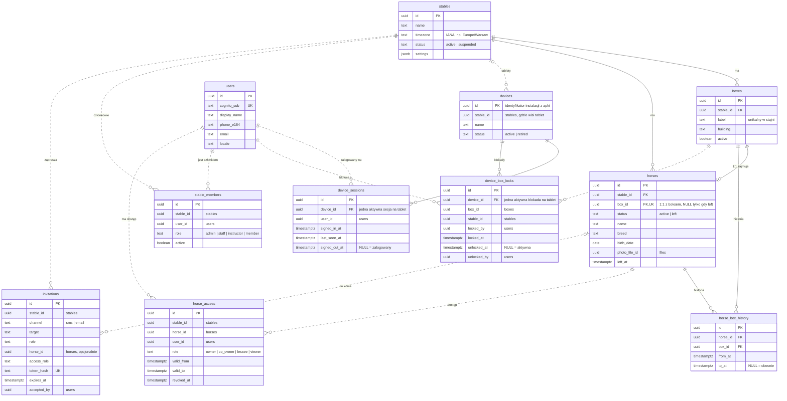
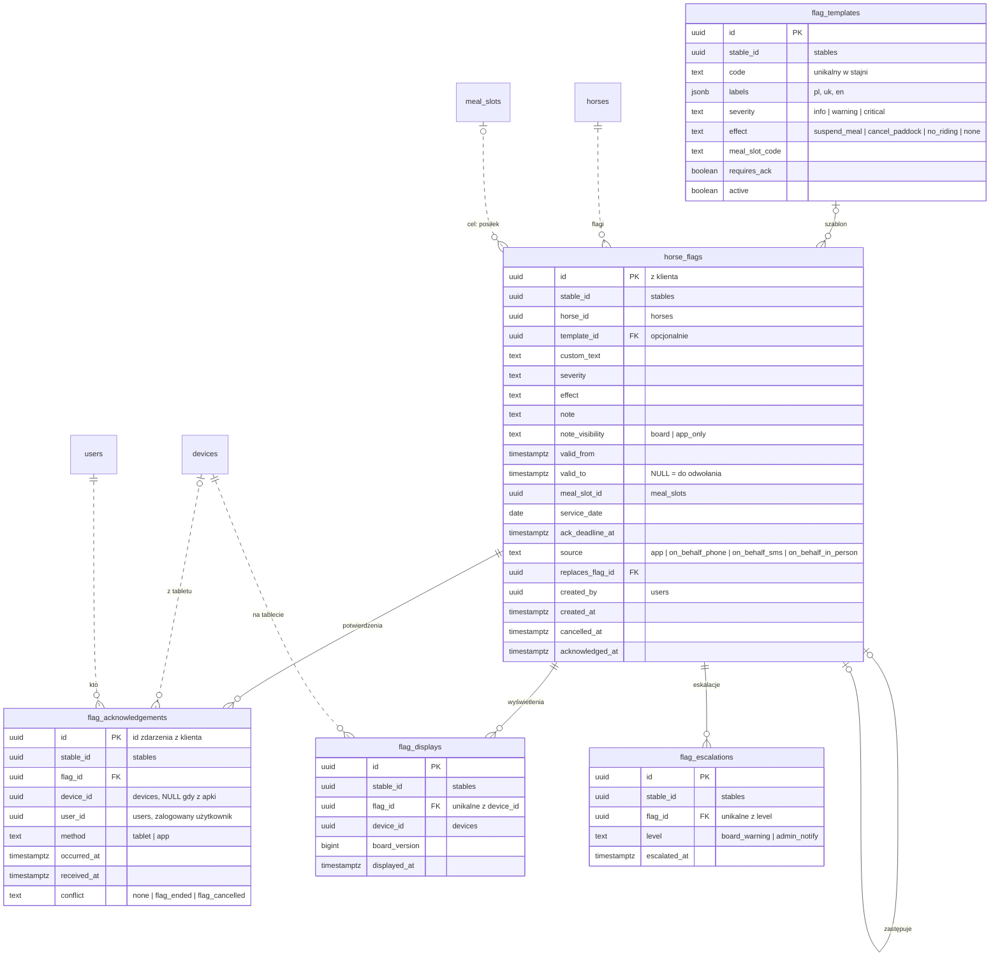
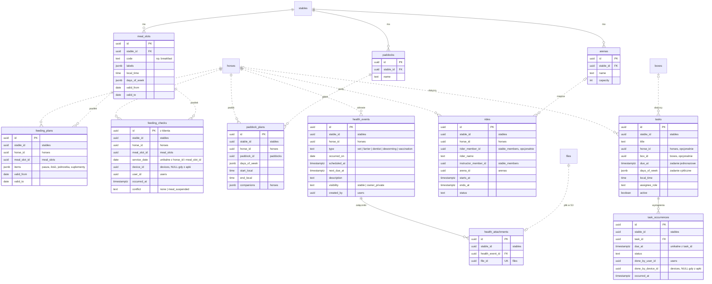
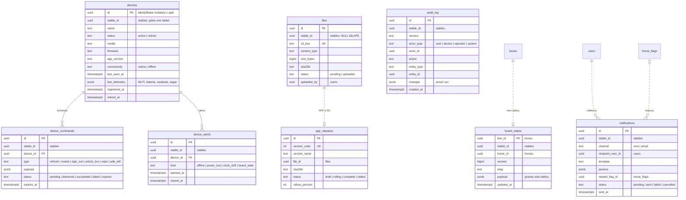

# KonskaAppka: model danych (ERD) do zatwierdzenia

> Wersja robocza v1 · 2026-10-12. Uwzględnia decyzje: osobne mikroserwisy w monorepo (także crony), Cognito jako serwer autoryzacji
> (OTP przez SMS i TOTP z RFC 6238), pliki w S3, koń powiązany 1:1 z boksem, bez WebSocketów, użytkownik logowany na tabletach
> i blokujący na nich boks.

## Do zatwierdzenia

1. **Koń ↔ boks 1:1.**
   - `horses.box_id` ma unikalny indeks, więc jeden boks ma najwyżej jednego konia, a koń jest w najwyżej jednym boksie.
   - Koń aktywny (`status = active`) zawsze ma boks; pilnuje tego kod.
   - Boks może stać pusty.
   - Koń, który opuścił stajnię (`status = left`), zwalnia boks (`box_id = NULL`). Zostaje w bazie razem z historią flag i zdrowia.
   - Przeniesienie albo zamiana dwóch koni to jedna transakcja z wpisami w `horse_box_history`.
   - Boksy i konie należą do jednego serwisu (`stable`), więc relację 1:1 pilnuje baza: klucz obcy i unikalność, bez żadnej logiki w bazie.
2. **Tablet: logowanie użytkownika i blokada boksu.**
   - Tablet nie ma własnego konta. Loguje się na nim użytkownik tym samym kontem co w apce.
   - Jeden użytkownik może być zalogowany na kilku tabletach naraz i wszędzie widzi te same dane, bo decydują jego uprawnienia, a nie tablet.
   - Na danym tablecie użytkownik wybiera boks i go blokuje (`device_box_locks`). Tablet pokazuje wtedy tylko ten boks.
   - Na tablecie jest najwyżej jedna aktywna blokada, a jeden boks może być zablokowany na kilku tabletach.
   - Założenia do potwierdzenia:
     - na tablecie jest zalogowany jeden użytkownik naraz;
     - zablokować można tylko boks, który użytkownik ma prawo widzieć;
     - odblokować może ten, kto zablokował, albo admin stajni.
3. **Schemat per mikroserwis** w jednej bazie PostgreSQL. Klucze obce są tylko wewnątrz schematu. Między serwisami są same identyfikatory: na diagramach linia przerywana, a spójności pilnuje kod. To założenie robocze; jeśli wolisz osobne bazy, diagram się nie zmienia.
4. **Tożsamość w Cognito.**
   - `users.cognito_sub` wiąże nasz profil z kontem w puli Cognito.
   - Hasła, kody OTP (SMS, TOTP), sesje i tokeny trzyma Cognito, więc nie ma ich w naszej bazie.
   - Tablety nie mają kont w Cognito. `devices` to rejestr fizycznych tabletów, identyfikowanych identyfikatorem instalacji nadawanym przez apkę.
   - `device_sessions` zapisuje, który użytkownik jest zalogowany na którym tablecie. Służy do wylogowania zdalnego, audytu i pokazywania na tablecie, kto jest zalogowany.
5. **Pliki w S3.** Tabela `files` trzyma tylko metadane i `s3_key`. Treść jest w S3.
6. **Bez WebSocketów.** `board_states` to gotowy stan tablicy dla każdego boksu. Tablet odpytuje go przez REST z `ETag`. Między serwisami: kolejki albo REST (decyzja otwarta). Przy kolejkach każdy serwis dostaje tabele techniczne `outbox` i `inbox`, których nie ma na diagramach.

Zasady wspólne: identyfikatory UUIDv7 z kodu, czas w `timestamptz` (UTC), statusy jako `text` walidowany w kodzie. Każda tabela danych stajni ma `stable_id`. Bez triggerów, funkcji, `CHECK`, `DEFAULT` i sekwencji.

## Mikroserwisy i ich schematy

| Mikroserwis | Schemat | Tabele |
|---|---|---|
| `identity` | `identity` | `users` |
| `access` | `access` | `stable_members`, `horse_access`, `invitations` |
| `stable` | `stable` | `stables`, `boxes`, `horses`, `horse_box_history`, `meal_slots`, `paddocks`, `arenas` |
| `devices` | `devices` | `devices`, `device_sessions`, `device_box_locks`, `device_commands`, `device_alerts` |
| `flags` | `flags` | `flag_templates`, `horse_flags`, `flag_acknowledgements`, `flag_displays`, `flag_escalations` |
| `care` | `care` | `feeding_plans`, `feeding_checks`, `paddock_plans` |
| `health` | `health` | `health_events`, `health_attachments` |
| `rides` | `rides` | `rides` |
| `tasks` | `tasks` | `tasks`, `task_occurrences` |
| `board` | `board` | `board_states` |
| `files` | `files` | `files` (metadane; treść w S3) |
| `releases` | `releases` | `app_releases` |
| `notifications` | `notifications` | `notifications` |
| `audit` | `audit` | `audit_log` |

**Crony to osobne mikroserwisy bez własnych tabel domenowych.** Działają przez API albo kolejki serwisów, do których należą dane:

| Cron | Serwis danych |
|---|---|
| `escalation-scheduler` | `flags` |
| `device-offline-detector` | `devices` |
| `board-display-check` | `board`, `flags` |
| `task-occurrence-generator` | `tasks` |
| `health-due-reminders` | `health`, `notifications` |
| `retention-pruner` | czyści dane w każdym serwisie |

Względem v3 znikają:
- `otp_challenges`, `auth_sessions`, `access_tokens`, `refresh_tokens`, `device_auth_challenges` i `rate_limit_buckets`: przejmuje je Cognito;
- `device_pairing_requests`: nie ma parowania, bo tablet rejestruje się przy pierwszym logowaniu użytkownika;
- `stored_files` i `stored_file_chunks`: przejmuje je S3;
- `outbox_seq`, `outbox_events` i `device_presence`: odpadają razem z WebSocketami;
- `device_boxes`: zastępuje je `device_box_locks` (blokada boksu ustawiana przez użytkownika);
- `jobs`: zastępują je crony jako serwisy.

## Legenda

- Linia ciągła oznacza klucz obcy wewnątrz jednego serwisu.
- Linia przerywana oznacza sam identyfikator z innego serwisu, bez klucza obcego.
- Oznaczenia krotności przy każdym końcu linii:
  - `||` dokładnie jeden;
  - `o|` zero albo jeden;
  - `o{` zero lub wiele.

## 1. Rdzeń: stajnia, boksy, konie, tablety, użytkownicy i dostęp

## 2. Flagi i potwierdzenia

## 3. Opieka, zdrowie, jazdy i zadania

## 4. Urządzenia, stan tablicy, pliki, wydania, powiadomienia i audit

