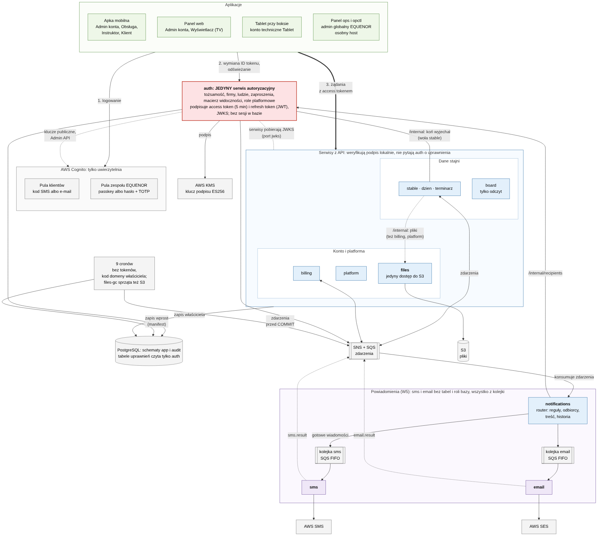

# EQUENOR: rozpiska mikroserwisów

> Wersja robocza · 2026-10-13, po recenzji (bezpieczeństwo, pokrycie wymagań, czytelność) i po decyzjach właściciela produktu z 13.10. Wymagania twarde z 13.10:
> - **W1:** admin globalny (zespół EQUENOR) ma wjazd wszędzie: do każdej firmy, stajni i serwisu;
> - **W2:** tylko jeden serwis jest autoryzacyjny. On decyduje o tożsamości i uprawnieniach i podpisuje tokeny. Reszta tylko weryfikuje podpis i czyta claimy;
> - **W3:** crony piszą do bazy bezpośrednio. Nie wołają serwisów, nie mają tokenów i nie rozmawiają z `auth`;
> - **W4:** „Po co trzymać dane sesji. JWT to zrobi.” Żadnych sesji w bazie: bez tabel sesji i listy unieważnień;
> - **W5:** serwisy SMS i e-mail są niezależne. Nie mają dostępu do tabel, wszystko dostają z kolejki.
>
> **Decyzja 13.10 (podział serwisów):** obsługa S3 to osobny mikroserwis (`files`); `flags`, `care` i `tasks` łączą się w `dzien`, `health` i `rides` w `terminarz`, a `releases` i `audit` w `platform`.
>
> Model danych: [erd.md](erd.md). Development i testy: [development.md](development.md), [development-szczegoly.md](development-szczegoly.md). Gdy tamte dokumenty mówią inaczej o tożsamości, uprawnieniach albo podziale serwisów, obowiązuje ten dokument. Poprawki w tamtych plikach wprowadzono 13.10 (sekcja 11).

**Oznaczenia:**
- Całość od sekcji 1 to **propozycja architekta** do zatwierdzenia przez właściciela produktu. Wymagania użytkownika oznaczam **W1**–**W5**, podział serwisów: **decyzja 13.10**, a wcześniejsze decyzje z erd.md i arkusza decyzji: **(bez zmian)**.
- **[Ś]**: fakt o średniej pewności, do sprawdzenia w spike'u (11.4).
- `…` w ścieżce to zawsze `/stables/{stableId}`. Identyfikatory w przykładach są skrócone (`u-ola`, `st-podlipami`); w systemie to UUIDv7.
- **Aplikacja** to klient OAuth (`client_id`): `mobile`, `web`, `tablet`, `ops`, `opctl`. Słowo „klient” oznacza w tym dokumencie wyłącznie rolę Klient.
- **admin** w tabelach endpointów: admin konta firmy, do której należy stajnia, albo admin globalny (`plt = admin`). Wsparcie IT (`plt = support`) wpisuję osobno tam, gdzie ma dostęp.
- `[PANEL]`, `[API]`: adresy panelu i API (domena nieustalona). `[OPS]`: osobny host panelu zespołu EQUENOR, np. `ops.<domena>`.

## W skrócie

Wymagania W1–W5 i podział serwisów (decyzja 13.10) są twarde. Sposób ich spełnienia (wszystko niżej) to propozycja.

1. **Jeden serwis autoryzacyjny: `auth` (W2).** Zastępuje `identity` i `access` i przejmuje ze `stable` konto firmy, adminów konta i macierz widoczności. Tylko `auth` wie, kto jest kim i co może, i tylko on podpisuje tokeny: jeden klucz, jeden JWKS. Cognito tylko uwierzytelnia (kod, passkey, hasło z TOTP).
2. **Admin globalny (W1):** rola platformowa `plt = admin` dla zespołu EQUENOR (w danych demo Kuba). Wchodzi do każdej firmy, stajni i serwisu z prawami admina konta i ma trasy `/platform/*`. Loguje się osobno: pula zespołu z MFA, osobny host `[OPS]`, powód wejścia; każdy zapis trafia do audytu, a każdy odczyt do logu odczytów.
3. **Reszta tylko czyta podpis (W2).** Pozostałe serwisy z API weryfikują token lokalnie (klucz publiczny z JWKS w cache). Decydują na podstawie claimów i danych zasobu, np. do której firmy należy stajnia. Nie wołają `auth` przy żądaniu i nie mają w bazie dostępu do tabel uprawnień.
4. **11 serwisów (decyzja 13.10):** `auth`, `stable`, `board`, `dzien` (dawniej `flags`, `care`, `tasks`), `terminarz` (dawniej `health`, `rides`), `billing`, `notifications`, `sms`, `email`, `files`, `platform` (dawniej `releases`, `audit`). 9 cronów, lista bez zmian.
5. **Token EQUENOR bez sesji w bazie (W4):** access token to JWT ES256 podpisany kluczem w AWS KMS, ważny 5 min dla wszystkich. Niesie firmy admina (`biz`), członkostwa w stajniach z rolą, widocznymi funkcjami i końmi klienta (`m`) i rolę platformową (`plt`). Refresh token to też JWT od `auth`, nigdzie niezapisany. Tabel sesji i listy unieważnień nie ma.
6. **Odebranie dostępu działa do 5 min:** przy najbliższym odświeżeniu `auth` sprawdza konto i `users.token_version` i liczy claimy od nowa (3.8). Wyjazd konia i nowa stajnia admina działają od razu.
7. **Crony piszą do bazy wprost (W3):** tylko do tabel z manifestu, kodem domeny właściciela, i publikują zdarzenia. Tokenów nie mają.
8. **Powiadomienia (W5):** `notifications` dobiera odbiorców i treść i wrzuca gotową wiadomość do kolejki `sms` albo `email`. Te dwa serwisy nie mają tabel ani roli bazy.
9. **Bez tokenów serwisowych:** zostają 4 rodzaje wywołań `/internal`, po portach wewnętrznych (osobny port na każdy zestaw wołających) i z NetworkPolicy z manifestu (7.1).
10. **Makiety z drobnymi zmianami (11.4).** Dochodzi plansza PanelOps (admin globalny). Poprawki makiet: lista w 11.4 i mockups/STAN.md.
11. **Do decyzji przed implementacją:** 10.2 pkt 1–8, zwłaszcza macierz w tokenie (pkt 1), `businesses` w `auth` (2), KMS (5) i DPoP (8).

## Diagram



Wersja do powiększania: [mikroserwisy/uslugi.svg](mikroserwisy/uslugi.svg). Źródło: [mikroserwisy/uslugi.mmd](mikroserwisy/uslugi.mmd).

Jak czytać:
1. Aplikacja loguje użytkownika w Cognito (pula klientów albo pula zespołu).
2. Aplikacja wymienia ID token z Cognito w `auth` na access token i refresh token EQUENOR. Tak samo odświeża token: `auth` sprawdza wtedy własne tabele, ale sesji nie zapisuje. Z Cognito `auth` pobiera tylko klucze publiczne i woła jego Admin API (wylogowanie, usuwanie kont).
3. Z access tokenem aplikacja woła serwisy. Serwisy pobierają z `auth` JWKS (osobny port). 4 rodzaje wywołań `/internal` (7.2) idą portami wewnętrznymi bez tokenów; pilnuje ich NetworkPolicy.
4. Crony piszą do bazy wprost (tylko tabele z manifestu) i publikują zdarzenia. Z S3 rozmawia tylko `files` i jego cron `files-gc`.
5. `notifications` zamienia zdarzenia na gotowe wiadomości w kolejkach `sms` i `email`. Te wysyłają je przez AWS i publikują wynik.

## 1. Zasady

### 1.1 Autoryzacja (W2)

- **Decyduje tylko `auth`.** Jest właścicielem wszystkich tabel tożsamości i uprawnień (5.2), wylicza z nich claimy i podpisuje token.
- **Każdy inny serwis przy każdym żądaniu:**
  1. weryfikuje podpis kluczem z JWKS oraz `alg = ES256`, `typ = at+jwt`, `iss` środowiska, `aud`, `exp`, `iat` (nie z przyszłości) i maksymalny czas życia 5 min (3.5);
  2. wylicza dostęp do stajni z claimów i danych zasobu (`resolveStable`, 3.6);
  3. stosuje politykę trasy z deskryptora w `packages/contracts`.
- **Dane zasobu to nie autoryzacja.** Serwis może sprawdzić u siebie albo w czytanych tabelach, do której firmy należy stajnia (`stables.business_id`), do której stajni i hali należy boks (`boxes`), w którym boksie stoi koń i czy koń nie wyjechał (`horses.box_id`, `horses.status`) oraz co jest włączone w stajni (`stable_settings`, `flag_templates.active`). Kim jest użytkownik i jaką ma rolę, wie tylko z tokenu.
- **Zakazane:** wołanie `auth` przy żądaniu użytkownika (introspekcja) i czytanie tabel uprawnień (`business_admins`, `stable_members`, `horse_access`, `invitations`, `stable_role_features`, `platform_roles`, `platform_requests`). Pilnują tego granty bazy i meta-test w CI (1.2). Wąskie granty trzech cronów na tabelach `auth` służą sprzątaniu, a nie autoryzacji (1.5).
- **Sam `auth` sprawdza też bazę.** Zmiany uprawnień (Ludzie, zaproszenia, dostęp do koni, macierz, blokada, role platformowe) `auth` sprawdza w tej samej transakcji we własnych tabelach, a nie tylko w tokenie. Admin odebrany przed chwilą nic już nie zmieni, nawet jeśli jego token jeszcze żyje.
- **Obiekt bez dostępu daje 404**, także obiekt innej firmy (bez zmian). Admin globalny ma dostęp wszędzie (W1).

### 1.2 Dane

- **Zapis (W3, zmiana erd pkt 5):** do tabeli pisze jej serwis-właściciel oraz crony, którym manifest daje zapis do tej tabeli (1.5).
- **Odczyt (zmiana erd pkt 5):**
  - tabele domenowe czytają wszystkie serwisy i crony;
  - tabele prywatne `auth` (5.2) czyta tylko `auth`, poza wąskimi grantami cronów (1.5);
  - `notifications` (adres odbiorcy i wyrenderowana treść) czyta tylko `notifications`; `retention-pruner` tylko usuwa stare wiersze;
  - schemat `audit`: każda rola ma tylko `INSERT`, czyta `platform`, usuwa po retencji tylko `retention-pruner` (1.5);
  - z `users` inni widzą tylko `id`, `display_name`, `locale`, `identity_pool` i `deleted_at` (grant kolumnowy); telefon i e-mail zna tylko `auth`. `identity_pool = team` pozwala pokazać autora jako „Zespół EQUENOR” (4.4);
  - `businesses` czytają `stable` (nazwa firmy) i `billing` (NIP, adres, e-mail do faktur);
  - `sms` i `email` nie mają roli bazy (W5).
- `packages/db/owners.ts` dostaje dla każdej tabeli pole `visibility: shared | private | columns([...])` i listę cronów z prawem zapisu (tabele, gdzie się da: kolumny). Z niego generator grantów tworzy role bazy, a lint swoją regułę.
- Klucze obce do `users` z tabel innych serwisów zostają; baza sprawdza je bez grantu `SELECT`.
- **Meta-test w CI:** żadna rola poza `auth` nie ma `SELECT` na tabelach prywatnych `auth` (w tym `invitations.target`) ani na `users.phone_e164` i `users.email`, a poza `notifications` na `notifications.recipient_address` i `notifications.body`, poza grantami cronów z manifestu; granty kolumnowe cronów zgadzają się z manifestem; żaden cron nie ma zapisu poza manifestem; w `audit` nikt poza `retention-pruner` nie ma `DELETE` ani `UPDATE`.
- **Niezmienne dane zasobu:** `stables.business_id` i `boxes.stable_id`. Żadna trasa ich nie zmienia, a lint odrzuca `UPDATE` tych kolumn (triggera nie dodajemy, bo erd zakazuje triggerów). Przeniesienie stajni do innej firmy to nowa stajnia.
- **Stan w pamięci (wyjątek od szcz. 4.1, „Repliki”: żaden serwis nie trzyma stanu w pamięci):** wolno trzymać cache JWKS i niezmienne dane zasobu z punktu wyżej. Oba da się odtworzyć ze źródła.

### 1.3 Trasy

| Rodzaj | Ścieżka | Token | Dodatkowo |
|---|---|---|---|
| Publiczne | `/<serwis>/v1/{ścieżka}` | access token EQUENOR, `aud = equenor-api` | role, funkcja i dozwolone aplikacje z deskryptora trasy |
| Platformowe | `/<serwis>/v1/platform/{ścieżka}` | access token EQUENOR z `plt` | zapytania przekrojowe (`crossTenant()`), log odczytów (4.4) |
| Wewnętrzne | `/<serwis>/v1/internal/{ścieżka}` | bez tokenu | tylko port wewnętrzny (osobny na każdy zestaw wołających), TLS z CA klastra, NetworkPolicy z manifestu (7.1) |
| Webhook płatności | `/billing/v1/webhooks/{provider}` | bez tokenu | podpis dostawcy |
| Stan poda | `/livez`, `/readyz` | bez tokenu | `/readyz` czeka tylko na JWKS |

- Port publiczny nie obsługuje `/internal` (404), a Ingress nie kieruje ruchu na porty wewnętrzne ani na port `jwks`.
- Trasy `/internal` są tylko dla wywołań z 7.2. Tras dla cronów, `/internal/prune` ani `/internal/horses/{id}/left` poza `auth` nie ma (W3).
- **W1 w każdym serwisie:** meta-test sprawdza, że każdy serwis z API ma co najmniej jedną trasę dostępną dla `plt = admin` (`notifications` i `files` mają trasy `/platform`, 5.8 i 5.9). `sms` i `email` nie mają API (W5); ich wysyłki admin globalny widzi w `notifications`.

### 1.4 Zdarzenia

- SNS + SQS, bez outboxu i WebSocketów (bez zmian). Serwis publikuje po COMMIT, cron tuż przed COMMIT (1.5).
- Publikować na temat może tylko rola IAM serwisu-właściciela albo crona, któremu manifest daje to zdarzenie (IRSA albo EKS Pod Identity).
- Koperta zdarzenia niesie aktora do audytu i dane potrzebne konsumentowi. Konsument niczego na jej podstawie nie autoryzuje.
- Kolejki `sms` i `email` (SQS FIFO) zasila tylko `notifications` (5.8, W5).

### 1.5 Crony (W3)

- Każdy cron to osobny mikroserwis (CronJob), bez własnych tabel (bez zmian). Kod leży w module serwisu-właściciela, np. `services/dzien/jobs/escalation-scheduler`.
- **Pisze do bazy wprost.** Ma własną rolę bazy: odczyt tabel domenowych i zapis tylko do tabel (gdzie się da: kolumn) z manifestu w `packages/db/owners.ts`. Granty tworzy generator grantów, a meta-test w CI pilnuje, że cron nie pisze poza manifestem.
- **Kod domeny właściciela:** te same funkcje zapisu co serwis, `version` i `updated_at` z kodu, audyt z `actor_type = system` w tej samej transakcji. Crony przekrojowe (`horse-left-reconciler`, `retention-pruner`) używają modułów domeny kilku serwisów; to jedyny wyjątek od reguły lintu „serwis nie importuje innego serwisu”.
- **Tabele prywatne `auth`:** wąskie granty kolumnowe, nie do autoryzacji (W2 zostaje). Funkcje domeny `auth` używane przez cron czytają tylko te kolumny:
  - `invitation-expiry-notifier`: `SELECT (id, stable_id, role, display_name, locale, horse_id, expires_at, accepted_at, revoked_at)` na `invitations`, bez `target`;
  - `horse-left-reconciler`: `SELECT (id, stable_id, horse_id, revoked_at, version)` i `UPDATE (revoked_at, version, updated_at)` na `horse_access`;
  - `retention-pruner`: `SELECT (id, requested_at)` i `DELETE` na `platform_requests`.
- **Schemat `audit`:** tylko `retention-pruner` ma `DELETE` na `audit_log_changes` i `audit_log` oraz `SELECT` na `audit_log (id, created_at)` i `audit_log_changes (audit_log_id)`. Usuwa wyłącznie wiersze starsze niż retencja, najpierw `audit_log_changes`; każdy przebieg trafia do logów, a nietypowa liczba usuniętych wierszy daje alert.
- **Bez tokenów i bez wywołań:** cron nie woła serwisów ani `auth`. Nie zna adresów i nie wysyła powiadomień: publikuje zdarzenie (6), a resztę robi `notifications`.
- **Publikacja przed COMMIT** (wyjątek od 1.4, tylko dla cronów): w tej samej transakcji, tuż przed COMMIT; jedna transakcja na obiekt (flaga, faktura), nie na cały przebieg. Gdy COMMIT się nie uda, następny przebieg powtórzy publikację, a `notifications.dedupe_key` nie dopuści drugiego SMS-a. Gdy publikacja się nie uda, transakcja się wycofuje.
- **Konsument zdarzenia crona, które zmienia stan,** traktuje je jako sygnał i czyta źródło w bazie, bo zdarzenie mogło wyjść przed nieudanym COMMIT albo przyjść w innej kolejności: `stable` bierze bieżące `subscriptions.status`, a nie wartość z koperty; `billing` (PDF) i `notifications` przy `invoice.issued` i `payment.overdue` wymagają widocznego wiersza `invoices`, a bez niego nie potwierdzają wiadomości (ponowienie, potem DLQ i alarm). Dane do treści powiadomienia konsument bierze z koperty.

## 2. Role

| Rola | Poziom | Kto nadaje | Gdzie zapisana | Zakres |
|---|---|---|---|---|
| **Admin globalny** (`plt = admin`) | platforma | dwóch adminów globalnych: wniosek i zatwierdzenie w `opctl` (4.5) | `platform_roles` | każda firma, stajnia i serwis z prawami admina konta; trasy `/platform/*` (4.2) |
| Wsparcie IT (`plt = support`; na PoC nikt) | platforma | jw. | `platform_roles` | patrz 4.6 |
| **Admin konta** | konto firmy | pierwszy powstaje przy rejestracji firmy; kolejnych dodaje admin globalny we dwie osoby, z powiadomieniem adminów firmy (4.3) | `business_admins` | wszystkie stajnie firmy, także nowe; pełny dostęp, bez macierzy widoczności (bez zmian) |
| Obsługa (`staff`) | stajnia | admin: zaproszenie albo przypisanie osoby z firmy | `stable_members` | wszystkie konie stajni; funkcje według macierzy |
| Instruktor (`instructor`) | stajnia | admin | `stable_members` | jazdy, flagi do odczytu; funkcje według macierzy |
| Klient (`client`) | stajnia i koń | admin: zaproszenie z koniem | `stable_members`, `horse_access` | tylko swoje konie (w oknie `valid_from`–`valid_to`) i boks, w którym stoją |
| Wyświetlacz (`display`) | stajnia, konto techniczne | admin | `stable_members` | odczyt tablic stajni; każdy zapis 403 |
| Tablet (`tablet`) | stajnia, konto techniczne | admin | `stable_members` | tablica boksu, potwierdzenie flagi, akcje boksu i jego hali (`X-Box-Id`) |

- Osoba może być w kilku stajniach, w każdej z jedną rolą (bez zmian).
- **Konto techniczne** (`users.account_kind = technical`): rola `tablet` albo `display` w dokładnie jednej stajni; bez `biz` i `plt`. Nie zakłada firmy (`POST /businesses` daje 403), nie dostaje drugiej stajni, roli osoby ani admina konta (409). Rodzaj konta ustala pierwsze dopasowanie zaproszenia i potem się nie zmienia.
- **Zaproszenie konta technicznego** dopasowuje tylko świeże konto. Gdy telefon albo e-mail należy już do istniejącego konta, `auth` odrzuca zaproszenie przy tworzeniu (`409 target_in_use`), więc tablet nie dostanie konta Damiana.
- Konto z puli klientów nigdy nie dostanie `plt`. Konto z puli zespołu nie jest członkiem stajni ani adminem konta: `auth` odrzuca zaproszenie, którego cel to telefon albo e-mail konta z puli zespołu (`409 target_in_use`).
- Wsparcie IT nie jest rolą stajni: stajnia go nie zaprasza i nie konfiguruje (bez zmian).

**Dane demo:**

| Kto | Rola | Stajnie |
|---|---|---|
| Damian | admin konta Stajnie Lipowe sp. z o.o. | Pod Lipami, Brzozowa i każda kolejna stajnia firmy |
| Ola | obsługa | Pod Lipami, Brzozowa |
| Piotr | obsługa | Pod Lipami |
| Paweł | obsługa | Brzozowa |
| Marta | instruktor | Pod Lipami, Brzozowa |
| Anna | klientka: Kasztan i Bella (Pod Lipami), Kometa (Brzozowa) | Pod Lipami, Brzozowa |
| Marek Nowak | klient: Luna, bez boksu (zaproszenie czeka, makieta MainLuna) | Pod Lipami |
| Telewizor korytarz | wyświetlacz (konto techniczne) | Pod Lipami |
| Tablety Pod Lipami, Tablety Brzozowa | tablet (konta techniczne) | każde konto w swojej stajni |
| Kuba | admin globalny, zespół EQUENOR | wszystkie firmy i stajnie |

## 3. Token

### 3.1 Skąd się bierze

1. Aplikacja loguje użytkownika w Cognito. Pula klientów: kod SMS albo e-mail. Pula zespołu: passkey albo hasło z TOTP. Ekrany logowania bez zmian.
2. Aplikacja od razu wymienia ID token Cognito w `auth`: `POST /auth/v1/token` (RFC 8693, `grant_type=urn:ietf:params:oauth:grant-type:token-exchange`, `client_id = mobile | web | tablet`). Panel zespołu robi to na własnym hoście: `POST [OPS]/auth/v1/ops/token` (`client_id = ops`, wymagany `reason`); CLI: `client_id = opctl` (4.1).
3. `auth` sprawdza ID token: podpis puli, `token_use = id`, pula pasuje do aplikacji, `auth_time` nie starszy niż 5 min. `jti` nie zapisujemy (W4), więc ten sam ID token da się wymienić ponownie tylko w tym oknie (ryzyko: 10.1 pkt 3).
4. W jednej transakcji `auth`:
   - zapisuje albo aktualizuje `users` z kopią telefonu i e-maila;
   - dopasowuje zaproszenia po zweryfikowanym telefonie albo e-mailu i zapisuje członkostwo (klientowi też `horse_access`); zaproszenie konta technicznego oznacza świeże konto jako `technical` (sekcja 2);
   - sprawdza zgodność konta z aplikacją;
   - wylicza claimy, nadaje `sid` (UUIDv7) i podpisuje access token i refresh token. Sesji nie zapisuje (W4).
5. Odpowiedź: access token EQUENOR (5 min) i refresh token (3.7). Tokeny Cognito aplikacja wyrzuca.

Wymieniamy ID token, bo tylko on niesie zweryfikowany telefon i e-mail. Po nich `auth` dopasowuje zaproszenia.

**Zgodność konta z aplikacją** (inaczej `403 wrong_client`, ekran TabletBrakUprawnien albo BrakDostepu):
- konto techniczne `tablet` loguje się tylko aplikacją `tablet`, a osoba nigdy;
- konto techniczne `display` loguje się tylko aplikacją `web`;
- `ops` i `opctl` wymagają puli zespołu i aktywnej roli w `platform_roles`;
- konto z puli zespołu nie loguje się aplikacjami `mobile`, `web` ani `tablet`.

### 3.2 Claimy

Nagłówek access tokenu: `{"alg":"ES256","typ":"at+jwt","kid":"<odcisk klucza publicznego, RFC 7638>"}`.

| Claim | Znaczenie | Kto ma |
|---|---|---|
| `iss` | `https://[API]/auth/v1`, inny host w każdym środowisku | wszyscy |
| `aud` | `equenor-api` | wszyscy |
| `sub` | `users.id` | wszyscy |
| `sid` | UUIDv7 nadany przy wymianie ID tokenu i przenoszony przy odświeżaniu; bez tabeli, tylko do korelacji w audycie i logach (W4) | wszyscy |
| `client_id` | `mobile`, `web`, `tablet`, `ops`, `opctl` | wszyscy |
| `iat`, `exp`, `jti` | wydanie, wygaśnięcie, identyfikator | wszyscy |
| `ver` | wersja schematu claimów (1) | wszyscy |
| `biz` | firmy, w których osoba jest adminem konta | admini konta |
| `m` | członkostwa: `s` stajnia, `r` rola, `f` widoczne funkcje, `h` konie klienta | członkowie stajni |
| `plt` | `admin` albo `support` | admin globalny, Wsparcie IT |
| `amr`, `auth_time` | `["mfa"]` i czas logowania w Cognito z ID tokenu (step-up, 4.1); przy odświeżeniu przenoszony z refresh tokenu, nigdy czas odświeżenia | admin globalny, Wsparcie IT |

**Reguły wyliczania:**
- `m` pomija nieaktywne członkostwa i stajnie firm z `biz`, bo admin konta i tak ma tam pełny dostęp.
- `h` zawiera tylko dostępy ważne teraz: `valid_from ≤ teraz < valid_to` (albo `valid_to` puste), puste `revoked_at` i koń bez `status = left`.
- Klient bez żadnego ważnego konia w stajni nie ma tej stajni w `m` (dec. 24, 10.2 pkt 10). Bez żadnej stajni widzi BrakDostepu.
- `exp` nie wychodzi poza najbliższą granicę okna dostępu klienta. Koniec dzierżawy działa więc dokładnie w swojej chwili, bez zdarzeń i bez dat w tokenie.
- `f` to funkcje z `stable_role_features` dla roli w stajni. Stajnia bez wierszy ma macierz domyślną z `packages/rules`, równą macierzy Pod Lipami (10.2 pkt 15). Tablet nigdy nie ma `tasks` ani `box_history`.
- Admin konta i `plt` nie mają `f`: widzą wszystko.
- Konto techniczne ma zawsze dokładnie jedno `m` (swoją stajnię) i nigdy `biz` ani `plt`, bez względu na inne wiersze w bazie. Pilnuje tego test claimów względem wzorca.
- Token nie ma danych osobowych, nazw stajni ani ustawień. Te dane daje `GET /auth/v1/me`. Aplikacje nie dekodują tokenu.
- **Budżet rozmiaru:** 4 KB (Damian ok. 0,6 KB, Ola ok. 0,9 KB, Anna ok. 1,0 KB). Test w CI liczy wszystkie osoby z danych demo, klienta z 60 końmi i konto zaproszone przez 50 firm naraz.
- **Twarde limity w `auth`** (zaproszenia dopasowują się same, bez zgody, więc obce firmy mogłyby „nadmuchać” komuś token): najwyżej 20 członkostw na konto, 100 koni w `h` na stajnię, 200 zaproszeń na firmę na dobę. Zaproszenie ponad limit zostaje niedopasowane, a `auth` wysyła alert. Gdyby token i tak przekroczył budżet, `auth` wydaje token zawężony do stajni wybranej w aplikacji (`resource=<stableId>`, RFC 8707) zamiast odmawiać.

**Refresh token (W4):** JWT podpisany tym samym kluczem, `typ = rt+jwt`, `aud` tylko `auth`, nigdzie niezapisany. Claimy: `iss`, `iat`, `sub`, `client_id`, `sid`, `sst` (start sesji), `tv` (`users.token_version`) i `exp` (3.4); `ops` i `opctl` także `auth_time` (bez zmian przy odświeżaniu); tablet i TV z DPoP także `cnf.jkt` (3.7). Serwisy go odrzucają (`typ`, `aud`).

### 3.3 Przykłady dla danych demo

Wtorek 13.10.2026, 07:15 czasu polskiego (`iat` = 1791868500). Funkcje według seedu:
- Pod Lipami: klient `flags, feeding_plan, routine, box_history, health, rides`; obsługa wszystko; tablet `flags, feeding_plan, routine, health`; wyświetlacz `flags, feeding_plan, routine, tasks`; instruktor `flags, rides`.
- Brzozowa: klient `flags, routine, box_history, health`; obsługa `flags, feeding_plan, routine, box_history, health`; tablet `flags, feeding_plan, routine, health`; instruktor `flags, rides`.

**Damian, admin konta, panel (pełny token).** Nie ma `m`: Pod Lipami, Brzozowa i każda kolejna stajnia wynikają z `stables.business_id = biz-lipowe`.
```json
{"iss":"https://[API]/auth/v1","aud":"equenor-api","sub":"u-damian","sid":"ses-d1","client_id":"web",
 "iat":1791868500,"exp":1791868800,"jti":"j-01","ver":1,
 "biz":["biz-lipowe"]}
```

Pozostali mają te same `iss`, `iat`, `exp` (`iat + 300`), `jti` i `ver`; różnią się tym:

| Kto | `client_id` | Pozostałe claimy |
|---|---|---|
| Ola | `mobile` | `m`: `st-podlipami` `staff` (wszystkie funkcje); `st-brzozowa` `staff` (`flags, feeding_plan, routine, box_history, health`) |
| Piotr | `mobile` | `m`: `st-podlipami` `staff` (wszystkie funkcje) |
| Paweł | `mobile` | `m`: `st-brzozowa` `staff` (`flags, feeding_plan, routine, box_history, health`) |
| Marta | `mobile` | `m`: `st-podlipami` i `st-brzozowa`, `instructor` (`flags, rides`) |
| Anna | `mobile` | `m` niżej |
| Tablety Pod Lipami | `tablet` | `m`: `st-podlipami` `tablet` (`flags, feeding_plan, routine, health`) |
| Tablety Brzozowa | `tablet` | `m`: `st-brzozowa` `tablet` (`flags, feeding_plan, routine, health`) |
| Telewizor korytarz | `web` | `m`: `st-podlipami` `display` (`flags, feeding_plan, routine, tasks`) |
| Kuba | `ops` | `plt: "admin"`, `amr: ["mfa"]`, `auth_time`; bez `biz` i `m`. Powód wejścia `auth` zapisuje w audycie przy wymianie tokenu (wpis `ops_login` z `sid`, 4.4) |

Członkostwa Anny:
```json
"m":[{"s":"st-podlipami","r":"client","f":["flags","feeding_plan","routine","box_history","health","rides"],
      "h":["h-kasztan","h-bella"]},
     {"s":"st-brzozowa","r":"client","f":["flags","routine","box_history","health"],"h":["h-kometa"]}]
```
Gdyby Bella miała dzierżawę do 31.12.2026 23:59:59, token wydany 31.12 o 23:57 miałby `exp` 1798757999 zamiast `iat + 300`.

Tablety: boksu nie ma w tokenie, bo wszystkie tablety stajni logują się tym samym kontem. Boks przychodzi w `X-Box-Id`. Każdy tablet ma własny `sid`.

### 3.4 Czas życia

**Access token: 5 min dla wszystkich** (osoby, tablet, wyświetlacz, admin globalny). Długość sesji, czyli okna refresh tokenu, zależy od aplikacji i od roli, a rolę zna `auth`. Telewizor w aplikacji `web` ma długą sesję, a admin w tym samym panelu krótką.

| Konto i aplikacja | Bezczynność (`exp` refresh tokenu) | Maksimum sesji (od `sst`) |
|---|---|---|
| Osoba w apce (`mobile`) | 30 dni | 180 dni |
| Osoba w panelu (`web`) | 7 dni | 30 dni |
| Tablet (`tablet`) | 30 dni | bez limitu (do blokady albo „Wyloguj wszystkie tablety”) |
| Wyświetlacz (`web`, rola `display`) | 30 dni | 365 dni |
| Admin globalny, Wsparcie IT (`ops`) | 30 min | 10 h, bez „zapamiętaj mnie” |
| Admin globalny w CLI (`opctl`) | 30 min | 1 h |

Tokeny Cognito: ID i access 5 min, refresh 60 min. Aplikacja używa ID tokenu tylko raz, do wymiany.

### 3.5 Klucze i JWKS

- **Podpis:** ES256 kluczem AWS KMS `ECC_NIST_P256`, ten sam klucz dla access i refresh tokenu. Klucz prywatny nie opuszcza KMS. `kms:Sign` ma tylko rola IAM `auth`.
- **`kid`:** odcisk klucza publicznego (RFC 7638), więc rotacja awaryjna i planowa w tym samym miesiącu nie dadzą duplikatu. Tabela `signing_keys` (klucz główny `kid`) wiąże `kid` z kluczem KMS i statusem `next`, `active`, `retiring`, `retired` albo `revoked`.
- **Refresh token** `auth` przyjmuje tylko z kluczem `active`, `retiring` albo `retired` z `retired_at` nie starszym niż 30 dni; klucz `revoked` albo `next` daje `401 session_revoked`.
- **JWKS:** `GET /auth/v1/.well-known/jwks.json`, tylko w klastrze, na osobnym porcie `jwks` otwartym dla wszystkich serwisów z API (porty `/internal` są osobne, 7.1), z kluczami `next`, `active` i `retiring`. Serwisy pobierają go przez TLS z certyfikatem z CA klastra (cert-manager) i sprawdzeniem nazwy hosta, więc przejęty pod nie podsunie własnego JWKS.
- **Cache w serwisach:** `jose.createRemoteJWKSet`, 5 min, ponowne pobranie nie częściej niż co 30 s. Nieznany `kid` wymusza ponowne pobranie.
- **Twarde granice weryfikacji** (`packages/auth`): odrzuca `iat` późniejszy niż teraz + 60 s i `exp − iat` dłuższe niż 5 min.
- **Rotacja planowa co 90 dni** (`opctl keys rotate`; KMS nie rotuje sam kluczy asymetrycznych): nowy klucz trafia do JWKS jako `next` co najmniej 24 h przed użyciem; potem przełączenie (nowy `active`, stary `retiring`); po dobie stary jest `retired`: znika z JWKS, ale `auth` przyjmuje nim podpisane refresh tokeny jeszcze 30 dni (najdłuższe okno bezczynności), więc rotacja nikogo nie wylogowuje.
- **Rotacja awaryjna przy wycieku:** nowy klucz od razu `active`, stary `revoked` (z `revoked_at`) i znika z JWKS. Stare access tokeny padają w ciągu 5 min (cache JWKS), a stare refresh tokeny od razu, bo `auth` ich nie przyjmie. Wszyscy logują się ponownie. Test: token podpisany wycofanym kluczem jest odrzucany w ≤ 5 min.
- **Koszt:** każde odświeżenie co 5 min to dwa podpisy (access i refresh token), czyli ok. 17 300 podpisów miesięcznie na urządzenie aktywne całą dobę (tablety, TV). Przy 0,15 USD za 10 tys. podpisów ECC [Ś]: 500 takich urządzeń to ok. 8,6 mln podpisów i ok. 130 USD miesięcznie; 5000 kont aktywnych naraz przez całą dobę to ok. 33 podpisy/s (poniżej limitu KMS dla kluczy ECC [Ś]), ok. 86 mln podpisów i ok. 1300 USD. Opóźnienie podpisu (dziesiątki do 300 ms) dotyczy tylko wydania tokenu, nie weryfikacji. Tańsze warianty: 10.2 pkt 5.

### 3.6 Jak serwis sprawdza dostęp do stajni

```ts
async function resolveStable(p: Principal, stableId: string, tx: Tx): Promise<StableAccess> {
  const st = await stables.meta(tx, stableId);  // business_id z cache (niezmienne), status z bazy
  if (!st) return { as: 'none' };                                                               // 404
  if (p.kind === 'operator') return p.plt === 'admin' ? { as: 'platform' } : { as: 'none' };    // support: 404
  if (p.kind !== 'account') return { as: 'none' };
  if (p.biz.has(st.businessId)) return { as: 'admin' };
  const m = p.members.get(stableId);
  return m ? { as: 'member', ...m } : { as: 'none' };                                           // none: 404
}
```

- **`platform` przechodzi wszędzie tam, gdzie `admin`, także sprawdzenie aplikacji:** trasa dostępna dla admina przyjmuje `client_id = ops`, nawet gdy deskryptor ogranicza ją do `mobile` (np. potwierdzenie flagi). Wyjątek to trasy wyłącznie tabletowe (`GET /platform/v1/tablet/latest`). Meta-test generowany z kontraktów: każda trasa, odczytu i zapisu, z `admin` na liście ról przechodzi dla Kuby z aplikacją `ops`.
- Deskryptor trasy w `packages/contracts`: `audience`, `clients` (np. tylko `tablet`), `stable: { roles, feature, write }`, `platform` (np. `['admin','support']`), `stepUp`, a dla `/internal` `callers` (z nich NetworkPolicy, 7.1).
- Tablet z `X-Box-Id`: stajnia ze ścieżki musi być stajnią z tokenu, boks musi należeć do tej stajni (inaczej 404, bez zapisu), akcja hali musi dotyczyć hali tego boksu (inaczej `403 other_building`).
- Klient: koń spoza `h` daje 404. Koń z `horses.status = left` (dane zasobu) też daje 404 od razu, bez czekania na nowy token.
- Pakiety: `packages/auth` (weryfikacja, schemat claimów w zod), `packages/tenancy` (`resolveStable`, `TenantScope`), `packages/authz` (polityki jako czyste funkcje), `packages/rules` (`stableFeatures` i macierz domyślna). Żaden nie czyta tabel uprawnień.

### 3.7 Odświeżanie i wylogowanie (bez sesji, W4)

- **Gdzie leży refresh token:**
  - apka w `expo-secure-store`, tablet w Android Keystore;
  - panel i TV: ciasteczko `__Secure-eq_rt` (`HttpOnly; Secure; SameSite=Strict; Path=/auth/v1/token`, bez `Domain`, czyli tylko host API); access token tylko w pamięci strony. Warunek: panel i API w jednej domenie (zamyka szcz. 5 pkt 15 bez BFF);
  - panel zespołu: osobny host `[OPS]` już na PoC (najlepiej inna domena), z własną trasą `POST [OPS]/auth/v1/ops/token` i ciasteczkiem `__Secure-eq_rt_ops` (`Path=/auth/v1/ops/token`, tylko ten host). XSS w panelu klientów nie dosięga refresh tokenu admina globalnego. Prefiksu `__Host-` nie używamy, bo wymaga `Path=/`.
- **Ochrona panelu i `[OPS]`:** ścisłe CSP z nonce, Trusted Types, bez skryptów inline. Każdy `POST /token` z ciasteczkiem wymaga nagłówka `Origin` z listy dozwolonych (dla `/ops/token` tylko `[OPS]`) i nagłówka `X-Equenor-Client`, który wymusza preflight CORS. To zamyka logowanie cudzym kontem z obcej strony (login CSRF).
- **Odświeżenie** daje nowy access token i nowy refresh token: `exp` = teraz + okno bezczynności, ale nie dalej niż `sst` + maksimum (3.4). `sid` i `sst` przechodzą bez zmian.
- **Przy odświeżeniu `auth` sprawdza we własnych tabelach, w tej kolejności:**
  1. klucz podpisu (3.5) i `exp`;
  2. konto istnieje i nie jest usunięte (`401 session_revoked`);
  3. konto techniczne ma aktywne członkostwo (`stable_members.active`; inaczej `403 access_revoked`, tak samo przy wymianie ID tokenu);
  4. `users.token_version = tv` (`401 session_revoked`);
  5. `ops`, `opctl`: rola platformowa aktywna i konfiguracja MFA puli zespołu zgodna (4.1; `401 session_revoked`);
  6. zgodność konta z aplikacją (3.1).

  Blokada podbija też `token_version`, więc dopiero ta kolejność daje zablokowanemu urządzeniu ekran blokady, a nie logowanie. Potem `auth` liczy claimy od nowa (`auth_time` przenosi z refresh tokenu), więc tu działają wszystkie zmiany uprawnień (3.8).
- **Zgubiona odpowiedź** nie jest problemem: poprzedni refresh token działa do swojego `exp`, więc aplikacja po prostu ponawia.
- **Kradzież refresh tokenu:** bez wykrywania ponownego użycia (świadomie, W4). Ograniczenia:
  - bezpieczne przechowywanie (Android Keystore, `expo-secure-store`, ciasteczko `HttpOnly`);
  - krótkie okna w panelu i `ops` (3.4);
  - tablet i TV: DPoP (RFC 9449), czyli refresh token z `cnf.jkt` i dowód z oknem `iat` 60 s, bez zapisu `jti`; klucz urządzenia nie do wyeksportowania (Android Keystore, WebCrypto z `extractable: false`). Propozycja do spike'u [Ś] (10.2 pkt 8);
  - w ostateczności „Wyloguj ze wszystkich urządzeń” albo „Wyloguj wszystkie tablety” (`token_version` + 1).
- **Wylogowanie z jednego urządzenia:** aplikacja usuwa tokeny, panel i TV wołają `POST /auth/v1/logout`, a panel zespołu `POST [OPS]/auth/v1/ops/logout` (ciasteczko `[OPS]` czyści tylko odpowiedź z tego hosta). Obie trasy tylko czyszczą ciasteczko. Skopiowany wcześniej refresh token działa do `exp` (świadome ryzyko, 10.1).

| Odpowiedź | Co robi aplikacja |
|---|---|
| `401 token_expired` | jedno ciche odświeżenie, powtórzenie żądania, `GET /me` |
| `401 step_up_required` (panel `[OPS]`) | ponowne logowanie passkeyem, nowa wymiana, powtórzenie zapisu |
| `401 session_revoked` przy odświeżeniu (refresh token wygasł, klucz `revoked`, `tv` nieaktualne, konto usunięte, rola platformowa odebrana) | ekran logowania; tablet zachowuje boks i język |
| `403 access_revoked` (`blocked`) przy odświeżeniu albo wymianie | ekran blokady bez starych danych; ponawia co 5 min; po odblokowaniu dostaje `session_revoked` (blokada podbiła `token_version`), czyli logowanie |
| nagłówek `Equenor-Token-Refresh: required` | natychmiastowe odświeżenie (np. po rejestracji firmy) |
| powrót apki na pierwszy plan | odświeżenie i `GET /me` |

### 3.8 Odebranie dostępu

**Skutek: do 5 min** (czas życia access tokenu, W4). Limit w testach akceptacyjnych (erd pkt 14, A-23…A-25, T-23): 5 min. Ten czas obowiązuje w całym dokumencie; wyjątki („od razu”) są w tabeli niżej.

- Listy unieważnień nie ma: serwis przyjmuje ważny token do `exp`. Zmianę uwzględnia `auth` przy najbliższym odświeżeniu, bo liczy claimy od nowa (3.7).
- `users.token_version` podbijają tylko: „Wyloguj ze wszystkich urządzeń”, blokada konta, usunięcie konta, odebranie roli platformowej i „Wyloguj wszystkie tablety”. Pozostałe zmiany uprawnień go nie ruszają.
- Zapisy w `auth` (Ludzie, zaproszenia, macierz, role) `auth` sprawdza w bazie od razu (1.1).

| Zdarzenie | Mechanizm (jedna transakcja z audytem) | Kiedy działa |
|---|---|---|
| Damian odbiera Oli Brzozową („Usuń ze stajni”) | `auth` usuwa członkostwo, zdarzenie `member.removed` | do 5 min: nowy token ma tylko Pod Lipami; Brzozowa znika z przełącznika i daje 404 |
| Anna traci Kometę (`revoked_at`) | `auth` aktualizuje `horse_access` | do 5 min: Kometa znika; Brzozowa też, bo Anna nie ma tam konia |
| Koniec dzierżawy (`valid_to`) | nic | w chwili granicy (±30 s): `exp` tokenu wypada na granicy (3.2) |
| Koń wyjeżdża | `stable` po COMMIT woła synchronicznie `auth /internal/horses/{id}/left`, potem `horse.left`; `auth` zamyka `horse_access` | **od razu:** serwisy widzą `horses.status = left` (3.6); token odświeża się w ciągu 5 min |
| Zmiana macierzy widoczności | `auth` zapisuje `stable_role_features` | do 5 min: członkowie, tablety i TV dostają nowe `f`; sekcje znikają albo się pojawiają |
| Przypisanie Oli do Brzozowej, zaproszenie istniejącego konta, zmiana roli | `auth` zapisuje członkostwo albo rolę | do 5 min albo od razu po powrocie apki na pierwszy plan; bez ponownego logowania |
| Zablokowanie konta technicznego | `active = false`, `token_version` + 1 | do 5 min: odświeżenie daje `403 access_revoked`, ekran blokady bez flag |
| „Wyloguj wszystkie tablety” | `token_version` konta tabletów + 1 | do 5 min: wszystkie tablety stajni pokazują logowanie; te, które mają działać, admin loguje ponownie kodem |
| „Wyloguj ze wszystkich urządzeń” | `token_version` osoby + 1 | do 5 min: urządzenia osoby pokazują logowanie; tablety i TV bez zmian |
| Usunięcie konta | jw. plus pseudonimizacja, usunięcie w Cognito, `user.deleted` | do 5 min |
| Odebranie roli admina globalnego | `platform_roles.revoked_at`, `token_version` + 1 | do 5 min |
| Wylogowanie z jednego urządzenia | nic; aplikacja usuwa tokeny, panel czyści ciasteczko | od razu na tym urządzeniu; skopiowany wcześniej refresh token działa do `exp` |
| Wyciek klucza podpisu | rotacja awaryjna (3.5) | refresh tokeny od razu, access tokeny do 5 min; wszyscy logują się ponownie |
| Nowa stajnia admina konta | nic | **od razu:** dostęp przez `biz` |
| Zawieszenie stajni (`billing`) | nic; to `stables.status`, dane zasobu | **od razu:** `board` pokazuje stan „zawieszona” |

**Zgubiony tablet:** odłączenia jednego urządzenia nie ma, bo to byłyby dane sesji (W4). Admin klika „Wyloguj wszystkie tablety” albo blokuje konto; pozostałe tablety logują się ponownie kodem. To powrót do pierwotnej decyzji erd pkt 2: bez listy tabletów i sesji w panelu.

## 4. Admin globalny (W1)

### 4.1 Kto i jak się loguje

- **Kto:** zespół EQUENOR, w danych demo Kuba. Nie ma członkostwa w żadnej stajni i nie występuje w Ludziach.
- **Konto:**
  - osobna pula Cognito „zespół”, bez samodzielnej rejestracji; konta zakłada `opctl operators create`;
  - wiersz `users` z `identity_pool = team`;
  - `auth` wydaje `plt` tylko przy puli zespołu, aplikacji `ops` albo `opctl` i aktywnym wierszu `platform_roles` (zatwierdzonym, nieodwołanym, z `expires_at` w przyszłości); sprawdza to przy wymianie i przy każdym odświeżeniu (3.7);
  - przejęcie numeru telefonu klienta (SIM swap) nie daje dostępu wszędzie, bo pula klientów nigdy nie dostaje `plt`.
- **Logowanie:**
  - panel zespołu na osobnym hoście `[OPS]` (3.7); allowlista IP albo VPN później (10.2 pkt 4);
  - passkey albo hasło z TOTP (MFA zawsze), potem wymiana tokenu z wymaganym powodem wejścia, np. numerem zgłoszenia;
  - CLI `opctl`: osobna aplikacja `client_id = opctl` (kod autoryzacji z PKCE i przekierowaniem na localhost, RFC 8252). Tylko ona przechodzi trasy ról platformowych i kluczy (`clients: ['opctl']`), więc XSS w panelu zespołu nie nada roli;
  - bez apki mobilnej i bez tabletu.
- **Dowód MFA:** ID token z puli Cognito nie niesie `amr` [Ś]. `amr: ["mfa"]` to więc twierdzenie `auth` wynikające z konfiguracji puli zespołu. `auth` sprawdza ją przy starcie i co godzinę (`GetUserPoolMfaConfig`, `DescribeUserPool`: MFA włączone, pierwszy czynnik tylko hasło albo passkey, wymagana weryfikacja użytkownika, zakładanie kont tylko przez admina). Przy rozjeździe odrzuca wymiany i odświeżenia `ops` i `opctl` (`401 session_revoked`) i wysyła alert. Do tego test polityki Terraform w CI.
- **Step-up:** nadanie, zatwierdzenie i odebranie roli, dodanie albo usunięcie admina konta i rotacja kluczy wymagają `auth_time` (czas logowania z ID tokenu, odświeżenie go nie zmienia, 3.2) nie starszego niż 5 min. Inaczej `401 step_up_required` i ponowne logowanie passkeyem.
- **Ekran:** po zalogowaniu wybór firmy i stajni, potem zwykłe ekrany admina. Stały pasek „EQUENOR · pełny dostęp · Stajnie Lipowe › Stajnia Pod Lipami · powód: …”. Nowa plansza PanelOps do makiet P2.

### 4.2 Co może

- Wszystko na każdej trasie, na której przechodzi admin konta, w każdej firmie i stajni, z danymi koni, klientów i kontaktami (telefon jak u admina konta). Zapisy, które admin konta robi w apce (np. potwierdzenie flagi, „Boks gotowy”), robi z panelu `[OPS]` (3.6).
- Trasy `/platform/*`: firmy i stajnie z NIP-em i statusem; użytkownicy i ich wylogowanie; konta techniczne; kolejny admin konta i przejęcie NIP-u (we dwie osoby); wydania APK; plany billingu; audyt; historia i ponowienie powiadomień; metadane plików; diagnostyka (P3).
- Pliki: treść przez trasy serwisów-właścicieli (`stable`, `terminarz`, `billing`, `platform`), metadane przez `files /platform` (5.9).
- Ręczne przebiegi cronów: `opctl cron run <nazwa>`. To uprawnienie infrastruktury (Job z CronJoba), a nie token. `/internal` jest tylko na porcie wewnętrznym (7.1), więc tokenem Kuby się go nie wywoła.

### 4.3 Czego nie może

- Podszyć się pod innych. „Zobacz jako” to P3: token z claimem `act`, tylko odczyt.
- Logować się w apce mobilnej ani na tablecie.
- Omijać reguł biznesowych: `409 option_disabled`, `If-Match`, `422` obowiązują go tak samo.
- Nadawać ról platformowych z panelu `[OPS]` (tylko `opctl`, we dwie osoby, 4.5).
- **Założyć sobie trwałego dostępu poza `plt`.** Każde nadanie dostępu tokenem z `plt` (zaproszenie, członek, dostęp do konia, admin konta) ma `granted_via = platform` i `granted_session_id` (`sid` z tokenu). PanelLudzie pokazuje je jako „nadane przez zespół EQUENOR”, a raport kwartalny je wylicza. Cel z puli zespołu `auth` odrzuca (sekcja 2). Dodanie albo usunięcie admina konta wymaga zatwierdzenia drugiej osoby. Po zatwierdzeniu `auth` publikuje `business_admin.changed`, a `notifications` powiadamia obecnych adminów firmy SMS-em i e-mailem (stała reguła, poza `notification_rules`).

### 4.4 Audyt i log odczytów

- Każdy zapis ma `actor_type = operator`, `actor_id` Kuby, `client = ops` i `session_id = sid`. `sid` prowadzi do wpisu logowania, który `auth` zapisuje przy wymianie tokenu: `action = ops_login`, `entity_type = user`, `entity_id` admina globalnego, `session_id = sid` i `audit_log_changes` z `field = reason`, `new_value = ZGL-123`.
- `audit_log.client` z aplikacji: `mobile` → `app`, `web` → `web`, `tablet` → `tablet`, `ops` → `ops`, `opctl` → `opctl`; cron → brak (`actor_type = system`).
- W tabelach domenowych: `horse_flags.author_role = operator`; `flag_acknowledgements.method`, `box_care_events.source` i `building_routines.source` mają wartości `tablet | app | web | ops`.
- Apki i panel pokazują autora z puli zespołu (`users.identity_pool = team`) jako „Zespół EQUENOR”, bez imienia (10.2 pkt 4).
- `service-kit` zapisuje każde żądanie z `plt` (serwis, trasa, stajnia, obiekt, `sid`) do osobnego strumienia logów z retencją jak audyt. Audyt w bazie zapisuje zmiany i logowania z `plt`.

### 4.5 Zabezpieczenia

- Czasy sesji: 3.4. MFA, jego dowód i step-up: 4.1.
- **Role we dwie osoby:** `opctl platform grant` składa wniosek, `opctl platform approve` zatwierdza inny admin globalny (`approved_by ≠ requested_by`). Odebranie roli komuś innemu też we dwie osoby; własną rolę można oddać od razu. `auth` odmawia, gdy zostałoby mniej niż 2 aktywnych adminów globalnych.
- **Odebranie roli:** `platform_roles.revoked_at` i `token_version` + 1. Refresh token przestaje działać od razu, access token do 5 min (3.8).
- **Wygasanie:** rola wygasa po 90 dniach; wniosek o odnowienie powstaje sam 14 dni przed `expires_at`; przegląd co kwartał.
- **Pierwsi admini:** jednorazowy `opctl bootstrap` (Job Kubernetes) zakłada od razu dwóch imiennych adminów; każdy musi zalogować się z MFA w ciągu 24 h, inaczej jego rola wygasa. Bootstrap działa tylko wtedy, gdy nie ma żadnej aktywnej roli admina (np. wszystkie wygasły), i zawsze wysyła alert.
- **Konto awaryjne:** wiersz `platform_roles` z `kind = break_glass`, dane logowania w sejfie, alert przy każdym użyciu, rola wygasa sama 4 h po pierwszym użyciu.
- **Alerty** na kanał zespołu: każde logowanie z `plt`, każdy zapis w danych stajni, nietypowa liczba odczytów, każde nadanie dostępu z `granted_via = platform`.
- **Testy:** token z puli klientów nigdy nie ma `plt`; `ops` bez roli dostaje `403 wrong_client`; `plt` podpisany kluczem spoza JWKS jest odrzucany; trasy ról z aplikacji `ops` dają `403 client_not_allowed`; zapis wrażliwy z `auth_time` starszym niż 5 min daje `401 step_up_required`, także po odświeżeniu tokenu 6 min po logowaniu; odświeżenie po odebraniu roli daje `401 session_revoked`.

### 4.6 Wsparcie IT

- Rola `plt = support` w tym samym mechanizmie. Na PoC nikt jej nie dostaje (10.2 pkt 9).
- Trasy:
  - `GET /auth/v1/platform/businesses`: firmy i stajnie;
  - `GET /auth/v1/platform/stables/{s}/technical-accounts`: konta techniczne i ich status, bez kontaktów;
  - `GET /stable/v1/platform/stables/{s}/boxes`: numery boksów i hale, bez koni;
  - `GET /platform/v1/platform/releases`: wydania APK;
  - diagnostyka (P3).
- Na trasach danych stajni dostaje 404, więc nie widzi koni ani klientów.
- Ukryte ustawienia tabletu działają dalej bez logowania (przytrzymanie).

## 5. Serwisy

### 5.1 Tabela zbiorcza

Podział: decyzja 13.10. Publikacje cronów są w sekcji 6.

| Serwis | Za co odpowiada | Tabele (pisze) | Publikuje | Konsumuje |
|---|---|---|---|---|
| **`auth`** | tożsamość, tokeny, JWKS, konto firmy, ludzie, zaproszenia, dostęp do koni, macierz widoczności, role platformowe | `users`, `businesses`, `business_admins`, `stable_members`, `horse_access`, `invitations`, `stable_role_features`, `platform_roles`, `platform_requests`, `signing_keys` | `invitation.created`, `invitation.accepted`, `user.deleted`, `member.removed`, `business_admin.changed` | — |
| `stable` | stajnie, ustawienia, reguły powiadomień, hale, boksy, konie | `stables`, `stable_settings`, `notification_rules`, `buildings`, `boxes`, `horses`, `horse_box_history` | `stable.created`, `horse.left` | `subscription.status_changed` |
| `board` | ekrany złożone: tablet, TV, lista dnia, widoki admina i klienta; tylko odczyt, najczęstszy ruch | brak | — | — |
| `dzien` (dawniej `flags`, `care`, `tasks`) | codzienna obsługa: flagi, szablony, potwierdzenia, eskalacje; pory posiłków, pasze, padoki, plany, rutyna hali, „Boks gotowy”, „Woda”; zadania. Tablet pisze głównie tu | `flag_templates`, `flag_template_labels`, `horse_flags`, `flag_acknowledgements`, `flag_escalations`, `meal_slots`, `meal_slot_labels`, `feeds`, `paddocks`, `feeding_plans`, `feeding_plan_items`, `building_routines`, `box_care_events`, `paddock_plans`, `paddock_plan_companions`, `tasks` | `flag.created` | `horse.left`, `stable.created`, `member.removed` |
| `terminarz` (dawniej `health`, `rides`) | wizyty i załączniki, ujeżdżalnie, jazdy | `health_events`, `health_attachments`, `arenas`, `rides` | — | `horse.left` |
| `billing` | subskrypcje, zużycie, faktury, płatności | 9 tabel (erd) | `subscription.status_changed`, `payment.failed` | `stable.created`, `invoice.issued` (PDF) |
| `notifications` | router powiadomień: reguły, odbiorcy, treść, historia i status wysyłek | `notifications` | wiadomości do kolejek `sms` i `email` | zdarzenia powiadomień, `sms.result`, `email.result` (7.3) |
| `sms` | wysyłka SMS z kolejki (W5) | brak, bez roli bazy | `sms.result` | kolejka `sms` |
| `email` | wysyłka e-maili przez SES z kolejki (W5) | brak, bez roli bazy | `email.result` | kolejka `email` |
| `files` | metadane plików, jedyny dostęp do S3, linki | `files` | — | — |
| `platform` (dawniej `releases`, `audit`) | wydania APK tabletu; odczyt audytu (retencja: cron `retention-pruner`) | `app_releases`, `app_release_targets`; schemat `audit` (`audit_log`, `audit_log_changes`): odczyt, `INSERT` mają wszyscy | — | — |

Strona www (`apps/www`) jest statyczna, bez API.

### 5.2 `auth`

- **Tabele prywatne** (`SELECT` ma tylko rola `auth`, poza grantami cronów z 1.5): `business_admins`, `stable_members`, `horse_access`, `invitations`, `stable_role_features`, `platform_roles`, `platform_requests`, `signing_keys`. Do tego `users` (inni widzą 5 kolumn) i `businesses` (czytają `stable` i `billing`). Tabel sesji nie ma (W4).
- **Dlaczego `businesses` w `auth`:** rejestracja firmy i pierwszy admin to jedna transakcja; claim `biz` powstaje z własnych tabel; odmowa usunięcia konta jedynemu adminowi i lista firm dla admina globalnego są lokalne. W `stable` potrzebne byłoby zdarzenie, a jego zgubienie (bez outboxu) zostawiłoby firmę bez admina (10.2 pkt 2).
- **Dlaczego `stable_role_features` w `auth`:** ukryta funkcja daje 403 na trasie, więc macierz decyduje o uprawnieniach. Gdyby czytały ją wszystkie serwisy, łamałoby to W2 (10.2 pkt 1).
- **Czyta jako dane zasobu:** `stables(id, name, business_id, status)`, `horses(id, stable_id, name, status)`.
- **AWS:** tylko rola IAM `auth` ma `kms:Sign` na kluczach podpisu, `cognito-idp:Admin*` na obu pulach oraz odczyt konfiguracji puli zespołu (4.1). Konfiguracja pul w Terraform w `services/auth/infra`.
- **Cron:** `invitation-expiry-notifier` (6).
- **Wdrożenie:** co najmniej 3 repliki w różnych strefach, PodDisruptionBudget, osobne SLO (99,95% dla `POST /token`, bo każdy odświeża co 5 min), alerty.

| Obszar | Metoda i ścieżka (`/auth/v1`) | Kto | Uwagi |
|---|---|---|---|
| Tokeny | `POST /token` | bez Bearer | wymiana ID tokenu Cognito (`mobile`, `web`, `tablet`), `refresh_token`; z ciasteczkiem wymaga `Origin` z listy i `X-Equenor-Client`; limit zapytań per IP i konto |
| | `POST /ops/token` | bez Bearer, tylko host `[OPS]` | to samo dla `ops`, z `reason`; `Origin` tylko `[OPS]` |
| | `POST /logout` | panel, TV | czyści `__Secure-eq_rt`; nic nie zapisuje |
| | `POST /ops/logout` | tylko host `[OPS]` | czyści `__Secure-eq_rt_ops`; `Origin` tylko `[OPS]`; nic nie zapisuje |
| | `GET /.well-known/jwks.json`, `GET /.well-known/oauth-authorization-server` | w klastrze, port `jwks` (wszystkie serwisy z API), TLS | cache 5 min |
| Profil | `GET /me` | każde konto | profil, stajnie z nazwą, rolą, funkcjami i statusem, firmy admina, `plt`, widok startowy, świeżo dopasowane zaproszenia |
| | `PATCH /me` | osoby, admin globalny | imię, język |
| | `DELETE /me` | osoby | `409 sole_business_admin` dla jedynego admina firmy |
| | `POST /me/sign-out-everywhere` | osoby | wylogowanie ze wszystkich urządzeń (`token_version` + 1) |
| | `DELETE /me/memberships/{stableId}` | osoby | „Opuść stajnię”, np. po niechcianym zaproszeniu (bez makiety, 10.2 pkt 21) |
| Konto firmy | `GET /business-registry/{taxId}` | osoba | dane z rejestru po NIP-ie, adapter |
| | `POST /businesses` | osoba (konto techniczne: 403) | `409 tax_id_taken`; odpowiedź z `Equenor-Token-Refresh: required` |
| | `GET`, `PATCH /businesses/{b}` | admin | NIP-u nie da się zmienić |
| Ludzie | `GET …/members?role=&technical=` | admin | lista członków; nadane przez zespół EQUENOR oznaczone |
| | `POST …/members` | admin | przypisanie osoby z firmy bez zaproszenia; konto techniczne: 409 |
| | `PATCH …/members/{id}` | admin | rola w obrębie `staff`, `instructor`, `client`; `active` tylko dla osób (konto techniczne: blokada) |
| | `POST …/members/{id}/block`, `POST …/members/{id}/unblock` | admin | tylko konta techniczne (osoba: 409); blokada podbija `token_version` |
| | `POST …/members/{id}/sign-out` | admin | tylko konta techniczne (osoba: 409): „Wyloguj wszystkie tablety” (`token_version` + 1); pozostałe urządzenia logują się ponownie kodem |
| | `DELETE …/members/{id}` | admin | „Usuń ze stajni” |
| Dostęp do koni | `GET`, `POST …/horses/{horseId}/access`; `PATCH …/horse-access/{id}` | admin | `valid_to`, `revoked_at` |
| | `GET …/horse-clients` | admin, obsługa | imiona klientów przy koniach; telefon tylko dla admina |
| Zaproszenia | `GET`, `POST …/invitations`; `POST …/invitations/{id}/resend`, `POST …/invitations/{id}/revoke` | admin | „Wyślij ponownie” tworzy nowe zaproszenie; konto techniczne albo cel z puli zespołu na zajęty kontakt: `409 target_in_use`; limit na firmę (3.2) |
| Widoczność | `GET`, `PUT …/role-features` (z `If-Match`) | admin | macierz 5 ról × 7 funkcji; tablet bez `tasks` i `box_history` (taki wiersz: 422) |
| Platforma | `GET /platform/businesses` | `plt = admin`, `plt = support` | firmy i stajnie z NIP-em i statusem |
| | `GET /platform/stables/{s}/technical-accounts` | `plt = admin`, `plt = support` | konta techniczne i ich status, bez kontaktów |
| | `GET /platform/users?q=`, `POST /platform/users/{u}/sign-out` | `plt = admin` | wylogowanie: `token_version` + 1 |
| | `POST /platform/business-admin-requests` (dodanie albo usunięcie), `POST /platform/business-admin-requests/{id}/approve` | `plt = admin`, step-up | kolejny admin konta, przejęcie NIP-u; we dwie osoby; powiadomienie adminów firmy (`business_admin.changed`) |
| | `POST /platform/role-requests` (nadanie albo odebranie), `POST /platform/role-requests/{id}/approve` | `plt = admin`, tylko `opctl`, step-up | role platformowe we dwie osoby (4.5) |
| | `POST /platform/team-accounts`, `POST /platform/keys/rotate` | `plt = admin`, tylko `opctl`, step-up | `opctl operators create`, `opctl keys rotate` |
| Wewnętrzne (każda trasa na własnym porcie, 7.1) | `GET /internal/recipients?stableId=&businessId=&roles=&channel=&horseId=&feature=` | `notifications` | adresowanie, nie autoryzacja; `feature` zostawia tylko role, które widzą funkcję (`stable_role_features`); `businessId`: admini firmy (4.3) |
| | `POST /internal/horses/{id}/left` | `stable` | po wyjeździe konia; zamyka dostęp tylko, gdy `horses.status = left` |

### 5.3 `stable`

- **Czyta:** `businesses` (nazwa firmy), `flag_templates` (aktywne szablony do `features`).
- **W tokenie sprawdza:** dostęp do stajni (`biz` wobec `stables.business_id`, `m`) i rolę. Przy `POST /stables`: `businessId ∈ biz` albo `plt = admin`, inaczej 404.
- **Po COMMIT `POST /stables`** woła synchronicznie `dzien /internal/stables/{id}/defaults` (jedno wywołanie: szablony flag, pory posiłków z kreatora, słowniki; do 3 prób, idempotentnie), potem publikuje `stable.created` z porami posiłków.
- **Gdy wywołanie się nie uda,** odpowiedź ma `setupPending: ["dzien"]`, a PanelPulpitStart pokazuje pozycję „Dokończ zakładanie stajni”. `POST /stables/{id}/setup/retry` przyjmuje w body pory posiłków, bo panel trzyma jeszcze formularz kreatora. Bez formularza (np. zamknięta karta) panel ponawia bez pór: `dzien` zakłada pory domyślne z `packages/rules` (06:30, 12:00, 18:00), a pozycja w PanelPulpitStart prowadzi do `dzien PUT …/meal-slots`.
- **Po COMMIT wyjazdu konia** woła synchronicznie `auth /internal/horses/{id}/left` (do 3 prób), potem publikuje `horse.left`.

| Metoda i ścieżka (`/stable/v1`) | Kto | Uwagi |
|---|---|---|
| `GET /stables?businessId=` | admin | lista stajni firmy |
| `POST /stables` | admin | stajnia, strefa, hala, boksy z poidłem, reguły powiadomień, pory posiłków |
| `POST /stables/{id}/setup/retry` | admin | ponowienie domyślnych danych przy `setupPending`; pory posiłków w body opcjonalnie |
| `GET`, `PATCH /stables/{id}` | admin | nazwa, strefa |
| `GET`, `PATCH …/settings` (`If-Match`) | admin | przełączniki opcji stajni |
| `GET …/features` | każda rola w stajni | `rules.stableFeatures(settings, activeTemplates, f, rola)` |
| `GET`, `PUT …/notification-rules` | admin | reguły powiadomień |
| `POST …/buildings`; `PATCH`, `DELETE …/buildings/{id}` | admin | „Dodaj halę” z boksami; usunąć można tylko pustą (409) |
| `POST …/buildings/{id}/boxes`, `PATCH …/boxes/{id}` | admin | numer, poidło, hala w obrębie stajni |
| `POST …/horses`, `PATCH …/horses/{id}`, `POST …/horses/{id}/photo` | admin | koń, zdjęcie przez `files` |
| `POST …/horses/{id}/box`, `POST …/horses/swap`, `POST …/horses/{id}/leave` | admin | przypisz albo przenieś, zamień, wyjazd |
| `GET /platform/stables/{s}/boxes` | `plt = admin`, `plt = support` | numery boksów i hale, bez koni |

### 5.4 `board`

- **Bez tabel, tylko odczyt.** Składa ekrany z danych zasobu i konfiguracji: `stables`, `buildings`, `boxes`, `horses`, `horse_box_history`, `horse_flags`, `flag_templates`, plany, rutyny i `tasks` z `dzien`, `health_events` (dla tabletu i wyświetlacza tylko typ i termin) i `rides` z `terminarz`, `stable_settings`, `users.display_name` i `users.identity_pool`.
- **W tokenie sprawdza:** dostęp do stajni, rolę, `m[].f` (ukryta sekcja znika z odpowiedzi), u klienta konie z `m[].h`.
- **Plan dnia na wyświetlaczu** („Dziś w stajni” w WyswietlaczCentralny: posiłki, padoki oraz terminy wizyt i jazd z godziną, typem, koniem i miejscem, bez opisów) należy do funkcji `routine`. Dlatego TV z danych demo (bez funkcji `health` i `rides`) pokazuje wet, kowala i jazdę jak na makiecie. Funkcje `health` i `rides` u wyświetlacza dotyczą szczegółów, których tablica i tak nie pokazuje (10.2 pkt 7).
- Wszystkie ścieżki mają prefiks stajni. Język to parametr zapytania. ETag to hash treści, odpowiedź może być 304.
- Dane o ludziach (imiona klientów przy koniach, zaproszenia, liczba osób) aplikacja dociąga równolegle z `auth`, a kafel subskrypcji z `billing`. `board` nie woła `auth`.

| Metoda i ścieżka (`/board/v1`) | Kto | Ekran |
|---|---|---|
| `GET …/boxes/{b}` | tablet, klient (boks swojego konia), obsługa, admin | TabletBoks, MojBoks |
| `GET …/boxes` | tablet, obsługa, admin | „Zmień boks”, TabletPierwszyBoks |
| `GET …/display?buildingId=` | wyświetlacz, admin | WyswietlaczCentralny, WyswietlaczHala |
| `GET …/day` | obsługa, admin | ListaDnia |
| `GET …/admin-today` | admin | AdminDzis, część PanelPulpit |
| `GET …/setup-checklist` | admin | PanelPulpitStart, „Pierwsze kroki 3 z 8” (stan „Pomiń”: 10.2 pkt 22) |
| `GET …/client-home` | klient | Main, MainLuna |
| `GET …/boxes-overview` | admin | BoksyAdmin, PanelBoksy, liczniki |
| `GET …/horses-overview` | obsługa, admin | StajennyKonie |
| `GET …/horses/{h}/card` | klient (swój koń), obsługa, admin | KartaKonia |
| `GET …/boxes/{b}/details` | obsługa, admin | BoksSzczegoly |
| `GET …/boxes/{b}/history` | klient (od dnia przypisania konia), obsługa, admin | historia boksu |

### 5.5 `dzien` (dawniej `flags`, `care`, `tasks`)

- **Czyta:** `stable_settings`, `horses`, `boxes`, `buildings`.
- **W tokenie sprawdza:** rolę, funkcje `flags`, `feeding_plan`, `routine` i `tasks`, u klienta konia w `m[].h`, u tabletu `X-Box-Id`. `author_role` bierze z tokenu (`client`, `staff`, `admin`, nowa wartość `operator` dla admina globalnego), `method` i `source` z aplikacji (4.4). Na zadaniach klient i tablet dostają 403.
- **Konsumuje:** `stable.created` (zapas dla domyślnych danych), `horse.left` (odwołuje flagi konia, zamyka plany, usuwa konia z towarzyszy padoku, odwołuje otwarte zadania konia), `member.removed` (zwalnia „Biorę” osoby usuniętej ze stajni).
- **Cron:** `escalation-scheduler` (6).

| Obszar | Metoda i ścieżka (`/dzien/v1`) | Kto | Uwagi |
|---|---|---|---|
| Flagi | `GET …/flag-templates` | role z funkcją `flags` | kafelki |
| | `PATCH …/flag-templates/{id}` | admin | włączenie, wyłączenie szablonu |
| | `POST …/flag-preview` | klient, obsługa, admin | podpowiedź okna i skutków |
| | `POST …/horses/{h}/flags` | klient (swój koń), obsługa i admin (każdy koń, także `on_behalf_*`) | nowa flaga, `flag.created` |
| | `POST …/flags/{id}/replace`, `POST …/flags/{id}/cancel` | jw. | zmiana, odwołanie |
| | `POST …/flags/{id}/acks` | tablet z `X-Box-Id` (koń flagi stoi w tym boksie), obsługa (apka), admin (apka, panel, `[OPS]`) | potwierdzenie |
| | `GET …/flags?date=`, `GET …/flags/{id}` | role z funkcją `flags` | lista, status flagi z eskalacjami |
| Opieka | `GET`, `PUT …/meal-slots` | odczyt: każda rola w stajni; zapis: admin | pory posiłków |
| | `GET`, `PUT …/feeds`, `…/paddocks` | odczyt: role z `feeding_plan` albo `routine`; zapis: obsługa, admin | słowniki |
| | `GET`, `PUT …/horses/{h}/feeding-plan` | odczyt: role z `feeding_plan` (klient: swój koń); zapis: obsługa, admin, klient (swój koń) tylko przy `owner_edits_feeding` | plan karmienia |
| | `GET`, `PUT …/horses/{h}/paddock-plan` | odczyt: role z `routine` (klient: swój koń); zapis: obsługa, admin | plan padoku |
| | `POST …/box-care-events` (`tidy` albo `water`, `boxIds[]`) | tablet (tylko boks z `X-Box-Id`), obsługa, admin | „Boks gotowy”, „Woda” |
| | `POST …/building-routines` (`meal_served` albo `paddock_out`) | tablet (tylko hala swojego boksu), obsługa, admin | akcja dla całej hali |
| | `POST …/box-care-events/{id}/undo`, `POST …/building-routines/{id}/undo` | jw. | „Cofnij” do godziny |
| Zadania | `GET …/tasks` | obsługa, admin, wyświetlacz (funkcja `tasks`) | |
| | `POST …/tasks`, `POST …/tasks/{id}/cancel` | admin | |
| | `POST …/tasks/{id}/take` | obsługa | „Biorę” |
| | `POST …/tasks/{id}/done` | ten, kto wziął (`taken_by = sub`), albo admin | „Zrobione” |
| Wewnętrzne | `POST /internal/stables/{id}/defaults` | `stable` | szablony flag, pory z kreatora albo domyślne, słowniki; `INSERT … ON CONFLICT DO NOTHING` na unikalnościach z erd, więc wywołanie, ponowienie i `stable.created` niczego nie zdublują |

### 5.6 `terminarz` (dawniej `health`, `rides`)

- **W tokenie sprawdza:** funkcje `health` i `rides` w `f` (admin i `plt` mają wszystko), u klienta konia w `m[].h`. Wpis `owner_private` widzi tylko klient z koniem, admin i `plt`. „Moje jazdy” instruktora to `instructor_user_id = sub`.
- Kolumny `rider_user_id` i `instructor_user_id` zastępują `*_member_id`, bo inne serwisy nie czytają `stable_members`.
- Link do pliku zleca `files /internal` po sprawdzeniu uprawnień użytkownika.
- **Konsumuje** `horse.left`: anuluje przyszłe jazdy konia. **Cron:** `health-due-reminders` (6).

| Obszar | Metoda i ścieżka (`/terminarz/v1`) | Kto |
|---|---|---|
| Zdrowie | `GET …/horses/{h}/health-events` | klient (swój koń), obsługa, admin |
| | `POST …/horses/{h}/health-events` | obsługa, admin |
| | `GET …/health-events?date=` | obsługa, admin, wyświetlacz z funkcją `health` (plan dnia na TV idzie przez `board`, 5.4) |
| | `POST …/health-events/{id}/attachments` | obsługa, admin |
| | `POST …/health-attachments/{id}/download-url` | jak odczyt wpisu |
| Jazdy | `GET …/arenas`; `POST …/arenas` | odczyt: role z `rides`; zapis: admin |
| | `GET …/rides?date=&mine=` | instruktor, admin, obsługa i wyświetlacz z funkcją `rides`, klient (swój koń) |
| | `POST`, `PATCH …/rides` | admin, instruktor |

### 5.7 `billing`

- **Czyta:** `businesses`, `horses`, `stables`.
- **W tokenie sprawdza:** admin.
- **Surowe body webhooka** zapisuje przez `files /internal`, bo S3 obsługuje tylko `files`; `payment_provider_events` wskazuje plik (`payload_file_id`).
- **Konsumuje** `stable.created` (konto rozliczeniowe i subskrypcja) i `invoice.issued`: generuje PDF faktury (tylko dla widocznego wiersza `invoices`, 1.5) i zapisuje go przez `files`. Powiadomienia o fakturze i nieudanej płatności idą zdarzeniami (`invoice.issued`, `payment.failed`), bez wołania `notifications`.
- **Crony:** `billing-usage-snapshot`, `billing-invoicing`, `billing-dunning` (6).

| Metoda i ścieżka (`/billing/v1`) | Kto | Uwagi |
|---|---|---|
| `GET …/subscription`, `PUT …/subscription/plan`, `GET …/usage` | admin | |
| `GET`, `PATCH …/account` | admin | NIP i nazwa idą z `businesses`, bez edycji |
| `GET …/invoices`, `POST …/invoices/{id}/pdf-url`, `POST …/payment-method-session` | admin | PDF przez `files` |
| `POST /webhooks/{provider}` | dostawca płatności | podpis dostawcy |
| `GET`, `PUT /platform/plans` | `plt = admin` | plany i ceny |

### 5.8 `notifications`, `sms`, `email` (W5)

- **`notifications` (router):**
  - dostaje wszystko zdarzeniami (7.3); nikt nie woła go synchronicznie;
  - stosuje `notification_rules`, a odbiorców i adresy bierze z `auth GET /internal/recipients` (adresowanie, nie autoryzacja); zaproszenie niesie adres w zdarzeniu;
  - **nie omija macierzy widoczności:** pyta `recipients` z `feature` (`flags` dla zdarzeń flag, `health` dla `health.due`), więc rola ze schowaną funkcją nic nie dostaje; `health.due` niesie `visibility`, a wpis `owner_private` idzie tylko do roli `admin`;
  - `business_admin.changed`: stała reguła poza `notification_rules`, zawsze do adminów firmy (`recipients?businessId=`), SMS i e-mail;
  - renderuje treść, zapisuje wiersz `notifications` i wrzuca gotową wiadomość do kolejki `sms` albo `email`. `dedupe_key` (UK) to klucz domenowy z odbiorcą i kanałem, a nie id zdarzenia ani wiersza, np. `flag_unacknowledged:{flagId}:{userId}:{channel}`, `invoice_issued:{subscriptionId}:{periodStart}:…`, `payment_overdue:{invoiceId}:{etap}:…`; powtórzona publikacja crona nie da więc drugiej wysyłki;
  - konflikt `dedupe_key` z wierszem `pending` (awaria między zapisem a kolejką) wrzuca wiadomość do kolejki ponownie; zdarzenie domenowe potwierdza dopiero po wrzuceniu;
  - przed wysyłką eskalacji sprawdza `horse_flags` (flaga już potwierdzona: `cancelled`);
  - konsumuje `sms.result` i `email.result` i aktualizuje `status`, `attempts`, `provider_message_id`, `sent_at`;
  - `GET /notifications/v1/…/deliveries?flagId=&invitationId=`: admin; stan wysyłek eskalacji i zaproszeń w swojej stajni (baner „wysłano Ci SMS i e-mail” w PanelPulpit, zaproszenia w PanelZaprosOsobe);
  - `GET /notifications/v1/platform/notifications?stableId=&userId=&status=`, `POST /notifications/v1/platform/notifications/{id}/retry`: `plt = admin`, np. przy zgłoszeniu „nie dostałem kodu zaproszenia”; ponowienie podbija `attempts` i wrzuca wiadomość do kolejki jeszcze raz.
- **`sms` i `email`:**
  - bez tabel, bez roli bazy i bez API;
  - czytają tylko swoją kolejkę SQS FIFO z kompletną wiadomością: numer albo adres, treść (e-mail także temat), id powiadomienia. `MessageGroupId = notifications.id`, więc wiadomość ponawiana nie blokuje kolejnych; `MessageDeduplicationId` = `notifications.id` + `attempts`, więc SQS nie odrzuci ręcznego ponowienia;
  - `sms` wysyła przez AWS (SMS), `email` przez SES; potem publikują `sms.result` albo `email.result` (id powiadomienia, status, `provider_message_id`);
  - ponowienia z SQS. Błędu stałego (np. zły numer) nie ponawiają; przy nim albo przy ostatniej próbie (`ApproximateReceiveCount`) publikują wynik `failed` i usuwają wiadomość. Do DLQ trafia tylko to, czego nie dało się nawet oznaczyć; DLQ ma alarm, a ponowienie robi admin globalny;
  - dostarczanie co najmniej raz: awaria między wysyłką a usunięciem wiadomości może dać duplikat (świadome ryzyko);
  - uprawnienia AWS: odbiór z własnej kolejki, publikacja wyniku, wysyłka SMS albo SES.
- Kody logowania (OTP) dalej wysyła Cognito, nie `sms` ani `email`.

### 5.9 `files` i `platform`

- **`files`** (decyzja 13.10: osobny mikroserwis):
  - jedyny dostęp do S3; metadane w `files`; cron `files-gc` (6);
  - `/internal` (port wewnętrzny): `create` (link do wgrania pliku do S3), `attach`, `download-url`, `delete`. Wołają `dzien`, `terminarz`, `billing`, `stable` i `platform` (7.2). Uprawnienia użytkownika sprawdza wcześniej serwis-właściciel. Bez tokenów serwisowych `files` nie wie, kto woła: `owner_service` podaje wywołujący, a granicę wyznacza NetworkPolicy (10.1 pkt 6);
  - `GET /files/v1/platform/files?stableId=&ownerService=`: `plt = admin`, tylko metadane, z logiem odczytów.
- **`platform`:**
  - `GET /platform/v1/tablet/latest?versionCode=&installId=`: tylko aplikacja `tablet`. Stajnię bierze z tokenu (parametr `stableId` znika), okno instalacji ze `stable_settings`;
  - `GET`, `POST /platform/v1/platform/releases`; `POST /platform/v1/platform/releases/{id}/rollout` (oraz `/complete`, `/halt`): `plt = admin`; odczyt także `plt = support`;
  - audyt: każda rola ma w schemacie `audit` tylko `INSERT` (bez zmian), czyta `platform`; jedyny wyjątek to `DELETE` po retencji w roli `retention-pruner` (1.5, 6);
  - `GET /platform/v1/…/entities/{type}/{id}/history`: admin (zamyka szcz. 5 pkt 21);
  - `GET /platform/v1/platform/audit-entries`: `plt = admin`.

## 6. Crony

9 cronów, bez nowych. Każdy ma własne konto serwisowe Kubernetes, rolę IAM (publikacja tylko swoich zdarzeń; `files-gc` także usuwanie obiektów w S3) i rolę bazy z grantami z manifestu (1.5). Tokenów nie ma (W3).

| Cron (właściciel) | Kiedy | Czyta | Pisze | Publikuje |
|---|---|---|---|---|
| `escalation-scheduler` (`dzien`) | co minutę | flagi z `requires_ack` po `warn_at` albo `notify_at`, bez potwierdzenia | `flag_escalations` (unikalne `flag_id` + `level`) | `flag.escalated`, tylko dla poziomu `admin_notify` |
| `invitation-expiry-notifier` (`auth`) | co godzinę | `invitations` (wąski grant) | nic | `invitation.expired` dla zaproszeń wygasłych w ostatniej dobie, nieprzyjętych i nieodwołanych |
| `health-due-reminders` (`terminarz`) | co godzinę | `health_events` | nic | `health.due` |
| `files-gc` (`files`) | co godzinę | `files` | usuwa wiersze `files` i obiekty S3: `pending` starsze niż 24 h, `deleted` po retencji | — |
| `billing-usage-snapshot` (`billing`) | koniec okresu | `subscriptions`, `boxes`, `horses` | `usage_snapshots` (boksy z koniem) | — |
| `billing-invoicing` (`billing`) | 1. dnia miesiąca | `subscriptions`, `usage_snapshots`, `billing_plan_prices`, `billing_accounts` | `invoices` (`INSERT … ON CONFLICT DO NOTHING` na unikalności subskrypcja + okres), `invoice_lines` | `invoice.issued` (PDF robi serwis `billing`, 5.7) |
| `billing-dunning` (`billing`) | codziennie | `invoices`, `payments`, `subscriptions` | `invoices.status` (`overdue`), `subscriptions.status` (`past_due`, `suspended`) | `payment.overdue`, `subscription.status_changed` |
| `horse-left-reconciler` (przekrojowy) | co godzinę | konie `left` z ostatnich 30 dni | zamyka wprost to, co zostało po koniu: `horse_access` (`revoked_at`, `version`, `updated_at`; bez `token_version`); `horse_flags.cancelled_at`; `feeding_plans.valid_to`, `paddock_plans.valid_to`, `paddock_plan_companions`; `tasks.cancelled_at`; przyszłe `rides` | — |
| `retention-pruner` (przekrojowy) | co noc | kolumny dat i klucze w tabelach z retencją | usuwa po retencji w tabelach z manifestu (m.in. `notifications`), także w schemacie `audit` (1.5; zmiana: dotąd sprzątał tylko serwis `audit`) i w `platform_requests` | — |

- **Idempotencja:** dają ją tylko unikalności w bazie (np. `flag_escalations`, `usage_snapshots`, `invoices`), w razie potrzeby z blokadą doradczą `pg_try_advisory_xact_lock` na cron. `concurrencyPolicy: Forbid` i `timeZone` zostają, ale nie chronią przed ręcznym `opctl cron run` ani przed dwoma Jobami z jednego terminu. `notifications.dedupe_key` chroni przed powtórzonymi zdarzeniami. Testy przebiegu powtórzonego, równoległego, przerwanego i fałszywego zegara (bez zmian), a dla każdego konsumenta test „COMMIT nie przechodzi po publikacji”.
- **Zdarzenie z crona niesie dane dla konsumenta** (np. flaga, koń, boks, stajnia, poziom). Zdarzenie, które zmienia stan, konsument sprawdza w bazie (1.5).
- Ręczny przebieg: `opctl cron run <nazwa>` (4.2).

## 7. Komunikacja

### 7.1 Wywołania wewnętrzne bez tokenów serwisowych

1. Tokenów serwisowych nie ma: bez `/auth/v1/internal/token`, `client_id = svc`, `aud = equenor-internal`, `scope` i `sub = svc:<nazwa>`.
2. Trasy `/internal` są tylko na portach wewnętrznych, a JWKS `auth` na osobnym porcie `jwks`. Service Kubernetes wystawia je w klastrze, Ingress nie.
3. Ruch idzie przez TLS z certyfikatem z CA klastra (cert-manager) i sprawdzeniem nazwy hosta.
4. Kto może wołać który serwis, pilnuje NetworkPolicy generowana z manifestu w `packages/contracts` (`callers` w deskryptorach tras). NetworkPolicy działa na portach, nie na ścieżkach, więc każdy zestaw wołających ma własny port `/internal`. W `auth`: port `recipients` tylko dla `notifications`, port `horses` tylko dla `stable`, port `jwks` dla wszystkich serwisów z API; inaczej każdy serwis z dostępem do JWKS czytałby adresy z `/internal/recipients`. Meta-test: ruch przychodzący na każdy port `/internal` = `callers` jego tras.
5. Ruch wychodzący też z manifestu: crony tylko do PostgreSQL i endpointów AWS (bez portów serwisów), `sms` i `email` tylko do endpointów AWS (bez PostgreSQL). Meta-test sprawdza obie reguły.
6. Wywołanie w imieniu użytkownika (np. `terminarz` prosi `files` o link): serwis-właściciel najpierw sprawdza uprawnienia użytkownika, potem woła.
7. Na później (10.2 pkt 23, może poczekać): serwis docelowy zna wołającego (token konta serwisowego Kubernetes albo mTLS), bez udziału `auth`.
8. Dostęp do AWS (SNS, SQS, S3, KMS, SES, SMS) bez zmian: IRSA albo EKS Pod Identity, osobna rola dla każdego Deploymentu i CronJoba. Sekretów statycznych nie ma.

### 7.2 Wywołania synchroniczne `/internal`

| Wywołujący | Cel | Po co |
|---|---|---|
| `stable` | `dzien /internal/stables/{id}/defaults` | domyślne dane nowej stajni: szablony flag, pory posiłków, słowniki (jedno wywołanie zamiast dwóch) |
| `stable` | `auth /internal/horses/{id}/left` | zamknięcie dostępu klientów do konia po wyjeździe |
| `notifications` | `auth /internal/recipients` | odbiorcy i adresy powiadomień |
| `dzien`, `terminarz`, `billing`, `stable`, `platform` | `files /internal/*` | pliki (`billing` także surowe body webhooków i PDF faktur) |

Innych wywołań synchronicznych nie ma. JWKS (cache 5 min) serwisy pobierają od `auth` osobnym portem `jwks` (3.5).

### 7.3 Zdarzenia SNS + SQS

| Zdarzenie | Publikuje | Konsumuje | Uwagi |
|---|---|---|---|
| `invitation.created` | `auth` | `notifications` | ładunek z kanałem, adresem, imieniem i językiem |
| `invitation.accepted` | `auth` | `notifications` | reguła `invitation_accepted` |
| `invitation.expired` | cron `invitation-expiry-notifier` | `notifications` | reguła `invitation_expired`; deduplikacja po zaproszeniu, odbiorcy i kanale |
| `user.deleted` | `auth` | `notifications` | anuluje wysyłki `pending` |
| `member.removed` | `auth` | `dzien` | zwalnia „Biorę” w tej stajni |
| `business_admin.changed` | `auth` | `notifications` | firma, osoba, `add` albo `remove`, operator; stała reguła: admini firmy, SMS i e-mail (4.3) |
| `stable.created` | `stable` | `dzien` (zapas, gdy wywołanie synchroniczne się nie uda), `billing` (konto rozliczeniowe i subskrypcja) | ładunek z porami posiłków |
| `horse.left` | `stable` | `dzien`, `terminarz` | po synchronicznym wywołaniu `auth`; konsumenci domykają idempotentnie |
| `subscription.status_changed` | `billing`, cron `billing-dunning` | `stable` | `stables.status` według bieżącego `subscriptions.status`, nie koperty (1.5) |
| `flag.created` | `dzien` | `notifications` | reguła `flag_created_by_client` |
| `flag.escalated` | cron `escalation-scheduler` | `notifications` | tylko poziom `admin_notify`; reguła `flag_unacknowledged` |
| `health.due` | cron `health-due-reminders` | `notifications` | z `visibility` (`owner_private` tylko do admina, 5.8); reguły brak w słowniku (10.2 pkt 20) |
| `invoice.issued` | cron `billing-invoicing` | `billing` (PDF), `notifications` | reguła `invoice_issued`; obaj wymagają widocznego wiersza `invoices` (1.5) |
| `payment.failed` | `billing` | `notifications` | reguła `payment_failed` |
| `payment.overdue` | cron `billing-dunning` | `notifications` | sprawdza fakturę (1.5); reguły brak w słowniku (10.2 pkt 20) |
| `sms.result`, `email.result` | `sms`, `email` | `notifications` | id powiadomienia, status (także `failed`), `provider_message_id` |

**Kolejki wysyłki (W5):** `notifications` wysyła gotowe wiadomości wprost do kolejek SQS FIFO `sms` i `email` (bez SNS). Grupy, deduplikacja, ponowienia i DLQ: 5.8.

## 8. Macierz uprawnień

**Oznaczenia:** W = zapis; R = odczyt; R* = odczyt według macierzy widoczności stajni (`f`); — = brak (403; obiekt innej stajni 404). Admin globalny ma wszystko, co admin konta, w każdej firmie (W1); Wsparcie IT na danych stajni dostaje 404. Opcja wyłączona w stajni daje 409 każdemu, także adminowi globalnemu.

| Operacja | Admin globalny | Wsparcie IT | Admin konta | Obsługa | Instruktor | Klient | Tablet | Wyświetlacz |
|---|---|---|---|---|---|---|---|---|
| **Konto i stajnie** (`auth`, `stable`) | | | | | | | | |
| Rejestracja nowej firmy (osoba zostaje jej adminem) | — | — | W | W | W | W | — | — |
| Kolejny admin konta, przejęcie NIP-u | W (`/platform`, we dwie osoby) | — | — | — | — | — | — | — |
| Załóż stajnię | W | — | W | — | — | — | — | — |
| Ustawienia, macierz widoczności, reguły powiadomień | W | — | W | — | — | — | — | — |
| Hale, boksy, poidło, konie (dodaj, przenieś, wyjazd) | W | R (numery boksów i hale) | W | R (poidło 403) | — | R (boks swojego konia) | R (lista boksów) | R |
| **Ludzie** (`auth`) | | | | | | | | |
| Zaproszenia, członkowie, blokada kont technicznych, dostęp do koni | W | — | W | — | — | — | — | — |
| Konta techniczne: status, „Wyloguj wszystkie tablety” | W | R (status) | W | — | — | — | — | — |
| Imiona klientów przy koniach | R (z telefonem) | — | R (z telefonem) | R | — | — | — | — |
| Role platformowe | W (`opctl`, we dwie osoby) | — | — | — | — | — | — | — |
| **Flagi** (`dzien`) | | | | | | | | |
| Ustaw, zmień, odwołaj | W | — | W | W (każdy koń, w imieniu klienta) | R* | W (swoje konie) | R* | R* |
| Potwierdź flagę | W (panel `[OPS]`) | — | W (apka, panel) | W (apka) | — | — | W (boks z `X-Box-Id`) | — |
| Szablony flag | W | — | W | — | — | — | — | — |
| **Opieka** (`dzien`) | | | | | | | | |
| „Boks gotowy”, „Woda” | W (panel `[OPS]`) | — | W | W | — | R* (stan) | W (swój boks) | R* |
| Posiłek, padok dla hali; „Cofnij” | W (panel `[OPS]`) | — | W | W | — | R* (stan) | W (hala swojego boksu) | R* |
| Plan karmienia i padoku | W | — | W | W | — | R*; W przy `owner_edits_feeding` | R* | R* |
| **Zadania** (`dzien`) | | | | | | | | |
| Lista | R | — | R | R* | — | — | — | R* |
| Dodaj, odwołaj | W | — | W | — | — | — | — | — |
| „Biorę” | — | — | — | W | — | — | — | — |
| „Zrobione” | W | — | W | W (swoje) | — | — | — | — |
| **Zdrowie i jazdy** (`terminarz`) | | | | | | | | |
| Wizyty i wpisy zdrowia | W | — | W | W; R* bez `owner_private` | — | R* (swój koń) | R* (typ i termin) | R* (terminy w planie dnia, 5.4) |
| Jazdy | W | — | W | R* | W; R swoje | R* (swój koń) | — | R* (terminy w planie dnia, 5.4) |
| **Tablice i widoki** (`board`) | | | | | | | | |
| Tablica boksu | R | — | R | R | — | R (boks swojego konia) | R | — |
| Tablica hal (TV) | R | — | R | — | — | — | — | R |
| Lista dnia | R | — | R | R | — | — | — | — |
| „Dziś” admina, pulpit, pierwsze kroki | R | — | R | — | — | — | — | — |
| **Płatności, audyt, platforma** (`billing`, `platform`, `notifications`, `files`) | | | | | | | | |
| Subskrypcja, faktury, dane do faktury | W | — | W | — | — | — | — | — |
| Historia obiektu (audyt) | R | — | R | — | — | — | — | — |
| Wysyłki powiadomień | R, ponowienie W (wszystkie) | — | R (eskalacje i zaproszenia stajni) | — | — | — | — | — |
| Firmy i stajnie | R | R | — | — | — | — | — | — |
| Użytkownicy, plany, audyt platformy, metadane plików | W | — | — | — | — | — | — | — |
| Wydania APK | W | R | — | — | — | — | — | — |
| Sprawdzenie aktualizacji APK (`GET /tablet/latest`) | — | — | — | — | — | — | R | — |

**Kody odmowy:**

| Sytuacja | Kod | Skąd serwis to wie |
|---|---|---|
| Brak tokenu; zły podpis, `iss`, `aud`, `typ` albo `alg`; `iat` z przyszłości; za długi czas życia; refresh token zamiast access tokenu | 401 `invalid_token` | weryfikacja |
| Token wygasł | 401 `token_expired` | `exp` |
| Zapis wrażliwy admina globalnego bez świeżego logowania | 401 `step_up_required` | `auth_time` |
| Odświeżenie: refresh token wygasł, `tv` nieaktualne, konto usunięte, rola platformowa odebrana, klucz `revoked` | 401 `session_revoked` | `auth` |
| Odświeżenie albo wymiana: konto techniczne zablokowane albo usunięte ze stajni (sprawdzane przed `tv`, 3.7) | 403 `access_revoked` | `auth` (`stable_members.active`) |
| Stajni nie ma w `m`, jej firmy nie ma w `biz`, brak `plt = admin`; stajnia innej firmy | 404 | token i `stables.business_id` |
| Obiekt z innej stajni niż ta w ścieżce | 404 | zapytanie z `stable_id` |
| Klient: koń spoza `h` albo po wyjeździe, boks bez jego konia | 404 | token, `horses.status`, `horses.box_id` |
| Tablet: `X-Box-Id` boksu innej stajni | 404, bez zapisu | `boxes.stable_id` |
| `plt = support` na danych stajni | 404 | `plt` |
| Rola bez prawa (też każdy zapis wyświetlacza) | 403 `forbidden_role` | `m[].r` |
| Funkcja ukryta w macierzy | 403 `feature_hidden`; w odpowiedziach złożonych brak sekcji | `m[].f` |
| Trasa niedozwolona dla aplikacji (np. tablet i zadania, trasy ról z `ops`) | 403 `client_not_allowed` | `client_id` |
| Tablet: akcja dla innej hali | 403 `other_building` | `boxes.building_id` |
| `plt = support` na trasie tylko dla admina | 403 `forbidden_platform` | `plt` |
| Konto na złej aplikacji (tablet, wyświetlacz, osoba na tablecie, pula zespołu w apce) | 403 `wrong_client` przy wymianie | `auth` |
| Zaproszenie konta technicznego na zajęty kontakt albo na kontakt konta z puli zespołu | 409 `target_in_use` | `auth` |
| Opcja wyłączona w stajni | 409 `option_disabled` | `stable_settings` |

## 9. Przepływy krok po kroku

### 9.1 Logowanie osoby i przełączenie stajni (Ola)

1. Ola w apce (LogowanieNumer) podaje telefon. Cognito wysyła kod SMS, Ola go wpisuje.
2. Apka wymienia ID token: `POST /auth/v1/token`, `client_id = mobile`. `auth` aktualizuje kopię telefonu i liczy claimy: dwie stajnie w `m`.
3. Apka trzyma refresh token w `expo-secure-store`, a access token w pamięci.
4. `GET /auth/v1/me` daje nazwy stajni, rolę, funkcje i `startView = staff_day`. Apka otwiera ListaDnia Stajni Pod Lipami (`GET /board/v1/stables/st-podlipami/day`).
5. Ola przełącza stajnię na Brzozową. Token się nie zmienia, bo ma już obie stajnie. Apka woła `GET /board/v1/stables/st-brzozowa/day`. Sekcje zadań i jazd znikają, bo `f` Brzozowej nie ma `tasks` ani `rides`.
6. Po 5 min token wygasa. Apka po cichu odświeża go refresh tokenem i ponawia żądanie. `auth` sprawdza konto i `token_version`, liczy claimy od nowa i wydaje nowy refresh token z przesuniętym `exp` (3.7).

### 9.2 Rejestracja firmy i założenie stajni (Damian)

1. PanelLogowanie: telefon i kod. Wymiana tokenu (`client_id = web`). `auth` tworzy wiersz `users` (`account_kind = person`) i nie znajduje zaproszeń. Token nie ma `biz`, `m` ani `plt`, więc `GET /me` daje `startView = welcome`: PanelWitaj.
2. PanelWitaj: `PATCH /auth/v1/me` z imieniem i językiem.
3. PanelRejestracjaFirmy:
   1. „Pobierz dane z rejestru”: `GET /auth/v1/business-registry/{nip}`;
   2. `POST /auth/v1/businesses` z `Idempotency-Key`;
   3. jedna transakcja `auth`: `businesses` (zajęty NIP daje `409 tax_id_taken`), `business_admins`, audyt;
   4. odpowiedź `201` z `Equenor-Token-Refresh: required`; panel odświeża token, który ma teraz `biz: ["biz-lipowe"]`.
4. PanelZalozStajnie i PanelZalozPowiadomienia, „Załóż stajnię”:
   1. `POST /stable/v1/stables` z `businessId`, stajnią, strefą, pierwszą halą, boksami z poidłem, regułami powiadomień i porami posiłków;
   2. `stable` sprawdza `businessId ∈ biz`;
   3. jedna transakcja `stable`: stajnia, domyślne ustawienia, hala, boksy, reguły, audyt;
   4. po COMMIT synchronicznie `dzien /internal/stables/{id}/defaults` (szablony flag, pory posiłków, słowniki), potem `stable.created`: `billing` zakłada subskrypcję, a `dzien` powtarza idempotentnie;
   5. gdy wywołanie się nie uda, odpowiedź ma `setupPending: ["dzien"]`, a PanelPulpitStart pokazuje „Dokończ zakładanie stajni”: ponowienie z porami z formularza albo z porami domyślnymi (5.3).
5. Token się nie zmienia: nowa stajnia należy do `biz-lipowe`, więc Damian od razu widzi PanelPulpitStart.
6. Zaproszenie Pawła (PanelZaprosOsobe): `POST /auth/v1/stables/st-brzozowa/invitations` z kanałem, numerem, imieniem, językiem, „ważne do” i rolą `staff`. `auth` publikuje `invitation.created`; `notifications` renderuje SMS, zapisuje go w historii i wrzuca do kolejki `sms`, a `sms` go wysyła i publikuje `sms.result`.
7. Paweł się loguje. Przy wymianie tokenu `auth` dopasowuje numer, zapisuje członkostwo i publikuje `invitation.accepted`. Pierwszy token Pawła ma już Brzozową; apka otwiera ListaDnia.
8. Klient z koniem (Marek Nowak, Luna z danych demo): przy dopasowaniu `auth` zapisuje też `horse_access`. Pierwszy token ma `h: ["h-luna"]`, a MainLuna działa od razu. Ekran ZaproszeniePrzyjmij tylko zapisuje imię i język (`PATCH /me`, przycisk „Dalej”); dostęp jest już nadany.

### 9.3 Tablet przy boksie

1. Damian zaprasza „Tablety Pod Lipami” na boksy@stajnielipowe.pl jako „Konto techniczne: Tablet przy boksie”. Adres nie należy do żadnego konta, więc zaproszenie przechodzi (inaczej `409 target_in_use`).
2. Tablet: TabletLogowanie, e-mail, kod z e-maila. Wymiana tokenu z `client_id = tablet`. `auth` zakłada konto z `account_kind = technical` i rolą `tablet` i wydaje token na 5 min z jedną stajnią. Konto Oli na tablecie dostałoby `403 wrong_client` i ekran TabletBrakUprawnien.
3. TabletPierwszyBoks: `GET /board/v1/stables/st-podlipami/boxes`. Wybór boksu zapamiętuje tablet; serwer o nim nie wie.
4. Tablica: `GET …/boxes/{b}` z językiem, ETag i 304.
5. Zapisy (POTWIERDZAM, „BOKS GOTOWY”, „Woda”, posiłek i padok dla hali, „Cofnij”) idą do `dzien` z nagłówkiem `X-Box-Id`. Serwis sprawdza: stajnia ze ścieżki = stajnia z tokenu, boks należy do tej stajni, hala akcji = hala boksu. Zapis bez autora: `source = tablet`, `user_id = NULL`, boks i czas.
6. Refresh co 5 min. Gdy odpowiedź zginie przy zerwanym Wi-Fi, tablet ponawia tym samym refresh tokenem, który działa dalej (3.7), więc nie zostaje wylogowany.

### 9.4 Telewizor

1. TV otwiera zwykłą stronę logowania panelu. Konto „Telewizor korytarz” loguje się e-mailem i kodem.
2. Wymiana tokenu z `client_id = web`. Rola `display`, więc `auth` daje token na 5 min i sesję do 365 dni. `GET /me` daje widok tablicy: WyswietlaczCentralny.
3. Tablica: `GET /board/v1/stables/st-podlipami/display?buildingId=`. Sekcje według `f` wyświetlacza, plan dnia według `routine` (5.4). Wybór widoku zapamiętuje przeglądarka.
4. Każdy zapis kontem `display` daje 403.

### 9.5 Odebranie dostępu

**Ola traci Brzozową:**
1. Damian w PanelLudzie klika „Usuń ze stajni” przy Oli w Brzozowej: `DELETE /auth/v1/stables/st-brzozowa/members/{id}`.
2. `auth` w jednej transakcji: sprawdza w `business_admins`, że Damian nadal jest adminem; usuwa członkostwo; audyt. Po COMMIT `member.removed` (`dzien` zwalnia jej „Biorę” w Brzozowej).
3. Bieżący token Oli działa jeszcze do `exp`, najdłużej 5 min (3.8).
4. Przy najbliższym odświeżeniu `auth` liczy claimy od nowa. Nowy token ma tylko Pod Lipami. Brzozowa znika z przełącznika, a jej obiekty dają 404.

**Kradzież tabletu:**
1. Damian w PanelLudzieWyswietlacze klika „Wyloguj wszystkie tablety” przy koncie „Tablety Pod Lipami” (`POST …/members/{id}/sign-out`).
2. `auth` podbija `token_version` konta. W ciągu 5 min każdy tablet stajni przy odświeżeniu dostaje `401 session_revoked`: ekran logowania bez flag; tablet zachowuje boks i język.
3. Damian loguje pozostałe tablety ponownie kodem z e-maila. Skradziony tablet bez kodu nie wróci; skopiowany refresh token też nie zadziała (stare `tv`).
4. Zamiast tego Damian może zablokować konto („Zablokuj”): ekran blokady na wszystkich tabletach, potem „Odblokuj” i logowanie kodem.

### 9.6 Wejście admina globalnego (Kuba, przykład)

1. Anna zgłasza, że nie widzi Komety. Kuba otwiera `[OPS]` i loguje się passkeyem w puli zespołu.
2. Panel wymienia ID token w `POST [OPS]/auth/v1/ops/token`: `client_id = ops`, `reason = ZGL-123`. `auth` sprawdza pulę zespołu i aktywny wiersz `platform_roles`, zapisuje w audycie wpis `ops_login` z powodem i `sid = ses-k7` (4.4) i wydaje token na 5 min z `plt = admin`. Alert na kanał zespołu: „Kuba zalogowany, powód ZGL-123”.
3. PanelOps: `GET /auth/v1/platform/businesses`. Kuba wybiera Stajnie Lipowe › Stajnia Brzozowa. Pasek „EQUENOR · pełny dostęp · … · powód: ZGL-123”.
4. Ekrany admina działają jak u Damiana: `resolveStable` daje stan `platform`. Każde żądanie trafia do logu odczytów z `sid`.
5. W `GET /auth/v1/stables/st-brzozowa/horses/h-kometa/access` Kuba widzi, że dostęp Anny wygasł wczoraj, i przedłuża go (`PATCH /auth/v1/stables/st-brzozowa/horse-access/{id}`). Audyt: `actor_type = operator`, `session_id = ses-k7`; dostęp dostaje `granted_via = platform`. Alert: zapis w danych stajni.
6. Apka Anny przy najbliższym odświeżeniu (do 5 min) dostaje token z Kometą. W PanelLudzie Damian widzi przy tym dostępie „nadane przez zespół EQUENOR”.
7. Po 30 min bezczynności albo 10 h od logowania (`sst`) refresh token Kuby wygasa.

## 10. Otwarte kwestie

### 10.1 Ryzyka

1. **`auth` to pojedynczy punkt krytyczny:** logowanie i odświeżanie co 5 min dla wszystkich. Awaria dłuższa niż kilka minut jest widoczna, bo aplikacje nie odświeżą tokenu. Ograniczamy to trzema replikami w różnych strefach, SLO i alertami.
2. **Własny kod tokenów** (refresh token jako JWT, okna sesji, `token_version`, ciasteczka) to kod bezpieczeństwa. Ograniczamy to testami, przeglądem bezpieczeństwa przed produkcją i biblioteką `jose` zamiast własnej kryptografii.
3. **Bez sesji w bazie (W4) skradziony refresh token działa** do wygaśnięcia albo do podbicia `token_version` („Wyloguj ze wszystkich urządzeń”, „Wyloguj wszystkie tablety”). Ponownego użycia nie wykryjemy, a jednego urządzenia nie odłączymy. Do tego ten sam ID token Cognito da się wymienić kilka razy w 5-minutowym oknie `auth_time` (`jti` nie zapisujemy), a każda wymiana to niezależna sesja. Ograniczamy to bezpiecznym przechowywaniem, ID tokenem tylko w pamięci aplikacji, krótkimi oknami w panelu i `ops` i DPoP dla tabletu i TV już od wymiany (10.2 pkt 8).
4. **Odebranie dostępu trwa do 5 min** (W4): osoba usunięta ze stajni czyta i zapisuje (poza `auth`) jej dane jeszcze do wygaśnięcia tokenu, np. odebrany admin konta może przez 5 min zmienić plan w `billing` albo usunąć halę. Zapisy w `auth` są sprawdzane w bazie od razu (1.1), a koń po wyjeździe znika od razu (3.6).
5. **Cron omija API serwisu (W3)** i może zapisać coś, czego serwis by nie przyjął. Ograniczamy to wspólnym kodem domeny właściciela, grantami z manifestu, meta-testem i testami przebiegów (6).
6. **Bez tokenów serwisowych przejęty pod może wołać `/internal`** serwisów, do których dopuszcza go NetworkPolicy, np. pod `terminarz` poprosi `files` o link do PDF-u faktury albo usunie lub podepnie cudzy plik (faktury, surowe body webhooków). Ograniczamy to portami wewnętrznymi (osobny na każdy zestaw wołających), NetworkPolicy i TLS; później tożsamością wołającego (10.2 pkt 23).
7. **Admin globalny może zapisywać wszędzie.** Ograniczamy to MFA ze step-up, nadaniem ról we dwie osoby, osobnym hostem, krótką sesją z powodem, alertami, logiem odczytów i oznaczeniem nadanych dostępów. Nadużycia przez osobę z zespołu nie da się wykluczyć całkowicie.
8. **`auth` jest duży.** Każda zmiana ekranu Ludzie to wdrożenie najbardziej krytycznego serwisu. Ograniczamy to przełącznikami funkcji i wdrożeniem stopniowym.
9. **Użytkownik może sam usunąć konto w Cognito** tokenem Cognito, zanim aplikacja go wyrzuci. Skutek: osierocony profil tylko tego użytkownika; jedynego admina firmy odtwarza zespół EQUENOR.

### 10.2 Do decyzji właściciela produktu

Rozstrzygnięte 13.10: lista unieważnień czy sam TTL (sam podpis i TTL 5 min, W4); lista sesji w panelu (nie ma, W4).

**Przed implementacją**
1. **Macierz widoczności w tokenie** (ten dokument) czy jako konfiguracja stajni czytana przez serwisy? Konfiguracja wymagałaby wyjątku od W2.
2. **`businesses` w `auth`** (ten dokument) czy w `stable`, z sagą i cronem uzgadniającym?
3. **Okna refresh tokenu z 3.4**, zwłaszcza panel admina (7 i 30 dni) i TV (365 dni).
4. **Admin globalny:** passkey czy hasło z TOTP jako jedyna metoda; czy `[OPS]` dostaje VPN albo allowlistę IP; czy admin konta dostaje powiadomienie albo log wejść EQUENOR do swoich stajni (dziś: tylko przy dodaniu admina konta); autor w historii jako „Zespół EQUENOR” czy imię.
5. **Klucz w pamięci `auth` zamiast KMS:** szybszy i tańszy (koszt KMS rośnie z liczbą urządzeń aktywnych całą dobę, 3.5), ale klucz prywatny leży wtedy w pamięci podów. Czy to dopuszczalne? Wariant pośredni: refresh token, który weryfikuje tylko `auth`, podpisany kluczem HMAC w KMS (`GenerateMac`, `VerifyMac`, taryfa symetryczna [Ś]), z tą samą rotacją i stanem `revoked`; to połowa podpisów asymetrycznych.
6. **Domena:** ciasteczko z refresh tokenem wymaga panelu i API w jednej domenie, a panel zespołu osobnego hosta. Czy to możliwe? Jeśli nie, potrzebny BFF.
7. **Plan dnia na TV:** wizyty i jazdy jako część `routine` (ten dokument, makiety bez zmian), funkcje `health` i `rides` dla wyświetlacza w danych demo (zmiana makiet ustawień i arkusza G) czy TV bez wizyt i jazd (zmiana makiety WyswietlaczCentralny)?
8. **DPoP dla tabletu i TV** (3.7): wymaga spike'u. Bez niego skopiowany refresh token tabletu działa do 30 dni bezczynności, bez limitu maksimum, albo do „Wyloguj wszystkie tablety”.

**Może poczekać**
9. **Wsparcie IT** (`plt = support`): teraz, później czy wcale?
10. **Czy klient bez ważnego konia traci stajnię w tokenie** (dec. 24)?
11. **Jazdy w `terminarz`:** przejście na `*_user_id`; kto tworzy jazdy; czy instruktor ustawia flagi.
12. **Ekrany złożone w `board`** i dane o ludziach dociągane przez aplikację z `auth` czy osobny BFF?
13. **Domyślne dane nowej stajni:** synchroniczne wywołanie i zdarzenie (ten dokument) czy cron uzgadniający?
14. **Ręczne zawieszenie stajni przez admina globalnego** niezależnie od billingu (nowa kolumna w `stables`?).
15. **Domyślna macierz widoczności nowej stajni:** czy jak Pod Lipami?
16. **Diagnostyka tabletu:** endpoint z tokenem tabletu czy SDK narzędzia obserwowalności?
17. **TOTP dla kont klientów** (bez zmian, otwarte).
18. **„Zobacz jako” dla admina globalnego:** P3 czy wcale?
19. **Token zawężony do jednej stajni:** tylko przy przekroczeniu budżetu (3.2) czy zawsze?
20. **Odbiorcy `health.due` i `payment.overdue`:** słownik `notification_rules.event` nie ma `health_due` ani `payment_overdue`. Propozycja: `health_due` (admin; obsługa tylko z funkcją `health`, a wpis `owner_private` tylko admin, 5.8) i `payment_overdue` (admin) w kroku 2 kreatora, co zmienia makietę PanelZalozPowiadomienia.
21. **„Opuść stajnię”** (`DELETE /auth/v1/me/memberships/{stableId}`): gdzie w apce, bo makiety tego nie mają.
22. **Luki poza autoryzacją, bez właściciela:** telefon stajni do „Zadzwoń do stajni”, dzwonek powiadomień w apce, podgląd SMS w PanelZaprosOsobe, stan „Pomiń” w pierwszych krokach (`board …/setup-checklist` nie ma gdzie go zapisać), szablon treści kodu logowania.
23. **Tożsamość wołającego na `/internal`:** token konta serwisowego Kubernetes (serwis docelowy sprawdza lokalnie jego podpis, JWKS klastra) albo tańszy mTLS z certyfikatem klienta per serwis od cert-managera. Wtedy serwis docelowy wie, kto woła (np. `files` sprawdza `owner_service`). Do tego czasu granicą jest NetworkPolicy (7.1).

## 11. Załącznik: zmiany w innych dokumentach

Wprowadzone 13.10 w erd.md (z diagramem), development.md, development-szczegoly.md, makiety-plan.md i arkuszu decyzji (sekcja O; W3–W5 i podział serwisów, z drugiej rundy tego samego dnia, w sekcji P). Makiet `.dc.html` nie zmieniano: lista poprawek jest w 11.4 i w mockups/STAN.md.

### 11.1 Model danych (erd.md)

| Zmiana | Tabela, kolumna | Szczegóły |
|---|---|---|
| Przeniesienie do `auth` | `users` | z `identity`; nowe kolumny `identity_pool` (`customer` albo `team`), `account_kind` (`person` albo `technical`), `token_version` (zamiast `authz_version`; claim `tv` refresh tokenu, 3.8); unikalność (`identity_pool`, `cognito_sub`) |
| Przeniesienie do `auth` | `stable_members`, `horse_access`, `invitations` | z `access`; `invitations` dostaje `display_name` i `locale` (nazwa konta technicznego, język wiadomości) |
| Przeniesienie do `auth` | `businesses`, `business_admins`, `stable_role_features` | ze `stable`; brak wierszy w `stable_role_features` oznacza macierz domyślną |
| Zmiana | `stable_members`, `horse_access`, `invitations`, `business_admins` | `granted_via` (`business` albo `platform`) i `granted_session_id` (`sid` z tokenu admina globalnego, bez klucza obcego) |
| Nowa | `platform_roles` | `id`, `user_id`, `role` (`admin` albo `support`), `kind` (`named` albo `break_glass`), `reason`, `requested_by`, `approved_by`, `approved_at`, `expires_at`, `first_used_at`, `revoked_by`, `revoked_at`; częściowy unikalny indeks `user_id` przy `revoked_at IS NULL` |
| Nowa | `platform_requests` | wnioski we dwie osoby: `id`, `kind` (`role_grant`, `role_revoke`, `business_admin_add`, `business_admin_remove`), `target_user_id`, `business_id`, `role`, `reason`, `requested_by`, `requested_at`, `approved_by`, `approved_at`, `rejected_at`, `expires_at` |
| Nowa | `signing_keys` | `kid` (PK, odcisk RFC 7638), `kms_key_arn`, `status` (`next`, `active`, `retiring`, `retired`, `revoked`), `public_x`, `public_y`, `created_at`, `activated_at`, `retired_at`, `revoked_at` |
| Usunięte (W4) | `auth_sessions`, `auth_revocations` | bez sesji i listy unieważnień; `sid` żyje tylko w tokenach |
| Zmiana | `rides` | `rider_member_id`, `instructor_member_id` → `rider_user_id`, `instructor_user_id` (FK `users`) |
| Zmiana | `horse_flags.author_role` | nowa wartość `operator` |
| Zmiana | `flag_acknowledgements.method`, `box_care_events.source`, `building_routines.source` | wartości `tablet`, `app`, `web`, `ops` |
| Zmiana | `payment_provider_events` | `payload_s3_key` → `payload_file_id` (FK `files`) |
| Zmiana | `invoices`, `meal_slots`, `feeds`, `paddocks` | częściowe unikalności: faktura na (`subscription_id`, `period_start`) poza `void` (6); aktywna pora posiłku (`stable_id`, `code`) przy `valid_to IS NULL`; nazwa paszy i padoku w stajni (5.5) |
| Zmiana | `notifications` | `stable_id` puste dla powiadomień konta firmy (`business_admin.changed`); tabela prywatna (1.2) |
| Zmiana | `audit.audit_log` | nowa kolumna `session_id` (`sid` z tokenu, bez klucza obcego); `client`: `tablet`, `app`, `web`, `ops`, `opctl` (brak dla `system`, czyli cronów); `actor_type = operator` to admin globalny albo Wsparcie IT |

Nowe tabele przestrzegają zasad erd: bez `jsonb`, tablic, enumów i `DEFAULT`, statusy jako `text`. Na diagramie ERD kolory `identity` i `access` zastępuje jeden kolor `auth`, kolory `flags`, `care` i `tasks` jeden kolor `dzien`, kolory `health` i `rides` jeden kolor `terminarz`, a kolor `releases` kolor `platform` (turkusowy, odróżniony od szarego `files`); linie do `auth_sessions` znikają. Diagram ma teraz 50 tabel.

### 11.2 Tekst erd.md

- nagłówek decyzji: Cognito tylko uwierzytelnia, tokeny w `auth` bez sesji w bazie (W4), admin globalny, W3–W5, 11 serwisów;
- tabele sesji usunięte; `token_version` zamiast `authz_version`; `signing_keys.status` z `revoked`;
- pkt 2, 4 i 14: zgubiony tablet („Wyloguj wszystkie tablety” albo blokada), blokada w `auth`, odebranie dostępu do 5 min, Wsparcie IT jako `plt = support`, admin globalny i wpis `ops_login`;
- pkt 5 i „Crony”: tabele prywatne `auth` i `notifications`, granty kolumnowe cronów, wyjątek `retention-pruner` w `audit`, idempotencja z unikalności, `sms` i `email` bez roli bazy;
- pkt 6–9 i 15–17: wymiana tokenu i dopasowanie zaproszeń, S3 tylko w `files`, publikacja crona przed COMMIT, kolejki `sms` i `email`, `dzien` i `terminarz`, domyślne dane stajni z `setupPending`, odbiorcy z `/internal/recipients`;
- tabele serwisów i cronów, „Współpraca serwisów”, słowniki, legenda, kolory i diagram ERD.

### 11.3 development.md, development-szczegoly.md, makiety-plan.md

- **development.md:** 11 serwisów i 9 cronów piszących wprost, `auth`/`authz` bez listy unieważnień, dwie pule Cognito, lokalny `auth`, seed z Kubą, testy bezpieczeństwa (granty, NetworkPolicy), odebranie dostępu do 5 min, rozstrzygnięte pkt 4, 5, 6 i 11 sekcji 5.
- **development-szczegoly.md:** 2.4, 3.1 (katalogi, granty i meta-test, deskryptory, wtyczki, szablon crona, kolejki), 3.2, 3.3 (`auth`, `dzien`, `terminarz`, `platform`, `notifications`, `sms`, `email`), 3.4, 3.5, 4.1, 4.2, T-23 i A-23…A-25 (limit 5 min), sekcja 5.
- **makiety-plan.md:** Kuba jako admin globalny, PanelOps w P2, PanelDiagnostyka w `[OPS]`, blokada przez `token_version`, „Wyloguj wszystkie tablety”, odwołania szcz. 3.3 → `auth`, `dzien`, `terminarz`.

### 11.4 Arkusz decyzji, makiety, spike

- decyzje-spec.md: sekcja O (W1–W2 i ustalenia z tej rozpiski, w tym Wsparcie IT jako `plt = support`, na PoC nienadawane) i sekcja P (W3–W5, podział serwisów z 13.10; nadrzędna wobec O).
- **Makiety do poprawy** (bez zmian w tej rundzie, zadanie w mockups/STAN.md):
  - Zaproszenie.dc.html: usunąć rolę „Wsparcie IT” i jej opis;
  - PanelUstawieniaStajni i PanelUstawieniaBezAkcji: w kolumnie Tablet „Zadania” i „Historia boksu” nieaktywne, bez zaznaczenia (erd pkt 16), „Jazdy” odznaczone (dane demo); PanelUstawieniaBrzozowa: u Tabletu „Historia boksu” nieaktywna;
  - ZaproszeniePrzyjmij: przycisk „Dalej” zamiast „Przyjmij zaproszenie” (dostęp jest już nadany);
  - PanelPulpitStart: stan z pozycją „Dokończ zakładanie stajni” (`setupPending`);
  - PanelLudzieWyswietlacze: stan konta zablokowanego z „Odblokuj” i przycisk „Wyloguj wszystkie tablety” (bez listy sesji i bez „Odłącz to urządzenie”, W4);
  - PanelLudzie: oznaczenie „nadane przez zespół EQUENOR”.
- **Nowa plansza P2:** PanelOps (logowanie passkeyem na `[OPS]`, powód wejścia, wybór firmy i stajni, pasek EQUENOR, historia powiadomień).
- analiza.md bez zmian: jej model autoryzacji nie obowiązuje.
- **Spike przed implementacją:**
  1. ID token z `USER_AUTH` (SMS_OTP, EMAIL_OTP): obecność `phone_number_verified` i `email_verified`, `auth_time` przy odświeżeniu Cognito [Ś];
  2. passkey w puli zespołu: RP ID na hoście `[OPS]`, `MULTI_FACTOR_WITH_USER_VERIFICATION`, managed login; czy ID token niesie dowód MFA i czy da się odczytać konfigurację puli (4.1) [Ś];
  3. Expo i tablet z Amplify tylko do logowania i z własnym refresh tokenem EQUENOR; ciasteczko httpOnly w panelu, na TV i na `[OPS]`;
  4. opóźnienie, koszt i limit KMS Sign z EKS przy dwóch podpisach na odświeżenie co 5 min;
  5. NetworkPolicy w EKS (egzekwowanie w VPC CNI, także ruchu wychodzącego) i porty wewnętrzne z TLS z CA klastra;
  6. DPoP dla tabletu i wyświetlacza (Android Keystore w Expo, WebCrypto w Chromium na Pi) i refresh przez tygodnie przy zrywanym Wi-Fi;
  7. wysyłka SMS z AWS na polskie numery (nadawca, rejestracja) i SES z domeny EQUENOR [Ś].
